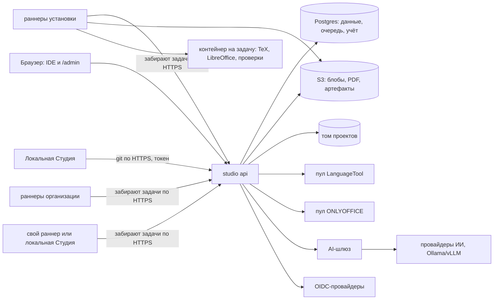

# Совместная работа: режимы, доступы, этапы

Статус: решения приняты 25.10.2026. Этап 0 и этап 1 (Git, раздел 11) сделаны, остальные этапы в дизайне.

Документ не входит в сайт документации (`docs_dir = "ru"`), это рабочий дизайн для разработки.

## 1. Цель

Студия должна работать так, как удобно конкретному человеку или команде:

- **локально** — как сейчас: одна машина, без аккаунтов и сети;
- **через git** — проект синхронизируется с любым git-хостингом (GitHub, GitLab, свой Gitea/GitLab), совместная работа через него;
- **гибрид** — данные и бэкенд на сервере, правка и сборка локально у каждого, онлайн только синхронизация;
- **облако (self-hosted)** — Студия целиком на сервере: Postgres, S3-совместимое хранилище, SSO или своя регистрация; разворачивает команда, кафедра или компания со своими кредами.

Требования к доступам:

- каждый пользователь видит только свои проекты и те, куда его пустили;
- в свой проект можно добавить других людей (по почте или логину) и выдать доступ по ссылке, как в Google Docs;
- без SSO должна работать своя регистрация;
- у self-hosted установки есть админка.

## 2. Принятые решения

| Вопрос | Решение |
|---|---|
| Кто разворачивает облако | Только self-hosted. Публичного сервиса автора нет; оператор ПДн тот, кто развернул |
| Главный сценарий | Ревью научрука и одновременная правка командой одинаково важны |
| Порядок | Фундамент (этап 0), затем git, затем сервер |
| Анонимная ссылка | Может дать роль вплоть до Редактора, как в Google; организация ограничивает политикой |
| Приглашение существующего пользователя | С подтверждением, как в GitHub |
| Что видно по ссылке «Читатель» | По умолчанию только PDF; исходники и историю владелец включает у конкретной ссылки |
| Кто приглашает и создаёт ссылки | Владелец; редакторам по галке «редакторы могут делиться» |
| Организации | Модель и UI сразу, в первом серверном этапе |
| Регистрация | Все режимы: открытая, по доменам, по приглашению, выключена. Режим выбирает мастер первого запуска; можно задать через env |
| Ключи ИИ на сервере | Свои и общие (организации, установки) с лимитами; нужен AI-шлюз с квотами |
| Секретные ключи подписи на сервере | Разрешать или нет — решает админ установки |
| Что уходит в git remote | Все автоснапшоты |
| Когда синхронизировать | Кнопка «Синхронизировать» плюс фоновый fetch с бейджем «есть изменения» |
| Какой git подключать к remote | Изолированный стор Студии `.hse-studio/git`; свой `.git` пользователя не трогаем |
| Админка | Один UI: раздел `/admin` и API `/api/admin`, отдельный чанк; по env можно пускать только с хоста или IP |
| Тяжёлая работа в облаке | Задачи идут на раннеры через очередь, как джобы в CI; интерактивные сервисы — пулы реплик с лимитами (раздел 14) |
| Чьи раннеры | Общие (установки), организации и свои (пользователя), как в GitLab; свои не тратят квоту установки |
| Единица квот | По видам ресурсов: минуты раннеров × класс ресурсов, символы LanguageTool, сессии ONLYOFFICE, токены ИИ, место |
| Квота исчерпана | Решает админ (низкий приоритет, отказ или только предупреждение); по умолчанию низкий приоритет |

## 3. Что есть сейчас

### 3.1 На что опираемся

- **Изолированный git проекта** в `.hse-studio/git` (`core/vcs/protocols.py`, `infra/vcs/git_vcs_service.py`). Автокоммиты с трейлером `Hse-Kind`, ветки, теги, restore. Нет только remote.
- **ETag и If-Match** при записи файлов (`core/file_version.py`, `use_cases/files/put_file.py`). Потерянное обновление уже ловится.
- **Трёхстороннее слияние** через `git merge-file` (`infra/template_update/merge_engine.py`, порт `IMergeEngine`) и UI превью и отмены из обновления шаблонов.
- **Совместимость данных между версиями Студии**: `read_compat` и `write_compat` в project.json (`core/project_schema.py`), режимы доступа full, read_only, files_only (`core/project_access.py`). Если у сокомандника Студия старее, проект откроется у него только на чтение.
- **Глобальный гард записи** на всём `/api/v1` (`api/guards.py`). Рядом встанет гард прав.
- **Командный проект**: `shared/` и папки авторов, `Author.slug`, `Author.managed`, `Project.shared_enabled` (`core/team.py`). Распределённая работа в модели заложена.
- **Слоты подписей по владельцам** (`author--<slug>`), КриптоПро ЭЦП Browser plug-in работает в браузере, ONLYOFFICE с JWT.
- **SyncTeX** (`infra/synctex`): переход между PDF и исходником. Пригодится для комментариев к PDF.
- **Репозитории за протоколами** (`core/repositories.py`), DI на dishka.

### 3.2 Что мешает

| Что | Где | Что делать |
|---|---|---|
| Нет понятия пользователя: настройки, ИИ-провайдеры, роли агента, ключи подписи глобальны | JSON в data_dir | Actor в контексте запроса; на сервере репозитории на пользователя |
| Реестр проектов — список путей | `infra/persistence/project_index.py` | На сервере таблица проектов и членства |
| Чаты агента в папке проекта | `.hse-studio/chats` | На сервере личные, в Postgres |
| Docker через сокет: сборка, LanguageTool, Gotenberg, ONLYOFFICE, Ollama, самообновление | `infra/docker`, `infra/compile`, `infra/languagetool`, `infra/office`, `infra/ai/ollama`, `infra/update` | Порты: диспетчер задач, рантайм вспомогательных сервисов, обновление |
| Очередь сборок — в памяти процесса, лимит из настроек пользователя | `infra/compile/concurrency.py` (`CompileConcurrencyLimiter`) | Становится лимитом встроенного раннера; на сервере — планировщик в Postgres |
| LanguageTool вызывается из движка проверок напрямую через менеджер контейнера | `infra/checks/external_engine.py` | Порт сервиса проверки языка: контейнер локально, пул реплик на сервере |
| use_cases импортируют infra напрямую: 68 файлов; сборка завязана на конкретный `DockerCompileExecutor` | `use_cases/compile/trigger_compile.py` и др. | Закрыть портами в core там, где режимы расходятся |
| Состояние в памяти процесса: блокировки папок, троттлинг правок, лог-шина сборки, фоновые прогоны агента | `infra/vcs/folder_locks.py`, `infra/vcs/edit_throttle.py`, `infra/compile/log_bus.py`, `infra/ai/agent/run_manager.py` | Порты; на сервере Postgres (advisory locks, LISTEN/NOTIFY, очередь) |
| Все коммиты от `HSE Studio <bot@hse-studio.local>` | `VCSConfig` | Автор коммита — актор |
| Браузер по ФС сервера, «подключить папку», «перенести проект» | `IFilesystemBrowser`, `connect_project`, `move_project` | В серверном режиме выключены |
| Авторизации нет | `api/entrypoint.py` | Вход, сессии, токены |

## 4. Целевая архитектура

### 4.1 Принципы

1. **Один код и один образ.** Режим задаётся конфигурацией: `HSE_STUDIO__MODE=local|server`.
2. **Локальный режим — это серверный с одним неявным пользователем.** `Actor.local` владеет всем, политика прав вызывается всегда и всегда разрешает. Веток кода «если локально» нет.
3. **Текст проекта = папка + git.** Данные системы: data_dir локально, Postgres на сервере. Тяжёлые артефакты: диск локально, S3 на сервере. Поэтому 275 обращений к `project.folder` в use_cases переписывать не нужно: на сервере папка проекта лежит на томе.
4. **Одна модель доступа**, одна функция `can()`. Входов много: веб, API-токены, git по HTTPS, CLI и CI.
5. **Всё, что зависит от окружения, стоит за портами**: диспетчер задач, вспомогательные сервисы, блокировки, шина событий, хранилище артефактов, вход, AI.
6. **Тяжёлая работа — задачи на раннерах**, как в CI. Локально раннер встроен в процесс и работает с локальным Docker, это нынешнее поведение. На сервере раннеры отдельные, общие или свои (раздел 14).
7. **Минимум компонентов** в self-hosted по умолчанию: api, runner, Postgres, S3 и вспомогательные сервисы. Redis не обязателен.

### 4.2 Режимы

| | Локально | Git | Гибрид | Облако |
|---|---|---|---|---|
| Вход | нет | ключи git | аккаунт сервера (device flow) | свой аккаунт или SSO |
| Данные системы | JSON в data_dir | JSON | JSON + сервер | Postgres |
| Проект | папка | папка + remote | папка + сервер как remote | том + бэкап в S3 |
| Сборка | встроенный раннер, Docker | встроенный раннер или CI | встроенный раннер или раннеры сервера | раннеры: общие, организации, свои |
| Кто решает о доступе | один пользователь | хостинг git | сервер | сервер |
| Доступ по ссылке | нет | только публичный репозиторий | да | да |

Гибрид — это сочетание git-режима и серверного: локальная Студия, у которой remote указывает на сервер. Один и тот же проект можно править и локально, и в браузере на сервере.

### 4.3 Компоненты серверной установки



- **studio api** — тот же образ с `MODE=server`, без `docker.sock`. Держит планировщик задач и роутер сервисов.
- **studio runner** — тот же образ, команда `runner` (раздел 14). Только у раннера есть доступ к Docker, Podman или Kubernetes API.
- **Postgres** — данные системы, очередь задач (`SELECT … FOR UPDATE SKIP LOCKED`), блокировки (advisory locks), события (LISTEN/NOTIFY), учёт использования.
- **S3-совместимое хранилище** (MinIO в демо-compose, любое S3 в бою) — блобы входа задач по хешу, PDF, архив PDF, пакеты сдачи, загруженные файлы, бэкапы git (bundle).
- **Том проектов** — рабочие папки `projects/<project_id>/`, в каждой свой `.hse-studio/git`. Раннеры к тому доступа не имеют.
- **Пулы сервисов** — LanguageTool, ONLYOFFICE, LLM: постоянные реплики по URL, а не контейнеры по требованию.
- **Поставка**: docker compose (api, runner, postgres, minio, languagetool, onlyoffice, опционально keycloak и ollama) и helm-чарт.
- **v1 — одна реплика api.** Масштабирование потом: маршрутизация по `project_id` или выгрузка простаивающих проектов в S3 с подъёмом при открытии.
- **Самообновление** на сервере выключено: обновление через compose или helm.

### 4.4 Где что хранится

| Данные | Локально | Сервер |
|---|---|---|
| Тексты, ресурсы, project.json, анкеты, состояние подписей | папка проекта | том проектов |
| История | `.hse-studio/git` | то же + bundle в S3 |
| Пользователи, организации, членство, приглашения, ссылки, аудит | — | Postgres |
| Настройки, ИИ-провайдеры, роли агента | data_dir | Postgres, на пользователя и организацию |
| Чаты агента | папка проекта | Postgres, личные |
| Записи сборок | папка проекта | Postgres |
| PDF, архив PDF, пакеты сдачи | папка проекта | S3 |
| Ключи подписи | data_dir | по политике админа: Postgres (зашифровано) или только у пользователя |
| Паки, шрифты | образ и data_dir | общие на установку, управляет админ |

## 5. Вход и регистрация

- **Аккаунт**: уникальная почта, имя, статус (`active`, `pending_verification`, `pending_approval`, `disabled`). Один человек — один аккаунт, к нему привязано несколько способов входа.
- **Способы входа** включает админ, одновременно можно несколько:
  - пароль (argon2id), подтверждение почты, сброс пароля; по желанию TOTP и passkey;
  - код или ссылка на почту;
  - OIDC, несколько провайдеров (Keycloak, Authentik, Entra ID, Google Workspace, GitLab и др.). SAML и LDAP подключаются через Keycloak, сами их не реализуем.
- **Режимы регистрации** (поддерживаются все): открытая; по доменам почты из списка; только по приглашению; выключена (аккаунты заводит админ). Отдельная галка: «новые аккаунты ждут одобрения админа».
- **Первый запуск сервера**: мастер. Первый вошедший становится админом установки и выбирает режим регистрации и способы входа. Пока режим не выбран, регистрация только по приглашению. Всё можно задать заранее через env (`HSE_STUDIO__AUTH__…`), тогда мастер эти шаги пропускает.
- **Склейка аккаунтов**: новый способ входа привязывается к аккаунту по почте автоматически, только если провайдер подтвердил почту (`email_verified`). Иначе привязка вручную из профиля после входа. Это защита от захвата чужого аккаунта.
- **Организация может требовать SSO** для своих доменов: пользователь с такой почтой паролем не войдёт.
- **Почта опциональна.** Без SMTP приглашения, подтверждения и сбросы выдаются ссылками, которые владелец или админ копирует и пересылает сам.
- **Сессии** серверные: cookie HttpOnly, SameSite=Lax, CSRF-токен. В профиле список сессий и «выйти везде».
- **Токены**: личные (PAT) со scope (`api`, `git:read`, `git:write`) и сроком, хранится хеш. Локальная Студия и CLI получают токен через device flow. Для CI — токен проекта только на чтение.

## 6. Организации и группы

Модель и UI с первого серверного этапа.

- Владелец проекта — пользователь или организация.
- Роли в организации: владелец, админ, участник. У админов организации права владельца на её проекты.
- Группы внутри организации («МСПИН251», «Команда Bertie»). Группу можно сделать участником проекта. По желанию группы синхронизируются из claim `groups` SSO.
- **Политики организации:**
  - ссылки: запрещены, только внутри организации или любые; максимальная роль гостя (по умолчанию Редактор);
  - можно ли приглашать людей с чужих доменов;
  - обязательный SSO для доменов;
  - NDA-проекты без публичных ссылок (предлагаю включить по умолчанию);
  - квоты: место, минуты сборки, токены ИИ;
  - общие ИИ-провайдеры.
- Проект организации видят его участники (лично или через группу). «Виден всей организации» — опция проекта.

## 7. Роли и права в проекте

### 7.1 Роли

| Действие | Читатель | Рецензент | Редактор | Владелец |
|---|---|---|---|---|
| PDF, статус сборки, результаты проверок | ✓ | ✓ | ✓ | ✓ |
| Исходники и история | если включено | ✓ | ✓ | ✓ |
| Комментарии | | ✓ | ✓ | ✓ |
| Правка файлов и анкет, сборка | | | ✓ | ✓ |
| Агент | | | ✓, кроме гостей | ✓ |
| Снимки, ветки, восстановление, синхронизация | | | ✓ | ✓ |
| Сдача пакета | | | свой пакет, если привязан к автору | ✓ |
| Приглашения и ссылки | | | если владелец включил | ✓ |
| Версия шаблона, NDA, настройки проекта | | | | ✓ |
| Удаление, передача владения | | | | ✓ |

### 7.2 Привязка к персонам проекта

В project.json уже есть авторы, научрук, соруководитель и академрук. Участника можно привязать к одной из этих персон.

- **Автор командного проекта** правит `<slug>/` и `shared/` (если `shared_enabled`), остальное читает. Право править всё выдаётся явно. Область считается от `doc_base_dir` (`core/team.py`) по префиксу пути.
- **Научрук** обычно Рецензент. «Согласовано» и подпись своего слота доступны только привязанному. Раздел «Мои студенты» — проекты, где он привязан.
- **Слот подписи** `<slot>--<slug>` подписывает только привязанный к автору `<slug>`.
- Кнопка «Пригласить научрука» создаёт приглашение с ролью Рецензент и привязкой.

### 7.3 Гость по ссылке

- Роль вплоть до Редактора, организация может ограничить.
- При первом действии гость вводит имя. В истории и комментариях он виден как «Гость: <имя> (ссылка «<подпись>»)», в присутствии тоже.
- Гостю недоступны агент (непонятно, чей ключ и чьи квоты), приглашения, git, сдача и подписи. Сборка доступна в квоту владельца проекта.
- Частота запросов по токену ссылки ограничена.

## 8. Как делиться

### 8.1 Приглашения

- По почте или логину: роль, при желании привязка к персоне, срок (по умолчанию 7 дней), сообщение.
- Всегда с подтверждением, как в GitHub. У получателя раздел «Входящие приглашения» (и письмо, если есть SMTP); доступ появляется после «Принять».
- Если аккаунта нет, приглашение ждёт во входящих после регистрации или входа с этой почтой. В режиме «только по приглашению» приглашение в проект даёт право зарегистрироваться.
- Приглашение можно отозвать или отправить повторно; у просроченного свой статус.
- Членство через группу или организацию подтверждения каждым не требует: его решает админ организации.

### 8.2 Ссылки

- Общий доступ проекта: только участники, вся организация или все, у кого есть ссылка.
- У проекта может быть несколько ссылок. У каждой: подпись («для научрука», «для комиссии»), роль, «показывать исходники и историю» (по умолчанию выключено), «требовать вход», срок, пароль.
- Токен ссылки — не меньше 128 бит случайных данных, не id проекта. Перевыпуск отзывает старую ссылку.
- Вошедший по ссылке видит проект в «Доступные мне», но доступ держится на самой ссылке: отозвали ссылку — доступ пропал.
- Создают ссылки владелец и редакторы, если владелец включил «редакторы могут делиться».

### 8.3 Остальное

- **Запрос доступа**: закрытый проект → «Запросить доступ» с сообщением → уведомление владельцу → одобрение с выбором роли.
- **Передача владения** вступает в силу после подтверждения получателем; бывший владелец становится Редактором.
- **Аудит**: приглашения, смена ролей, ссылки, входы по ссылке (агрегированно), смена владельца, удаление, скачивание пакета сдачи. Видят владелец проекта, админ организации, админ установки.
- **Уведомления** в Студии и на почту, если есть SMTP.

## 9. Как соблюдаются права

- **Actor**: `user(id)`, `guest(link_id, name)` или `local`; роли в организациях; источник (сессия, PAT со scope, ссылка). Передаётся через dishka в scope запроса.
- **Политика в core**: `can(actor, action, project, path=None)`. Чистая функция без I/O; членство и ссылки загружает use case.
- **Гард прав** рядом с гардом записи (`api/guards.py`). Маршрут сопоставляется с действием по явной таблице; маршрут с `project_id` без записи в таблице роняет тест.
- **Нет доступа — 404, а не 403**, чтобы не выдавать существование проекта.
- **Запись файлов** проверяет путь против области автора.
- **Агент** вызывает инструменты через ту же политику с актором пользователя.
- **Списки** в БД всегда фильтруются по актору. Выборки «всё подряд» есть только в `/api/admin`.
- **Git по HTTPS**: fetch требует права «исходники», push требует права «правка»; pre-receive проверяет изменённые пути той же политикой.
- **S3**: бакет закрыт, файлы отдаются только по подписанным ссылкам с коротким сроком.
- **Сборка**: контейнер на задачу видит только свой проект.
- **Локально**: `Actor.local`, политика всегда разрешает. Тесты политики общие для обоих режимов.

## 10. Доступы в каждом режиме

- **Локально**: входа нет. Есть профиль (имя и почта) для подписи коммитов.
- **Git**: доступ делегирован хостингу (collaborators на GitHub, members на GitLab). Read соответствует Читателю, Write Редактору, Admin Владельцу. Рецензента и ссылок нет. Позже можно приглашать прямо из Студии через API хостинга, если токен позволяет.
- **Гибрид и облако**: вся модель из разделов 5–9, решает сервер.

## 11. Git-синхронизация

Статус: сделано в этапе 1. Ниже то, что построено, и решения, которые приняты по ходу. Пользовательское описание: `docs/ru/workbench/git-sync.md`.

### 11.1 Основа

- Remote вешается на изолированный стор `.hse-studio/git`. Свой `.git` пользователя не трогаем. Настройки remote (`remote.origin.url`, `hse.credential`) пишутся только в конфиг стора; токена там нет.
- В remote уходят все автоснапшоты. В истории фильтр по виду версии (`Hse-Kind`), у версий метки `pushed`, `unpushed`, `incoming`. Слияние пишет `Hse-Kind: sync` и `Hse-Sync: <id>`.
- Синхронизируется одна пара веток (локальная и удалённая), по умолчанию удалённая это HEAD сервера, а в пустом репозитории `main`. Локальная `master` уходит в `main`. Теги и `refs/hse/template/*` не отправляются, `history.json` остаётся вне git.
- Сеть работает только через стор: окружение git берётся по списку разрешённого, включены `core.hooksPath` на пустой каталог, `core.fsmonitor=false`, `credential.helper=` и `core.sshCommand=`, а хранилище с чужим конфигом получает `store_untrusted`. Те же ограничения применены к локальным командам `GitVcsService`.
- Профиль автора (имя и e-mail, `GET/PUT/DELETE /api/v1/profile`) обязателен для подключения, синхронизации и клонирования (`profile_required`). Порядок автора коммита: пользователь запроса, затем профиль, затем бот. Прежние версии бота публикуются как есть, подключение показывает их число.

### 11.2 Где что живёт в коде

Синхронизация, клонирование и bundle остаются в api за портами, а не видами задач диспетчера: сетевая работа с секретами не вписывается в сериализуемый вход задачи (так же устроено подписание). Слои: `core/git_sync` (сущности, закрытый список кодов ошибок, разбор адреса, классификатор ошибок git, планировщик слияния, каталог провайдеров), `infra/git_sync` (раннер, транспорт, секреты, состояние, чтение истории, коммит слияния, расписание), `use_cases/git_sync`.

- Операции (`sync`, `resolve`, `connect`, `clone`, `bundle_import`) запускаются ответом 202 `{operation_id}`, клиент опрашивает `GET /projects/{id}/git` (статус из ссылок и кэша, без сети) и `GET /git/operations/{id}`; отмена убивает дочерние git. Итог переживает перезагрузку страницы: `last_sync` в `<git_dir>/hse-sync.json`.
- Папка занята, пока идёт операция (`IGitOperationRegistry.is_busy`): перенос и удаление проекта это учитывают. Применение слияния ждёт идущую сборку до 120 с, затем `sync_busy_build`.
- Журнал обновления шаблона и слияния общий (`.hse-studio/update/journal.json`, поле `kind`): проект считается только для чтения и в том, и в другом случае, восстановление при старте общее.
- Фоновая выборка только серверная (`fetch_scheduler`): интервал по умолчанию 300 с, минимум 60, с разбросом по проектам, после сбоя связи пауза растёт до часа, после отказа в доступе опрос останавливается. Клиент таймера не держит, а дергает `POST /git/fetch` при открытии проекта и возврате в окно (сервер не запускает выборку чаще, чем раз в 15 с). В выборку ничего не скачивается в рабочую папку.

### 11.3 Алгоритм синхронизации

Снимок (под замком папки, `kind=manual`) → выборка (без замка) → классификация → применение (под замком, всё локально) → отправка (без замка, на зафиксированный sha, не больше трёх повторов при `non-fast-forward`, затем `remote_moved`).

- Force, rebase и squash не используются. Применение: проверка HEAD, план по объектам, при конфликтах ничего не пишется и сессия сохраняется, без конфликтов журнал → бэкапы → запись → коммит слияния через plumbing с `update-ref` по сравнению с ожидаемым значением.
- Схема удалённого проекта читается при выборке: если `read_compat` или `write_compat` новее нашего, статус `blocked` с `remote_schema_newer`. Режим «читать проект новой Студии» отложен.
- Перед отправкой проверяется размер блобов (от 95 МБ `large_file`), указатели LFS только считаются и предупреждаются.

### 11.4 Слияние и конфликты

Планировщик трёх деревьев по типу файла, один шов `IFileMergeStrategy`:

- текст (`.tex`, `.bib`, `.md`, `.sty`, `.cls`): diff3 с метками `hse:ours/hse:base/hse:theirs`, разобранный в участки со стабильными ключами;
- JSON (`project.json`, `signatures.json`, `forms/*.json`, `template.json`, остальное `.hse-studio/*.json`): по полям в каноническом порядке, неверный результат становится вынужденным конфликтом. Личные поля слияние не трогает (правило `local_only`: `pinned`, `archived`, `meta.vcs`, `documents[].last_compile_id`, `signing_identity_id`, `sign_mode`). Отдельный файл `local.json` и повышение версии схемы не делались;
- двоичные файлы: побеждает более новый по `(committer_time, sha)`, копия `<имя>.conflict-<sha7><расширение>`, это не блокирующее решение; производные PDF побеждает более новый без копии;
- группа подписей документа (frozen и открепленные) берётся атомарно от одной стороны; удаление против правки всегда конфликт;
- небезопасные пути чужого дерева (`..`, абсолютные, `.git/`, служебные каталоги `.hse-studio/*`, симлинки, подмодули, буква диска, а на Windows любое двоеточие в имени) пропускаются с предупреждением; на Linux и macOS имя вроде `Отчёт: итог.tex` принимается как обычное, иначе коммит слияния не содержал бы файл, и его отправка удалила бы файл из ветки у всех, коллизии регистра после NFC и casefold выделяются в `case_collision`.

Конфликты разбираются на отдельном экране (общие части вынесены из экрана обновления шаблона). На диск ничего не пишется, пока не решено всё, в историю метки конфликтов не попадают (ручной текст с метками отвергается `unresolved_markers`). Сессия лежит в `<git_dir>/hse-sync.json`, отпечаток считается от базы, их вершины и конфликтных файлов: правка других файлов сессию не сбрасывает, а новая вершина «их» или смена нашего блоба конфликтного файла даёт `plan_outdated`, черновики переносятся по ключу участка или указателю поля. Отмена убирает только сессию. Переименования не склеиваются (переименование с правкой видно как удаление против правки и новый файл, данные не теряются).

### 11.5 Провайдеры и доступ

Каталог провайдеров `contracts/git-sync/providers.json` единственный источник для бэкенда и фронтенда (копии в `core/git_sync` и `entities/git-remote`, тест требует побайтного совпадения, общие векторы `provider_cases.json`): GitHub, GitLab, Gitea (Forgejo, Codeberg), Bitbucket, other.

- **Определение провайдера:** пользовательская подмена для хоста, затем эвристика по имени (`github.com`, `gitlab.com`, `codeberg.org`, `bitbucket.org`, метки `gitlab`/`github`/`gitea`/`forgejo`), затем запрос к API без учётных данных (`/api/v4/version`, `/api/v3`, `/api/v1/version`, таймаут 3 с). Результат: провайдер, как определён (`override|host|api|unknown`), версия. Установки в подпути работают: корень API берётся из префикса адреса.
- **Ссылки на токен** с заполненными полями только там, где это подтверждено документацией: GitHub точный токен (`name`, `description`, `target_name`, `expires_in`, `contents=write`, срок по умолчанию 90 дней, репозиторий выбирается руками), запасная классическая `scopes=repo`; GitLab `scopes=write_repository,read_repository` с запасной `/-/profile/...` для старых серверов; Gitea и Bitbucket простая ссылка и шаги. Права: GitHub `Contents: Read and write` (для CI ещё `Workflows`), GitLab `read_repository` и `write_repository` без `api`, Gitea `write:repository`, Bitbucket `Repositories: Write` (токен репозитория, имя `x-token-auth`).
- **Проверка токена** (`POST /git/credentials/{id}/check`): логин, права и срок у GitHub (заголовок `X-OAuth-Scopes`, только классический), GitLab (`/personal_access_tokens/self`), Gitea (`/user`); оценка `sufficient|too_narrow|too_broad|unknown`; сервер не сообщил, значит `unknown`, а не отказ, решает настоящий обмен. Срок запоминается в доступе, список показывает «истекает через N дней»; отказ приходит ошибкой (`auth_failed`, `token_expired`).
- **Доступ по https:** токен идёт только в окружение процесса git как `http.<url>.extraheader`, привязанный к схеме, хосту и порту; в argv, логах, конфиге стора и ответах API его нет. Доступ годится только для своего хоста (`credential_host_mismatch`).
- **Доступ по ssh:** пара Ed25519 генерируется на `cryptography` (без `ssh-keygen`), закрытая часть шифруется, на время команды лежит во временном файле 0600 в каталоге 0700. Варианты: ключ пользователя и deploy key репозитория (ссылки на страницы добавления ключа). Собственный `known_hosts` Студии, `StrictHostKeyChecking=yes`, `IdentityAgent=none`, `ProxyCommand=none`; `accept-new` не используется: отпечаток показывается и подтверждается, смена ключа требует ввода имени хоста. `~/.ssh` и ssh-agent не читаются.
- **TLS своих серверов:** отключения проверки нет. Для каждого сервера либо свой CA (PEM до 128 КБ, до десяти сертификатов, без закрытого ключа; передаётся git как `http.<url>.sslCAInfo` на время его команд), либо закрепление отпечатка сертификата с подтверждением человека (как у ключей ssh: сервер перечитывает сертификат и сохраняет, только если отпечаток тот же). Коды: `tls_untrusted_ca`, `tls_pin_mismatch`. Обычный `http` только при `GitConfig.allow_insecure_http` и отметке у самого remote.
- **Секреты:** `data_dir/git/credentials.json` (шифртекст Fernet `hs1:<key_id>:<токен>`), ключи в `data_dir/secrets/master.keys.json` (0600, несколько ключей, поддержка ротации в формате) или `HSE_STUDIO__SECRETS__KEY` и `..._KEY_FILE`; `git/known_hosts`, `git/host_settings.json`, `git/trust/`. Токены, ключи, known_hosts, настройки серверов и профиль автора не входят в экспорт настроек и игнорируются при импорте.

### 11.6 Остальное

- **Подключение и клонирование:** мастер «Клонировать проект из git» и «Подключить репозиторий» в настройках проекта. Проверка адреса читает `project.json` через неглубокую выборку; не проект Студии, чужой проект, разные истории с возможностью объединить (`adopt=merge_remote`). Нет пака или версии шаблона, значит проект открывается только на чтение (механизм уже был). Разные версии Студии покрыты `read_compat` и `write_compat`.
- **Обмен без сервера:** экспорт и импорт `git bundle` одной ветки, по желанию под паролем (контейнер `HSEB1`, PBKDF2 и Fernet кадрами по 4 МБ, соль на файл). Импорт идёт тем же планом слияния, что и синхронизация, без отправки; ссылка `refs/hse/bundle/<ветка>`.
- **Общие папки:** детектор по имени каталога-предка и служебным файлам (Яндекс Диск, Dropbox, Google Диск, OneDrive, iCloud, Nextcloud, Syncthing) только предупреждает и запоминает подтверждение по проекту; то же для папки данных, где токены и ключ оказываются рядом. Вынос стора из синхронизируемой папки отложен.
- **CI:** команда `hse-doc-studio build [папка] [--all | --docs ID…] [--out DIR]` (выходы 0, 1, 2) и генерация `.github/workflows/hse-studio-build.yml` или `.gitlab-ci.yml` (триггеры push, тег `v*`, вручную; артефакты или релиз). Значения параметров проходят строгую проверку алфавита, потому что идентификаторы документов приходят из `project.json` соавтора.

### 11.7 Отложено

Локальный файл `local.json`, склейка переименований, пословное слияние строк `.tex`, режим «читать проект новой Студии», подтверждение, когда слияние делает проект только для чтения, вынос стора из общей папки, отправка тегов и релизов, инкрементальные bundle, ротация ключа шифрования, системная связка ключей, подсказки владельца в командных проектах, синхронизация `history.json`, Git LFS, ssh через HTTP-прокси, git старше 2.31.

## 12. Гибрид: сервер как remote

- Сервер отдаёт git по HTTPS на `/git/<project_id>.git` через `git http-backend` за авторизацией (PAT или токен из device flow).
- Канонический репозиторий — стор рабочей папки проекта на сервере. Перед приёмом push сервер фиксирует несохранённые веб-правки снапшотом. Если из-за этого push перестал быть fast-forward, клиент повторяет обычный цикл fetch → слияние → push.
- pre-receive проверяет изменённые пути по политике: автор может менять только свою папку и `shared/`.
- После локальной сборки Студия выгружает PDF на сервер, чтобы читатели по ссылке видели свежую версию.
- **Удалённая сборка**: локальная Студия без Docker отправляет задачи в очередь сервера, на общие раннеры, в квоту пользователя.
- **Своя машина как раннер**: локальная Студия с Docker может зарегистрироваться раннером своего пользователя (раздел 14.2). Тогда облачные проекты хозяина собираются у него и не тратят квоту установки.
- Локальная Студия входит на сервер через device flow. «Открыть проект с сервера» — это клонирование с уже настроенным remote.

## 13. Админка

- **Один UI**, раздел `/admin` со своим лейаутом и API `/api/admin/*` со своим гардом (админ установки или админ организации). Код админки — отдельный lazy-чанк, обычным пользователям он не загружается.
- По env можно пускать в `/admin` только с указанного хоста или диапазонов IP.
- **Три уровня настроек:**

| Уровень | Где | Что |
|---|---|---|
| Пользователь | Настройки | тема, язык, свои ИИ-провайдеры, роли агента, ключи подписи (если разрешено), токены, сессии, способы входа, свои раннеры, использование |
| Организация | `/admin/org/<slug>` | участники, группы, политики, SSO-домены, раннеры организации, общие ИИ-провайдеры, квоты и использование, аудит |
| Установка | `/admin` | пользователи, регистрация, способы входа и OIDC, SMTP, S3, раннеры и токены регистрации, образы исполнителей (TeX, LibreOffice), пулы сервисов, паки и шрифты, AI-шлюз, квоты по умолчанию и поведение при исчерпании, использование, политика ключей подписи, аудит, бэкапы, версия |

- В локальном режиме админки нет: разделы уровня установки (образы, LanguageTool, ONLYOFFICE, Ollama, шрифты, обновление) остаются в Настройках, как сейчас. В серверном режиме они переезжают в `/admin`, у пользователя их нет.
- Мастер первого запуска сервера: создание админа, режим регистрации, способы входа, проверка Postgres, S3 и хотя бы одного раннера.

## 14. Раннеры, сервисы и квоты

Когда IDE работает в облаке, вся тяжёлая работа идёт на общих мощностях. Её нужно распределять и ограничивать, как раннеры в CI/CD.

### 14.1 Что куда

| Класс | Что | Как исполняется |
|---|---|---|
| Задачи | сборка LaTeX (latexmk, texcount, число страниц), тяжёлые проверки, конвертация docx и pptx в PDF (LibreOffice), сборка пакета сдачи, проверка ГОСТ-подписей (Стрибог на чистом Python ~1,5 с/МБ), сравнение PDF, фоновые прогоны агента, бэкапы bundle | очередь → раннеры |
| Интерактивные сервисы | LanguageTool, ONLYOFFICE Document Server, LLM (через AI-шлюз), сервер совместной правки Yjs | пулы реплик за роутером api, лимиты частоты и одновременности |
| Лёгкое в api | переходы SyncTeX, быстрые проверки по исходникам, рендер шаблонов, git | в процессе api |
| В браузере | просмотр PDF (pdf.js), подсветка, превью | без воркеров; PDF из S3 по подписанной ссылке с поддержкой Range |

### 14.2 Раннеры

- **Процесс** `hse-doc-studio runner`: тот же образ или облегчённый образ раннера плюс образы исполнителей (TeX Live, LibreOffice).
- **Регистрация** по токену. Раннер объявляет теги (`tex:TL2024`, `office`, `checks`, `agent`, `gpu`), класс ресурсов и число одновременных задач.
- **Модель pull**: раннер сам забирает задачи по HTTPS (long-poll) и работает за NAT, поэтому его можно поставить где угодно.
- **Уровни**, как в GitLab:
  - раннеры установки — общие для всех;
  - раннеры организации — только задачи её проектов;
  - свои раннеры пользователя — только его проекты. Локальная Студия в гибриде может зарегистрироваться таким раннером и собирать облачные проекты хозяина у него на машине.
  - Задачи на раннерах организации и пользователя не тратят квоту установки.
- **Исполнители** внутри раннера: docker, podman, kubernetes (под на задачу), shell (только для разработки).
- **Изоляция**: контейнер на задачу; без сети, кроме нужного (агенту — только AI-шлюз); read-only rootfs; лимиты CPU, памяти и времени; shell-escape выключен. Общие раннеры в Kubernetes — с gVisor или Kata.
- **Токен задачи** действует только на её вход и выход и живёт до конца задачи. Раннер не видит ни другие проекты, ни том проектов.
- **Локальный режим** = встроенный раннер в процессе api с локальным Docker, как сейчас. `CompileConcurrencyLimiter` становится лимитом одновременных задач встроенного раннера.

### 14.3 Вход и выход задачи

- **Вход — манифест** `{путь, sha256}` плюс блобы в S3 по хешу, как CLSI у Overleaf. В манифест входят сгенерированные файлы (dynamic includes, `common/meta.tex`), управляемые шрифты и ресурсы.
- **Почему не общий том**: раннер может стоять на другой машине или у пользователя. **Почему не git fetch**: нужны сгенерированные и неотслеживаемые файлы.
- **Кэш раннера**: блобы и рабочие папки по проектам, докачивается только недостающее. `.build/` тоже кэшируется, поэтому latexmk пересобирает инкрементально.
- **Сродство**: планировщик предпочитает раннер, который последним собирал этот проект (тёплый кэш), но не ждёт его дольше пары секунд.
- **Выход**: PDF, лог, `synctex.gz`, счётчики, результаты проверок уходят в S3, итог возвращается в api. Лог стримится в реальном времени: раннер → api → SSE клиенту (сейчас это `log_bus` в памяти).

### 14.4 Планировщик

- Живёт в api, очередь в Postgres; по каждому тегу отдельная очередь.
- **Приоритеты**: сборка из редактора, затем проверки, затем пакетные задачи (сдача, бэкапы).
- **Справедливость**: взвешенная очередь по пользователю и организации. «Собрать всё» в командном проекте (15+ сборок) не забивает пул остальным.
- **Схлопывание**: новая сборка того же документа отменяет ещё не начатую старую (автосохранение).
- Таймауты, повтор при падении раннера (heartbeat), отмена пользователем.

### 14.5 Сервисы

- **LanguageTool**: N реплик (JVM, тяжёлые n-граммы), api распределяет запросы. Лимит частоты на пользователя. Кэш результатов по хешу абзаца: неизменённые абзацы не перепроверяются.
- **ONLYOFFICE**: один или несколько Document Server, квота — одновременные сессии. Ограничение: Community Edition держит около 20 одновременных подключений на установку. Для большего нужна лицензия у того, кто разворачивает. Конвертация в PDF от ONLYOFFICE не зависит: это задачи `office` на раннерах.
- **LLM**: через AI-шлюз (раздел 15); Ollama или vLLM как пул на GPU-нодах.
- **Yjs**: реплики, документ закреплён за репликой.
- В локальном режиме те же порты реализованы контейнерами по требованию, как сейчас.

### 14.6 Квоты и учёт

- **Учёт** по каждой задаче и вызову сервиса: пользователь, проект, организация, раннер, вид ресурса.
- **Квоты по видам ресурсов**:
  - минуты раннеров × класс ресурсов в месяц, отдельно по видам задач;
  - одновременные задачи, максимальная длительность, доступные классы ресурсов;
  - символы LanguageTool в день, одновременные сессии ONLYOFFICE, токены ИИ, место в S3.
- **Уровни**: значения установки по умолчанию → переопределение для организации → для пользователя.
- **Исчерпание квоты**: поведение выбирает админ (низкий приоритет, отказ или только предупреждение). По умолчанию низкий приоритет: задача уходит в конец очереди и выполняется на свободных раннерах, поэтому перед дедлайном студент не остаётся совсем без сборки. Мягкий порог шлёт предупреждение.
- **Страница «Использование»** у пользователя и организации, сводка в `/admin`.
- **Автомасштабирование**: в Kubernetes под на задачу и KEDA по глубине очереди; в compose фиксированное число (`--scale runner=N`).

## 15. AI-шлюз

- Все вызовы агента, суммаризатора и списка моделей идут через шлюз: порт перед `IAgentProvider`, `IChatSummarizer`, `IAIModelLister`.
- **Провайдеры** трёх уровней: пользователя, организации, установки. Ключи шифруются (envelope, мастер-ключ из env или KMS). Общие ключи пользователю не показываются.
- **Учёт**: входные и выходные токены и стоимость по пользователю, проекту, организации и провайдеру.
- **Квоты** токенов — часть общей системы квот (раздел 14.6): день и месяц, мягкий и жёсткий лимит; плюс белый список моделей.
- **Выбор провайдера**: явно или по порядку «свой → организации → установки».
- Можно подключить внешний шлюз (например, LiteLLM proxy) как OpenAI-совместимого провайдера; тогда учёт ведётся там.
- Локально шлюз — тонкая прослойка без квот, поведение как сейчас.
- Ollama на сервере — общий сервис по URL, а не менеджер контейнера.

## 16. Подписи в серверном режиме

- Админ установки выбирает, разрешено ли хранить секретные ключи на сервере; организация может ужесточить.
- Без хранения ключей на сервере доступны всегда: загрузка готовой подписи, КриптоПро в браузере, подпись OpenPGP в браузере (OpenPGP.js, новое).
- Если хранение разрешено: ключ зашифрован, расшифровывается только в момент подписи, подпись доступна только привязанной персоне, каждое действие пишется в аудит.

## 17. Модель данных (набросок, Postgres)

```text
users(id, email, email_verified, name, status, is_instance_admin, created_at)
user_identities(id, user_id, provider, subject, email, email_verified, last_login_at)
password_credentials(user_id, hash, updated_at); totp_credentials; webauthn_credentials
sessions(id, user_id, created_at, expires_at, ip, user_agent, revoked_at)
api_tokens(id, user_id, name, hash, scopes, project_id?, expires_at, last_used_at)

orgs(id, slug, name, policies jsonb, created_at)
org_members(org_id, user_id, role)
groups(id, org_id, name, external_ref?)
group_members(group_id, user_id)

projects(id, owner_user_id?, owner_org_id?, name, workspace_path, org_visible, nda,
         created_at, archived_at, deleted_at)
project_members(project_id, principal_kind, principal_id, role, persona?, scope?, added_by, created_at)
invitations(id, project_id?, org_id?, email?, user_id?, role, persona?, token_hash,
            invited_by, message, expires_at, status)
share_links(id, project_id, label, token_encrypted, role, show_sources, require_login,
            password_hash?, expires_at, created_by, revoked_at)
link_visits(link_id, user_id?, guest_name?, first_at, last_at)
access_requests(id, project_id, user_id, message, status, decided_by, decided_at)
audit_log(id, at, actor, action, target_kind, target_id, details jsonb, ip)
notifications(id, user_id, kind, payload jsonb, read_at)

user_settings(user_id, data jsonb)
ai_providers(id, owner_kind, owner_id, type, base_url, models, key_encrypted, ...)
ai_usage(id, at, user_id, project_id, org_id, provider_id, model, tokens_in, tokens_out, cost)
agent_personas(id, owner_kind, owner_id, ...)
chat_sessions / chat_messages / chat_summaries / agent_runs(..., user_id, project_id)
compile_records(id, project_id, doc_id, actor, status, job_id, ...)
signing_identities(id, user_id, ..., key_encrypted?)

runners(id, owner_kind[instance|org|user], owner_id?, name, tags, resource_class, concurrency,
        token_hash, version, last_seen_at, paused, created_by)
runner_registration_tokens(id, owner_kind, owner_id?, token_hash, expires_at, created_by)
jobs(id, kind, tags, project_id, actor, priority, resource_class, manifest_ref, status,
     runner_id?, queued_at, started_at, finished_at, attempts, timeout_s, coalesce_key, result jsonb)
job_artifacts(job_id, kind, s3_key, size, sha256)
blobs(sha256, size, s3_key, created_at)          -- вход задач по хешу
usage(id, at, owner user/org, project_id, resource, amount, unit, runner_id?, job_id?)
quotas(owner_kind, owner_id, resource, period, soft_limit, hard_limit)
quota_policy(owner_kind, owner_id, on_exhausted[low_priority|reject|warn])
```

Токен ссылки хранится зашифрованным, а не хешем: владелец должен иметь возможность скопировать ссылку снова, как в Google.

## 18. Этапы

| Этап | Что появляется | Зависит от | Готово, когда |
|---|---|---|---|
| 0. Фундамент | Actor и политика прав (локально всё разрешено), таблица «маршрут → действие»; диспетчер задач со встроенным раннером (сборка, конвертация, сдача, проверка подписей идут через него, вход задачи — манифест), порты сервисов (LanguageTool, ONLYOFFICE), блокировки, шина событий, хранилище артефактов; импорты infra из use_cases убраны там, где режимы расходятся; автор коммитов из профиля; флаг `MODE` | — | снаружи ничего не изменилось, тесты зелёные, use_cases не знают про Docker |
| 1. Git | раздел 11 | 0 | двое правят один проект через GitHub, конфликты разбираются в UI |
| 2. Сервер | вход (все способы и режимы регистрации), мастер первого запуска, Postgres-репозитории вместо data_dir, том проектов, S3; раннеры установки, планировщик (приоритеты, справедливость, схлопывание), блобы по хешу; пулы LanguageTool и ONLYOFFICE; базовые квоты (одновременность, длительность); организации и группы (модель и UI), `/admin`, личные ИИ-провайдеры, политика ключей подписи; compose и helm | 0 | студент и научрук работают только в браузере, каждый видит только свои проекты, «Собрать всё» одного не тормозит других |
| 3. Совместный доступ | роли, приглашения с подтверждением, ссылки (гости вплоть до Редактора), запросы доступа, передача владения, персоны и области путей, политики организации, аудит, уведомления, присутствие и мягкие блокировки | 2 | научрук по ссылке смотрит PDF, команда правит каждый свою папку, гость правит по ссылке |
| 4. Гибрид и свои раннеры | раздел 12; раннеры организации и пользователя, токены регистрации, локальная Студия как раннер | 1, 3 | локальная Студия синхронизируется с сервером и без Docker собирает на нём; кафедра подключает свой сервер раннером |
| 5. Ревью и реалтайм | две параллельные ветки. Ревью: комментарии к PDF и исходнику со связкой через SyncTeX, предложения правок, «согласовано» как пункт сдачи. Реалтайм: совместная правка на Yjs (`y-codemirror.next` + `pycrdt-websocket`), курсоры | 3 | научрук комментирует PDF, автор видит комментарий на строке; двое пишут один файл одновременно |
| 6. Эксплуатация | учёт и квоты по всем видам ресурсов, поведение при исчерпании, страницы «Использование»; AI-шлюз с общими провайдерами; автомасштабирование раннеров (Kubernetes, KEDA); бэкап и восстановление, мониторинг, масштабирование api за пределы одного узла | 2, лучше после 3 | кафедра держит установку на сотни пользователей |

Этапы 1 и 2 друг от друга не зависят, их можно вести параллельно после этапа 0.

Включение серверного режима: `ensure_supported_mode` пускает `server`, когда в реестре `ServerReadinessRegistry` есть проверки всех зон (identity, persistence, jobs, services, пользовательские маршруты) и все зелёные; отказ перечисляет всё недостающее разом. Флага experimental больше нет. Роли агента лежат отдельным файлом на человека, закрытые ключи OpenPGP в списке видны только владельцу, список доверенных корней общий для установки и меняется только администратором.

Персистентность этапа 2 (что на томе, что в БД, репозитории, ambient UoW, тесты): `docs/design/persistence-server.md`. Владельцы сущностей: `docs/design/stage2-ownership.md`.

### 18.1 Что вошло в этап 0

- Права: `StudioMode` (режим `server` отклоняется на старте, пока реестр готовности не зелёный; с финального среза этапа 2 он пускает установку, где заданы база, ключ секретов и внешний адрес), `core/access` (Actor, Role, Action, ProjectAcl, единая политика), таблица «маршрут → действие» с тестом полноты и гард `project_access_guard`. Нет доступа: не участник получает 404, участник с недостаточной ролью 403. Для локального актора гард ничего не делает.
- Шов автора коммита, порты сервисов (шина событий, проверки, office, замки VCS), тест-храповик слоёв (use_cases не импортируют infra, список исключений только сжимается) и смоук-тест настоящего DI.
- Диспетчер задач `core/jobs` со встроенным раннером. Через него идут четыре вида: `compile`, `office.convert`, `pack.submission`, `signature.verify_detached`. Вход задачи сериализуем (кодек отвергает Path, bytes и сущности), локально раннер читает проект из папки, в этапе 2 этот шов заменяется манифестом и блобами.
- Остаются в API за портами и ждут этапа 2: подписание, экспорт PAdES, штамп заморозки, загрузка цепочки по AIA, сессия и конфиг ONLYOFFICE, управление Docker-образами, `AgentRunManager`.
- Образ office у загрузки файла и пакета сдачи (по умолчанию) и у сборки с колбэком (из настроек) различается, это сохранено как есть и закреплено тестами. Выравнивание отдельным изменением.

## 19. Риски и открытые вопросы

- **Гость-редактор и NDA.** Предлагаю по умолчанию запрещать публичные ссылки для NDA-проектов.
- **Гость и агент.** Предлагаю агента гостям не давать.
- **Реалтайм и git одновременно.** Входящий push при открытой сессии Yjs нужно превращать в операции над `Y.Text`, иначе блокировать push на время сессии. Решить на этапе 5.
- **Масштаб.** v1: одна реплика api и общий том. Дальше: шардирование по `project_id` или выгрузка проектов в S3.
- **Песочница задач.** `docker.sock` остаётся только у раннера. На общих раннерах в Kubernetes — под на задачу с gVisor или Kata.
- **`history.json`**: в git или нет.
- **Сервер Yjs**: на Python (`pycrdt-websocket`) внутри api или отдельный Node (Hocuspocus).
- **Лицензия ONLYOFFICE.** Community Edition держит около 20 одновременных подключений на установку. Для большой установки нужна лицензия у того, кто разворачивает, или правка презентаций в облаке ограничивается. Конвертация в PDF от этого не зависит.
- **Размер образа раннера.** TeX Live весит гигабайты. Образы исполнителей тянутся на раннер один раз и кэшируются; для своих раннеров нужна понятная команда установки.
- **Доверие своим раннерам.** Раннер пользователя или организации получает только задачи своих проектов. Результат такого раннера в общий кэш блобов не попадает, чтобы чужой раннер не мог подменить чужие артефакты.
- **ПДн.** В self-hosted оператор тот, кто развернул. В документации установки об этом нужно написать явно.
