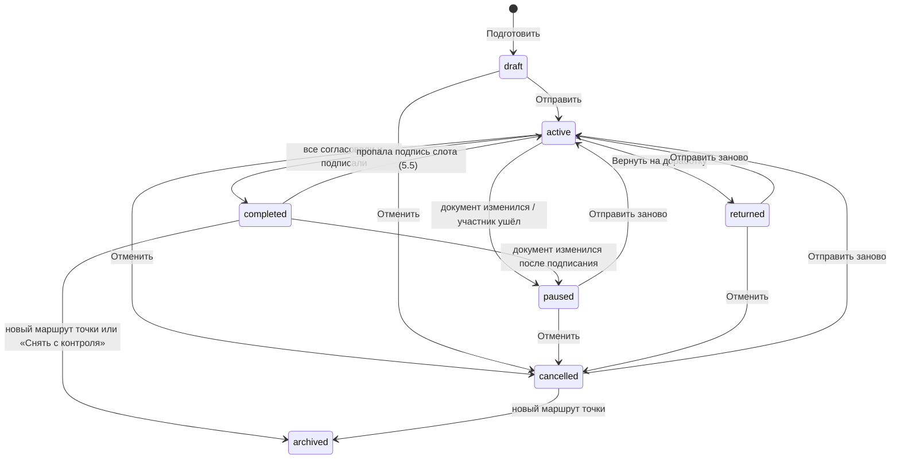

# Маршрут подписания: «Отправить на подписание»

Статус: принято 09.11.2026, внедряется срезами раздела 10. Модель и расчёт описаны так, как их реализует
`core/signing_route` (срез R1); уточнения по итогам R1 внесены в разделы 4, 5 и 6, по итогам R8 в раздел 6.6, по
итогам R6 (сценарии подписанта) в разделы 5.5, 6.3, 6.5, 6.10 и 8, по итогам R11 в раздел 5.7, по итогам доводки
(помеха `placement_off`, «Скопировать ссылку», `sent` у `sign_failed`) в разделы 5.7, 6.5 и 8.

Основа: `docs/design/signature-plan.md` (план подписей, слои L0, L1, L2, L3, «Подписать комплект»),
`docs/design/collaboration.md` (раздел 7.2 «Привязка к персонам», 8.1 «Приглашения»), `docs/ru/deploy/invitations.md`.

Документ не входит в сайт документации, это рабочий дизайн для разработки.

## 1. Задача

Сейчас, чтобы документ подписали другие, автор приглашает каждого с ролью «Рецензент» и персоной (`supervisor`,
`academic_supervisor`, ...), объясняет на словах, что и где подписать, а подписант сам ищет свои слоты на вкладке
«Подписи». Порядок никто не держит: академрук может подписать раньше научрука, научрук после этого оставит замечания,
автор поправит текст, и академруку придётся подписывать снова.

Нужно:

1. Автор готовит точку сдачи (например, «Заявка на тему КП (SmartLMS)»): для каждого документа и слота точки указывает,
   где стоит подпись и чья она. Подписанты это участники проекта с персоной; кого нет в проекте, приглашают тут же.
2. Автор нажимает «Отправить на подписание».
3. Подписант получает уведомление во «Входящих» и письмо (если настроен SMTP) со ссылкой на страницу, где есть только
   то, что подписывает он: документы, места на страницах и способ (картинка или ЭП, как разрешает точка).
4. Подписант подписывает там же: картинкой (нарисовать или загрузить) или ЭП. Нет ключа: создать или загрузить его
   прямо на странице, без ухода в профиль.
5. Порядок задаётся: например, автор, затем научрук, затем академрук. Следующий получает уведомление, когда закончил
   предыдущий. В одном шаге может быть несколько человек. Порядок по умолчанию берётся из пака.
6. Если документ изменился во время маршрута, подписи сбрасываются и маршрут начинается заново. Подписант может
   вместо подписи вернуть документ на доработку с комментарием.

## 2. Инварианты

Инварианты плана подписей (`signature-plan.md`, раздел 2) остаются. Маршрут добавляет свои:

1. **Согласование по порядку.** Подписант шага k получает запрос и может согласовать только после того, как все шаги
   до k согласовали эту же версию. Ни одна видимая подпись шага k не появляется в документе раньше.
2. **Картинка это согласие.** Картинка подписанта попадает в документ (предпросмотр, «С подписями», фиксация) только
   после его согласования текущей версии.
3. **Подписи не ломают друг друга.** Ни одно действие маршрута не делает недействительной уже поставленную ЭП, кроме
   явного сброса из-за изменения документа (раздел 5.5).
4. **Минимум действий.** Подписант делает одно действие, если порядок позволяет; два, только если без этого нарушился бы
   инвариант 1 или 3 (раздел 4.4). Повторное согласование после сброса это одно нажатие.
5. **Маршрут не хранит то, что уже хранит план.** Что подписано и чем, знает состояние подписей
   (`.hse-studio/signatures.json`). Маршрут хранит людей, порядок, согласия и события.

## 3. Как это выглядит

### 3.1 Автор

1. **Точка сдачи** (`/projects/:id/submit/cp/:profileId`). Новая карточка «Подписание»: «Подписано 0 из 3. Отправьте
   документы на подписание, руководители подпишут у себя». Кнопка «Подготовить и отправить».
2. **Экран «Отправка на подписание»** (`/projects/:id/submit/cp/:profileId/route`). Четыре блока:
   - **Документы точки**: собран ли каждый документ, кнопка «Собрать». Без сборки отправить нельзя.
   - **Кто и в каком порядке**: шаги карточками. В шаге люди: имя, персона («Научный руководитель»), статус в проекте
     («участник», «приглашение отправлено», «нет в проекте» с кнопкой «Пригласить»), способ («Картинка», «ЭП»), готовность
     («подпись загружена», «ключ известен»). Шаги перетаскиваются; «В один шаг с предыдущим» и «Отдельным шагом».
     Рядом с человеком подсказка «1 действие» или «2 действия: согласовать, затем подписать итоговый PDF» (раздел 4.4).
   - **Где подписи**: вкладки документов, страница PDF с рамками слотов (тот же редактор размещения, что на вкладке
     «Подписи»). Необязательные для точки слоты (например, академрук на заявлении в КП) включаются здесь: «Добавить
     подпись академического руководителя».
   - **Ваша подпись**: картинка автора или его ключ. Если не готово, загрузить или нарисовать тут же.
   - Внизу: «Срок» (необязательно), «Сообщение подписантам» (необязательно), список того, что мешает, и кнопка
     «Отправить на подписание». Если автор подписывает ЭП и фиксация возможна сразу, кнопка «Отправить и подписать».
3. **После отправки** карточка «Подписание» на точке: «Шаг 2 из 3: ждём Петрова П. П. (научный руководитель) с 10.11».
   Шаги со статусами и временем. Действия: «Напомнить», «Скопировать ссылку» (для пересылки, если нет SMTP),
   «Отменить маршрут». В редакторе документов маршрута плашка: «Документ на подписании (шаг 2 из 3). Правка и пересборка
   остановят маршрут».
4. **Вернули на доработку**: уведомление и карточка «Петров П. П. вернул на доработку: «Уточните цель проекта»».
   Кнопки «Открыть документ» и «Отправить заново».
5. **Документ изменился**: «Документ изменился после согласования: маршрут остановлен». Кнопка «Отправить заново»,
   настройки маршрута сохраняются.
6. **Все подписали**: «Все подписали. Можно собирать пакет». Кнопка «Собрать пакет» (существующая сборка пакета).

### 3.2 Подписант

1. **Уведомление** (колокольчик, «Входящие» раздел «На подпись», письмо): «Иванов И. просит подписать: Заявка на тему КП
   (SmartLMS), проект «…». Срок 15.11». Ссылка `/sign/:projectId/:routeId`.
2. Не вошёл: вход, затем та же страница. Ещё не участник: страница приглашения, «Принять», затем та же страница
   (параметр `next`).
3. **Страница подписания** (без рабочего места проекта, вёрстка под телефон):
   - Шапка: проект, точка, от кого, срок, сообщение автора.
   - Ход маршрута одной строкой: «1. Иванов И.: согласовал · 2. Вы · 3. Сидоров С.: ждёт».
   - «Что нужно от вас»: «Подписать 2 документа: картинкой или открепленной ЭП».
   - Документы вкладками: PDF, кнопка «К месту подписи» (страница и рамка «Ваша подпись»), чужие слоты видны как есть.
   - «Как подписать»: выбор из разрешённых точкой способов.
     - Картинка: сохранённая подпись, «Нарисовать», «Загрузить» (редактор с удалением фона), галка «Запомнить для других
       проектов».
     - ЭП: если ключ известен, строка «Ключ: Петров П. П., OpenPGP 1A2B …» и больше ничего. Иначе, только то, что
       разрешено на установке: «Подписать в КриптоПро (в браузере)», «Загрузить готовую подпись (.asc, .sig, .p7s)»,
       «Создать ключ OpenPGP», «Импортировать ключ (.p12, OpenPGP)», «Указать сертификат для плашки».
   - Кнопки по ситуации (раздел 4.4): «Согласовать», «Согласовать и подписать» или «Подписать». Рядом «Вернуть на
     доработку» (обязательный комментарий).
4. **После действия**: «Готово. Следующим подписывает Сидоров С.» или «Согласовано. Когда все поставят видимые подписи,
   вас попросят подписать итоговый PDF».
5. **Второе действие** (если нужно): «Документы зафиксированы: подпишите итоговый PDF». Та же страница, итоговый PDF и
   одна кнопка «Подписать» (пароль ключа, если есть).
6. **После сброса**: «Документ изменён: нужна повторная подпись». Картинка и ключ уже на месте, одно нажатие.

### 3.3 Тексты

| Где | Текст |
|---|---|
| кнопка автора | Отправить на подписание; Отправить и подписать; Отправить заново; Отменить маршрут; Напомнить; Скопировать ссылку |
| кнопка подписанта | Согласовать; Согласовать и подписать; Подписать; Вернуть на доработку |
| уведомление подписанту | {автор} просит подписать: {точка}; Подпишите итоговый PDF: {точка}; Напоминание: {точка}, срок {дата} |
| уведомление автору | {кто} вернул на доработку: «{комментарий}»; Документ изменился, маршрут остановлен: {точка}; Все подписали: {точка} |
| уведомление всем | Маршрут отменён: {точка} |
| плашка в редакторе | Документ на подписании (шаг {k} из {n}). Правка и пересборка остановят маршрут |

## 4. Видимый слой и порядок

### 4.1 Ограничение

Всё видимое (картинки, плашки открепленных ЭП, картинки видимых PAdES) входит в зафиксированный PDF B, а открепленные
подписи сделаны над байтами B (`signature-plan.md`, раздел 4). Значит, картинка следующего подписанта меняет B и
делает недействительными все ЭП, поставленные раньше. Последовательный маршрут «каждый ставит свою подпись по очереди»
ломает подписи, если хотя бы одна картинка идёт после ЭП.

### 4.2 Решение: согласие по порядку, метки по слоям

Разделяем два действия подписанта:

| | Согласование | Метка |
|---|---|---|
| что это | «я прочитал эту версию и согласен» | картинка, плашка или ЭП в документе |
| где хранится | маршрут (сервер) | состояние подписей (файлы проекта) |
| порядок | строго по шагам маршрута | по слоям: L1 видимое до фиксации, L2 и L3 после |
| что привязано | отпечаток сборки каждого документа | байты B или F |

Правила:

1. **Картинка ставится в момент согласования.** До согласования слот картинки «придержан» (`withheld`, раздел 6.1):
   место на странице есть, картинки нет ни в предпросмотре, ни в «С подписями», ни в фиксации.
2. **Плашка ставится заранее.** Плашка это место под ЭП, без файла подписи она ничего не утверждает, и план не считает
   её подписью. Её данные (владелец, сертификат, срок) берутся из известного ключа подписанта (раздел 6.5). Если данных
   нет, подписант задаёт ключ на своём шаге, и это меняет B так же, как картинка.
3. **Фиксация автоматическая.** Маршрут фиксирует все документы, как только не осталось участников, чьё действие ещё
   может изменить видимый слой: несогласовавших подписантов картинкой и подписантов ЭП без данных плашки. Фиксация
   одна на маршрут: в этот момент фиксируются сразу все документы маршрута, где есть слот ЭП, а не каждый документ
   отдельно по мере готовности. Документ без слотов ЭП не фиксируется (6.2). Непосредственно перед фиксацией плашки
   без подписанта получают данные известного ключа участника (эффект `FillPlate`), раньше их не трогают.
4. **ЭП после фиксации.** Подписанты ЭП, согласовавшие до фиксации, подписывают B после неё. Подписанты ЭП после
   фиксации согласуют и подписывают одним действием, по порядку шагов.

Обозначим L последний шаг, где есть участник, способный изменить видимый слой. Точнее, участник ещё меняет видимый
слой, если у него есть слот с картинкой (картинка или видимая PAdES), а действующего согласия текущей сборки нет, или
слот с плашкой, у которой нет данных подписанта ни в слоте (`slot.signer`), ни в его известном ключе (6.5). Если таких
участников нет, L = 0. Пока они есть, фаза `approval`; когда их не осталось, фаза `signing`. Тогда маршрут идёт так:

```text
шаги 1..L        согласование по порядку; картинки появляются при согласовании
конец шага L     фиксация всех документов маршрута = B (L0 + все видимые метки)
сразу после      «подпишите итоговый PDF» всем подписантам ЭП из шагов 1..L (параллельно)
шаги L+1..N      по порядку: согласовать и подписать B одним действием
готово           все согласовали и все слоты маршрута в плане `signed`
```

L считается заново при каждом событии: подписант может сменить способ (из разрешённых точкой) на своём шаге. После
фиксации подписанту предлагаются только способы, которые не меняют видимый слой (ЭП с уже стоящей плашкой или PAdES
без картинки), иначе пришлось бы сбросить чужие ЭП.

Последний, кто меняет видимый слой, может совместить: если после его согласования не остаётся изменений видимого
слоя, сервер в том же запросе фиксирует документы и подписывает его слоты ЭП («Согласовать и подписать»). Отпечатки
проверяются так же, как в «Подписать комплект» (`build:<сборка>:<видимый слой>` до фиксации).

Шаг пройден, когда каждый его участник сделал всё, что было возможно в этот момент: до фиксации согласовал, после
фиксации согласовал и подписал. Поэтому вторые подписи из шагов 1..L не задерживают шаги после L. Различать это
помогает фаза, записанная в согласии (`Approval.phase`, 5.1): кто согласовал в фазе `approval`, подписывает после
фиксации параллельно с остальными и шаги не держит; кто согласовал в фазе `signing`, считается прошедшим шаг только
вместе с подписью (например, между согласием и загрузкой подписи КриптоПро).

### 4.3 Почему так держатся инварианты

- Порядок согласий строгий: академрук не получает запрос, пока документ не согласовал научрук, в любом сочетании
  способов.
- B меняется только до фиксации и только согласиями; после фиксации видимый слой заморожен (раздел 5.5), поэтому ЭП
  над B не сбрасываются ничем, кроме изменения документа.
- Картинка подписанта никогда не стоит на версии, которую он не согласовал: она придержана до согласия и снова
  придерживается, если версия изменилась.

### 4.4 Сколько действий у каждого

| Подписант | Действий |
|---|---|
| картинкой | 1: согласовать (картинка встаёт сразу) |
| ЭП, шаг после L (данные плашки известны) | 1: согласовать и подписать |
| ЭП, последний меняющий видимый слой | 1: согласовать и подписать (совмещение) |
| ЭП, шаги 1..L, согласовал до фиксации | 2: согласовать; после фиксации подписать |
| автор-отправитель | отправка это его согласование; ЭП как у всех |
| только согласование (без слотов) | 1 |

Примеры для «Заявки на тему КП» (автор, научрук, академрук):

| Способы | L | Автор | Научрук | Академрук |
|---|---|---|---|---|
| все картинкой | 3 | отправка | 1 | 1 |
| автор картинкой, научрук и академрук ЭП с известными ключами | 1 | отправка (фиксация сразу после) | 1 | 1 |
| все ЭП с известными ключами | 0 | «Отправить и подписать» | 1 | 1 |
| автор ЭП, научрук ЭП, академрук картинкой | 3 | отправка, потом подписать | 2 | 1 |
| автор ЭП, научрук картинкой, академрук ЭП без ключа | 3 | отправка, потом подписать | 1 | 1 (задаёт ключ и подписывает) |

Редактор маршрута показывает это число у каждого человека (`ParticipantView.remaining_actions` расчёта отправленного
маршрута). Подсказка: «Подписи-картинки раньше ЭП сокращают число действий». Для подписанта ЭП на шаге L, где кроме
него есть другие участники, меняющие видимый слой, число 2 это верхняя граница: кто из них согласует последним и
совместит согласие с подписью, заранее неизвестно.

Что пропускается само:

- шаг отправителя: отправка и есть его согласие, если он участник первого шага (иначе он согласует в свою очередь,
  как все, чтобы не нарушить инвариант 1); картинка или данные плашки должны быть готовы до отправки, сценарий
  отправки проверяет это по расчёту (`needs_image`, `needs_plate`);
- настройка плашки, если данные ключа подписанта уже известны (6.5);
- ожидание фиксации, если никто не меняет видимый слой (L = 0): фиксация при отправке, автор может сразу «Отправить и
  подписать»;
- согласие при повторной отправке, если документы участника не менялись с его прошлого согласия (5.4);
- после остановки картинка и ключ подписанта остаются: повторное согласие или подпись это одно нажатие.

### 4.5 Отвергнутые варианты

| Вариант | Почему нет |
|---|---|
| Зафиксировать при отправке, все подписывают B по очереди | картинка позднего подписанта должна быть в B до его согласия, либо её добавление сбросит ранние ЭП |
| Картинки поздних подписантов инкрементальным обновлением поверх B | открепленная подпись проверяется только против B, а в LMS уходит один PDF с подписью к нему; для PAdES это изменение после подписи |
| Сначала все видимые метки по порядку, а подписанты ЭП с известным ключом в первой фазе не участвуют | академрук ставит картинку раньше, чем научрук прочитал документ: ровно тот случай, от которого защищаемся |
| Сервер сам подписывает ключом ЭП-подписанта после фиксации по заранее данному согласию | подпись покрыла бы байты, которых подписант не видел (инвариант 1 плана); пароль ключа не хранится; на проде ключи на сервере запрещены |
| ЭП из шагов 1..L тоже строго по порядку | согласия уже по порядку, B после фиксации измениться не может; очередь добавила бы дни ожидания и ничего не защитила |

## 5. Модель маршрута

### 5.1 Сущности

```text
SigningRoute
  id, project_id, profile_id
  status: draft | active | paused | returned | completed | cancelled | archived
  phase?: approval | signing | done         (только у active и completed, иначе пусто)
  round: int                                 (растёт при каждой отправке)
  docs: [doc_id]                             (документы точки с подписями маршрута)
  snapshot: {doc_id: {compiled_sha256, frozen_sha256?, marks_digest}}
  deadline?, message?, created_by, sent_by, sent_at, completed_at
  stop_reason?: rebuilt | marks_changed | frozen_changed | participant_left | returned
  stopped_by?                                (участник, чей возврат или уход остановил маршрут)

Participant
  id, route_id, step: int, persona
  user_id?                                   (пусто, пока приглашение не принято)
  invitation_id?
  assignments: [(doc_id, slot_id)]           (пусто: только согласование)
  approval?: {round, tokens: {doc_id: "build:<sha>"}, at, phase: approval | signing}
  notified?: {round, outcome: approve | approve_sign | sign, at}   (последний запрос участнику)
  reminded_at?, reminders: int

RouteEvent
  route_id, round, at, actor_id, participant_id?, kind, details
  kind: sent | approved | signed | returned | paused | resumed | cancelled | completed | reminded | invited | frozen
```

Способ подписи берётся из слота (`SignatureSlot.sign_mode`, общий для всех документов проекта), как в плане. Маршрут
его не дублирует.

- `Approval.phase`: фаза маршрута в момент согласия (4.2, «Шаг пройден»). При переносе согласия на новый раунд
  ставится `approval`.
- `notified`: о чём и в каком раунде был последний запрос; по нему расчёт не повторяет запрос (6.6).
- `stopped_by`: кто вернул на доработку или ушёл; по нему у участника состояние `returned`, а у автора текст
  «Петров П. П. вернул на доработку».

Чистый расчёт `evaluate(route, facts) -> Evaluation` живёт в `core/signing_route/engine.py`, сущности в
`entities.py`, эффекты в `effects.py`, переходы в `transitions.py`. `facts` (`RouteFacts`) это то, что известно о
документах: `DocFacts` каждого документа маршрута, состояние подписей, придержанные слоты (`withheld`, передаются
отдельным полем, сценарий кладёт туда `SignaturesState.withheld`), известные данные плашек по пользователям (6.5) и
персоны участников проекта (для ухода участника, 5.4). Статусы слотов расчёт берёт из `slot_state`.

`Evaluation`: статус, к которому надо перейти (`paused` при остановке, `completed` когда все сделали своё, `active`
если у завершённого пропала подпись), фаза, L, текущий шаг, по каждому участнику состояние (5.3), следующее действие
(`wait`, `approve`, `approve_and_sign`, `sign`, `done`), сколько нажатий ещё нужно (4.4), нужна ли картинка или данные
плашки до согласия; причина остановки и эффекты: `Withhold`, `Release`, `FillPlate`, `Freeze`, `Notify`. Сценарии
выполняют эффекты.

Эффекты это разница между нужным и текущим, поэтому расчёт идемпотентный. Сценарий под блокировкой строки маршрута
делает так: переход (`send`, `approve`, `return_route`, ...), `evaluate`, файловые эффекты под `project_lock`,
`refresh_snapshot` (5.5), `apply_evaluation`, затем одна транзакция с маршрутом, событиями и уведомлениями и
`mark_notified` для отправленных запросов. После этого повторный расчёт на тех же фактах эффектов не даёт.

### 5.2 Порядок по умолчанию из пака

Новый необязательный ключ версии шаблона и переопределение в профиле:

```yaml
signatures:
  route: [[author], [supervisor, co_supervisor], [academic_supervisor]]   # шаги, внутри шага параллельно

pack_submission:
  profiles:
    - id: topic-approval
      signing_route: [[author], [supervisor], [co_supervisor], [academic_supervisor]]   # необязательно
```

Без ключа: авторы, затем научрук и соруководитель (консультант) одним шагом, затем академрук. Слот, которого нет в
списке, идёт отдельным последним шагом. `author` с `per_author: true` в команде раскрывается в шаг со всеми авторами.
Порядок служит заготовкой: автор меняет его до отправки, маршрут запоминает свой и предлагает его при следующей
отправке.

### 5.3 Состояния

Маршрут:



Переходы сверх основного пути: отменить можно и остановленный маршрут («в любой момент», раздел 9); отменённый
снимается с контроля, когда у точки появляется новый маршрут, иначе его повторная отправка столкнулась бы с новым по
документам; завершённый снова идёт (`active`, фаза `signing`), если подпись его слота удалили или она стала
недействительной: ждёт только этот слот (5.5). Таблица переходов `TRANSITIONS` в `core/signing_route/transitions.py`.

Участник (вычисляется, не хранится):

| Состояние | Когда |
|---|---|
| `invited` | приглашение не принято; шаг ждёт его |
| `waiting` | его шаг ещё не настал, или он согласовал до фиксации и ждёт её (у него есть `approved_at`), или маршрут не идёт |
| `to_approve` | его очередь согласовать (до фиксации) |
| `to_approve_sign` | его очередь, документы зафиксированы: согласовать и подписать |
| `to_sign` | согласовал до фиксации, документы зафиксированы, ждём его ЭП |
| `done` | согласовал, все его слоты `signed` |
| `returned` | вернул на доработку (до следующей отправки) |

### 5.4 Переходы и уведомления

| Событие | Что делает маршрут |
|---|---|
| Отправить | новый `round`, снимок отпечатков, слоты картинок придержаны, согласие отправителя записано, если он участник первого шага; L = 0: фиксация; уведомить шаг 1 (или первый незавершённый) |
| Согласование | записать согласие с отпечатками; открыть его картинки; если больше никто не меняет видимый слой: фиксация, «подпишите итоговый PDF» подписантам ЭП шагов до L; если шаг пройден: уведомить следующий |
| Подпись ЭП (любой путь: страница, КриптоПро, загрузка .asc, «Подписать в Студии») | пересчёт; шаг пройден: уведомить следующий; всё подписано: `completed`, уведомить автора и участников |
| Вернуть на доработку | `returned`, комментарий в событии, уведомить автора и тех, кто уже согласовал |
| Документ изменился (5.5) | `paused`, уведомить автора и тех, кто уже согласовал в этом раунде; картинки придерживаются по версии (ниже) |
| Отменить | `cancelled`, уведомить тех, кому уже приходил запрос; поставленные ЭП над B остаются |
| Отправить заново | новый `round`; согласие участника переносится, если отпечатки всех его документов те же (документ не менялся) |
| Приглашение принято | участник получает `user_id`; если его очередь, уведомление |
| Участник ушёл или сменил персону | только у идущего маршрута: `paused` (`participant_left`), уведомление только автору: «назначьте другого подписанта». Завершённый маршрут уход участника не останавливает: подписи уже стоят |

Картинки придерживаются по версии. Картинка участника открыта, пока его согласие этого раунда относится к текущей
сборке всех его документов (отпечатки `build:<sha>`), иначе придержана. Поэтому при `rebuilt` согласия
недействительны и картинки снова придержаны. При `marks_changed`, `frozen_changed` и `participant_left` сборка та же:
согласия при повторной отправке всё равно перенеслись бы, и картинки не трогаются. Отменённый и снятый с контроля
маршрут не трогает ничего (5.6).

Запросы не повторяются. У участника хранится последний запрос (`notified`: раунд и `outcome`). Расчёт шлёт запрос один
раз за раунд на согласие (`approve` и `approve_sign` это один ход) и один раз на «подпишите итоговый PDF» (`sign`).
Запрос `sign` получают только согласившие до фиксации: кто согласует после фиксации, подписывает в том же действии.
При «Согласовать и подписать» сценарий фиксирует, подписывает и только потом рассылает уведомления. Если подпись слота
пропала (5.5), повторная подпись сама не уведомляет: автор может «Напомнить». Новый раунд обнуляет `notified`.

### 5.5 Что сбрасывает маршрут

Маршрут хранит снимок отпечатков документов (`snapshot`) и сверяет с ним текущее состояние:

| Изменение документа маршрута | Итог |
|---|---|
| собранный PDF другой (`compiled_sha256`): пересборка, обновление шаблона, восстановление из истории, синхронизация | `paused/rebuilt` |
| зафиксированный PDF другой или удалён вне маршрута (git, восстановление) | `paused/frozen_changed` |
| видимый слой другой, а маршрут его не менял | `paused/marks_changed` |
| подпись ЭП слота удалена или недействительна | только этот слот снова ждёт подписи, маршрут не останавливается; завершённый снова становится `active` |
| комментарии, другие документы, сборка других документов | ничего |

Сверка строгая. `compiled_sha256` в снимке это сборка, отправленная на подписание: маршрут сам не пересобирает, и
`refresh_snapshot` её не меняет. Видимый слой и фиксацию маршрут меняет сам (открывает и придерживает картинки,
заполняет плашки, фиксирует), поэтому после своих эффектов и после действий подписанта на своей странице (картинка,
плашка, способ, подпись) сценарий под `project_lock` обновляет в снимке `marks_digest` и `frozen_sha256`. Любое другое
отличие это изменение вне маршрута. Если транзакция упала после записи файлов, снимок остался прежним, и следующий
расчёт остановит маршрут (`marks_changed` или `frozen_changed`) и вернёт придержанные картинки: состояние
согласованное и безопасное, автор отправит заново.

Сброс не перезапускает маршрут сам: иначе каждая пересборка во время правки рассылала бы запросы. Маршрут
останавливается, автор правит и нажимает «Отправить заново». Новый раунд начинается с шага 1, но согласие
переносится, если документ участника не менялся (например, академрук вернул на доработку, автор решил ничего не менять).

Чтобы видимый слой не менялся случайно, пока маршрут активен, правки подписей документов маршрута запрещены (409
«Документ на подписании: отмените маршрут, чтобы изменить подписи»): размещения, настройка слота, картинка слота,
подписант плашки, фиксация и её снятие (в том числе через «Подписать комплект»), удаление открепленной подписи.
Подписант меняет свою картинку, ключ и свою открепленную подпись только через свою страницу и только в свою очередь. Сборка не запрещается: это
и есть способ внести правку, редактор предупреждает плашкой.

Сборка LaTeX воспроизводима (срез R12, #230): все исполнители запускают latexmk с постоянной
`SOURCE_DATE_EPOCH=315532800` (1980-01-01) и `FORCE_SOURCE_DATE=0`. Постоянная дата фиксирует `/CreationDate`, а
от неё и одинаковых путей сборки и `/ID` трейлера, поэтому пересборка без правок в том же образе TeX даёт тот же PDF
и маршрут не останавливает. Дата от последнего снимка не годится: снимок «Сборка» после каждой сборки с правками
сдвигает историю, а облако и локальная Студия с разной историей собирали бы разные PDF. `FORCE_SOURCE_DATE=0`
оставляет `\today` и `\the\year` настоящими: документ с `\today`, пересобранный на следующий день, честно меняется и
даёт `rebuilt`. PDF из office-документов (конвертация Gotenberg) по-прежнему невоспроизводим: там свои дата и `/ID`,
и его пересборка без изменений тоже даёт `rebuilt`.

Действие подписанта тоже сверка (срез R6): под блокировками оно сначала считает маршрут на текущих фактах. Если
документы изменились вне маршрута (или участник ушёл), действие записывает остановку (событие `paused`, уведомления,
картинки с недействительным согласием снова придержаны) и отвечает 409 `doc_changed` со списком разошедшихся документов
(при уходе участника `not_your_turn`). Общий шаг сценариев: `RouteScenario._stop_if_changed`, им же пользуются
триггеры R7.

Как замечаем изменения: хук успешной сборки (`IBuiltPdfObserver.on_pdf_built`), хуки после записи состояния подписей,
применения синхронизации и восстановления (`IRouteWatch.on_project_changed`), и периодическая сверка активных
маршрутов (`PeriodicTask` лидера, раз в 5 минут) как страховка для гибрида. Чтение маршрута ничего не пишет, но
показывает вычисленное состояние, даже если хук ещё не сработал.

### 5.6 Вернуть, отменить, отправить заново

- **Вернуть на доработку**: любой участник в свою очередь (`to_approve`, `to_approve_sign`, `to_sign`). Комментарий
  обязателен, до 2000 символов. Подробные замечания к тексту подписант оставляет обычными ревью-комментариями (ссылка
  «Оставить замечания к тексту» ведёт в проект, право `COMMENT` у рецензента есть).
- **Отменить**: кто управляет маршрутом (раздел 7), из `draft`, `active`, `paused` и `returned`. Поставленные ЭП над B
  остаются в состоянии подписей, придержанные картинки остаются придержанными. На вкладке «Подписи» у такого слота пометка «Придержано маршрутом» и кнопка
  «Показать» (право записи файлов, как у любой правки размещения).
- **Отправить заново**: из `paused`, `returned`, `cancelled`. Те же шаги и люди, можно изменить до отправки.

### 5.7 Сроки и напоминания

- Срок необязательный, ставит автор. Показывается на странице, в уведомлении и письме; просроченный маршрут помечен,
  но не отменяется.
- «Напомнить» у автора: тем, чья очередь, не чаще раза в 12 часов на человека.
- Автоматически: за сутки до срока и через 3 дня ожидания в очереди, не больше 3 автонапоминаний на человека за раунд.

Как это сделано (срез R11, правила в `core/signing_route/reminders.py`, сценарии в
`use_cases/signing_route/reminders.py`):

- Напоминание это уведомление `signing_reminder` (6.6) тому, чья очередь по расчёту на текущих фактах (`to_approve`,
  `to_approve_sign`, `to_sign`), с ходом его следующего действия. У участника пишутся `reminded_at` и `reminders`
  (все напоминания раунда, ручные и автоматические; новый раунд их обнуляет), в историю событие `reminded` с
  `details.trigger`: `manual`, `deadline` или `waiting` (у ручного ещё `delivery`). Актор события автор, у
  автонапоминания его нет. Отметка, событие и уведомление пишутся одной транзакцией под блокировкой строки маршрута.
- Если документ изменился и маршрут по расчёту уже не идёт, напоминать не о чем: ручное отвечает
  `participant_not_waiting`, автоматическое пропускает маршрут (остановит его сверка, 5.5).
- **Вручную** (`POST .../participants/{pid}/remind`). 12 часов считаются от `reminded_at`, то есть от любого
  напоминания, и автоматического тоже: кнопка у автора закрыта по тому же полю. Раньше срока 429 `rate_limited` с
  `retry_after` (секунды) и `available_at` (когда станет можно, ISO 8601). Ответ `delivery`: `email`, если настроен
  SMTP и почта участника подтверждена, иначе `inbox`.
- **Приглашённому** (`invited`, на любом шаге идущего маршрута) «Напомнить» повторяет приглашение
  (`ResendInvitationUC`): секрет ссылки меняется в транзакции маршрута, письмо уходит после неё; в историю событие
  `invited`. Действуют и правила самого приглашения: нужно право решать доступ (иначе 403 `forbidden`), не чаще
  раза в 10 минут и не больше 5 повторов (`invitation_resend_too_soon`), приглашение ещё ждёт
  (`invitation_not_pending`); при отказе в маршрут ничего не пишется. У участника без приглашения (`missing`)
  напоминать некому: `participant_not_waiting`.
- **Приглашённому без SMTP** напомнить нечем: письмо не уйдёт. «Напомнить» отвечает `manual` со ссылкой
  `/project-invite/<token>?next=/sign/<проект>/<маршрут>` (6.5), которую автор пересылает сам. Это не повтор
  приглашения и не напоминание: 10 минут, 5 повторов и 12 часов не действуют, `reminded_at`, `reminders` и история
  маршрута не меняются. Приглашению аккаунту (без ссылки) по-прежнему повторяется уведомление во «Входящих».
- **«Скопировать ссылку»** (`POST .../participants/{pid}/link`, `SigningRouteReminding.link`) отдельно от
  напоминания: ограничений по времени нет, в маршрут ничего не пишется. Участнику с аккаунтом это адрес его
  страницы `/sign/<проект>/<маршрут>` (`kind: page`). Приглашённому по почте без SMTP новая ссылка приглашения
  (`kind: invitation`, `ResendInvitationUC.relink`): секрет хранится хэшем, прежнюю ссылку показать нельзя, поэтому
  выдаётся новый секрет, прежняя ссылка перестаёт работать, срок приглашения отсчитывается заново; `sent_count` и
  `last_sent_at` не меняются, в аудит `project.invitation.relink`. С настроенным SMTP ссылку несёт письмо, и её
  замена молча сломала бы отправленное: 409 `link_by_mail`, автору остаётся «Напомнить». Приглашённому как аккаунт
  ссылка на «Входящие» (`kind: inbox`). Поэтому метод POST, а не GET: у приглашённого он меняет секрет.
- **Автоматически**: периодическая задача лидера `signing_reminders` (`PeriodicTask`, `SigningReminderSweeper`),
  по умолчанию раз в 15 минут. Обходит идущие маршруты и напоминает участнику с аккаунтом, чья очередь:
  - о сроке: до срока меньше суток и срок ещё не прошёл; один раз за раунд на человека (`deadline`);
  - об ожидании: три дня тишины, то есть от последнего запроса или напоминания этому человеку (`waiting`); ручное
    «Напомнить» отодвигает его, а без ответа оно повторяется каждые три дня;
  - не раньше чем через 12 часов после запроса или прошлого напоминания: запрос за шесть часов до срока уже
    называет срок;
  - не больше трёх автонапоминаний на человека за раунд; их считают по событиям `reminded` раунда;
  - приглашённому без аккаунта не пишет: некуда, а повтор приглашения сломал бы прежнюю ссылку;
  - тому, кому расчёт ещё не доставил запрос этого раунда (`notified`), не напоминает.
- Решение зависит только от записанного в маршруте и его истории, поэтому повторный проход, перезапуск сервера и
  смена лидера ничего не отправляют второй раз. Сбой одного маршрута (битый проект, снятый пак) остальным не мешает.
- Настройки (окружение, группа `HSE_STUDIO__SIGNING_ROUTE__`): `REMINDER_INTERVAL_S` (900),
  `REMINDER_BEFORE_DEADLINE_HOURS` (24), `REMINDER_WAITING_DAYS` (3), `REMINDER_MAX_AUTO` (3; 0 выключает
  автонапоминания). 12 часов ручного напоминания не настраиваются: то же число держит фронтенд
  (`REMIND_INTERVAL_MS`).
- Просроченный маршрут сервер не трогает: срок отдаётся в `deadline`, пометку «просрочено» рисует фронтенд, а
  напоминания об ожидании идут и после срока.

### 5.8 Где хранится

Маршрут живёт в Postgres сервера. В файлы проекта попадает только то, что уже было там: подписи, фиксации, картинки,
плюс список придержанных слотов (`withheld`, раздел 6.1).

| | Postgres | `.hse-studio/…` в проекте |
|---|---|---|
| участники это аккаунты, уведомления и письма | в одной транзакции с событием (как `Notifier`) | нет пользователей |
| кто может изменить | только сценарии маршрута | любой с правом записи файлов и git push |
| параллельные подписанты | блокировка строки маршрута | git-слияние |
| сроки и напоминания | периодическая задача | нечем запускать |
| где нужен | на сервере, где есть другие люди | локально подписант один, маршрут не нужен (раздел 6.9) |

Файлы проекта синхронизируются через git и правятся любым редактором, поэтому как источник истины для согласий они не
годятся. Результат маршрута при этом виден везде: это обычное состояние подписей. Экспорт и импорт проекта маршруты не
переносят: это процесс, а не содержимое.

Таблицы (миграция `sr_01_signing_routes`):

| Таблица | Поля |
|---|---|
| `signing_routes` | `id`, `project_id` (каскад), `profile_id`, `status`, `phase`, `round`, `snapshot` jsonb, `deadline`, `message`, `stop_reason`, `stopped_by`, `created_by`, `sent_by`, времена, `version`; уникальный частичный индекс `(project_id, profile_id)` для `draft`, `active`, `paused`, `returned` |
| `signing_route_docs` | `route_id`, `project_id`, `doc_id`, `position`, `active` (маршрут в `active`, `paused`, `returned` или `completed`); уникальный частичный индекс `(project_id, doc_id)` где `active`: документ под одним маршрутом |
| `signing_route_participants` | `id`, `route_id`, `position`, `step`, `persona`, `user_id`, `invitation_id`, `assignments` jsonb, `approval` jsonb, `notified` jsonb, `reminded_at`, `reminders` |
| `signing_route_events` | `id`, `route_id`, `round`, `at`, `actor_id`, `participant_id`, `kind`, `details` jsonb |

Хранилище (`ISigningRouteRepository` в `core/signing_route/repositories.py`, срез R4):

- `version` защищает от гонки подписантов: сохранение идёт только поверх прочитанной версии, иначе `stale_route`
  (409), сценарий перечитывает маршрут и повторяет расчёт. Блокировка строки (`lock=True`) держит её до конца
  транзакции сценария.
- Нарушение правил точки (`route_exists`) и документа (`doc_on_route`) откатывает только эту запись (точка
  сохранения), транзакция сценария продолжается.
- `position` хранит порядок документов и участников; снимок и отпечатки согласий лежат списками, потому что jsonb не
  держит порядок ключей. Пользователи хранятся как `users.id` (32 hex-символа) без внешнего ключа: маршрут это
  история, ушедшего участника расчёт замечает по персонам. `invitation_id` это id приглашения (`inv_…`).

Переходы идут под блокировкой строки маршрута (`SELECT … FOR UPDATE`), запись файлов под `project_lock` проекта.
Порядок: сначала файлы (придержать, открыть, зафиксировать, подписать), затем транзакция с маршрутом, событиями и
уведомлениями. Если транзакция упала после записи файлов, следующий пересчёт приводит всё к согласованному виду:
останавливает маршрут по строгой сверке снимка и возвращает придержанные картинки (5.5).

## 6. Интеграция

### 6.1 План подписей и придержанные слоты

- Новое необязательное поле состояния подписей: `withheld: {doc_id: [slot_id]}`. `stamps_for_doc` пропускает такие
  слоты, поэтому их нет в предпросмотре, «С подписями», пакете для подписанта и фиксации. Отпечаток видимого слоя
  считается уже без них.
- Новая причина плана `awaiting_approval` (статус `pending`): «Ждёт согласования подписанта по маршруту». Проверяется
  после `placement_off` и до `no_image`. Размещение остаётся включённым, поэтому необязательный слот не выпадает из
  плана и счётчик «k из n» не прыгает.
- `GET /projects/{id}/signature-plan` добавляет к ответу `route` (id, статус, фаза, шаг) и к слоту `route_state`
  участника, которому слот принадлежит. Точка показывает состояние маршрута вместо подсказки слота.
- Старая Студия сохраняет `withheld` (`preserve_unknown`), но не учитывает его и поставит придержанную картинку в своём
  предпросмотре. Принимаем: маршрут есть только на сервере, а сдаётся зафиксированный там файл. git-слияние держит
  `withheld` в группе подписей документа вместе с `frozen` и `detached`.
- Маршрут считает статусы по своим парам «документ, слот» тем же `slot_state`, включая необязательные слоты, которые
  автор добавил (в профильный план они не входят).
- Расчёт маршрута получает придержанные слоты отдельным полем `RouteFacts.withheld`, а не читает их из состояния
  подписей сам: сценарий передаёт туда `SignaturesState.withheld`. Если его не передать, расчёт решит, что ничего не
  придержано, и будет каждый раз заново придерживать картинки.

### 6.2 Фиксация

- Фиксирует маршрут сам (`FreezePdfUC` без проверки прав внутри, как сейчас). Право на это дал отправитель: для отправки
  нужно право сдачи (раздел 7). В аудит `signature.freeze` добавляется `route_id`, актор тот, чьё действие её вызвало.
- Фиксация одна на маршрут (4.2, правило 3): когда видимый слой окончателен, фиксируются сразу все документы маршрута
  со слотами ЭП. Повторно маршрут фиксирует документ, только если его фиксация не соответствует текущей сборке и
  видимому слою или в этом же расчёте маршрут сам изменил его видимый слой.
- Перед фиксацией маршрут заполняет плашки без подписанта данными известного ключа участника (эффект `FillPlate`,
  только в этот момент) и ставит дату у размещений, где автор включил дату: дату согласования для картинки, дату
  фиксации для плашки.
- Ручная фиксация и снятие фиксации документов активного маршрута запрещены (раздел 5.5).
- Документ без криптослотов не фиксируется: картинки считаются по плану, как сейчас.

### 6.3 Ограничение способов

- Подписант выбирает способ на своей странице из пересечения `methods` всех пунктов точки, где его слот обязателен
  (`SubmissionDocItem.allowed_methods`). Запрещённые комбинации проверяются тем же `slot_mode_conflict`.
- Смена способа своего слота это действие маршрута (запись `sign_mode` от его имени), а не общая правка настройки
  слота: во время маршрута общая правка запрещена. Способ приходит в `task/approve` (`method`) и записывается вместе
  с согласием: «картинка» это режим `image`, «открепленная ЭП» плашка (`detached_text`), «PAdES» подпись без видимой
  метки (`crypto_invisible`); слот, который уже подписывается выбранным способом, не меняется. Слот, переставший
  быть картинкой, снимается с придержания. Отказ согласия (нет картинки, нет данных плашки) способ не записывает.
- Выбирать можно только на своём шаге до фиксации (состояние `to_approve`): `me.methods` это способы точки, без
  PAdES при запрете ключей на сервере (его ставит только ключ Студии). В остальных состояниях `me.methods` это
  один текущий способ, другой отклоняется (409 `method_not_allowed`).
- `method_not_allowed` у слота подписанта не мешает отправке: подписант выберет способ сам. Редактор маршрута
  показывает: «Петров выберет способ при подписании».

### 6.4 Командные проекты

- Один маршрут на точку для всей команды: пары «документ, слот» как у `profile_pairs(..., author=None)`, то есть
  личные документы всех ведомых авторов и общие документы.
- Шаг «Авторы» параллельный: у каждого автора его слоты `author--<слаг>` на личных и общих документах.
- Отправитель, если он автор в первом шаге, согласует свой участок отправкой. Остальные авторы согласуют на своих
  страницах.
- Владелец без привязки к слагу отправить может, но автором в маршруте не считается (`signature-plan.md`, раздел 13).

### 6.5 Персоны и приглашения

- Участник шага это член проекта с `persona_slug` нужной персоны. Если таких несколько, автор выбирает одного; если
  нет, кнопка «Пригласить» открывает существующий `InviteDialog` с заготовкой: роль «Рецензент», персона слота, почта.
- Заготовка черновика (срез R5) ставит на персону отправителя, если она у него есть, иначе первого участника проекта с
  ней, иначе ожидающее приглашение с этой персоной; никого нет: «нет в проекте», это мешает отправке. Новый маршрут
  точки берёт состав прежнего (люди, шаги, включённые необязательные слоты), согласий и запросов у него нет. Пары
  «документ, слот» сервер назначает по персоне; необязательному слоту без участника с его персоной правка добавляет
  участника отдельным последним шагом. Человеку без `user_id` и `invitation_id` в правке (новый согласующий или
  очищенный) сервер подбирает человека так же, но только из ещё не занятых в маршруте: второй научрук при одном
  научруке в проекте остаётся «нет в проекте». Из кого выбирать, когда людей с персоной несколько, отдаёт ход
  маршрута (`candidates`, 8.2), выбранного автор передаёт в PUT.
- Приглашённый участник ждёт в маршруте как `invited`. Когда приглашение принято, сценарий принятия вызывает хук
  маршрута, участник получает `user_id`. Ссылка приглашения ведёт после принятия на страницу подписания (`next`, только
  относительный путь этого же сайта): редактор маршрута создаёт приглашение обычным `POST /projects/{id}/invitations`
  с полем `next: "/sign/<проект>/<маршрут>"`, сервер кладёт его в ссылку письма (`/project-invite/<token>?next=…`),
  другие пути (`//…`, со схемой) отклоняются (422). Id маршрута берётся у черновика: при отправке он не меняется.
- Без SMTP «Скопировать ссылку» у приглашённого отдаёт новую ссылку приглашения без повтора и его пауз (5.7):
  автор только что пригласил человека и сразу копирует ссылку ещё раз.
- Режим регистрации «закрыта»: пригласить человека без аккаунта нельзя, редактор маршрута так и пишет.
- Известные данные плашки (для расчёта L и автозаполнения): `slot.signer` из состояния подписей, иначе сертификат
  или открытый ключ из профиля участника (порт `ISignerPlateData`, на сервере `ProfileSignerPlateData`; срезы R10
  и R6). Закрытые ключи чужих людей маршрут не читает. Ключи Студии видит только их владелец, поэтому открытая
  часть его ключа по умолчанию попадает в плашку его же действием: `task/plate`, «Согласовать и подписать» (плашку
  без подписанта заполняет ключ подписи) или согласие без ключа, если в профиле ключа нет (плашку заполняет ключ по
  умолчанию). До этого действия такой участник для расчёта ещё меняет видимый слой.
- Плашка, заполненная перед фиксацией открытым ключом OpenPGP из профиля, кладёт этот ключ в связку ключей сервера:
  иначе открепленную подпись `.asc`, загруженную после фиксации, нечем проверить (`unknown_key`). То же делает
  `task/plate/file` с ключом OpenPGP. Сертификат X.509 приходит внутри самой подписи.

### 6.6 Уведомления и почта

Новые виды `NotificationKind`:

| Вид | Кому | Письмо |
|---|---|---|
| `signing_request` (`outcome`: `approve`, `approve_sign`, `sign`) | участнику, чья очередь | да |
| `signing_reminder` | ему же | да |
| `signing_returned` | автору и тем, кто уже согласовал | да, автору |
| `signing_paused` | автору и тем, кто уже согласовал в этом раунде; при уходе участника только автору | нет |
| `signing_completed` | автору и участникам | да, автору |
| `signing_cancelled` | тем, кому приходил запрос | нет |

- `NotificationPayload`: `ref_id` id маршрута, `excerpt` комментарий возврата или название точки, новое поле
  `profile_id`. Ключ дедупликации `signing:<route>:<round>:<participant>:<вид>`, а у `signing_request` ещё и ход:
  `...:signing_request:approve` (исходы `approve` и `approve_sign`) или `...:signing_request:sign`. Иначе запрос
  «подпишите итоговый PDF» совпал бы по ключу с запросом согласия того же раунда.
- Повтор запросов в самом маршруте не допускает `Participant.notified` (5.4): расчёт шлёт запрос, только если
  последний запрос участнику был в другом раунде или о другом ходе; после отправки сценарий вызывает `mark_notified`.
- Шаблоны писем в `core/mail/locales` (ru, en): кто просит, проект, точка, срок, кнопка «Открыть страницу подписи».
  Ссылка без токенов, нужна авторизация, поэтому пересланное письмо ничего не открывает.
- «Входящие»: раздел «На подпись» (`GET /account/signing-tasks`), колокольчик считает и задачи на подпись
  (`InboxSummary.signing_tasks`). `notificationRoute` ведёт подписанта на `/sign/...`, автора на точку сдачи.

Как это сделано (срез R8):

- Подписи уведомления: `actor_name` у запроса и напоминания отправивший маршрут, у возврата вернувший, у остальных
  тот, чьё действие вызвало уведомление; `outcome` ход запроса или причина остановки (`StopReason`); `excerpt`
  название точки на языке аккаунта получателя или комментарий возврата. Кроме `profile_id` в `NotificationPayload`
  есть `deadline` (срок маршрута, ISO 8601): письмо собирается только из подписей уведомления, а в нём есть срок.
- Порт доставки `ISigningNotifier.notify(route, notices, *, actor_id, comment)` (`core/signing_route/ports.py`),
  реализация `SigningNotifier` пишет через `INotifier` в транзакции сценария. Сценарий в одном `uow.begin()`:
  `mark_notified` для каждого запроса (для набора уведомлений `notices.mark_requests`), сохранение маршрута,
  `notify`. Адресатов, ключ повтора и письма считает `core/signing_route/notices.py`: один человек в двух ролях
  получает одно уведомление; вернувший и отменивший о своём действии не уведомляются; автор, который не участник,
  в ключе повтора записан как `sender`.
- Письмо адресату решает `mails()`: запрос и напоминание всем, возврат и завершение только автору
  (`INotifier.notify(..., mail=False)` остальным). Шаблоны `signing_request`, `signing_request_sign` (ход `sign`),
  `signing_reminder`, `signing_returned` (комментарий отдельным блоком), `signing_completed`; подписанту ссылка
  `/sign/{project}/{route}`, автору `/projects/{project}/submit/cp/{profile}`.
- «На подпись» и счётчик: идущие маршруты человека, `evaluate()` на текущих фактах (`IRouteFacts`,
  `core/signing_route/ports.py`), задача там, где `next_action` это `approve`, `approve_and_sign` или `sign`.
- Принятие приглашения вызывает `IInvitationAcceptedHook`: участники маршрутов проекта с этим `invitation_id`
  получают `user_id`, у идущего маршрута в их очередь запрос доставляется сразу. Файловые эффекты расчёта хук не
  выполняет: это делают сценарии подписанта и сверка (R6, R7).

Как это сделано на фронтенде (срез W6, `features/inbox`):

- «Входящие»: вкладка «На подпись» (`/inbox?tab=signing`, вкладка живёт в адресе). Карточка задачи: точка, проект,
  кто просит, что нужно («Согласовать», «Согласовать и подписать», «Подписать итоговый PDF»), срок; просроченный
  срок красным, такие задачи первыми, затем по сроку, без срока в конце. «Открыть» ведёт на `/sign/...`. Во вкладке
  «Всё» раздел виден, только если задачи есть или не загрузились; во вкладке «На подпись» под задачами лента
  уведомлений маршрутов.
- Тексты уведомлений по ходу и причине: `signing_request` и `signing_reminder` различают `approve`, `approve_sign`
  и `sign`, `signing_paused` все причины остановки. Рядом с текстом проект, у запроса и напоминания ещё срок.
- Колокольчик: в окошке над уведомлениями строка «Ждут вашей подписи: N» (`InboxSummary.signing_tasks`), она ведёт
  во вкладку «На подпись». Демо считает задачи тем же расчётом, что и `GET /account/signing-tasks`.

### 6.7 Аудит

`signing_route.send`, `.approve`, `.sign` (через существующие `signature.*` с `route_id`), `.return`, `.pause`,
`.cancel`, `.complete`, `.remind`, `.invite`. В деталях проект, точка, раунд, шаг, документы и слоты, причина остановки.
Текст комментария в аудит не пишется (он в событиях маршрута), пароли и ключи никогда.

### 6.8 MCP

| Тул | Право | Что |
|---|---|---|
| `get_signing_route(project_id, profile_id?)` | `OUTPUT_READ` | статус, фаза, шаги, участники и их состояния, срок, причина остановки |
| `list_signing_tasks()` | вход | мои задачи на подпись по всем проектам |
| `send_for_signing(project_id, profile_id)` | `SUBMISSION_CREATE`, опасный | отправить сохранённый маршрут (или заготовку из пака), только если все участники уже в проекте |

Согласование и возврат через MCP не делаются: это решение человека. Если участник подписывает через `sign_submission`,
когда настала его очередь подписывать, маршрут засчитывает это как обычную подпись; не в его очередь тул пропускает
документы маршрута с причиной «Документ на подписании по маршруту».

### 6.9 Локальная Студия и гибрид

- Локально человек один: маршрута нет, кнопка «Отправить на подписание» не показывается, работает «Подписать
  комплект». Маршруты подключаются только в `MODE=server`; локальные запросы к ним получают 404.
- Гибрид: маршрут идёт на сервере над серверной копией проекта. Правка и сборка в локальной Студии, отправленные на
  сервер, останавливают маршрут при сверке (5.5). `withheld` доходит до локальной Студии через git, и её предпросмотр
  не показывает придержанные картинки.
- Показ хода маршрута в локальной Студии через API сервера в этот объём не входит (раздел 11).

### 6.10 Другие входы подписи

- Пока маршрут активен, подписать слот маршрута любым путём (страница подписи, «Подписать в Студии», КриптоПро,
  загрузка готовой подписи, `sign_submission`) может только его участник и только в свою очередь. Иначе 409 «Сейчас
  не ваша очередь по маршруту».
- «Подписать комплект» (и `sign_submission`) не фиксирует документы маршрута, это делает только маршрут, и подписывает
  их слоты только в очередь актора на подпись. Иначе у документа причина «Документ на подписании по маршруту» и
  ссылка на страницу подписи.
- После каждой записи подписи слота маршрута вызывается пересчёт маршрута.
- Срез R6 закрыл очередь и пересчёт у трёх входов (порт `ISigningRouteGate`, локально `NoSigningRoutes`):
  `POST .../docs/{doc}/detached/{slot}` (готовая подпись и КриптоПро), `.../detached/{slot}/sign` и
  `.../embedded/{slot}/sign` («Подписать в Студии»). Слот идущего маршрута принимает подпись только от своего
  участника в состоянии `to_sign`; после записи маршрут пересчитывается (событие `signed` с участником, запрос
  следующему шагу, завершение), подпись с вердиктом `invalid` слот подписанным не делает. Остановленный по расчёту
  маршрут очередь не держит. «Подписать комплект», `sign_submission`, удаление подписи и прочие правки (`route_locked`)
  остаются срезу R7.
- Существующие компоненты на странице подписания: `PdfStampEditor` и `usePdfPage` (просмотр), `SignatureEditorModal`
  (загрузка картинки), `CryptoProSignDialog` и `lib/cades.ts`, блоки загрузки открепленной подписи
  (`DetachedSignatureBlocks`), формы `OpenPgpCreateForm` и импорта из настроек подписи, пакет для подписанта (zip).
  Новое только рисование подписи пальцем или мышью.

## 7. Права и безопасность

| Действие | Кто |
|---|---|
| видеть ход маршрута точки | `OUTPUT_READ` по членству (гостю и ссылочному праву 404); комментарии возврата видят управляющие маршрутом и участники маршрута |
| создать, изменить, отправить, отменить, напомнить | `SUBMISSION_CREATE`: владелец, редактор; в команде редактор с привязкой к автору |
| пригласить из редактора маршрута | дополнительно `ACCESS_MANAGE`, как обычное приглашение |
| согласовать, подписать, вернуть | только участник (`user_id` = актор) и `SIGN` на каждый свой слот (`_may_sign_slot`) |

- Подписант видит и подписывает только свои слоты. API страницы (`.../task`) отдаёт только его задачу; не участнику
  404, как и для чужого проекта.
- Страница раскрывает: документы маршрута (PDF, который и так доступен по `OUTPUT_READ`), места слотов, имена и
  персоны участников маршрута, их состояния, сообщение автора, события маршрута. Не раскрывает: исходники, другие
  документы и точки, ключи и сертификаты других людей сверх напечатанного на плашке.
- Вход обязателен. Ссылка в письме это обычный адрес страницы без токена: подпись это юридически значимое действие,
  ссылочный доступ подписывать уже не может (`LINK_DENIED` содержит `SIGN`). Гостю маршрут закрыт.
- Согласие и подпись принимают отпечатки того, что человек видел (`expected`: `build:<sha>` для согласия,
  `build:<sha>:<видимый слой>` для совмещения с фиксацией, `pdf:<sha>` для подписи): если документ изменился между
  показом и нажатием, 409 «Документ изменился, откройте заново».
- Владелец по-прежнему вправе загрузить картинку руководителя или приложить его готовую подпись, но не во время
  активного маршрута для слотов маршрута (5.5): иначе можно обойти очередь.
- Ключи на сервере запрещены администратором (по умолчанию на проде): страница не предлагает создать или
  импортировать закрытый ключ, остаются КриптоПро в браузере, загрузка готовой подписи и сертификат для плашки.
- Частота: напоминания (5.7), отправка не чаще раза в минуту на маршрут, возврат с комментарием до 2000 символов.

## 8. API

Проектные маршруты (все в `ROUTE_ACTIONS`, тест сверки таблицы с приложением). В колонке «Тело и ответ» имена схем
из 8.2:

| Метод и путь (`/api/v1`) | Правило | Что | Тело и ответ |
|---|---|---|---|
| `GET /projects/{id}/signing-routes?profile_id=` | `OUTPUT_READ` | маршруты точки (сводка), новые первыми; без `profile_id` все маршруты проекта | `SigningRouteList` |
| `POST /projects/{id}/signing-routes` | `SUBMISSION_CREATE` | черновик точки: существующий незавершённый (200) или новый из пака (201); новый снимает с контроля завершённый и отменённый | `CreateSigningRouteRequest`, `SigningRoute` |
| `GET /projects/{id}/signing-routes/{route_id}` | `OUTPUT_READ` | ход маршрута | `SigningRoute` |
| `PUT /projects/{id}/signing-routes/{route_id}` | `SUBMISSION_CREATE` | шаги, люди, доп. слоты, срок, сообщение целиком (в `draft`, `paused`, `returned`, `cancelled`) | `UpdateSigningRouteRequest`, `SigningRoute` |
| `POST /projects/{id}/signing-routes/{route_id}/preview` | `SUBMISSION_CREATE` | что будет при отправке сохранённого маршрута; ничего не меняет | `{}`, `SigningRoutePreview` |
| `POST /projects/{id}/signing-routes/{route_id}/send` | `SUBMISSION_CREATE` | отправить или отправить заново; `sign` для «Отправить и подписать» | `SendSigningRouteRequest`, `SigningRoute` |
| `POST /projects/{id}/signing-routes/{route_id}/cancel` | `SUBMISSION_CREATE` | отменить | `{}`, `SigningRoute` |
| `POST /projects/{id}/signing-routes/{route_id}/archive` | `SUBMISSION_CREATE` | снять завершённый с контроля | `{}`, `SigningRoute` |
| `POST /projects/{id}/signing-routes/{route_id}/participants/{pid}/remind` | `SUBMISSION_CREATE` | напомнить; у приглашённого повторить приглашение (ссылка при `manual`) | `{}`, `SigningReminder` |
| `POST /projects/{id}/signing-routes/{route_id}/participants/{pid}/link` | `SUBMISSION_CREATE` | ссылка, которую автор сам перешлёт подписанту: страница подписи или новая ссылка приглашения (5.7) | `{}`, `SigningLink` |
| `GET /projects/{id}/signing-routes/{route_id}/task` | `OUTPUT_READ` + участник | моя задача | `SigningTask` |
| `POST /projects/{id}/signing-routes/{route_id}/task/approve` | `OUTPUT_READ` + участник + `SIGN` | согласовать; `method` сменить способ своих слотов; `sign` «Согласовать и подписать» | `ApproveSigningTaskRequest`, `SigningTask` |
| `POST /projects/{id}/signing-routes/{route_id}/task/sign` | `OUTPUT_READ` + участник + `SIGN` | подписать свои криптослоты ключом Студии | `SignSigningTaskRequest`, `SigningTask` |
| `POST /projects/{id}/signing-routes/{route_id}/task/return` | `OUTPUT_READ` + участник | вернуть на доработку | `ReturnSigningTaskRequest`, `SigningTask` |
| `GET /projects/{id}/signing-routes/{route_id}/task/image` | `OUTPUT_READ` + участник | своя загруженная картинка для предпросмотра (на документе она придержана до согласия); 404, пока её нет | `image/png` |
| `POST /projects/{id}/signing-routes/{route_id}/task/image` | `OUTPUT_READ` + участник + `SIGN` | своя картинка (загруженная или нарисованная) во все свои слоты, в очередь; `remember` кладёт её и в профиль подписанта | multipart: `file` (PNG до 2 МБ), `remember` (`true`, `false`); `SigningTask` |
| `PUT /projects/{id}/signing-routes/{route_id}/task/plate` | `OUTPUT_READ` + участник + `SIGN` | данные плашки из своего ключа Студии, в очередь | `SetSigningTaskPlateRequest`, `SigningTask` |
| `POST /projects/{id}/signing-routes/{route_id}/task/plate/file` | `OUTPUT_READ` + участник + `SIGN` | данные плашки из сертификата или открытого ключа файлом, в очередь | multipart: `file`; `SigningTask` |

Подпись КриптоПро и загрузка готовой подписи идут существующими `POST /projects/{id}/docs/{doc}/detached/{slot}` и
`.../sign`, с проверкой очереди (6.10). PDF документа подписант смотрит существующими адресами (`OUTPUT_READ`): до
фиксации `GET /projects/{id}/docs/{doc}/pdf/signed` (без придержанных картинок, раздел 6.1), после фиксации
`GET /projects/{id}/docs/{doc}/frozen/pdf`; задача отдаёт нужный в `pdf_url`.

Пользовательский: `GET /account/signing-tasks` (`SigningTaskList`): мои задачи по всем проектам, только те, где сейчас
нужно моё действие (`approve`, `approve_and_sign`, `sign`).

### 8.1 Общие правила

- Схемы строгие, как остальной контракт сервера: лишнее поле это ошибка (`extra=forbid`, `z.strictObject`), все поля
  приходят явно, пустое значение `null`. Время в ISO 8601 UTC.
- Названия из пака (точка, документ, слот) это словари `{ru, en}`, как в плане подписей и профилях сдачи; имена людей
  строкой.
- Шаги это массив массивов: номер шага равен индексу плюс 1, внутри шага параллельно.
- Пары «документ, слот» назначает сервер по персоне: слот принадлежит участнику с персоной владельца слота. PUT
  передаёт только людей (`id` участника или `null` для нового, `persona`, `user_id` или `invitation_id`). Человеку без
  обоих полей сервер подбирает человека по персоне, как в заготовке, из ещё не занятых в маршруте (6.5); никого нет:
  «нет в проекте», это мешает отправке. Необязательные слоты включаются через `extra_slots`.
- Отпечатки: каждое действие с документами передаёт `expected`, для каждого `doc_id` отпечаток из последнего показа.
  Отправка берёт `docs[].token` предпросмотра (`build:<sha>`); подписант берёт `docs[].token` задачи, где сервер уже
  положил отпечаток для его следующего действия: `build:<sha>` для согласия, `build:<sha>:<видимый слой>` для согласия
  с фиксацией, `pdf:<sha>` для подписи; `null`, когда действовать нечего. `pdf:<sha>` это байты фиксации B, а не файла
  со встроенными подписями: после фиксации подписывают параллельно, и чужая PAdES поверх того же B не отменяет
  открытую страницу. `approve_and_sign` у уже зафиксированного документа тоже `pdf:<sha>`; документ без ЭП не
  фиксируется, у него остаётся отпечаток сборки. Сверяются только документы участника (у согласующего без слотов
  все документы маршрута); лишние ключи `expected` не мешают.
- Очередь действий подписанта: согласовать при `approve` и `approve_and_sign`; `task/sign` при `sign`; вернуть в
  состояниях `to_approve`, `to_approve_sign`, `to_sign`; картинка, данные плашки и смена способа только в
  `to_approve`, то есть до фиксации. После неё (`to_approve_sign`) такая правка изменила бы зафиксированный PDF и
  сбросила чужие ЭП, поэтому 409 `visible_layer_final`; согласующему без слотов и не в свою очередь `not_your_turn`.
- Всё, что можно проверить, действие подписанта проверяет до записи файлов и маршрута: очередь, отпечатки, право
  `SIGN` на свои слоты, ключ (политика, свой ли, пароль пробной подписью), совпадение ключа с подписантом плашки,
  способ, картинку и данные плашки. Отказ на этом этапе ничего не меняет.
- Значения `next_action`, состояний участника, событий и причин остановки совпадают с перечислениями ядра
  (`core/signing_route/entities.py`: `NextAction`, `ParticipantState`, `EventKind`, `StopReason`). Уведомление
  `signing_request` хранит своё `outcome` (`approve`, `approve_sign`, `sign`).
- Действия автора отвечают ходом маршрута (`SigningRoute`), действия подписанта его задачей (`SigningTask`): клиент
  кладёт ответ в кэш без повторного чтения.
- Ошибки телом `{detail, code}`, дополнительные поля рядом с `code`:

| Код | Статус | Когда |
|---|---|---|
| `not_found` | 404 | нет маршрута или проекта, `task` не участнику (`not_participant` ядра), неизвестная точка, локальный режим |
| `no_participants`, `bad_step`, `duplicate_participant`, `duplicate_slot`, `unknown_doc` | 400 | маршрут собран неверно (`RouteInputError` ядра, `check_route`) |
| `unknown_slot` | 400 | необязательный слот из `extra_slots` не ставится на этот документ точки |
| `bad_id` | 400 | `id` или `user_id` человека в PUT не идентификатор |
| `passphrase_required`, `passphrase_invalid` | 400 | подпись ключом Студии («Отправить и подписать», `task/approve` с `sign`, `task/sign`): у ключа с паролем нет пароля или пароль не подошёл (пробная подпись ключом OpenPGP); ничего не отправлено, согласие не записано |
| `sign_failed` | 400 | сама подпись не удалась, хотя ключ прошёл проверку. Если это случилось после отправки или согласия (документы уже зафиксированы), они записаны: отправитель и подписант остаются в `to_sign` и подписывают на своей странице; `task/sign` при отказе ничего не меняет. У отправки («Отправить и подписать») рядом с кодом `sent: true`: маршрут отправлен, не поставлена только подпись отправителя; любой отказ подписи после записи отправки приходит этим кодом. Без `sent` ничего не отправлено |
| `key_not_found` | 409 | `identity_id` не ключ актора или подписывать нечем (нет ключа по умолчанию): подпись и `task/plate` |
| `server_keys_forbidden` | 403 | подпись ключом Студии и `task/plate` при запрете ключей на сервере; проверяется раньше поиска ключа |
| `forbidden` | 403 | слот ЭП актору не принадлежит, на плашке указан другой подписант, чем ключ подписи (до записи согласия), или у участника отнято право `SIGN` |
| `doc_changed` | 409 | `expected` не совпал с текущим отпечатком; `docs`: какие документы |
| `invalid_transition` | 409 | действие автора не подходит к статусу маршрута: PUT или отправка активного, отмена закрытого, архив незавершённого |
| `not_your_turn` | 409 | действие подписанта не в его очередь, в том числе у неактивного маршрута (и сторож 6.10) |
| `image_required` | 409 | согласие картинкой, пока картинка не загружена |
| `plate_required` | 409 | согласие ЭП, пока данные плашки неизвестны (`task/plate`) |
| `route_blocked` | 409 | отправка, когда предпросмотр называет помехи; `blockers` как в предпросмотре |
| `route_locked` | 409 | правка подписей документа активного маршрута (5.5, срез R7) |
| `route_exists`, `doc_on_route`, `stale_route` | 409 | хранилище (R4): у точки уже есть незавершённый маршрут, документ держит другой маршрут (`docs`), маршрут перезаписан параллельно и его надо перечитать |
| `method_not_allowed` | 409 | `approve.method` не входит в разрешённые сейчас способы (`me.methods`) или несовместим в принципе (`slot_mode_conflict`) |
| `visible_layer_final` | 409 | картинка или данные плашки после фиксации (`to_approve_sign`): видимый слой уже окончателен |
| `invalid_file` | 400 | `task/image`: не PNG, пусто или больше 2 МБ; `task/plate/file`: не сертификат и не открытый ключ, больше 128 КБ или в файле закрытый ключ |
| `bad_comment` | 400 | `task/return` без комментария или длиннее 2000 символов (тело мимо схемы даёт 422) |
| `participant_not_waiting` | 409 | напомнить тому, чья очередь не настала или кто уже закончил, или у неактивного маршрута |
| `rate_limited` | 429 | напоминание чаще раза в 12 часов, отправка раньше чем через минуту после прошлой отправки маршрута; `retry_after` в секундах, у напоминания ещё `available_at` (ISO 8601) |
| `invitation_resend_too_soon`, `invitation_not_pending`, `forbidden` | 429, 409, 403 | «Напомнить» приглашённому: отказ повтора приглашения (5.7), коды общие с блоком «Ожидают»; `invitation_not_pending` и `forbidden` также у «Скопировать ссылку» |
| `link_by_mail` | 409 | «Скопировать ссылку» приглашённому по почте при настроенном SMTP: ссылку несёт письмо, новая сломала бы его (5.7) |

Коды помех предпросмотра (`blockers[].code`): `not_built` (документ не собран), `participant_missing` (человека нет в
проекте), `slot_unassigned` (у слота маршрута нет участника с его персоной), `sender_not_ready` (картинка или данные
плашки отправителя не готовы), `doc_in_other_route` (документ под другим активным маршрутом), `no_participants`,
`placement_off` (у слота маршрута с видимой меткой нет включённого места на странице; `doc_id`, `slot_id` и
`participant_id` владельца слота).

`placement_off` повторяет причину плана: слот с картинкой или плашкой без включённого размещения план считает ждущим
при любой подписи, поэтому слот ЭП с плашкой не стал бы подписанным и маршрут не завершился бы, а картинка после
согласия не попала бы в документ. Место из пака без размещения автора не ставится. Метка считается видимой по
способу слота; если способ точка не принимает и его выберет подписант (6.3), место нужно, когда хотя бы один
разрешённый способ ставит картинку или плашку (любой, кроме PAdES без метки). Редактор маршрута ведёт от помехи к
блоку «Где подписи» на нужный документ.

### 8.2 Схемы

```text
SigningRoute (ход маршрута)
  id, project_id, profile: {id, name}, status, phase (null вне active и completed), round,
  current_step (первый шаг, где не все согласовали; null вне active),
  deadline, message, stop_reason, sent_by: {id, name}, sent_at, completed_at, created_at, updated_at,
  docs: [{doc_id, name, frozen, slots: [{slot_id, label, participant_id, optional, status}]}],
  steps: [[RouteParticipant]],
  events: [RouteEvent],
  candidates: [{persona, people: [{kind: member | invitation, id, name}]}]
    (из кого выбирать на персоны участников, слотов точки и необязательных слотов её документов: участники проекта
     с персоной, затем ожидающие приглашения с ней; `id` это `user_id` или `invitation_id` для PUT; только тому, кто
     управляет маршрутом, остальным пусто)

RouteParticipant
  id, persona, user_id, invitation_id,
  name (имя; у приглашённого подсказка адреса; null, если человека нет),
  membership: member | invited | missing, assignments: [{doc_id, slot_id}],
  method: image | detached | pades (null у согласующего без слотов),
  state, next_action, approved_at (согласие текущего раунда), notified_at, reminded_at, reminders

RouteEvent
  id, kind, round, at, who (имя актора; null у событий сервера),
  participant_id (участник маршрута, к которому относится событие: согласие, подпись, возврат; null у событий
  автора и сервера), comment (возврат), reason (остановка)

SigningRouteList: {items: [SigningRouteSummary]}
SigningRouteSummary
  id, profile, status, phase, round, current_step, steps_total, deadline, stop_reason, sent_at, completed_at,
  updated_at, waiting_for: [{name, persona}] (чья очередь сейчас)

CreateSigningRouteRequest: {profile_id}
UpdateSigningRouteRequest
  steps: [[{id, persona, user_id, invitation_id}]] (шаг не пустой; user_id и invitation_id не вместе),
  extra_slots: [{doc_id, slot_id}], deadline, message (до 2000)

SigningRoutePreview
  route_id, can_send, can_send_and_sign (L = 0 и отправитель подписывает ЭП), visual_step (L),
  docs: [{doc_id, name, built, token}],
  participants: [{participant_id, step, persona, name, membership, method, methods (разрешены точкой),
                  chooses_method (выберет при подписании), image_ready, plate_ready,
                  actions (0..2, `ParticipantView.remaining_actions`, раздел 4.4)}],
  blockers: [{code, doc_id, slot_id, participant_id}],
  sender_key: {id, label, kind, protected, signer} | null

SendSigningRouteRequest: {expected: {doc_id: token}, sign: {identity_id, passphrase} | null}
SigningReminder: {participant_id, delivery: email | inbox | manual, link (только при manual)}
SigningLink: {participant_id, kind: page | invitation | inbox, link}
  (page: страница подписи участника; invitation: новая ссылка приглашения, прежняя перестаёт работать;
   inbox: «Входящие» приглашённого как аккаунт; ссылка абсолютная, если на сервере задан публичный адрес)

SigningTask
  route: {id, project: {id, name}, profile, status, phase, round, current_step, deadline, message, sender,
          sent_at, stop_reason},
  steps: [[{name, persona, state, at (последнее действие), me}]],
  me: {participant_id, state, next_action, methods (сейчас разрешённые, 6.3), method,
       image_ready (у каждого своего слота есть картинка, каким бы способом он ни подписывался),
       image_url (GET .../task/image для предпросмотра; null, пока картинки нет),
       plate: {owner, kind: x509 | openpgp | manual, cert_id} | null
         (данные, известные серверу: слот, профиль подписанта, иначе его ключ по умолчанию, 6.5),
       keys: {server_keys_allowed, default_key: {id, label, kind, protected, signer} | null
                (действующий ключ по умолчанию; null и при запрете ключей на сервере)}},
  docs: [{doc_id, name, pdf_url, frozen, token,
          mine: [{slot_id, label, page, x_mm, y_mm, width_mm, height_mm, mark: png | plate | none, status,
                  reason}],
          others: [{slot_id, label, page, x_mm, y_mm, width_mm, height_mm, mark, status}]}],
    (документы, где у участника есть слоты; у согласующего без слотов все документы маршрута с пустым `mine`;
     место слота это размещение автора, а пока его нет, место из пака; `height_mm` высота метки: картинка по своим
     пропорциям, а пока её нет 0.4 ширины, плашка по вёрстке её строк, null у слота без видимой метки)
  steps[].at: последнее действие участника в текущем раунде (согласие, подпись или возврат)
  events: [RouteEvent] (участник видит и комментарии возврата)

ApproveSigningTaskRequest: {expected, method | null, sign: {identity_id, passphrase} | null}
SignSigningTaskRequest: {expected, identity_id, passphrase}
ReturnSigningTaskRequest: {comment} (без пробелов по краям, 1..2000)
SetSigningTaskPlateRequest: {identity_id}

SigningTaskList: {items: [{project: {id, name}, route_id, profile, round, sender, deadline,
                           next_action: approve | approve_and_sign | sign, since (уведомление раунда)}]}
```

`reason` у своего слота это причина плана (`PlanReason`, в том числе `awaiting_approval`), строкой: набор причин
растёт вместе с планом.

Ответ `task`, научрук ЭП после фиксации:

```json
{
  "route": {"id": "sr_01hy2b7k9q", "project": {"id": "p_01hxa1c4de", "name": "Bertie: курсовой проект"},
            "profile": {"id": "topic-approval", "name": {"ru": "Заявка на тему КП", "en": "Course project topic application"}},
            "status": "active", "phase": "signing", "round": 1, "current_step": 2,
            "deadline": "2026-11-15T20:59:00Z", "message": "Прошу подписать заявление до пятницы.",
            "sender": "Иванов И. И.", "sent_at": "2026-11-10T09:00:00Z", "stop_reason": null},
  "steps": [[{"name": "Иванов И. И.", "persona": "author", "state": "done", "at": "2026-11-10T09:00:00Z", "me": false}],
            [{"name": "Петров П. П.", "persona": "supervisor", "state": "to_approve_sign", "at": null, "me": true}]],
  "me": {"participant_id": "srp_supervisor", "state": "to_approve_sign", "next_action": "approve_and_sign",
         "methods": ["detached"], "method": "detached", "image_ready": false, "image_url": null,
         "plate": {"owner": "Петров П. П.", "kind": "openpgp", "cert_id": "1A2B 3C4D 5E6F 7A8B"},
         "keys": {"server_keys_allowed": false, "default_key": null}},
  "docs": [{"doc_id": "topic_application", "name": {"ru": "Заявление о выборе темы", "en": "Topic selection application"},
            "pdf_url": "/api/v1/projects/p_01hxa1c4de/docs/topic_application/frozen/pdf", "frozen": true,
            "token": "pdf:9c9c…",
            "mine": [{"slot_id": "supervisor", "label": {"ru": "Научный руководитель", "en": "Supervisor"}, "page": 1,
                      "x_mm": 110, "y_mm": 130, "width_mm": 40, "height_mm": 22, "mark": "plate",
                      "status": "pending", "reason": "no_signature_file"}],
            "others": [{"slot_id": "author", "label": {"ru": "Студент", "en": "Student"}, "page": 1,
                        "x_mm": 160, "y_mm": 208, "width_mm": 30, "height_mm": 12, "mark": "png",
                        "status": "signed"}]}],
  "events": [{"id": "sre_01", "kind": "sent", "round": 1, "at": "2026-11-10T09:00:00Z", "who": "Иванов И. И.",
              "participant_id": null, "comment": null, "reason": null}]
}
```

### 8.3 Схемы, эталоны и моки на фронтенде

Срез W1 держит контракт в коде, пока бэкенда нет:

- zod-схемы `services/web-app/src/entities/signing-route/model/signingRoute.schema.ts`, карта
  `SIGNING_ROUTE_CONTRACT_SCHEMAS` (схема zod по имени);
- эталоны `entities/signing-route/testing/fixtures.ts`, `SIGNING_ROUTE_CONTRACT_EXAMPLES` (тела по имени схемы и варианту);
- моки `entities/signing-route/testing/demoRoutes.ts` (`createSigningRouteDemo`) поверх демо-транспорта: правила
  разделов 4 и 5 в упрощённом виде, те же коды ошибок. Подключены к серверному демо (`VITE_SERVER_DEMO=1`), экраны
  W2, W3, W4, W5 и W6 работают на них до слияния R5 и R6.

Доводка экранов автора (W2, W3) после R5 и R6:

- Редактор маршрута (W2). У человека шага есть выбор из `candidates` его персоны: список виден, когда людей с
  персоной несколько или человека ещё нет, а взять есть из кого; занятые этой же персоной у других участников в
  список не попадают, «Пригласить» у «нет в проекте» остаётся. Помеха `placement_off` показана с названием слота и
  документа и кнопкой «К размещению»: блок «Где подписи» открывает документ слота, прокручивается к нему и ставит
  фокус на кнопку места. Отказ `sign_failed` с `sent: true` это не сбой отправки: экран остаётся на маршруте и
  пишет «Маршрут отправлен, ваша подпись не поставлена» с причиной и кнопкой «Подписать» (страница подписанта).
  Та же строка видна отправителю всегда, пока его `next_action` это `sign`.
- Карточка «Подписание» (W3). «Скопировать ссылку» участнику с аккаунтом кладёт в буфер адрес его страницы
  подписи без запроса к серверу (адрес известен, а запись в буфер после запроса браузер может не дать).
  Приглашённому карточка берёт ссылку у `POST .../participants/{pid}/link`; 12 часов напоминания эту кнопку не
  закрывают. Если на сервере настроена почта (`auth.smtp_enabled` сессии), кнопки у приглашённого нет: ссылку несёт
  письмо, его повторяет «Напомнить». Отправителю, который ещё не подписал сам, карточка пишет «Маршрут отправлен,
  ваша подпись ещё не поставлена» рядом с «Перейти к подписи».
- Серверное демо (`VITE_SERVER_DEMO=1`) отвечает и за точку сдачи маршрута: профиль сдачи, подписи проекта и места
  слотов (`app/demo/server/checkpointRoutes.ts`). Место подписи научрука там сначала выключено, чтобы помеха
  `placement_off` была видна; студента демо просят подписать в двух чужих проектах, поэтому во «Входящих» есть
  задачи «На подпись».

Срез W5 (подпись на странице, `features/signing-inline`) опирается на то же и уточняет для R6:

- «Согласовать и подписать» без ключа Студии (КриптоПро, готовая подпись) это `task/approve` с `sign: null`, затем
  подпись слота существующим `POST .../docs/{doc}/detached/{slot}`. После такого согласия участник в состоянии
  `to_sign` (`next_action` `sign`, `token` `pdf:<sha>`): и при согласии в фазе `signing` (4.2), и у последнего, кто
  менял видимый слой, если согласие зафиксировало документы. Адрес `detached` принимает подпись участника в
  `to_sign`, иначе 409 `not_your_turn`, и после записи пересчитывает маршрут (6.10); `verdict` `invalid` слот
  подписанным не делает.
- Плашку подписант задаёт до фиксации: `task/plate` (ключ Студии) или `task/plate/file` (сертификат PEM из
  КриптоПро, `.cer`, `.crt`, открытый ключ `.asc`). Ответ это задача уже с новыми отпечатками: страница шлёт их в
  следующем `approve`, потому что запись плашки может зафиксировать документы. Ключ Студии, которым подписывают, и
  плашка должны совпадать: подписывая выбранным на странице ключом, клиент сначала заполняет плашку из него.
- `me.plate` заполнен, если данные известны серверу (слот, ключ по умолчанию, профиль, 6.5); `me.keys.default_key`
  это действующий ключ по умолчанию (единственный ключ выбирается сам). Список ключей страница читает из
  `GET /signing-identities`, создаёт и импортирует ключи существующими адресами, только при `server_keys_allowed`.
- Сохранённую подпись профиля (`GET /account/signer-profile/image`) страница ставит обычным `task/image` без
  `remember`; с `remember: true` сервер кладёт картинку в профиль подписанта (R10).
- Отказы подписи ключом Студии приходят с кодами из таблицы 8.1 (`passphrase_required`, `passphrase_invalid`,
  `key_not_found`, `server_keys_forbidden`, `forbidden`) до записи согласия: неверный пароль ничего не меняет в
  маршруте. `sign_failed` после успешной проверки ключа согласие не отменяет (8.1): страница перечитывает задачу и
  показывает «Подписать».

Как это сделал срез R6: всё перечисленное выше работает так, как описано; `task/plate` и `task/image` после
фиксации отвечают 409 `visible_layer_final` (страница и так не предлагает их при `frozen`), `me.image_url` отдаёт
уже загруженную картинку для предпросмотра.

Моки W5: ключи Студии в `entities/signing-identity/testing`, профиль подписанта в `entities/signer-profile/testing`,
адреса `detached` и `frozen/pdf` в `demoRoutes.ts`.

R5 и R6 переносят эталоны в `contracts/server/fixtures/<Схема>/<вариант>.json`, добавляют модели pydantic в
`test_server_contract.py` и схемы из `SIGNING_ROUTE_CONTRACT_SCHEMAS` в `CONTRACT_SCHEMAS`
(`entities/session/api/contractSchemas.ts`). R5 перенёс схемы автора (`SigningRoute`, `SigningRouteList`,
`CreateSigningRouteRequest`, `UpdateSigningRouteRequest`, `SigningRoutePreview`, `SendSigningRouteRequest`; модели
`api/schemas/signing_route.py`), `SigningReminder` перенёс R11, R6 схемы подписанта (`SigningTask`,
`ApproveSigningTaskRequest`, `SignSigningTaskRequest`, `ReturnSigningTaskRequest`, `SetSigningTaskPlateRequest`).
Сообщения кодов маршрута лежат в `errors.json` фронтенда (`code.<код>`, ru и en), отказы страницы подписанта в
словаре `signing` (`failure.<код>`); в `contracts/server/error_codes.json` их нет: этот каталог равен `IdentityErrorCode`
(тест `test_error_codes_match_contract`). Расхождение с этим разделом правят в обе стороны одним PR: сначала
эталоны, затем схемы.

## 9. Решения

| Вопрос | Решение по умолчанию |
|---|---|
| Где хранится маршрут | Postgres сервера; в файлах проекта только результат подписей и `withheld` |
| Локальная Студия | маршрута нет, «Подписать комплект» как раньше |
| Нужен ли подписанту аккаунт | да; письмо ведёт на страницу после входа; не участник принимает приглашение и попадает туда же |
| Роль приглашённого подписанта | «Рецензент» с персоной слота, как «Пригласить научрука» |
| Порядок по умолчанию | из пака (`signatures.route`, профиль `signing_route`); иначе авторы, затем научрук и соруководитель одним шагом, затем академрук |
| Порядок согласований | строго по шагам, внутри шага параллельно |
| Согласование отдельно от метки | да: согласие по порядку, метки по слоям L1, L2, L3 |
| Картинка подписанта | придержана до его согласия текущей версии; снова придержана, если сборка его документов изменилась |
| Плашка | ставится заранее с данными известного ключа; без данных подписант задаёт ключ на своём шаге |
| Фиксация | автоматически, когда никто больше не меняет видимый слой, одна на все документы маршрута с ЭП; совмещается с последним согласием |
| ЭП тех, кто согласовал до фиксации | запрашиваются сразу у всех после фиксации, параллельно |
| ЭП после фиксации | по порядку шагов, согласование и подпись одним действием |
| Что останавливает маршрут | другой собранный PDF, другая фиксация или видимый слой документов маршрута (строгая сверка снимка); уход участника, только пока маршрут идёт |
| Пересборка без изменений | LaTeX: не остановка, сборка воспроизводима (R12); PDF из office-документа (Gotenberg): остановка |
| Правка подписей во время маршрута | запрещена (409), сборка разрешена с предупреждением |
| После остановки | автор отправляет заново; согласие переносится, если документ участника не менялся; картинка и ключ сохраняются |
| Вернуть на доработку | любой участник в свою очередь, комментарий обязателен; автору уведомление и письмо |
| Отмена | управляющий маршрутом в любой момент; поставленные ЭП остаются |
| Кто управляет маршрутом | право `SUBMISSION_CREATE` |
| Командный проект | один маршрут на точку для всех авторов, шаг «Авторы» параллельный |
| Документ в нескольких маршрутах | нельзя: один документ в одном активном маршруте; новый маршрут снимает с контроля завершённый |
| Завершённый маршрут | следит за документами до нового маршрута точки или «Снять с контроля» |
| Срок и напоминания | срок необязательный; вручную не чаще раза в 12 ч; автоматически за сутки до срока и через 3 дня ожидания, до 3 раз |
| Почта | запрос, напоминание, возврат и завершение; без SMTP ссылку копирует автор |
| MCP | чтение маршрута и своих задач; отправка опасным тулом; согласие и возврат только в интерфейсе |
| Согласующий без подписи | модель допускает (участник без слотов), в редакторе по кнопке «Добавить согласующего» |
| Способ подписи | выбирает подписант из разрешённых точкой; после фиксации только без новой видимой метки |
| Дата у подписи | если автор включил дату у размещения: дата согласования (картинка) или фиксации (плашка) |
| Ключи на сервере запрещены | только КриптоПро, готовая подпись и сертификат для плашки |
| Подпись и сертификат в профиле | да, отдельным срезом R10: картинка и открытый ключ для любых проектов |

## 10. План внедрения

Каждый срез это один PR в `master`, со своими тестами. Контракт API из раздела 8 позволяет вести фронтенд параллельно
бэкенду на моках.

### Бэкенд

| Срез | Что | Зависит от |
|---|---|---|
| R1 | `core/signing_route`: сущности, состояния, `evaluate()` (фаза, L, следующие действия, остановка, эффекты), переходы, юнит-тесты таблиц 4.4 и 5.5 (#229) | нет |
| R2 | пак: `signatures.route` и `profiles[].signing_route`, разбор в `yaml_template_repository`, `default_route(version, profile, project)`; встроенный порядок подходит hse-cs-sse и hse-cs-se, выпущенные версии паков не меняются | нет |
| R3 | `withheld` в `SignaturesState`, сериализация с `preserve_unknown`, `stamps_for_doc` его пропускает, причина плана `awaiting_approval`, правило git-слияния | нет |
| R4 | Postgres: ORM, миграция `sr_01_signing_routes`, `ISigningRouteRepository` и in-memory двойник для тестов | R1 |
| R5 | сценарии автора и API: черновик, изменение, предпросмотр, отправка («Отправить и подписать»), отмена, архив, список; разрешение участников по персонам и приглашениям; `ROUTE_ACTIONS`; только `MODE=server` | R1, R2, R3, R4 |
| R6 | сценарии подписанта и API `task`: согласие, картинка, плашка, способ, подпись ключом Студии, возврат; автоматическая фиксация и совмещение; придержать и открыть слоты; плашка из профиля подписанта; очередь и пересчёт у входов подписи слота (`detached`, `sign`, 6.10) | R5 |
| R7 | сторожа и триггеры: 409 на правки подписей (`route_locked`), «Подписать комплект» и `sign_submission` для документов маршрута, хук сборки, хук записи подписей, синхронизации и восстановления, периодическая сверка; `route` в ответе плана. Очередь и пересчёт у `detached` и «Подписать в Студии» уже есть (R6, `ISigningRouteGate`) | R6 |
| R8 | уведомления: виды, `profile_id` в payload, `MAILED_KINDS`, шаблоны писем ru и en, `GET /account/signing-tasks`, `InboxSummary.signing_tasks`, хук принятия приглашения | R1, R4 (вызовы из R5, R6 подключаются по мере слияния) |
| R9 | аудит и MCP: события `signing_route.*`, `route_id` в `signature.*`, тулы `get_signing_route`, `list_signing_tasks`, `send_for_signing` | R6 |
| R10 | профиль подписанта: сохранённая картинка и сертификат или открытый ключ без закрытой части; порт публичных данных плашки (до слияния R6 работает заглушка, читающая только `slot.signer`) | нет |
| R11 | сроки и напоминания: автоматические по `PeriodicTask`, ручное «Напомнить» с ограничением частоты | R8 |
| R12 | воспроизводимая сборка LaTeX: постоянные `SOURCE_DATE_EPOCH=315532800` и `FORCE_SOURCE_DATE=0` у всех исполнителей; тест «две сборки без изменений дают один sha» (#230). Конвертация office-документов (Gotenberg) не входит | нет |

### Фронтенд

| Срез | Что | Зависит от |
|---|---|---|
| W1 | `entities/signing-route`: zod-схемы, API, запросы, моки по разделу 8 | контракт раздела 8 |
| W2 | экран «Отправка на подписание»: шаги и перетаскивание, люди и «Пригласить» (`InviteDialog` с заготовкой), «Добавить согласующего», размещения (`PdfStampEditor` только для слотов маршрута), своя подпись, срок, сообщение, предпросмотр и отправка | W1 |
| W3 | карточка «Подписание» на точке сдачи, плашка в редакторе документов маршрута, «Напомнить», «Скопировать ссылку», «Отменить», «Отправить заново» | W1 |
| W4 | страница `/sign/:projectId/:routeId`: шапка, ход маршрута, PDF с рамками своих слотов, «Согласовать», «Вернуть на доработку», вёрстка под телефон, `next` после входа и после принятия приглашения | W1 |
| W5 | подпись на странице: картинка (сохранённая, нарисовать, загрузить), ЭП (ключ Студии, создание и импорт по политике, КриптоПро, готовая подпись, сертификат для плашки), «Согласовать и подписать», «Подписать» с паролем | W4 |
| W6 | «Входящие»: раздел «На подпись», тексты и переходы новых уведомлений, счёт колокольчика | W1, R8 |

### Документация и сквозной тест

| Срез | Что | Зависит от |
|---|---|---|
| D1 | пользовательская документация ru и en: «Отправить на подписание» для автора и «Как подписать» для руководителя | W2, W3, W4, W5 |
| E1 | e2e: автор отправляет, научрук картинкой, академрук готовой открепленной подписью; возврат и повторная отправка; сброс пересборкой | R7, W5 |

Итого 20 срезов: 12 бэкенд, 6 фронтенд, документация и e2e. Сразу параллельно можно начинать R1, R2, R3, R10, R12 и
W1. Критический путь: R1, R4, R5, R6, R7 и W1, W4, W5, затем E1.

## 11. Открытые вопросы

- Подписант без аккаунта (одноразовый код на почту вместо регистрации): удобно для академрука на сотню студентов, но
  ослабляет проверку личности. В этот объём не входит.
- Подпись OpenPGP в браузере (ключ не покидает браузер) при запрете ключей на сервере: сейчас остаётся только готовая
  подпись `.asc`, сделанная в gpg.
- Подписать всё сразу по нескольким проектам (академрук и «Мои студенты»): страница «На подпись» с пакетным действием.
- Показ хода маршрута в локальной Студии, подключённой к серверу.
- Нужен ли отдельный «Подписант» с правами только на PDF вместо «Рецензента»: сейчас рецензент видит исходники.
- Политика организации «маршрут обязателен для точки» (нельзя сдать пакет без завершённого маршрута).
