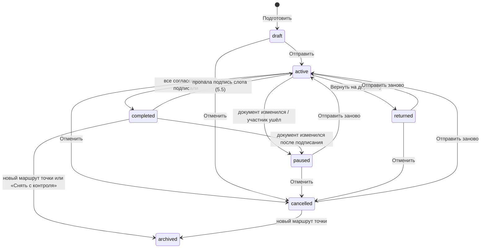

# Маршрут подписания: «Отправить на подписание»

Статус: принято 09.11.2026, внедряется срезами раздела 10. Модель и расчёт описаны так, как их реализует
`core/signing_route` (срез R1); уточнения по итогам R1 внесены в разделы 4, 5 и 6, по итогам R8 в раздел 6.6, по
итогам R6 (сценарии подписанта) в разделы 5.5, 6.3, 6.5, 6.10 и 8, по итогам R11 в раздел 5.7, по итогам R7
(сторожа и сверка) в разделы 5.5, 6.1, 6.10 и 8.1, по итогам R9 в разделы 6.7 и 6.8, по итогам доводки
(помеха `placement_off`, «Скопировать ссылку», `sent` у `sign_failed`) в разделы 5.7, 6.5 и 8, по итогам второй
доводки («Показать» после отмены, способ без места на странице, «Принять» во «Входящих», помеха другого маршрута с
его точкой, «Скопировать ссылку» заранее) в разделы 5.6, 6.3, 6.6, 8.1, 8.2 и 8.3.

10.11.2026 принят вариант Б: маршрут подписывает версию, снятую при отправке, а правка и пересборка его не
останавливают. Дизайн и срезы в разделе 12, ещё не внедрено; места, которые он меняет, помечены «Меняется разделом
12».

13.11.2026 предложены раздел 13 (необязательные подписи и пропуск подписанта автором на идущем маршруте) и раздел 14
(дата подписания: метки даты у слота в любом месте документа). Ещё не внедрены; срезы раздела 13 выходят раньше
срезов раздела 14.

Основа: `docs/design/signature-plan.md` (план подписей, слои L0, L1, L2, L3, «Подписать комплект»),
`docs/design/collaboration.md` (раздел 7.2 «Привязка к персонам», 8.1 «Приглашения»), `docs/ru/deploy/invitations.md`.

Документ не входит в сайт документации, это рабочий дизайн для разработки.

## 1. Задача

Сейчас, чтобы документ подписали другие, автор приглашает каждого с ролью «Рецензент» и персоной (`supervisor`,
`academic_supervisor`, ...), объясняет на словах, что и где подписать, а подписант сам ищет свои слоты на вкладке
«Подписи». Порядок никто не держит: академрук может подписать раньше научрука, научрук после этого оставит замечания,
автор поправит текст, и академруку придётся подписывать снова.

Нужно:

1. Автор готовит точку сдачи (например, «Заявка на тему КП (SmartLMS)»): для каждого документа и слота точки указывает,
   где стоит подпись и чья она. Подписанты это участники проекта с персоной; кого нет в проекте, приглашают тут же.
2. Автор нажимает «Отправить на подписание».
3. Подписант получает уведомление во «Входящих» и письмо (если настроен SMTP) со ссылкой на страницу, где есть только
   то, что подписывает он: документы, места на страницах и способ (картинка или ЭП, как разрешает точка).
4. Подписант подписывает там же: картинкой (нарисовать или загрузить) или ЭП. Нет ключа: создать или загрузить его
   прямо на странице, без ухода в профиль.
5. Порядок задаётся: например, автор, затем научрук, затем академрук. Следующий получает уведомление, когда закончил
   предыдущий. В одном шаге может быть несколько человек. Порядок по умолчанию берётся из пака.
6. Если документ изменился во время маршрута, подписи сбрасываются и маршрут начинается заново. Подписант может
   вместо подписи вернуть документ на доработку с комментарием.

Меняется разделом 12: пункт 6 становится таким. Подписывают версию, снятую при отправке; правка и пересборка
маршрут не останавливают, автор видит расхождение и сам отправляет новую версию, согласия сбрасываются только по
изменившимся документам.

## 2. Инварианты

Инварианты плана подписей (`signature-plan.md`, раздел 2) остаются. Маршрут добавляет свои:

1. **Согласование по порядку.** Подписант шага k получает запрос и может согласовать только после того, как все шаги
   до k согласовали эту же версию. Ни одна видимая подпись шага k не появляется в документе раньше.
2. **Картинка это согласие.** Картинка подписанта попадает в документ (предпросмотр, «С подписями», фиксация) только
   после его согласования текущей версии.
3. **Подписи не ломают друг друга.** Ни одно действие маршрута не делает недействительной уже поставленную ЭП, кроме
   явного сброса из-за изменения документа (раздел 5.5).
4. **Минимум действий.** Подписант делает одно действие, если порядок позволяет; два, только если без этого нарушился бы
   инвариант 1 или 3 (раздел 4.4). Повторное согласование после сброса это одно нажатие.
5. **Маршрут не хранит то, что уже хранит план.** Что подписано и чем, знает состояние подписей
   (`.hse-studio/signatures.json`). Маршрут хранит людей, порядок, согласия и события.

## 3. Как это выглядит

### 3.1 Автор

1. **Точка сдачи** (`/projects/:id/submit/cp/:profileId`). Новая карточка «Подписание»: «Подписано 0 из 3. Отправьте
   документы на подписание, руководители подпишут у себя». Кнопка «Подготовить и отправить».
2. **Экран «Отправка на подписание»** (`/projects/:id/submit/cp/:profileId/route`). Четыре блока:
   - **Документы точки**: собран ли каждый документ, кнопка «Собрать». Без сборки отправить нельзя.
   - **Кто и в каком порядке**: шаги карточками. В шаге люди: имя, персона («Научный руководитель»), статус в проекте
     («участник», «приглашение отправлено», «нет в проекте» с кнопкой «Пригласить»), способ («Картинка», «ЭП»), готовность
     («подпись загружена», «ключ известен»). Шаги перетаскиваются; «В один шаг с предыдущим» и «Отдельным шагом».
     Рядом с человеком подсказка «1 действие» или «2 действия: согласовать, затем подписать итоговый PDF» (раздел 4.4).
   - **Где подписи**: вкладки документов, страница PDF с рамками слотов (тот же редактор размещения, что на вкладке
     «Подписи»). Необязательные для точки слоты (например, академрук на заявлении в КП) включаются здесь: «Добавить
     подпись академического руководителя».
   - **Ваша подпись**: картинка автора или его ключ. Если не готово, загрузить или нарисовать тут же.
   - Внизу: «Срок» (необязательно), «Сообщение подписантам» (необязательно), список того, что мешает, и кнопка
     «Отправить на подписание». Если автор подписывает ЭП и фиксация возможна сразу, кнопка «Отправить и подписать».
3. **После отправки** карточка «Подписание» на точке: «Шаг 2 из 3: ждём Петрова П. П. (научный руководитель) с 10.11».
   Шаги со статусами и временем. Действия: «Напомнить», «Скопировать ссылку» (для пересылки, если нет SMTP),
   «Отменить маршрут». В редакторе документов маршрута плашка: «Документ на подписании (шаг 2 из 3). Правка и пересборка
   остановят маршрут». Меняется разделом 12 (12.2, 12.7): плашка «Подписывают версию от 10.11, ваши правки в неё не
   попадут», перед первой правкой вопрос «Документ на подписании. Изменения не попадут в подписываемую версию.
   Продолжить?».
4. **Вернули на доработку**: уведомление и карточка «Возвращено на доработку (Петров П. П.): «Уточните цель проекта»».
   Кнопки «Открыть документ» и «Отправить заново».
5. **Документ изменился**: «Документ изменился после согласования: маршрут остановлен». Кнопка «Отправить заново»,
   настройки маршрута сохраняются. Меняется разделом 12: маршрут не останавливается, карточка пишет «Есть изменения
   после отправки на подпись. Подписывают версию от 10.11», кнопка «Отправить новую версию».
6. **Все подписали**: «Все подписали. Можно собирать пакет». Кнопка «Собрать пакет» (существующая сборка пакета).

### 3.2 Подписант

1. **Уведомление** (колокольчик, «Входящие» раздел «На подпись», письмо): «Иванов И. просит подписать: Заявка на тему КП
   (SmartLMS), проект «…». Срок 15.11». Ссылка `/sign/:projectId/:routeId`.
2. Не вошёл: вход, затем та же страница. Ещё не участник: страница приглашения, «Принять», затем та же страница
   (параметр `next`).
3. **Страница подписания** (без рабочего места проекта, вёрстка под телефон):
   - Шапка: проект, точка, от кого, срок, сообщение автора.
   - Ход маршрута одной строкой: «1. Иванов И.: согласовал · 2. Вы · 3. Сидоров С.: ждёт».
   - «Что нужно от вас»: «Подписать 2 документа: картинкой или открепленной ЭП».
   - Документы вкладками: PDF, кнопка «К месту подписи» (страница и рамка «Ваша подпись»), чужие слоты видны как есть.
   - «Как подписать»: выбор из разрешённых точкой способов.
     - Картинка: сохранённая подпись, «Нарисовать», «Загрузить» (редактор с удалением фона), галка «Запомнить для других
       проектов».
     - ЭП: если ключ известен, строка «Ключ: Петров П. П., OpenPGP 1A2B …» и больше ничего. Иначе, только то, что
       разрешено на установке: «Подписать в КриптоПро (в браузере)», «Загрузить готовую подпись (.asc, .sig, .p7s)»,
       «Создать ключ OpenPGP», «Импортировать ключ (.p12, OpenPGP)», «Указать сертификат для плашки».
   - Кнопки по ситуации (раздел 4.4): «Согласовать», «Согласовать и подписать» или «Подписать». Рядом «Вернуть на
     доработку» (обязательный комментарий).
4. **После действия**: «Готово. Следующим подписывает Сидоров С.» или «Согласовано. Когда все поставят видимые подписи,
   вас попросят подписать итоговый PDF».
5. **Второе действие** (если нужно): «Документы зафиксированы: подпишите итоговый PDF». Та же страница, итоговый PDF и
   одна кнопка «Подписать» (пароль ключа, если есть).
6. **После сброса**: «Документ изменён: нужна повторная подпись». Картинка и ключ уже на месте, одно нажатие.
   Меняется разделом 12: над документом «Вы подписываете версию от 10.11», после новой версии «Новая версия:
   изменился документ «…». Согласуйте его заново», документы без изменений помечены «Без изменений».

### 3.3 Тексты

| Где | Текст |
|---|---|
| кнопка автора | Отправить на подписание; Отправить и подписать; Отправить заново; Отменить маршрут; Напомнить; Скопировать ссылку |
| кнопка подписанта | Согласовать; Согласовать и подписать; Подписать; Вернуть на доработку |
| уведомление подписанту | {автор} просит подписать: {точка}; Подпишите итоговый PDF: {точка}; Напоминание: {точка}, срок {дата} |
| уведомление автору | Возвращено на доработку ({кто}): «{комментарий}»; Документ изменился, маршрут остановлен: {точка}; Все подписали: {точка} |
| уведомление всем | Маршрут отменён: {точка} |
| плашка в редакторе | Документ на подписании (шаг {k} из {n}). Правка и пересборка остановят маршрут |

Новые тексты варианта Б (раздел 12):

| Где | Текст |
|---|---|
| кнопка автора | Отправить новую версию; Открыть версию на подписи; Подписывать текущую сборку |
| карточка, плашка, страница подписи у автора | Есть изменения после отправки на подпись. Подписывают версию от {дата}; у завершённого: Все подписали версию от {дата}. Есть изменения после подписания |
| плашка в редакторе | Документ на подписании (шаг {k} из {n}). Подписывают версию от {дата}, ваши правки в неё не попадут |
| мягкое предупреждение | Документ на подписании. Изменения не попадут в подписываемую версию. Продолжить? |
| подтверждение новой версии | Изменились: {документы}. Согласуют заново: {люди}. Без изменений: {документы}, подписи на них останутся |
| подписанту | Вы подписываете версию от {дата}; Новая версия: изменился документ «{документ}». Согласуйте его заново; Без изменений: вы уже подписали |
| уведомление подписанту | {автор} просит подписать новую версию: {точка}; Новая версия на подпись: {точка}. Запрос придёт в вашу очередь |
| пакет | Документ «{документ}» изменён после отправки на подпись: в пакет попала подписанная версия от {дата} |
| причина остановки `sent_changed` | Версия на подписи изменилась вне маршрута: маршрут остановлен |

## 4. Видимый слой и порядок

### 4.1 Ограничение

Всё видимое (картинки, плашки открепленных ЭП, картинки видимых PAdES) входит в зафиксированный PDF B, а открепленные
подписи сделаны над байтами B (`signature-plan.md`, раздел 4). Значит, картинка следующего подписанта меняет B и
делает недействительными все ЭП, поставленные раньше. Последовательный маршрут «каждый ставит свою подпись по очереди»
ломает подписи, если хотя бы одна картинка идёт после ЭП.

### 4.2 Решение: согласие по порядку, метки по слоям

Разделяем два действия подписанта:

| | Согласование | Метка |
|---|---|---|
| что это | «я прочитал эту версию и согласен» | картинка, плашка или ЭП в документе |
| где хранится | маршрут (сервер) | состояние подписей (файлы проекта) |
| порядок | строго по шагам маршрута | по слоям: L1 видимое до фиксации, L2 и L3 после |
| что привязано | отпечаток сборки каждого документа | байты B или F |

Правила:

1. **Картинка ставится в момент согласования.** До согласования слот картинки «придержан» (`withheld`, раздел 6.1):
   место на странице есть, картинки нет ни в предпросмотре, ни в «С подписями», ни в фиксации.
2. **Плашка ставится заранее.** Плашка это место под ЭП, без файла подписи она ничего не утверждает, и план не считает
   её подписью. Её данные (владелец, сертификат, срок) берутся из известного ключа подписанта (раздел 6.5). Если данных
   нет, подписант задаёт ключ на своём шаге, и это меняет B так же, как картинка.
3. **Фиксация автоматическая.** Маршрут фиксирует все документы, как только не осталось участников, чьё действие ещё
   может изменить видимый слой: несогласовавших подписантов картинкой и подписантов ЭП без данных плашки. Фиксация
   одна на маршрут: в этот момент фиксируются сразу все документы маршрута, где есть слот ЭП, а не каждый документ
   отдельно по мере готовности. Документ без слотов ЭП не фиксируется (6.2). Непосредственно перед фиксацией плашки
   без подписанта получают данные известного ключа участника (эффект `FillPlate`), раньше их не трогают.
4. **ЭП после фиксации.** Подписанты ЭП, согласовавшие до фиксации, подписывают B после неё. Подписанты ЭП после
   фиксации согласуют и подписывают одним действием, по порядку шагов.

Обозначим L последний шаг, где есть участник, способный изменить видимый слой. Точнее, участник ещё меняет видимый
слой, если у него есть слот с картинкой (картинка или видимая PAdES), а действующего согласия текущей сборки нет, или
слот с плашкой, у которой нет данных подписанта ни в слоте (`slot.signer`), ни в его известном ключе (6.5). Если таких
участников нет, L = 0. Пока они есть, фаза `approval`; когда их не осталось, фаза `signing`. Тогда маршрут идёт так:

```text
шаги 1..L        согласование по порядку; картинки появляются при согласовании
конец шага L     фиксация всех документов маршрута = B (L0 + все видимые метки)
сразу после      «подпишите итоговый PDF» всем подписантам ЭП из шагов 1..L (параллельно)
шаги L+1..N      по порядку: согласовать и подписать B одним действием
готово           все согласовали и все слоты маршрута в плане `signed`
```

L считается заново при каждом событии: подписант может сменить способ (из разрешённых точкой) на своём шаге. После
фиксации подписанту предлагаются только способы, которые не меняют видимый слой (ЭП с уже стоящей плашкой или PAdES
без картинки), иначе пришлось бы сбросить чужие ЭП.

Последний, кто меняет видимый слой, может совместить: если после его согласования не остаётся изменений видимого
слоя, сервер в том же запросе фиксирует документы и подписывает его слоты ЭП («Согласовать и подписать»). Отпечатки
проверяются так же, как в «Подписать комплект» (`build:<сборка>:<видимый слой>` до фиксации).

Шаг пройден, когда каждый его участник сделал всё, что было возможно в этот момент: до фиксации согласовал, после
фиксации согласовал и подписал. Поэтому вторые подписи из шагов 1..L не задерживают шаги после L. Различать это
помогает фаза, записанная в согласии (`Approval.phase`, 5.1): кто согласовал в фазе `approval`, подписывает после
фиксации параллельно с остальными и шаги не держит; кто согласовал в фазе `signing`, считается прошедшим шаг только
вместе с подписью (например, между согласием и загрузкой подписи КриптоПро).

### 4.3 Почему так держатся инварианты

- Порядок согласий строгий: академрук не получает запрос, пока документ не согласовал научрук, в любом сочетании
  способов.
- B меняется только до фиксации и только согласиями; после фиксации видимый слой заморожен (раздел 5.5), поэтому ЭП
  над B не сбрасываются ничем, кроме изменения документа.
- Картинка подписанта никогда не стоит на версии, которую он не согласовал: она придержана до согласия и снова
  придерживается, если версия изменилась.

### 4.4 Сколько действий у каждого

| Подписант | Действий |
|---|---|
| картинкой | 1: согласовать (картинка встаёт сразу) |
| ЭП, шаг после L (данные плашки известны) | 1: согласовать и подписать |
| ЭП, последний меняющий видимый слой | 1: согласовать и подписать (совмещение) |
| ЭП, шаги 1..L, согласовал до фиксации | 2: согласовать; после фиксации подписать |
| автор-отправитель | отправка это его согласование; ЭП как у всех |
| только согласование (без слотов) | 1 |

Примеры для «Заявки на тему КП» (автор, научрук, академрук):

| Способы | L | Автор | Научрук | Академрук |
|---|---|---|---|---|
| все картинкой | 3 | отправка | 1 | 1 |
| автор картинкой, научрук и академрук ЭП с известными ключами | 1 | отправка (фиксация сразу после) | 1 | 1 |
| все ЭП с известными ключами | 0 | «Отправить и подписать» | 1 | 1 |
| автор ЭП, научрук ЭП, академрук картинкой | 3 | отправка, потом подписать | 2 | 1 |
| автор ЭП, научрук картинкой, академрук ЭП без ключа | 3 | отправка, потом подписать | 1 | 1 (задаёт ключ и подписывает) |

Редактор маршрута показывает это число у каждого человека (`ParticipantView.remaining_actions` расчёта отправленного
маршрута). Подсказка: «Подписи-картинки раньше ЭП сокращают число действий». Для подписанта ЭП на шаге L, где кроме
него есть другие участники, меняющие видимый слой, число 2 это верхняя граница: кто из них согласует последним и
совместит согласие с подписью, заранее неизвестно.

Что пропускается само:

- шаг отправителя: отправка и есть его согласие, если он участник первого шага (иначе он согласует в свою очередь,
  как все, чтобы не нарушить инвариант 1); картинка или данные плашки должны быть готовы до отправки, сценарий
  отправки проверяет это по расчёту (`needs_image`, `needs_plate`);
- настройка плашки, если данные ключа подписанта уже известны (6.5);
- ожидание фиксации, если никто не меняет видимый слой (L = 0): фиксация при отправке, автор может сразу «Отправить и
  подписать»;
- согласие при повторной отправке, если документы участника не менялись с его прошлого согласия (5.4);
- после остановки картинка и ключ подписанта остаются: повторное согласие или подпись это одно нажатие.

### 4.5 Отвергнутые варианты

| Вариант | Почему нет |
|---|---|
| Зафиксировать при отправке, все подписывают B по очереди | картинка позднего подписанта должна быть в B до его согласия, либо её добавление сбросит ранние ЭП |
| Картинки поздних подписантов инкрементальным обновлением поверх B | открепленная подпись проверяется только против B, а в LMS уходит один PDF с подписью к нему; для PAdES это изменение после подписи |
| Сначала все видимые метки по порядку, а подписанты ЭП с известным ключом в первой фазе не участвуют | академрук ставит картинку раньше, чем научрук прочитал документ: ровно тот случай, от которого защищаемся |
| Сервер сам подписывает ключом ЭП-подписанта после фиксации по заранее данному согласию | подпись покрыла бы байты, которых подписант не видел (инвариант 1 плана); пароль ключа не хранится; на проде ключи на сервере запрещены |
| ЭП из шагов 1..L тоже строго по порядку | согласия уже по порядку, B после фиксации измениться не может; очередь добавила бы дни ожидания и ничего не защитила |

## 5. Модель маршрута

### 5.1 Сущности

```text
SigningRoute
  id, project_id, profile_id
  status: draft | active | paused | returned | completed | cancelled | archived
  phase?: approval | signing | done         (только у active и completed, иначе пусто)
  round: int                                 (растёт при каждой отправке)
  docs: [doc_id]                             (документы точки с подписями маршрута)
  snapshot: {doc_id: {compiled_sha256, frozen_sha256?, marks_digest}}
  deadline?, message?, created_by, sent_by, sent_at, completed_at
  stop_reason?: rebuilt | marks_changed | frozen_changed | participant_left | returned
  stopped_by?                                (участник, чей возврат или уход остановил маршрут)

Participant
  id, route_id, step: int, persona
  user_id?                                   (пусто, пока приглашение не принято)
  invitation_id?
  assignments: [(doc_id, slot_id)]           (пусто: только согласование)
  approval?: {round, tokens: {doc_id: "build:<sha>"}, at, phase: approval | signing}
  notified?: {round, outcome: approve | approve_sign | sign, at}   (последний запрос участнику)
  reminded_at?, reminders: int

RouteEvent
  route_id, round, at, actor_id, participant_id?, kind, details
  kind: sent | approved | signed | returned | paused | resumed | cancelled | completed | reminded | invited | frozen
```

Способ подписи берётся из слота (`SignatureSlot.sign_mode`, общий для всех документов проекта), как в плане. Маршрут
его не дублирует.

- `Approval.phase`: фаза маршрута в момент согласия (4.2, «Шаг пройден»). При переносе согласия на новый раунд
  ставится `approval`.
- `notified`: о чём и в каком раунде был последний запрос; по нему расчёт не повторяет запрос (6.6).
- `stopped_by`: кто вернул на доработку или ушёл; по нему у участника состояние `returned`, а у автора текст
  «Возвращено на доработку (Петров П. П.)». Тексты маршрута не согласуют глагол с родом человека:
  «согласовано», «подписано», «приглашение не принято».

Чистый расчёт `evaluate(route, facts) -> Evaluation` живёт в `core/signing_route/engine.py`, сущности в
`entities.py`, эффекты в `effects.py`, переходы в `transitions.py`. `facts` (`RouteFacts`) это то, что известно о
документах: `DocFacts` каждого документа маршрута, состояние подписей, придержанные слоты (`withheld`, передаются
отдельным полем, сценарий кладёт туда `SignaturesState.withheld`), известные данные плашек по пользователям (6.5) и
персоны участников проекта (для ухода участника, 5.4). Статусы слотов расчёт берёт из `slot_state`.

`Evaluation`: статус, к которому надо перейти (`paused` при остановке, `completed` когда все сделали своё, `active`
если у завершённого пропала подпись), фаза, L, текущий шаг, по каждому участнику состояние (5.3), следующее действие
(`wait`, `approve`, `approve_and_sign`, `sign`, `done`), сколько нажатий ещё нужно (4.4), нужна ли картинка или данные
плашки до согласия; причина остановки и эффекты: `Withhold`, `Release`, `FillPlate`, `Freeze`, `Notify`. Сценарии
выполняют эффекты.

Эффекты это разница между нужным и текущим, поэтому расчёт идемпотентный. Сценарий под блокировкой строки маршрута
делает так: переход (`send`, `approve`, `return_route`, ...), `evaluate`, файловые эффекты под `project_lock`,
`refresh_snapshot` (5.5), `apply_evaluation`, затем одна транзакция с маршрутом, событиями и уведомлениями и
`mark_notified` для отправленных запросов. После этого повторный расчёт на тех же фактах эффектов не даёт.

### 5.2 Порядок по умолчанию из пака

Новый необязательный ключ версии шаблона и переопределение в профиле:

```yaml
signatures:
  route: [[author], [supervisor, co_supervisor], [academic_supervisor]]   # шаги, внутри шага параллельно

pack_submission:
  profiles:
    - id: topic-approval
      signing_route: [[author], [supervisor], [co_supervisor], [academic_supervisor]]   # необязательно
```

Без ключа: авторы, затем научрук и соруководитель (консультант) одним шагом, затем академрук. Слот, которого нет в
списке, идёт отдельным последним шагом. `author` с `per_author: true` в команде раскрывается в шаг со всеми авторами.
Порядок служит заготовкой: автор меняет его до отправки, маршрут запоминает свой и предлагает его при следующей
отправке.

### 5.3 Состояния

Маршрут:



Переходы сверх основного пути: отменить можно и остановленный маршрут («в любой момент», раздел 9); отменённый
снимается с контроля, когда у точки появляется новый маршрут, иначе его повторная отправка столкнулась бы с новым по
документам; завершённый снова идёт (`active`, фаза `signing`), если подпись его слота удалили или она стала
недействительной: ждёт только этот слот (5.5). Таблица переходов `TRANSITIONS` в `core/signing_route/transitions.py`.

Участник (вычисляется, не хранится):

| Состояние | Когда |
|---|---|
| `invited` | приглашение не принято; шаг ждёт его |
| `waiting` | его шаг ещё не настал, или он согласовал до фиксации и ждёт её (у него есть `approved_at`), или маршрут не идёт |
| `to_approve` | его очередь согласовать (до фиксации) |
| `to_approve_sign` | его очередь, документы зафиксированы: согласовать и подписать |
| `to_sign` | согласовал до фиксации, документы зафиксированы, ждём его ЭП |
| `done` | согласовал, все его слоты `signed` |
| `returned` | вернул на доработку (до следующей отправки) |

### 5.4 Переходы и уведомления

| Событие | Что делает маршрут |
|---|---|
| Отправить | новый `round`, снимок отпечатков, слоты картинок придержаны, согласие отправителя записано, если он участник первого шага; L = 0: фиксация; уведомить шаг 1 (или первый незавершённый) |
| Согласование | записать согласие с отпечатками; открыть его картинки; если больше никто не меняет видимый слой: фиксация, «подпишите итоговый PDF» подписантам ЭП шагов до L; если шаг пройден: уведомить следующий |
| Подпись ЭП (любой путь: страница, КриптоПро, загрузка .asc, «Подписать в Студии») | пересчёт; шаг пройден: уведомить следующий; всё подписано: `completed`, уведомить автора и участников |
| Вернуть на доработку | `returned`, комментарий в событии, уведомить автора и тех, кто уже согласовал |
| Версия на подписи, B или видимый слой изменились мимо маршрута (12.5) | `paused`, уведомить автора и тех, кто уже согласовал в этом раунде; картинки придерживаются по версии (ниже) |
| Отменить | `cancelled`, уведомить тех, кому уже приходил запрос; поставленные ЭП над B остаются |
| Отправить заново, отправить новую версию (12.6) | новый `round`; согласие участника переносится всегда, с прежними отпечатками, и действует по каждому документу отдельно |
| Приглашение принято | участник получает `user_id`; если его очередь, уведомление |
| Участник ушёл или сменил персону | только у идущего маршрута: `paused` (`participant_left`), уведомление только автору: «назначьте другого подписанта». Завершённый маршрут уход участника не останавливает: подписи уже стоят |

Картинки придерживаются по версии (12.6). Согласие хранит отпечаток версии на подписи каждого документа участника
(`build:<sha>`). Картинка участника на документе открыта, пока его согласие этого раунда совпадает с отпечатком
**этого** документа, иначе придержана; для хода шагов участник согласовал, только если совпали отпечатки всех его
документов. Поэтому при `sent_changed` и при новой версии картинки придерживаются только на изменившемся документе, а
на остальных остаются вместе с B и ЭП над ним. При `marks_changed`, `frozen_changed` и `participant_left` версия та
же, и картинки не трогаются. Отменённый и снятый с контроля маршрут не трогает ничего (5.6). До R15 картинка
открывалась по отпечаткам всех документов участника, а `rebuilt` придерживал их все.

Запросы не повторяются. У участника хранится последний запрос (`notified`: раунд и `outcome`). Расчёт шлёт запрос один
раз за раунд на согласие (`approve` и `approve_sign` это один ход) и один раз на «подпишите итоговый PDF» (`sign`).
Запрос `sign` получают только согласившие до фиксации: кто согласует после фиксации, подписывает в том же действии.
При «Согласовать и подписать» сценарий фиксирует, подписывает и только потом рассылает уведомления. Если подпись слота
пропала (5.5), повторная подпись сама не уведомляет: автор может «Напомнить». Новый раунд обнуляет `notified`.

### 5.5 Что сбрасывает маршрут

Меняется разделом 12 (12.5): правка и пересборка маршрут не останавливают, сверка идёт по версии на подписи;
остановка `rebuilt` заменяется на `sent_changed` (подмена версии на подписи мимо маршрута). Расчёт (R15) сверяет по
источнику подписи и ставит `sent_changed`, отправка (R16) снимает версию на подписи, хук сборки у `RouteWatch` убран,
маршруты 0.20.0 переносятся на версию на подписи (R17, 12.11). Ниже поведение 0.20.0.

Маршрут хранит снимок отпечатков документов (`snapshot`) и сверяет с ним текущее состояние:

| Изменение документа маршрута | Итог |
|---|---|
| собранный PDF другой (`compiled_sha256`): пересборка, обновление шаблона, восстановление из истории, синхронизация | `paused/rebuilt` |
| зафиксированный PDF другой или удалён вне маршрута (git, восстановление) | `paused/frozen_changed` |
| видимый слой другой, а маршрут его не менял | `paused/marks_changed` |
| подпись ЭП слота удалена или недействительна | только этот слот снова ждёт подписи, маршрут не останавливается; завершённый снова становится `active` |
| комментарии, другие документы, сборка других документов | ничего |

Сверка строгая. `compiled_sha256` в снимке это сборка, отправленная на подписание: маршрут сам не пересобирает, и
`refresh_snapshot` её не меняет. Видимый слой и фиксацию маршрут меняет сам (открывает и придерживает картинки,
заполняет плашки, фиксирует), поэтому после своих эффектов и после действий подписанта на своей странице (картинка,
плашка, способ, подпись) сценарий под `project_lock` обновляет в снимке `marks_digest` и `frozen_sha256`. Любое другое
отличие это изменение вне маршрута. Если транзакция упала после записи файлов, снимок остался прежним, и следующий
расчёт остановит маршрут (`marks_changed` или `frozen_changed`) и вернёт придержанные картинки: состояние
согласованное и безопасное, автор отправит заново.

Сброс не перезапускает маршрут сам: иначе каждая пересборка во время правки рассылала бы запросы. Маршрут
останавливается, автор правит и нажимает «Отправить заново». Новый раунд начинается с шага 1, но согласие
переносится, если документ участника не менялся (например, академрук вернул на доработку, автор решил ничего не менять).

Чтобы видимый слой не менялся случайно, пока маршрут активен, правки подписей документов маршрута запрещены (409
«Документ на подписании: отмените маршрут, чтобы изменить подписи»): размещения, настройка слота, картинка слота,
подписант плашки, фиксация и её снятие (в том числе через «Подписать комплект»), удаление открепленной подписи.
Подписант меняет свою картинку, ключ и свою открепленную подпись только через свою страницу и только в свою очередь. Сборка не запрещается: это
и есть способ внести правку, редактор предупреждает плашкой.

Как это сделано (срез R7, `ISigningRouteGate.require_unlocked`, вызывается ручками плана подписей до правки):

- правка документа (размещение, фиксация и её снятие, удаление открепленной подписи) закрыта, если документ держит
  идущий маршрут; правка слота (настройка, картинка, подписант плашки и его уровень) закрыта, если слот входит в
  идущий маршрут проекта или его размещение включено на документе такого маршрута: слот общий для документов
  проекта, и его правка меняет их видимый слой;
- закрыто всем, и автору, и самому подписанту: он действует на своей странице (`task/image`, `task/plate`);
- держит только идущий маршрут. Остановленный, возвращённый и отменённый правку не запрещают: автор правит и
  отправляет заново. Завершённый тоже не запрещает, но следит за документами: правка его остановит, а удаление
  подписи вернёт в `active` (ждёт только этот слот), и пока он снова идёт, правки опять закрыты;
- маршрут, который по расчёту уже не идёт (документ пересобран, а остановка ещё не записана), правку не держит, как
  и очередь у других входов подписи: запись состояния подписей позовёт сверку, и она запишет остановку.

Сборка LaTeX воспроизводима (срез R12, #230): все исполнители запускают latexmk с постоянной
`SOURCE_DATE_EPOCH=315532800` (1980-01-01) и `FORCE_SOURCE_DATE=0`. Постоянная дата фиксирует `/CreationDate`, а
от неё и одинаковых путей сборки и `/ID` трейлера, поэтому пересборка без правок в том же образе TeX даёт тот же PDF
и маршрут не останавливает. Дата от последнего снимка не годится: снимок «Сборка» после каждой сборки с правками
сдвигает историю, а облако и локальная Студия с разной историей собирали бы разные PDF. `FORCE_SOURCE_DATE=0`
оставляет `\today` и `\the\year` настоящими: документ с `\today`, пересобранный на следующий день, честно меняется и
даёт `rebuilt`. PDF из office-документов (конвертация Gotenberg) по-прежнему невоспроизводим: там свои дата и `/ID`,
и его пересборка без изменений тоже даёт `rebuilt`.

Действие подписанта тоже сверка (срез R6): под блокировками оно сначала считает маршрут на текущих фактах. Если
документы изменились вне маршрута (или участник ушёл), действие записывает остановку (событие `paused`, уведомления,
картинки с недействительным согласием снова придержаны) и отвечает 409 `doc_changed` со списком разошедшихся документов
(при уходе участника `not_your_turn`). Общий шаг сценариев: `RouteScenario._stop_if_changed`, им же пользуются
триггеры R7.

Как замечаем изменения: хук успешной сборки (`IBuiltPdfObserver.on_pdf_built`), хуки после записи состояния подписей,
применения синхронизации и восстановления (`IRouteWatch.on_project_changed`), и периодическая сверка активных
маршрутов (`PeriodicTask` лидера, раз в 5 минут) как страховка для гибрида. Чтение маршрута ничего не пишет, но
показывает вычисленное состояние, даже если хук ещё не сработал.

Как это сделано (срез R7, `use_cases/signing_route/reconcile.py`, `watch.py`, `gate.py`):

- **Сверка** это тот же пересчёт, что после подписи слота другим входом (`RouteRecalculation.recalculate`): под
  блокировкой строки маршрута и `project_lock` расчёт на текущих фактах, остановка (`_stop_if_changed`: событие
  `paused`, уведомления, придержать картинки с недействительным согласием) или следующий ход (подпись появилась
  мимо страницы, у завершённого пропала подпись). `RouteReconciler.project` сверяет маршруты проекта, идущие и
  завершённые; `RouteReconciler.sweep` все идущие маршруты сервера (завершённых со временем много, а сверка читает
  PDF каждого документа: за ними следят хуки). Сверка идемпотентна: если ничего не изменилось, маршрут не
  переписывается (версия записи не растёт), остановленный маршрут уже не сверяется, поэтому повторный хук, второй
  проход и смена лидера ничего не повторяют. Сбой одного маршрута (битый проект, снятый пак) остальным не мешает.
- **Хуки** зовут `IRouteWatch.on_project_changed(project_id)` (локально `NoRouteWatch`). На сервере это `RouteWatch`:
  он ничего не блокирует и не считает сам, а ставит сверку в очередь, по одной задаче на проект; изменения за время
  сверки дают один повторный проход. Задача идёт в пустом контексте (без актора и транзакции запроса), в своём
  запросном окружении контейнера и своей транзакции. Поэтому хук можно звать откуда угодно, в том числе под
  `project_lock` и из рабочего потока. Кто зовёт:
  - сборка: `RouteWatch` это и есть серверный `IBuiltPdfObserver`;
  - запись состояния подписей: `WatchedSignatureRepository` поверх `ISignatureRepository`, то есть любая запись
    `signatures.json`, кто бы её ни сделал (ручные правки завершённого маршрута, «Подписать комплект», перепроверка
    подписи);
  - принятый push (`ReceivePushUC.finish`), применённая синхронизация (`SyncProjectUC`), восстановление из истории
    (`RestoreVcsUC`);
  - участник убран из проекта или сменил роль и персону (`RemoveProjectMemberUC`, `SetProjectMemberUC`), после
    транзакции: сверка идёт своей транзакцией и должна увидеть уже записанное членство. Остальные пути ухода
    (отключение аккаунта, передача проекта) ловит периодическая сверка.
- **Повторный вход.** Хук записи подписей срабатывает и внутри сценариев маршрута: они сами пишут `signatures.json`.
  Защиты две. Сверка отложена и сама берёт строку маршрута, поэтому не встаёт в обратный порядок блокировок и ждёт
  конца транзакции сценария. А свои записи маршрута хук не зовёт вовсе (`route_files`: `project_lock` сценария плюс
  отметка в контексте): сценарий сам обновляет снимок. Так же молчит запись подписи слота маршрута другим входом
  (`require_turn`, `hold`): маршрут следом пересчитывает сам вход с событием `signed`, иначе сверка без события
  могла бы записать завершение раньше подписи.
- **Периодическая сверка**: задача лидера `signing_route_sweep`, `HSE_STUDIO__SIGNING_ROUTE__SWEEP_INTERVAL_S` (300).
- PDF, выгруженный локальной Студией на сервер (`POST .../git/pdf`), лежит в хранилище артефактов и собранный PDF
  серверной копии не меняет: маршрут останавливает push исходников и серверная пересборка, а не выгрузка PDF.

### 5.6 Вернуть, отменить, отправить заново

- **Вернуть на доработку**: любой участник в свою очередь (`to_approve`, `to_approve_sign`, `to_sign`). Комментарий
  обязателен, до 2000 символов. Подробные замечания к тексту подписант оставляет обычными ревью-комментариями (ссылка
  «Оставить замечания к тексту» ведёт в проект, право `COMMENT` у рецензента есть).
- **Отменить**: кто управляет маршрутом (раздел 7), из `draft`, `active`, `paused` и `returned`. Поставленные ЭП над B
  остаются в состоянии подписей, придержанные картинки остаются придержанными. На вкладке «Подписи» у такого слота пометка «Придержано маршрутом» и кнопка
  «Показать» (право записи файлов, как у любой правки размещения).

  Как это сделано (доводка): отмена не снимает придержание сама, потому что картинка это согласие (инвариант 2), а
  отмена не согласие подписанта. `GET /projects/{id}/signatures` отдаёт `withheld` (`{doc_id: [slot_id]}`),
  панель слотов документа показывает пометку и «Показать» с подтверждением. «Показать» это
  `DELETE /projects/{id}/signatures/withheld/{doc_id}/{slot_id}` (204, `FILES_WRITE` по слоту, как размещение):
  снимает слот документа с придержания, повтор ничего не меняет. Пока документ держит идущий маршрут, 409
  `route_locked` (`ISigningRouteGate.require_unlocked`); остановленный и возвращённый правку не держат, и при
  повторной отправке расчёт снова придержит картинку без действующего согласия. В аудит пишется `signature.release`
  с документом и слотом.
- **Отправить заново**: из `paused`, `returned`, `cancelled`. Те же шаги и люди, можно изменить до отправки
  (`EDITABLE_STATUSES`). Согласие переносится всегда и действует по каждому документу отдельно (12.6, ядро R15).
  «Отправить новую версию» ещё и из `active` и `completed` (`SENDABLE_STATUSES`, 12.6); отмена снимает версии на
  подписи этого маршрута (R16).

### 5.7 Сроки и напоминания

- Срок необязательный, ставит автор. Показывается на странице, в уведомлении и письме; просроченный маршрут помечен,
  но не отменяется.
- «Напомнить» у автора: тем, чья очередь, не чаще раза в 12 часов на человека.
- Автоматически: за сутки до срока и через 3 дня ожидания в очереди, не больше 3 автонапоминаний на человека за раунд.

Как это сделано (срез R11, правила в `core/signing_route/reminders.py`, сценарии в
`use_cases/signing_route/reminders.py`):

- Напоминание это уведомление `signing_reminder` (6.6) тому, чья очередь по расчёту на текущих фактах (`to_approve`,
  `to_approve_sign`, `to_sign`), с ходом его следующего действия. У участника пишутся `reminded_at` и `reminders`
  (все напоминания раунда, ручные и автоматические; новый раунд их обнуляет), в историю событие `reminded` с
  `details.trigger`: `manual`, `deadline` или `waiting` (у ручного ещё `delivery`). Актор события автор, у
  автонапоминания его нет. Отметка, событие и уведомление пишутся одной транзакцией под блокировкой строки маршрута.
- Если документ изменился и маршрут по расчёту уже не идёт, напоминать не о чем: ручное отвечает
  `participant_not_waiting`, автоматическое пропускает маршрут (остановит его сверка, 5.5).
- **Вручную** (`POST .../participants/{pid}/remind`). 12 часов считаются от `reminded_at`, то есть от любого
  напоминания, и автоматического тоже: кнопка у автора закрыта по тому же полю. Раньше срока 429 `rate_limited` с
  `retry_after` (секунды) и `available_at` (когда станет можно, ISO 8601). Ответ `delivery`: `email`, если настроен
  SMTP и почта участника подтверждена, иначе `inbox`.
- **Приглашённому** (`invited`, на любом шаге идущего маршрута) «Напомнить» повторяет приглашение
  (`ResendInvitationUC`): секрет ссылки меняется в транзакции маршрута, письмо уходит после неё; в историю событие
  `invited`. Действуют и правила самого приглашения: нужно право решать доступ (иначе 403 `forbidden`), не чаще
  раза в 10 минут и не больше 5 повторов (`invitation_resend_too_soon`), приглашение ещё ждёт
  (`invitation_not_pending`); при отказе в маршрут ничего не пишется. У участника без приглашения (`missing`)
  напоминать некому: `participant_not_waiting`.
- **Приглашённому без SMTP** напомнить нечем: письмо не уйдёт. «Напомнить» отвечает `manual` со ссылкой
  `/project-invite/<token>?next=/sign/<проект>/<маршрут>` (6.5), которую автор пересылает сам. Это не повтор
  приглашения и не напоминание: 10 минут, 5 повторов и 12 часов не действуют, `reminded_at`, `reminders` и история
  маршрута не меняются. Приглашению аккаунту (без ссылки) по-прежнему повторяется уведомление во «Входящих».
- **«Скопировать ссылку»** (`POST .../participants/{pid}/link`, `SigningRouteReminding.link`) отдельно от
  напоминания: ограничений по времени нет, в маршрут ничего не пишется. Участнику с аккаунтом это адрес его
  страницы `/sign/<проект>/<маршрут>` (`kind: page`). Приглашённому по почте без SMTP новая ссылка приглашения
  (`kind: invitation`, `ResendInvitationUC.relink`): секрет хранится хэшем, прежнюю ссылку показать нельзя, поэтому
  выдаётся новый секрет, прежняя ссылка перестаёт работать, срок приглашения отсчитывается заново; `sent_count` и
  `last_sent_at` не меняются, в аудит `project.invitation.relink`. С настроенным SMTP ссылку несёт письмо, и её
  замена молча сломала бы отправленное: 409 `link_by_mail`, автору остаётся «Напомнить». Приглашённому как аккаунт
  ссылка на «Входящие» (`kind: inbox`). Поэтому метод POST, а не GET: у приглашённого он меняет секрет.
- **Автоматически**: периодическая задача лидера `signing_reminders` (`PeriodicTask`, `SigningReminderSweeper`),
  по умолчанию раз в 15 минут. Обходит идущие маршруты и напоминает участнику с аккаунтом, чья очередь:
  - о сроке: до срока меньше суток и срок ещё не прошёл; один раз за раунд на человека (`deadline`);
  - об ожидании: три дня тишины, то есть от последнего запроса или напоминания этому человеку (`waiting`); ручное
    «Напомнить» отодвигает его, а без ответа оно повторяется каждые три дня;
  - не раньше чем через 12 часов после запроса или прошлого напоминания: запрос за шесть часов до срока уже
    называет срок;
  - не больше трёх автонапоминаний на человека за раунд; их считают по событиям `reminded` раунда;
  - приглашённому без аккаунта не пишет: некуда, а повтор приглашения сломал бы прежнюю ссылку;
  - тому, кому расчёт ещё не доставил запрос этого раунда (`notified`), не напоминает.
- Решение зависит только от записанного в маршруте и его истории, поэтому повторный проход, перезапуск сервера и
  смена лидера ничего не отправляют второй раз. Сбой одного маршрута (битый проект, снятый пак) остальным не мешает.
- Настройки (окружение, группа `HSE_STUDIO__SIGNING_ROUTE__`): `REMINDER_INTERVAL_S` (900),
  `REMINDER_BEFORE_DEADLINE_HOURS` (24), `REMINDER_WAITING_DAYS` (3), `REMINDER_MAX_AUTO` (3; 0 выключает
  автонапоминания). 12 часов ручного напоминания не настраиваются: то же число держит фронтенд
  (`REMIND_INTERVAL_MS`).
- Просроченный маршрут сервер не трогает: срок отдаётся в `deadline`, пометку «просрочено» рисует фронтенд, а
  напоминания об ожидании идут и после срока.

### 5.8 Где хранится

Маршрут живёт в Postgres сервера. В файлы проекта попадает только то, что уже было там: подписи, фиксации, картинки,
плюс список придержанных слотов (`withheld`, раздел 6.1) и версия на подписи (`pinned`, раздел 12.3).

| | Postgres | `.hse-studio/…` в проекте |
|---|---|---|
| участники это аккаунты, уведомления и письма | в одной транзакции с событием (как `Notifier`) | нет пользователей |
| кто может изменить | только сценарии маршрута | любой с правом записи файлов и git push |
| параллельные подписанты | блокировка строки маршрута | git-слияние |
| сроки и напоминания | периодическая задача | нечем запускать |
| где нужен | на сервере, где есть другие люди | локально подписант один, маршрут не нужен (раздел 6.9) |

Файлы проекта синхронизируются через git и правятся любым редактором, поэтому как источник истины для согласий они не
годятся. Результат маршрута при этом виден везде: это обычное состояние подписей. Экспорт и импорт проекта маршруты не
переносят: это процесс, а не содержимое.

Таблицы (миграция `sr_01_signing_routes`):

| Таблица | Поля |
|---|---|
| `signing_routes` | `id`, `project_id` (каскад), `profile_id`, `status`, `phase`, `round`, `snapshot` jsonb, `deadline`, `message`, `stop_reason`, `stopped_by`, `created_by`, `sent_by`, времена, `version`; уникальный частичный индекс `(project_id, profile_id)` для `draft`, `active`, `paused`, `returned` |
| `signing_route_docs` | `route_id`, `project_id`, `doc_id`, `position`, `active` (маршрут в `active`, `paused`, `returned` или `completed`); уникальный частичный индекс `(project_id, doc_id)` где `active`: документ под одним маршрутом |
| `signing_route_participants` | `id`, `route_id`, `position`, `step`, `persona`, `user_id`, `invitation_id`, `assignments` jsonb, `approval` jsonb, `notified` jsonb, `reminded_at`, `reminders` |
| `signing_route_events` | `id`, `route_id`, `round`, `at`, `actor_id`, `participant_id`, `kind`, `details` jsonb |

Хранилище (`ISigningRouteRepository` в `core/signing_route/repositories.py`, срез R4):

- `version` защищает от гонки подписантов: сохранение идёт только поверх прочитанной версии, иначе `stale_route`
  (409), сценарий перечитывает маршрут и повторяет расчёт. Блокировка строки (`lock=True`) держит её до конца
  транзакции сценария.
- Нарушение правил точки (`route_exists`) и документа (`doc_on_route`) откатывает только эту запись (точка
  сохранения), транзакция сценария продолжается.
- `position` хранит порядок документов и участников; снимок и отпечатки согласий лежат списками, потому что jsonb не
  держит порядок ключей. Пользователи хранятся как `users.id` (32 hex-символа) без внешнего ключа: маршрут это
  история, ушедшего участника расчёт замечает по персонам. `invitation_id` это id приглашения (`inv_…`).

Переходы идут под блокировкой строки маршрута (`SELECT … FOR UPDATE`), запись файлов под `project_lock` проекта.
Порядок: сначала файлы (придержать, открыть, зафиксировать, подписать), затем транзакция с маршрутом, событиями и
уведомлениями. Если транзакция упала после записи файлов, следующий пересчёт приводит всё к согласованному виду:
останавливает маршрут по строгой сверке снимка и возвращает придержанные картинки (5.5).

## 6. Интеграция

### 6.1 План подписей и придержанные слоты

Картинка открыта по отпечатку своего документа, а не всех документов участника (12.6, расчёт R15).

- Поле состояния подписей `pinned: {doc_id: PinnedPdf}` (версия на подписи, 12.3). План считается по источнику
  подписи (12.4): `DocFacts.compiled_sha256` это sha256 версии на подписи, если она есть, иначе текущей сборки;
  `DocFacts.working_sha256` текущая сборка. У документа плана `pinned` и `working_differs` (12.9). Так же считает и
  маршрут: отпечаток согласия `build:<sha>` берёт sha источника.

- Новое необязательное поле состояния подписей: `withheld: {doc_id: [slot_id]}`. `stamps_for_doc` пропускает такие
  слоты, поэтому их нет в предпросмотре, «С подписями», пакете для подписанта и фиксации. Отпечаток видимого слоя
  считается уже без них.
- Новая причина плана `awaiting_approval` (статус `pending`): «Ждёт согласования подписанта по маршруту». Проверяется
  после `placement_off` и до `no_image`. Размещение остаётся включённым, поэтому необязательный слот не выпадает из
  плана и счётчик «k из n» не прыгает.
- `GET /projects/{id}/signature-plan` добавляет к ответу `route` (id, статус, фаза, шаг) и к слоту `route_state`
  участника, которому слот принадлежит. Точка показывает состояние маршрута вместо подсказки слота.
  Как это сделано (срез R7, `ISigningRouteGate.plan_routes`): `route` это
  `{id, profile_id, status, phase, round, current_step, steps_total, stop_reason}` маршрута, который держит документы
  (`active`, `paused`, `returned`, `completed`): с `profile_id` маршрут этой точки, с `doc_id` маршрут документа, у
  плана всего проекта `null`. Черновик, отменённый и снятый с контроля маршрут в план не попадают. Состояние
  вычислено на текущих файлах, как у хода маршрута: остановка видна раньше, чем записана. `route_state` есть у слотов
  всех документов под маршрутами проекта. Гостю и тому, кто открыл проект по ссылке, маршрут не раскрывается
  (раздел 7): `route` и `route_state` пусты. То же приходит в `plan` ответа «Подписать комплект». Плашка редактора
  документа (W3) читает `route` из плана документа одним запросом.
- Старая Студия сохраняет `withheld` (`preserve_unknown`), но не учитывает его и поставит придержанную картинку в своём
  предпросмотре. Принимаем: маршрут есть только на сервере, а сдаётся зафиксированный там файл. git-слияние держит
  `withheld` в группе подписей документа вместе с `frozen`, `detached`, `embedded` и `pinned`.
- Маршрут считает статусы по своим парам «документ, слот» тем же `slot_state`, включая необязательные слоты, которые
  автор добавил (в профильный план они не входят).
- Расчёт маршрута получает придержанные слоты отдельным полем `RouteFacts.withheld`, а не читает их из состояния
  подписей сам: сценарий передаёт туда `SignaturesState.withheld`. Если его не передать, расчёт решит, что ничего не
  придержано, и будет каждый раз заново придерживать картинки.

### 6.2 Фиксация

- Фиксация штампует источник подписи (12.4): версию на подписи, а без неё текущую сборку. `FrozenPdf.source_sha256`
  это sha256 источника, поэтому пересборка документа с версией на подписи фиксацию не делает устаревшей.
- Фиксирует маршрут сам (`FreezePdfUC` без проверки прав внутри, как сейчас). Право на это дал отправитель: для отправки
  нужно право сдачи (раздел 7). В аудит `signature.freeze` добавляется `route_id`, актор тот, чьё действие её вызвало.
- Фиксация одна на маршрут (4.2, правило 3): когда видимый слой окончателен, фиксируются сразу все документы маршрута
  со слотами ЭП. Повторно маршрут фиксирует документ, только если его фиксация не соответствует текущей сборке и
  видимому слою или в этом же расчёте маршрут сам изменил его видимый слой.
- Перед фиксацией маршрут заполняет плашки без подписанта данными известного ключа участника (эффект `FillPlate`,
  только в этот момент) и ставит дату у размещений, где автор включил дату: дату согласования для картинки, дату
  фиксации для плашки.
- Ручная фиксация и снятие фиксации документов активного маршрута запрещены (раздел 5.5).
- Документ без криптослотов не фиксируется: картинки считаются по плану, как сейчас.

### 6.3 Ограничение способов

- Подписант выбирает способ на своей странице из пересечения `methods` всех пунктов точки, где его слот обязателен
  (`SubmissionDocItem.allowed_methods`). Запрещённые комбинации проверяются тем же `slot_mode_conflict`.
- Смена способа своего слота это действие маршрута (запись `sign_mode` от его имени), а не общая правка настройки
  слота: во время маршрута общая правка запрещена. Способ приходит в `task/approve` (`method`) и записывается вместе
  с согласием: «картинка» это режим `image`, «открепленная ЭП» плашка (`detached_text`), «PAdES» подпись без видимой
  метки (`crypto_invisible`); слот, который уже подписывается выбранным способом, не меняется. Слот, переставший
  быть картинкой, снимается с придержания. Отказ согласия (нет картинки, нет данных плашки) способ не записывает.
- Выбирать можно только на своём шаге до фиксации (состояние `to_approve`): `me.methods` это способы точки, без
  PAdES при запрете ключей на сервере (его ставит только ключ Студии). В остальных состояниях `me.methods` это
  один текущий способ, другой отклоняется (409 `method_not_allowed`).
- `method_not_allowed` у слота подписанта не мешает отправке: подписант выберет способ сам. Редактор маршрута
  показывает: «Петров выберет способ при подписании».
- Способ с видимой меткой (картинка, плашка открепленной ЭП) предлагается, только если у каждого слота участника,
  где он дал бы метку, есть включённое место автора (`has_place_for` в `core/signing_route/signer.py`). Помеха
  отправки `placement_off` (8.1) смотрит на текущий способ слота, а необязательный слот точка не ограничивает
  вовсе: без этой проверки подписант слота PAdES без места мог бы выбрать картинку, она не попала бы в документ, и
  маршрут не завершился бы. Автор, не разместивший подпись, рассчитывал на подпись без метки. Такой способ не
  входит в `me.methods`, а `task/approve` с ним отвечает 409 `method_not_allowed` с пояснением «нет места подписи
  на странице». Текущий способ в списке остаётся всегда.
- Слот, который сменой способа стал плашкой, получает место не уже 70 мм (`widen_for_plate` в
  `core/signatures/stamps.py`, столько же даёт редактор размещения): на рамке картинки (около 30 мм) плашка
  переносилась бы на 8 строк, а после фиксации поправить её уже нельзя. Правый край рамки остаётся на месте, левый
  уходит влево, не левее края страницы. То же при смене режима слота автором (`PATCH .../slots/{slot}/config`).
  Обратно в картинку место не сужается.

### 6.4 Командные проекты

- Один маршрут на точку для всей команды: пары «документ, слот» как у `profile_pairs(..., author=None)`, то есть
  личные документы всех ведомых авторов и общие документы.
- Шаг «Авторы» параллельный: у каждого автора его слоты `author--<слаг>` на личных и общих документах.
- Отправитель, если он автор в первом шаге, согласует свой участок отправкой. Остальные авторы согласуют на своих
  страницах.
- Владелец без привязки к слагу отправить может, но автором в маршруте не считается (`signature-plan.md`, раздел 13).

### 6.5 Персоны и приглашения

- Участник шага это член проекта с `persona_slug` нужной персоны. Если таких несколько, автор выбирает одного; если
  нет, кнопка «Пригласить» открывает существующий `InviteDialog` с заготовкой: роль «Рецензент», персона слота, почта.
- Заготовка черновика (срез R5) ставит на персону отправителя, если она у него есть, иначе первого участника проекта с
  ней, иначе ожидающее приглашение с этой персоной; никого нет: «нет в проекте», это мешает отправке. Новый маршрут
  точки берёт состав прежнего (люди, шаги, включённые необязательные слоты), согласий и запросов у него нет. Пары
  «документ, слот» сервер назначает по персоне; необязательному слоту без участника с его персоной правка добавляет
  участника отдельным последним шагом. Человеку без `user_id` и `invitation_id` в правке (новый согласующий или
  очищенный) сервер подбирает человека так же, но только из ещё не занятых в маршруте: второй научрук при одном
  научруке в проекте остаётся «нет в проекте». Из кого выбирать, когда людей с персоной несколько, отдаёт ход
  маршрута (`candidates`, 8.2), выбранного автор передаёт в PUT.
- Приглашённый участник ждёт в маршруте как `invited`. Когда приглашение принято, сценарий принятия вызывает хук
  маршрута, участник получает `user_id`. Ссылка приглашения ведёт после принятия на страницу подписания (`next`, только
  относительный путь этого же сайта): редактор маршрута создаёт приглашение обычным `POST /projects/{id}/invitations`
  с полем `next: "/sign/<проект>/<маршрут>"`, сервер кладёт его в ссылку письма (`/project-invite/<token>?next=…`),
  другие пути (`//…`, со схемой) отклоняются (422). Id маршрута берётся у черновика: при отправке он не меняется.
- Без SMTP «Скопировать ссылку» у приглашённого отдаёт новую ссылку приглашения без повтора и его пауз (5.7):
  автор только что пригласил человека и сразу копирует ссылку ещё раз.
- Режим регистрации «закрыта»: пригласить человека без аккаунта нельзя, редактор маршрута так и пишет.
- Известные данные плашки (для расчёта L и автозаполнения): `slot.signer` из состояния подписей, иначе сертификат
  или открытый ключ из профиля участника (порт `ISignerPlateData`, на сервере `ProfileSignerPlateData`; срезы R10
  и R6). Закрытые ключи чужих людей маршрут не читает. Ключи Студии видит только их владелец, поэтому открытая
  часть его ключа по умолчанию попадает в плашку его же действием: `task/plate`, «Согласовать и подписать» (плашку
  без подписанта заполняет ключ подписи) или согласие без ключа, если в профиле ключа нет (плашку заполняет ключ по
  умолчанию). До этого действия такой участник для расчёта ещё меняет видимый слой.
- Плашка, заполненная перед фиксацией открытым ключом OpenPGP из профиля, кладёт этот ключ в связку ключей сервера:
  иначе открепленную подпись `.asc`, загруженную после фиксации, нечем проверить (`unknown_key`). То же делает
  `task/plate/file` с ключом OpenPGP. Сертификат X.509 приходит внутри самой подписи.

### 6.6 Уведомления и почта

Новые виды `NotificationKind`:

| Вид | Кому | Письмо |
|---|---|---|
| `signing_request` (`outcome`: `approve`, `approve_sign`, `sign`) | участнику, чья очередь | да |
| `signing_reminder` | ему же | да |
| `signing_returned` | автору и тем, кто уже согласовал | да, автору |
| `signing_paused` | автору и тем, кто уже согласовал в этом раунде; при уходе участника только автору | нет |
| `signing_completed` | автору и участникам | да, автору |
| `signing_cancelled` | тем, кому приходил запрос | нет |

- `NotificationPayload`: `ref_id` id маршрута, `excerpt` комментарий возврата или название точки, новое поле
  `profile_id`. Ключ дедупликации `signing:<route>:<round>:<participant>:<вид>`, а у `signing_request` ещё и ход:
  `...:signing_request:approve` (исходы `approve` и `approve_sign`) или `...:signing_request:sign`. Иначе запрос
  «подпишите итоговый PDF» совпал бы по ключу с запросом согласия того же раунда.
- Повтор запросов в самом маршруте не допускает `Participant.notified` (5.4): расчёт шлёт запрос, только если
  последний запрос участнику был в другом раунде или о другом ходе; после отправки сценарий вызывает `mark_notified`.
- Шаблоны писем в `core/mail/locales` (ru, en): кто просит, проект, точка, срок, кнопка «Открыть страницу подписи».
  Ссылка без токенов, нужна авторизация, поэтому пересланное письмо ничего не открывает.
- «Входящие»: раздел «На подпись» (`GET /account/signing-tasks`), колокольчик считает и задачи на подпись
  (`InboxSummary.signing_tasks`). `notificationRoute` ведёт подписанта на `/sign/...`, автора на точку сдачи.

Как это сделано (срез R8):

- Подписи уведомления: `actor_name` у запроса и напоминания отправивший маршрут, у возврата вернувший, у остальных
  тот, чьё действие вызвало уведомление; `outcome` ход запроса или причина остановки (`StopReason`); `excerpt`
  название точки на языке аккаунта получателя или комментарий возврата. Кроме `profile_id` в `NotificationPayload`
  есть `deadline` (срок маршрута, ISO 8601): письмо собирается только из подписей уведомления, а в нём есть срок.
- Порт доставки `ISigningNotifier.notify(route, notices, *, actor_id, comment)` (`core/signing_route/ports.py`),
  реализация `SigningNotifier` пишет через `INotifier` в транзакции сценария. Сценарий в одном `uow.begin()`:
  `mark_notified` для каждого запроса (для набора уведомлений `notices.mark_requests`), сохранение маршрута,
  `notify`. Адресатов, ключ повтора и письма считает `core/signing_route/notices.py`: один человек в двух ролях
  получает одно уведомление; вернувший и отменивший о своём действии не уведомляются; автор, который не участник,
  в ключе повтора записан как `sender`.
- Письмо адресату решает `mails()`: запрос и напоминание всем, возврат и завершение только автору
  (`INotifier.notify(..., mail=False)` остальным). Шаблоны `signing_request`, `signing_request_sign` (ход `sign`),
  `signing_reminder`, `signing_returned` (комментарий отдельным блоком), `signing_completed`; подписанту ссылка
  `/sign/{project}/{route}`, автору `/projects/{project}/submit/cp/{profile}`.
- «На подпись» и счётчик: идущие маршруты человека, `evaluate()` на текущих фактах (`IRouteFacts`,
  `core/signing_route/ports.py`), задача там, где `next_action` это `approve`, `approve_and_sign` или `sign`.
- Принятие приглашения вызывает `IInvitationAcceptedHook`: участники маршрутов проекта с этим `invitation_id`
  получают `user_id`, у идущего маршрута в их очередь запрос доставляется сразу. Файловые эффекты расчёта хук не
  выполняет: это делают сценарии подписанта и сверка (R6, R7).
- «Принять» во «Входящих» (приглашение аккаунту, без ссылки с `next`) ведёт туда же, куда ссылка: после принятия
  страница перечитывает «На подпись» (`GET /account/signing-tasks`), и если в проекте приглашения есть задача, то
  есть очередь человека уже настала, открывает `/sign/<проект>/<маршрут>`. Иначе, как раньше, проект: очередь не
  дошла, о ней придёт запрос.

Как это сделано на фронтенде (срез W6, `features/inbox`):

- «Входящие»: вкладка «На подпись» (`/inbox?tab=signing`, вкладка живёт в адресе). Карточка задачи: точка, проект,
  кто просит, что нужно («Согласовать», «Согласовать и подписать», «Подписать итоговый PDF»), срок; просроченный
  срок красным, такие задачи первыми, затем по сроку, без срока в конце. «Открыть» ведёт на `/sign/...`. Во вкладке
  «Всё» раздел виден, только если задачи есть или не загрузились; во вкладке «На подпись» под задачами лента
  уведомлений маршрутов.
- Тексты уведомлений по ходу и причине: `signing_request` и `signing_reminder` различают `approve`, `approve_sign`
  и `sign`, `signing_paused` все причины остановки. Рядом с текстом проект, у запроса и напоминания ещё срок.
- Колокольчик: в окошке над уведомлениями строка «Ждут вашей подписи: N» (`InboxSummary.signing_tasks`), она ведёт
  во вкладку «На подпись». Демо считает задачи тем же расчётом, что и `GET /account/signing-tasks`.

### 6.7 Аудит

`signing_route.send`, `.approve`, `.sign` (через существующие `signature.*` с `route_id`), `.return`, `.pause`,
`.cancel`, `.complete`, `.remind`, `.invite`. В деталях проект, точка, раунд, шаг, документы и слоты, причина остановки.
Текст комментария в аудит не пишется (он в событиях маршрута), пароли и ключи никогда.

Как это сделано (срез R9, `core/signing_route/audit.py`, `use_cases/signing_route/audit.py`):

- Запись журнала это `signing_route.<действие>` с целью «проект» (`target` и `details.project_id`), поэтому в
  разделе «Аудит» админки она видна и в общем списке, и по фильтру «все события этого объекта». Общие подробности:
  `route_id`, `profile_id`, `round`; у действий участника ещё `participant_id`, `persona`, `step` (номер шага с
  единицы) и `user_id`.
- Записи о событиях истории маршрута пишет само хранилище (`AuditedSigningRoutes` поверх
  `ISigningRouteRepository`): кто бы ни сохранил событие (сценарий автора или подписанта, сторож другого входа
  подписи, автонапоминание, хук приглашения, сверка R7), запись попадает в журнал в той же транзакции. Актор записи
  это актор события; у событий сервера (остановка, завершение, автонапоминание) его нет.

| Запись | Откуда | Что в подробностях |
|---|---|---|
| `signing_route.create` | новый черновик точки | `docs`, число шагов и участников |
| `signing_route.update` | PUT маршрута | состав, `extra_slots`, `deadline`, `has_message` (текста сообщения нет) |
| `signing_route.send` | событие `sent` | `docs`, число шагов и участников, `deadline`, `resend` (раунд больше первого) |
| `signing_route.approve` | событие `approved` | участник, его `slots` (пары «документ, слот») |
| `signing_route.sign` | событие `signed` | участник, `doc_id`, `slot_id` |
| `signing_route.return` | событие `returned` | участник, `reason`; комментария нет |
| `signing_route.pause` | событие `paused` | `reason` (`StopReason`), при уходе участника он сам |
| `signing_route.cancel` | событие `cancelled` | общие |
| `signing_route.complete` | событие `completed` | `docs` |
| `signing_route.archive` | «Снять с контроля» и новый черновик точки | у заменённого `superseded_by` (id нового маршрута) |
| `signing_route.remind` | событие `reminded` | участник, `trigger` (`manual`, `deadline`, `waiting`), `delivery` |
| `signing_route.invite` | событие `invited` | участник, `invitation_id`, `trigger` |
| `signing_route.signer_method` | согласие со сменой способа | участник, `slot_ids`, `method` |
| `signing_route.signer_plate` | `task/plate`, `task/plate/file`, плашка из ключа при согласии | участник, `slot_ids`, `source` (`studio`, `file`, `approval`), `plate_kind`, `cert_id` (номер, напечатанный на плашке) |
| `signing_route.signer_image` | `task/image` | участник, `slot_ids`, `sha256` и `size` картинки, `remember` |

- События `frozen` и `resumed` своей записи не дают: фиксацию уже пишет `signature.freeze` (по записи на документ),
  а повторная отправка это `sent` нового раунда.
- `route_id` у подписей: `signing_route_scope(route_id)` помечает действие как сделанное в маршруте, и серверный
  аудит подписей (`ServerSignatureAudit`) дописывает `route_id` к своей записи. Под пометкой идут фиксация маршрутом
  (`signature.freeze`, актор тот, чьё действие её вызвало), подпись ключом Студии со страницы подписи и при
  «Отправить и подписать» (`signature.sign`), картинка, запомненная в профиле (`signature.profile_image`), и три
  других входа подписи в очередь участника (`signature.attach`, `signature.sign`): `ISigningRouteGate.require_turn`
  возвращает id маршрута, ручка подписывает под пометкой. Подпись слота вне маршрута `route_id` не получает.
- В журнал не попадают: комментарий возврата и сообщение автора (они в маршруте), содержимое картинки, сертификата
  и файла ключа, пароль ключа. Имена полей подробностей не содержат `key`, `token`, `secret`: такие поля журнал
  вычёркивает (`core/identity/redaction.py`), тест это держит.
- Подписи действий и полей для раздела «Аудит»: словарь `locales/{ru,en}/admin/audit.json` (`audit.actions`,
  `audit.detailKeys`, `audit.values`); тест `tests/unit/contract/test_signing_route_audit_labels.py` сверяет
  словарь с `RouteAuditAction`.

### 6.8 MCP

| Тул | Право | Что |
|---|---|---|
| `get_signing_route(project_id, profile_id?)` | `OUTPUT_READ` | статус, фаза, шаги, участники и их состояния, срок, причина остановки |
| `list_signing_tasks()` | вход | мои задачи на подпись по всем проектам |
| `send_for_signing(project_id, profile_id)` | `SUBMISSION_CREATE`, опасный | отправить сохранённый маршрут (или заготовку из пака), только если все участники уже в проекте |

Согласование и возврат через MCP не делаются: это решение человека. Если участник подписывает через `sign_submission`,
когда настала его очередь подписывать, маршрут засчитывает это как обычную подпись; не в его очередь тул пропускает
документы маршрута с причиной «Документ на подписании по маршруту».

Как это сделано (срез R9, `use_cases/mcp/tools/signing_route.py`, решение M23 в `docs/design/mcp.md`):

- Все три тула только серверные (`server_only`): в каталоге локальной Студии их нет, прямой вызов отвечает
  `unknown_tool`, а включить `send_for_signing` в локальных настройках нельзя.
- `get_signing_route(project_id, profile_id?)`: с `profile_id` ход текущего маршрута точки (самый новый, не снятый с
  контроля) тем же расчётом, что `GET .../signing-routes/{id}`: `status`, `phase`, `round`, `current_step`,
  `steps_total`, `deadline`, `message`, `stop_reason`, `stopped_by` (кто вернул или ушёл), `sent_by`, `waiting_for`
  (чья очередь: имя, персона, шаг, состояние, следующее действие), `steps` с участниками, `docs` со слотами,
  последние 30 событий и `signing_page`. Комментарий возврата виден тем же, кому в API (раздел 7). У точки без
  маршрута `route: null` и подсказка. Без `profile_id` сводка маршрутов проекта, как `GET .../signing-routes`.
- `list_signing_tasks()`: задачи владельца токена, как `GET /account/signing-tasks`, с адресом страницы подписи.
- `send_for_signing(project_id, profile_id)`: опасный, по умолчанию выключен. Берёт незавершённый маршрут точки или
  создаёт черновик (как `POST .../signing-routes`: из прежнего маршрута или порядка пака, прежний завершённый или
  отменённый снимается с контроля), делает предпросмотр и отправляет с его отпечатками (`expected`), без ключа.
  Помехи предпросмотра (`blockers`) и участник с непринятым приглашением дают отказ с перечнем причин словами;
  уже идущий маршрут тоже отказ. Ограничение «не чаще раза в минуту» отвечает кодом `rate_limited`. Проект «только
  для чтения» отправку не принимает, как и HTTP.
- Тулов согласия, подписи задачи, возврата, картинки и плашки нет; тест каталога проверяет, что у маршрута в MCP
  только эти три тула.

### 6.9 Локальная Студия и гибрид

- Локально человек один: маршрута нет, кнопка «Отправить на подписание» не показывается, работает «Подписать
  комплект». Маршруты подключаются только в `MODE=server`; локальные запросы к ним получают 404.
- Гибрид: маршрут идёт на сервере над серверной копией проекта. Правка и сборка в локальной Студии, отправленные на
  сервер, останавливают маршрут при сверке (5.5). `withheld` доходит до локальной Студии через git, и её предпросмотр
  не показывает придержанные картинки.
- Показ хода маршрута в локальной Студии через API сервера в этот объём не входит (раздел 11).

### 6.10 Другие входы подписи

- Пока маршрут активен, подписать слот маршрута любым путём (страница подписи, «Подписать в Студии», КриптоПро,
  загрузка готовой подписи, `sign_submission`) может только его участник и только в свою очередь. Иначе 409 «Сейчас
  не ваша очередь по маршруту».
- «Подписать комплект» (и `sign_submission`) не фиксирует документы маршрута, это делает только маршрут, и подписывает
  их слоты только в очередь актора на подпись. Иначе у документа причина «Документ на подписании по маршруту» и
  ссылка на страницу подписи.
- После каждой записи подписи слота маршрута вызывается пересчёт маршрута.
- Срез R6 закрыл очередь и пересчёт у трёх входов (порт `ISigningRouteGate`, локально `NoSigningRoutes`):
  `POST .../docs/{doc}/detached/{slot}` (готовая подпись и КриптоПро), `.../detached/{slot}/sign` и
  `.../embedded/{slot}/sign` («Подписать в Студии»). Слот идущего маршрута принимает подпись только от своего
  участника в состоянии `to_sign`; после записи маршрут пересчитывается (событие `signed` с участником, запрос
  следующему шагу, завершение), подпись с вердиктом `invalid` слот подписанным не делает. Остановленный по расчёту
  маршрут очередь не держит. «Подписать комплект», `sign_submission`, удаление подписи и прочие правки (`route_locked`)
  остаются срезу R7.
- Срез R7 закрыл «Подписать комплект» и `sign_submission` (оба идут через `SignSubmissionUC`, порт
  `ISigningRouteGate.hold`). Документ идущего маршрута комплект не фиксирует никогда. Если маршрут ждёт подписи
  актора (`to_sign`), его неподписанные слоты ЭП этого документа подписываются поверх фиксации маршрута; остальные
  его слоты и весь документ не в его очередь получают причину «Документ на подписании по маршруту», а предпросмотр
  ещё и `route_id` для ссылки на страницу подписи. Согласие комплект не заменяет: до согласия (`to_approve`,
  `to_approve_sign`) документ закрыт. После подписи маршрут пересчитывается один раз на все подписанные слоты
  (`signatures_written`): события `signed`, затем завершение. Событие `signed` слота пишется один раз за раунд:
  повторная загрузка файла подписи второго события не даёт.
- Существующие компоненты на странице подписания: `PdfStampEditor` и `usePdfPage` (просмотр), `SignatureEditorModal`
  (загрузка картинки), `CryptoProSignDialog` и `lib/cades.ts`, блоки загрузки открепленной подписи
  (`DetachedSignatureBlocks`), формы `OpenPgpCreateForm` и импорта из настроек подписи, пакет для подписанта (zip).
  Новое только рисование подписи пальцем или мышью.

## 7. Права и безопасность

| Действие | Кто |
|---|---|
| видеть ход маршрута точки | `OUTPUT_READ` по членству (гостю и ссылочному праву 404); комментарии возврата видят управляющие маршрутом и участники маршрута |
| создать, изменить, отправить, отменить, напомнить | `SUBMISSION_CREATE`: владелец, редактор; в команде редактор с привязкой к автору |
| пригласить из редактора маршрута | дополнительно `ACCESS_MANAGE`, как обычное приглашение |
| согласовать, подписать, вернуть | только участник (`user_id` = актор) и `SIGN` на каждый свой слот (`_may_sign_slot`) |

- Подписант видит и подписывает только свои слоты. API страницы (`.../task`) отдаёт только его задачу; не участнику
  404, как и для чужого проекта.
- Страница раскрывает: документы маршрута (PDF, который и так доступен по `OUTPUT_READ`), места слотов, имена и
  персоны участников маршрута, их состояния, сообщение автора, события маршрута. Не раскрывает: исходники, другие
  документы и точки, ключи и сертификаты других людей сверх напечатанного на плашке.
- Вход обязателен. Ссылка в письме это обычный адрес страницы без токена: подпись это юридически значимое действие,
  ссылочный доступ подписывать уже не может (`LINK_DENIED` содержит `SIGN`). Гостю маршрут закрыт.
- Согласие и подпись принимают отпечатки того, что человек видел (`expected`: `build:<sha>` для согласия,
  `build:<sha>:<видимый слой>` для совмещения с фиксацией, `pdf:<sha>` для подписи): если документ изменился между
  показом и нажатием, 409 «Документ изменился, откройте заново».
- Владелец по-прежнему вправе загрузить картинку руководителя или приложить его готовую подпись, но не во время
  активного маршрута для слотов маршрута (5.5): иначе можно обойти очередь.
- Ключи на сервере запрещены администратором (по умолчанию на проде): страница не предлагает создать или
  импортировать закрытый ключ, остаются КриптоПро в браузере, загрузка готовой подписи и сертификат для плашки.
- Частота: напоминания (5.7), отправка не чаще раза в минуту на маршрут, возврат с комментарием до 2000 символов.

## 8. API

Проектные маршруты (все в `ROUTE_ACTIONS`, тест сверки таблицы с приложением). В колонке «Тело и ответ» имена схем
из 8.2:

| Метод и путь (`/api/v1`) | Правило | Что | Тело и ответ |
|---|---|---|---|
| `GET /projects/{id}/signing-routes?profile_id=` | `OUTPUT_READ` | маршруты точки (сводка), новые первыми; без `profile_id` все маршруты проекта | `SigningRouteList` |
| `POST /projects/{id}/signing-routes` | `SUBMISSION_CREATE` | черновик точки: существующий незавершённый (200) или новый из пака (201); новый снимает с контроля завершённый и отменённый | `CreateSigningRouteRequest`, `SigningRoute` |
| `GET /projects/{id}/signing-routes/{route_id}` | `OUTPUT_READ` | ход маршрута | `SigningRoute` |
| `PUT /projects/{id}/signing-routes/{route_id}` | `SUBMISSION_CREATE` | шаги, люди, доп. слоты, срок, сообщение целиком (в `draft`, `paused`, `returned`, `cancelled`) | `UpdateSigningRouteRequest`, `SigningRoute` |
| `POST /projects/{id}/signing-routes/{route_id}/preview` | `SUBMISSION_CREATE` | что будет при отправке сохранённого маршрута; ничего не меняет | `{}`, `SigningRoutePreview` |
| `POST /projects/{id}/signing-routes/{route_id}/send` | `SUBMISSION_CREATE` | отправить или отправить заново; `sign` для «Отправить и подписать» | `SendSigningRouteRequest`, `SigningRoute` |
| `POST /projects/{id}/signing-routes/{route_id}/cancel` | `SUBMISSION_CREATE` | отменить | `{}`, `SigningRoute` |
| `POST /projects/{id}/signing-routes/{route_id}/archive` | `SUBMISSION_CREATE` | снять завершённый с контроля | `{}`, `SigningRoute` |
| `POST /projects/{id}/signing-routes/{route_id}/participants/{pid}/remind` | `SUBMISSION_CREATE` | напомнить; у приглашённого повторить приглашение (ссылка при `manual`) | `{}`, `SigningReminder` |
| `POST /projects/{id}/signing-routes/{route_id}/participants/{pid}/link` | `SUBMISSION_CREATE` | ссылка, которую автор сам перешлёт подписанту: страница подписи или новая ссылка приглашения (5.7) | `{}`, `SigningLink` |
| `GET /projects/{id}/signing-routes/{route_id}/task` | `OUTPUT_READ` + участник | моя задача | `SigningTask` |
| `POST /projects/{id}/signing-routes/{route_id}/task/approve` | `OUTPUT_READ` + участник + `SIGN` | согласовать; `method` сменить способ своих слотов; `sign` «Согласовать и подписать» | `ApproveSigningTaskRequest`, `SigningTask` |
| `POST /projects/{id}/signing-routes/{route_id}/task/sign` | `OUTPUT_READ` + участник + `SIGN` | подписать свои криптослоты ключом Студии | `SignSigningTaskRequest`, `SigningTask` |
| `POST /projects/{id}/signing-routes/{route_id}/task/return` | `OUTPUT_READ` + участник | вернуть на доработку | `ReturnSigningTaskRequest`, `SigningTask` |
| `GET /projects/{id}/signing-routes/{route_id}/task/image` | `OUTPUT_READ` + участник | своя загруженная картинка для предпросмотра (на документе она придержана до согласия); 404, пока её нет | `image/png` |
| `POST /projects/{id}/signing-routes/{route_id}/task/image` | `OUTPUT_READ` + участник + `SIGN` | своя картинка (загруженная или нарисованная) во все свои слоты, в очередь; `remember` кладёт её и в профиль подписанта | multipart: `file` (PNG до 2 МБ), `remember` (`true`, `false`); `SigningTask` |
| `PUT /projects/{id}/signing-routes/{route_id}/task/plate` | `OUTPUT_READ` + участник + `SIGN` | данные плашки из своего ключа Студии, в очередь | `SetSigningTaskPlateRequest`, `SigningTask` |
| `POST /projects/{id}/signing-routes/{route_id}/task/plate/file` | `OUTPUT_READ` + участник + `SIGN` | данные плашки из сертификата или открытого ключа файлом, в очередь | multipart: `file`; `SigningTask` |

Подпись КриптоПро и загрузка готовой подписи идут существующими `POST /projects/{id}/docs/{doc}/detached/{slot}` и
`.../sign`, с проверкой очереди (6.10). PDF документа подписант смотрит существующими адресами (`OUTPUT_READ`): до
фиксации `GET /projects/{id}/docs/{doc}/pdf/signed` (без придержанных картинок, раздел 6.1), после фиксации
`GET /projects/{id}/docs/{doc}/frozen/pdf`; задача отдаёт нужный в `pdf_url`.

Пользовательский: `GET /account/signing-tasks` (`SigningTaskList`): мои задачи по всем проектам, только те, где сейчас
нужно моё действие (`approve`, `approve_and_sign`, `sign`).

### 8.1 Общие правила

- Схемы строгие, как остальной контракт сервера: лишнее поле это ошибка (`extra=forbid`, `z.strictObject`), все поля
  приходят явно, пустое значение `null`. Время в ISO 8601 UTC.
- Названия из пака (точка, документ, слот) это словари `{ru, en}`, как в плане подписей и профилях сдачи; имена людей
  строкой.
- Шаги это массив массивов: номер шага равен индексу плюс 1, внутри шага параллельно.
- Пары «документ, слот» назначает сервер по персоне: слот принадлежит участнику с персоной владельца слота. PUT
  передаёт только людей (`id` участника или `null` для нового, `persona`, `user_id` или `invitation_id`). Человеку без
  обоих полей сервер подбирает человека по персоне, как в заготовке, из ещё не занятых в маршруте (6.5); никого нет:
  «нет в проекте», это мешает отправке. Необязательные слоты включаются через `extra_slots`.
- Отпечатки: каждое действие с документами передаёт `expected`, для каждого `doc_id` отпечаток из последнего показа.
  Отправка берёт `docs[].token` предпросмотра (`build:<sha>`); подписант берёт `docs[].token` задачи, где сервер уже
  положил отпечаток для его следующего действия: `build:<sha>` для согласия, `build:<sha>:<видимый слой>` для согласия
  с фиксацией, `pdf:<sha>` для подписи; `null`, когда действовать нечего. `pdf:<sha>` это байты фиксации B, а не файла
  со встроенными подписями: после фиксации подписывают параллельно, и чужая PAdES поверх того же B не отменяет
  открытую страницу. `approve_and_sign` у уже зафиксированного документа тоже `pdf:<sha>`; документ без ЭП не
  фиксируется, у него остаётся отпечаток сборки. Сверяются только документы участника (у согласующего без слотов
  все документы маршрута); лишние ключи `expected` не мешают.
- Очередь действий подписанта: согласовать при `approve` и `approve_and_sign`; `task/sign` при `sign`; вернуть в
  состояниях `to_approve`, `to_approve_sign`, `to_sign`; картинка, данные плашки и смена способа только в
  `to_approve`, то есть до фиксации. После неё (`to_approve_sign`) такая правка изменила бы зафиксированный PDF и
  сбросила чужие ЭП, поэтому 409 `visible_layer_final`; согласующему без слотов и не в свою очередь `not_your_turn`.
- Всё, что можно проверить, действие подписанта проверяет до записи файлов и маршрута: очередь, отпечатки, право
  `SIGN` на свои слоты, ключ (политика, свой ли, пароль пробной подписью), совпадение ключа с подписантом плашки,
  способ, картинку и данные плашки. Отказ на этом этапе ничего не меняет.
- Значения `next_action`, состояний участника, событий и причин остановки совпадают с перечислениями ядра
  (`core/signing_route/entities.py`: `NextAction`, `ParticipantState`, `EventKind`, `StopReason`). Уведомление
  `signing_request` хранит своё `outcome` (`approve`, `approve_sign`, `sign`).
- Действия автора отвечают ходом маршрута (`SigningRoute`), действия подписанта его задачей (`SigningTask`): клиент
  кладёт ответ в кэш без повторного чтения.
- Ошибки телом `{detail, code}`, дополнительные поля рядом с `code`:

| Код | Статус | Когда |
|---|---|---|
| `not_found` | 404 | нет маршрута или проекта, `task` не участнику (`not_participant` ядра), неизвестная точка, локальный режим |
| `no_participants`, `bad_step`, `duplicate_participant`, `duplicate_slot`, `unknown_doc` | 400 | маршрут собран неверно (`RouteInputError` ядра, `check_route`) |
| `unknown_slot` | 400 | необязательный слот из `extra_slots` не ставится на этот документ точки |
| `bad_id` | 400 | `id` или `user_id` человека в PUT не идентификатор |
| `passphrase_required`, `passphrase_invalid` | 400 | подпись ключом Студии («Отправить и подписать», `task/approve` с `sign`, `task/sign`): у ключа с паролем нет пароля или пароль не подошёл (пробная подпись ключом OpenPGP); ничего не отправлено, согласие не записано |
| `sign_failed` | 400 | сама подпись не удалась, хотя ключ прошёл проверку. Если это случилось после отправки или согласия (документы уже зафиксированы), они записаны: отправитель и подписант остаются в `to_sign` и подписывают на своей странице; `task/sign` при отказе ничего не меняет. У отправки («Отправить и подписать») рядом с кодом `sent: true`: маршрут отправлен, не поставлена только подпись отправителя; любой отказ подписи после записи отправки приходит этим кодом. Без `sent` ничего не отправлено |
| `key_not_found` | 409 | `identity_id` не ключ актора или подписывать нечем (нет ключа по умолчанию): подпись и `task/plate` |
| `server_keys_forbidden` | 403 | подпись ключом Студии и `task/plate` при запрете ключей на сервере; проверяется раньше поиска ключа |
| `forbidden` | 403 | слот ЭП актору не принадлежит, на плашке указан другой подписант, чем ключ подписи (до записи согласия), или у участника отнято право `SIGN` |
| `doc_changed` | 409 | `expected` не совпал с текущим отпечатком; `docs`: какие документы |
| `invalid_transition` | 409 | действие автора не подходит к статусу маршрута: PUT или отправка активного, отмена закрытого, архив незавершённого |
| `not_your_turn` | 409 | действие подписанта не в его очередь, в том числе у неактивного маршрута (и сторож 6.10) |
| `image_required` | 409 | согласие картинкой, пока картинка не загружена |
| `plate_required` | 409 | согласие ЭП, пока данные плашки неизвестны (`task/plate`) |
| `route_blocked` | 409 | отправка, когда предпросмотр называет помехи; `blockers` как в предпросмотре |
| `route_locked` | 409 | правка подписей документа идущего маршрута мимо страницы подписи: размещение, настройка и картинка слота, подписант плашки, фиксация и её снятие, удаление открепленной подписи (5.5, срез R7) |
| `route_exists`, `doc_on_route`, `stale_route` | 409 | хранилище (R4): у точки уже есть незавершённый маршрут, документ держит другой маршрут (`docs`), маршрут перезаписан параллельно и его надо перечитать |
| `method_not_allowed` | 409 | `approve.method` не входит в разрешённые сейчас способы (`me.methods`) или несовместим в принципе (`slot_mode_conflict`) |
| `visible_layer_final` | 409 | картинка или данные плашки после фиксации (`to_approve_sign`): видимый слой уже окончателен |
| `stamping_failed`, `stamp_image_unreadable`, `stamp_page_missing` | 400 | фиксация маршрутом (последнее изменение видимого слоя, отправка) не нанесла метку на PDF: сбой наложения, картинка слота не читается, место стоит на несуществующей странице. `detail` называет страницу или слот; файл не зафиксирован и событие `frozen` не записано |
| `invalid_file` | 400 | `task/image`: не PNG, пусто или больше 2 МБ; `task/plate/file`: не сертификат и не открытый ключ, больше 128 КБ или в файле закрытый ключ |
| `bad_comment` | 400 | `task/return` без комментария или длиннее 2000 символов (тело мимо схемы даёт 422) |
| `participant_not_waiting` | 409 | напомнить тому, чья очередь не настала или кто уже закончил, или у неактивного маршрута |
| `rate_limited` | 429 | напоминание чаще раза в 12 часов, отправка раньше чем через минуту после прошлой отправки маршрута; `retry_after` в секундах, у напоминания ещё `available_at` (ISO 8601) |
| `invitation_resend_too_soon`, `invitation_not_pending`, `forbidden` | 429, 409, 403 | «Напомнить» приглашённому: отказ повтора приглашения (5.7), коды общие с блоком «Ожидают»; `invitation_not_pending` и `forbidden` также у «Скопировать ссылку» |
| `link_by_mail` | 409 | «Скопировать ссылку» приглашённому по почте при настроенном SMTP: ссылку несёт письмо, новая сломала бы его (5.7) |

Коды помех предпросмотра (`blockers[].code`): `not_built` (документ не собран), `participant_missing` (человека нет в
проекте), `slot_unassigned` (у слота маршрута нет участника с его персоной), `sender_not_ready` (картинка или данные
плашки отправителя не готовы), `doc_in_other_route` (документ держит другой маршрут: идущий, остановленный,
возвращённый или завершённый; `other_route` называет его `id`, точку `profile: {id, name}` и `status`, у остальных
помех `other_route: null`), `no_participants`,
`placement_off` (у слота маршрута с видимой меткой нет включённого места на странице; `doc_id`, `slot_id` и
`participant_id` владельца слота).

`doc_in_other_route` с `other_route` говорит, что делать: идущий, остановленный и возвращённый маршрут отменяют,
завершённый снимают с контроля, оба на странице его точки; редактор маршрута ведёт туда кнопкой «Открыть ту точку».
Завершённый маршрут другой точки продолжает держать документ: он следит за подписями (5.3, раздел 9 «Завершённый
маршрут»), а новый маршрут снимает с контроля только завершённый маршрут своей же точки. Иначе вторая точка молча
отняла бы у первой слежку за подписанным документом; автор решает это явно, «Снять с контроля».

`placement_off` повторяет причину плана: слот с картинкой или плашкой без включённого размещения план считает ждущим
при любой подписи, поэтому слот ЭП с плашкой не стал бы подписанным и маршрут не завершился бы, а картинка после
согласия не попала бы в документ. Место из пака без размещения автора не ставится. Метка считается видимой по
способу слота; если способ точка не принимает и его выберет подписант (6.3), место нужно, когда хотя бы один
разрешённый способ ставит картинку или плашку (любой, кроме PAdES без метки). Редактор маршрута ведёт от помехи к
блоку «Где подписи» на нужный документ.

### 8.2 Схемы

```text
SigningRoute (ход маршрута)
  id, project_id, profile: {id, name}, status, phase (null вне active и completed), round,
  current_step (первый шаг, где не все согласовали; null вне active),
  deadline, message, stop_reason, sent_by: {id, name}, sent_at, completed_at, created_at, updated_at,
  docs: [{doc_id, name, frozen, slots: [{slot_id, label, participant_id, optional, status}]}],
  steps: [[RouteParticipant]],
  events: [RouteEvent],
  candidates: [{persona, people: [{kind: member | invitation, id, name}]}]
    (из кого выбирать на персоны участников, слотов точки и необязательных слотов её документов: участники проекта
     с персоной, затем ожидающие приглашения с ней; `id` это `user_id` или `invitation_id` для PUT; только тому, кто
     управляет маршрутом, остальным пусто)

RouteParticipant
  id, persona, user_id, invitation_id,
  name (имя; у приглашённого подсказка адреса; null, если человека нет),
  membership: member | invited | missing, assignments: [{doc_id, slot_id}],
  method: image | detached | pades (null у согласующего без слотов),
  state, next_action, approved_at (согласие текущего раунда), notified_at, reminded_at, reminders

RouteEvent
  id, kind, round, at, who (имя актора; null у событий сервера),
  participant_id (участник маршрута, к которому относится событие: согласие, подпись, возврат; null у событий
  автора и сервера), comment (возврат), reason (остановка)

SigningRouteList: {items: [SigningRouteSummary]}
SigningRouteSummary
  id, profile, status, phase, round, current_step, steps_total, deadline, stop_reason, sent_at, completed_at,
  updated_at, waiting_for: [{name, persona}] (чья очередь сейчас)

CreateSigningRouteRequest: {profile_id}
UpdateSigningRouteRequest
  steps: [[{id, persona, user_id, invitation_id}]] (шаг не пустой; user_id и invitation_id не вместе),
  extra_slots: [{doc_id, slot_id}], deadline, message (до 2000)

SigningRoutePreview
  route_id, can_send, can_send_and_sign (L = 0 и отправитель подписывает ЭП), visual_step (L),
  docs: [{doc_id, name, built, token}],
  participants: [{participant_id, step, persona, name, membership, method, methods (разрешены точкой),
                  chooses_method (выберет при подписании), image_ready, plate_ready,
                  actions (0..2, `ParticipantView.remaining_actions`, раздел 4.4)}],
  blockers: [{code, doc_id, slot_id, participant_id,
              other_route: {id, profile: {id, name}, status} | null (только у doc_in_other_route)}],
  sender_key: {id, label, kind, protected, signer} | null

SendSigningRouteRequest: {expected: {doc_id: token}, sign: {identity_id, passphrase} | null}
SigningReminder: {participant_id, delivery: email | inbox | manual, link (только при manual)}
SigningLink: {participant_id, kind: page | invitation | inbox, link}
  (page: страница подписи участника; invitation: новая ссылка приглашения, прежняя перестаёт работать;
   inbox: «Входящие» приглашённого как аккаунт; ссылка абсолютная, если на сервере задан публичный адрес)

SigningTask
  route: {id, project: {id, name}, profile, status, phase, round, current_step, deadline, message, sender,
          sent_at, stop_reason},
  steps: [[{name, persona, state, at (последнее действие), me}]],
  me: {participant_id, state, next_action, methods (сейчас разрешённые, 6.3), method,
       image_ready (у каждого своего слота есть картинка, каким бы способом он ни подписывался),
       image_url (GET .../task/image для предпросмотра; null, пока картинки нет),
       plate: {owner, kind: x509 | openpgp | manual, cert_id} | null
         (данные, известные серверу: слот, профиль подписанта, иначе его ключ по умолчанию, 6.5),
       keys: {server_keys_allowed, default_key: {id, label, kind, protected, signer} | null
                (действующий ключ по умолчанию; null и при запрете ключей на сервере)}},
  docs: [{doc_id, name, pdf_url, frozen, token,
          mine: [{slot_id, label, page, x_mm, y_mm, width_mm, height_mm, mark: png | plate | none, status,
                  reason}],
          others: [{slot_id, label, page, x_mm, y_mm, width_mm, height_mm, mark, status}]}],
    (документы, где у участника есть слоты; у согласующего без слотов все документы маршрута с пустым `mine`;
     место слота это размещение автора, а пока его нет, место из пака; `height_mm` высота метки: картинка по своим
     пропорциям, а пока её нет 0.4 ширины, плашка по вёрстке её строк, null у слота без видимой метки)
  steps[].at: последнее действие участника в текущем раунде (согласие, подпись или возврат)
  events: [RouteEvent] (участник видит и комментарии возврата)

ApproveSigningTaskRequest: {expected, method | null, sign: {identity_id, passphrase} | null}
SignSigningTaskRequest: {expected, identity_id, passphrase}
ReturnSigningTaskRequest: {comment} (без пробелов по краям, 1..2000)
SetSigningTaskPlateRequest: {identity_id}

SigningTaskList: {items: [{project: {id, name}, route_id, profile, round, sender, deadline,
                           next_action: approve | approve_and_sign | sign, since (уведомление раунда)}]}
```

`reason` у своего слота это причина плана (`PlanReason`, в том числе `awaiting_approval`), строкой: набор причин
растёт вместе с планом.

Ответ `task`, научрук ЭП после фиксации:

```json
{
  "route": {"id": "sr_01hy2b7k9q", "project": {"id": "p_01hxa1c4de", "name": "Bertie: курсовой проект"},
            "profile": {"id": "topic-approval", "name": {"ru": "Заявка на тему КП", "en": "Course project topic application"}},
            "status": "active", "phase": "signing", "round": 1, "current_step": 2,
            "deadline": "2026-11-15T20:59:00Z", "message": "Прошу подписать заявление до пятницы.",
            "sender": "Иванов И. И.", "sent_at": "2026-11-10T09:00:00Z", "stop_reason": null},
  "steps": [[{"name": "Иванов И. И.", "persona": "author", "state": "done", "at": "2026-11-10T09:00:00Z", "me": false}],
            [{"name": "Петров П. П.", "persona": "supervisor", "state": "to_approve_sign", "at": null, "me": true}]],
  "me": {"participant_id": "srp_supervisor", "state": "to_approve_sign", "next_action": "approve_and_sign",
         "methods": ["detached"], "method": "detached", "image_ready": false, "image_url": null,
         "plate": {"owner": "Петров П. П.", "kind": "openpgp", "cert_id": "1A2B 3C4D 5E6F 7A8B"},
         "keys": {"server_keys_allowed": false, "default_key": null}},
  "docs": [{"doc_id": "topic_application", "name": {"ru": "Заявление о выборе темы", "en": "Topic selection application"},
            "pdf_url": "/api/v1/projects/p_01hxa1c4de/docs/topic_application/frozen/pdf", "frozen": true,
            "token": "pdf:9c9c…",
            "mine": [{"slot_id": "supervisor", "label": {"ru": "Научный руководитель", "en": "Supervisor"}, "page": 1,
                      "x_mm": 110, "y_mm": 130, "width_mm": 40, "height_mm": 22, "mark": "plate",
                      "status": "pending", "reason": "no_signature_file"}],
            "others": [{"slot_id": "author", "label": {"ru": "Студент", "en": "Student"}, "page": 1,
                        "x_mm": 160, "y_mm": 208, "width_mm": 30, "height_mm": 12, "mark": "png",
                        "status": "signed"}]}],
  "events": [{"id": "sre_01", "kind": "sent", "round": 1, "at": "2026-11-10T09:00:00Z", "who": "Иванов И. И.",
              "participant_id": null, "comment": null, "reason": null}]
}
```

### 8.3 Схемы, эталоны и моки на фронтенде

Срез W1 держит контракт в коде, пока бэкенда нет:

- zod-схемы `services/web-app/src/entities/signing-route/model/signingRoute.schema.ts`, карта
  `SIGNING_ROUTE_CONTRACT_SCHEMAS` (схема zod по имени);
- эталоны `entities/signing-route/testing/fixtures.ts`, `SIGNING_ROUTE_CONTRACT_EXAMPLES` (тела по имени схемы и варианту);
- моки `entities/signing-route/testing/demoRoutes.ts` (`createSigningRouteDemo`) поверх демо-транспорта: правила
  разделов 4 и 5 в упрощённом виде, те же коды ошибок. Подключены к серверному демо (`VITE_SERVER_DEMO=1`), экраны
  W2, W3, W4, W5 и W6 работают на них до слияния R5 и R6.

Доводка экранов автора (W2, W3) после R5 и R6:

- Редактор маршрута (W2). У человека шага есть выбор из `candidates` его персоны: список виден, когда людей с
  персоной несколько или человека ещё нет, а взять есть из кого; занятые этой же персоной у других участников в
  список не попадают, «Пригласить» у «нет в проекте» остаётся. Помеха `placement_off` показана с названием слота и
  документа и кнопкой «К размещению»: блок «Где подписи» открывает документ слота, прокручивается к нему и ставит
  фокус на кнопку места. Отказ `sign_failed` с `sent: true` это не сбой отправки: экран остаётся на маршруте и
  пишет «Маршрут отправлен, ваша подпись не поставлена» с причиной и кнопкой «Подписать» (страница подписанта).
  Та же строка видна отправителю всегда, пока его `next_action` это `sign`.
- Карточка «Подписание» (W3). «Скопировать ссылку» участнику с аккаунтом кладёт в буфер адрес его страницы
  подписи без запроса к серверу (адрес известен, а запись в буфер после запроса браузер может не дать). Кнопка
  есть у каждого человека идущего маршрута, кто ещё не закончил (`done`), а не только у того, чья очередь: автор
  рассылает ссылки заранее, а страница подписи до очереди пишет «Пока не ваша очередь». Сервер (`.../link`) очередь
  и раньше не проверял. «Напомнить» по-прежнему только тем, чья очередь, и приглашённым.
  Приглашённому карточка берёт ссылку у `POST .../participants/{pid}/link`; 12 часов напоминания эту кнопку не
  закрывают. Если на сервере настроена почта (`auth.smtp_enabled` сессии), кнопки у приглашённого нет: ссылку несёт
  письмо, его повторяет «Напомнить». Отправителю, который ещё не подписал сам, карточка пишет «Маршрут отправлен,
  ваша подпись ещё не поставлена» рядом с «Перейти к подписи».
- Серверное демо (`VITE_SERVER_DEMO=1`) отвечает и за точку сдачи маршрута: профиль сдачи, подписи проекта и места
  слотов (`app/demo/server/checkpointRoutes.ts`). Место подписи научрука там сначала выключено, чтобы помеха
  `placement_off` была видна; студента демо просят подписать в двух чужих проектах, поэтому во «Входящих» есть
  задачи «На подпись».

Срез W5 (подпись на странице, `features/signing-inline`) опирается на то же и уточняет для R6:

- «Согласовать и подписать» без ключа Студии (КриптоПро, готовая подпись) это `task/approve` с `sign: null`, затем
  подпись слота существующим `POST .../docs/{doc}/detached/{slot}`. После такого согласия участник в состоянии
  `to_sign` (`next_action` `sign`, `token` `pdf:<sha>`): и при согласии в фазе `signing` (4.2), и у последнего, кто
  менял видимый слой, если согласие зафиксировало документы. Адрес `detached` принимает подпись участника в
  `to_sign`, иначе 409 `not_your_turn`, и после записи пересчитывает маршрут (6.10); `verdict` `invalid` слот
  подписанным не делает.
- Плашку подписант задаёт до фиксации: `task/plate` (ключ Студии) или `task/plate/file` (сертификат PEM из
  КриптоПро, `.cer`, `.crt`, открытый ключ `.asc`). Ответ это задача уже с новыми отпечатками: страница шлёт их в
  следующем `approve`, потому что запись плашки может зафиксировать документы. Ключ Студии, которым подписывают, и
  плашка должны совпадать: подписывая выбранным на странице ключом, клиент сначала заполняет плашку из него.
- `me.plate` заполнен, если данные известны серверу (слот, ключ по умолчанию, профиль, 6.5); `me.keys.default_key`
  это действующий ключ по умолчанию (единственный ключ выбирается сам). Список ключей страница читает из
  `GET /signing-identities`, создаёт и импортирует ключи существующими адресами, только при `server_keys_allowed`.
- Сохранённую подпись профиля (`GET /account/signer-profile/image`) страница ставит обычным `task/image` без
  `remember`; с `remember: true` сервер кладёт картинку в профиль подписанта (R10).
- Отказы подписи ключом Студии приходят с кодами из таблицы 8.1 (`passphrase_required`, `passphrase_invalid`,
  `key_not_found`, `server_keys_forbidden`, `forbidden`) до записи согласия: неверный пароль ничего не меняет в
  маршруте. `sign_failed` после успешной проверки ключа согласие не отменяет (8.1): страница перечитывает задачу и
  показывает «Подписать».

Как это сделал срез R6: всё перечисленное выше работает так, как описано; `task/plate` и `task/image` после
фиксации отвечают 409 `visible_layer_final` (страница и так не предлагает их при `frozen`), `me.image_url` отдаёт
уже загруженную картинку для предпросмотра.

Моки W5: ключи Студии в `entities/signing-identity/testing`, профиль подписанта в `entities/signer-profile/testing`,
адреса `detached` и `frozen/pdf` в `demoRoutes.ts`.

Срез W7 (версия на подписи, раздел 12) переводит моки на снимок: отправка снимает версию на подписи, `rebuild()` больше
не останавливает маршрут, а даёт «есть изменения»; новая версия из `active` и `completed` меняет версию только у
изменившихся документов, согласия, B и ЭП остальных остаются; отмена снимает версии; `DELETE .../docs/{doc}/pinned`
и документ в плане (`pinned`, `working_differs`) тоже в `demoRoutes.ts`. `tamper()` подменяет версию мимо маршрута
(`sent_changed`), `seed({state})` заготавливает расхождение, новую версию у подписанта и перенос 0.20.0 (удачный и
нет). Серверное демо показывает их сценариями «Подписание: версии» и «Подписание: перенос 0.20.0». Контракт и
переходный период описаны в 12.9.

R5 и R6 переносят эталоны в `contracts/server/fixtures/<Схема>/<вариант>.json`, добавляют модели pydantic в
`test_server_contract.py` и схемы из `SIGNING_ROUTE_CONTRACT_SCHEMAS` в `CONTRACT_SCHEMAS`
(`entities/session/api/contractSchemas.ts`). R5 перенёс схемы автора (`SigningRoute`, `SigningRouteList`,
`CreateSigningRouteRequest`, `UpdateSigningRouteRequest`, `SigningRoutePreview`, `SendSigningRouteRequest`; модели
`api/schemas/signing_route.py`), `SigningReminder` перенёс R11, R6 схемы подписанта (`SigningTask`,
`ApproveSigningTaskRequest`, `SignSigningTaskRequest`, `ReturnSigningTaskRequest`, `SetSigningTaskPlateRequest`).
Сообщения кодов маршрута лежат в `errors.json` фронтенда (`code.<код>`, ru и en), отказы страницы подписанта в
словаре `signing` (`failure.<код>`); в `contracts/server/error_codes.json` их нет: этот каталог равен `IdentityErrorCode`
(тест `test_error_codes_match_contract`). Расхождение с этим разделом правят в обе стороны одним PR: сначала
эталоны, затем схемы.

## 9. Решения

| Вопрос | Решение по умолчанию |
|---|---|
| Где хранится маршрут | Postgres сервера; в файлах проекта только результат подписей и `withheld` |
| Локальная Студия | маршрута нет, «Подписать комплект» как раньше |
| Нужен ли подписанту аккаунт | да; письмо ведёт на страницу после входа; не участник принимает приглашение и попадает туда же |
| Роль приглашённого подписанта | «Рецензент» с персоной слота, как «Пригласить научрука» |
| Порядок по умолчанию | из пака (`signatures.route`, профиль `signing_route`); иначе авторы, затем научрук и соруководитель одним шагом, затем академрук |
| Порядок согласований | строго по шагам, внутри шага параллельно |
| Согласование отдельно от метки | да: согласие по порядку, метки по слоям L1, L2, L3 |
| Картинка подписанта | придержана до его согласия текущей версии; снова придержана, если сборка его документов изменилась |
| Плашка | ставится заранее с данными известного ключа; без данных подписант задаёт ключ на своём шаге |
| Фиксация | автоматически, когда никто больше не меняет видимый слой, одна на все документы маршрута с ЭП; совмещается с последним согласием |
| ЭП тех, кто согласовал до фиксации | запрашиваются сразу у всех после фиксации, параллельно |
| ЭП после фиксации | по порядку шагов, согласование и подпись одним действием |
| Что останавливает маршрут | другой собранный PDF, другая фиксация или видимый слой документов маршрута (строгая сверка снимка); уход участника, только пока маршрут идёт |
| Пересборка без изменений | LaTeX: не остановка, сборка воспроизводима (R12); PDF из office-документа (Gotenberg): остановка |
| Правка подписей во время маршрута | запрещена (409), сборка разрешена с предупреждением |
| После остановки | автор отправляет заново; согласие переносится, если документ участника не менялся; картинка и ключ сохраняются |
| Вернуть на доработку | любой участник в свою очередь, комментарий обязателен; автору уведомление и письмо |
| Отмена | управляющий маршрутом в любой момент; поставленные ЭП остаются |
| Кто управляет маршрутом | право `SUBMISSION_CREATE` |
| Командный проект | один маршрут на точку для всех авторов, шаг «Авторы» параллельный |
| Документ в нескольких маршрутах | нельзя: один документ в одном активном маршруте; новый маршрут снимает с контроля завершённый |
| Завершённый маршрут | следит за документами до нового маршрута точки или «Снять с контроля» |
| Срок и напоминания | срок необязательный; вручную не чаще раза в 12 ч; автоматически за сутки до срока и через 3 дня ожидания, до 3 раз |
| Почта | запрос, напоминание, возврат и завершение; без SMTP ссылку копирует автор |
| MCP | чтение маршрута и своих задач; отправка опасным тулом; согласие и возврат только в интерфейсе |
| Согласующий без подписи | модель допускает (участник без слотов), в редакторе по кнопке «Добавить согласующего» |
| Способ подписи | выбирает подписант из разрешённых точкой; после фиксации только без новой видимой метки |
| Дата у подписи | если автор включил дату у размещения: дата согласования (картинка) или фиксации (плашка) |
| Ключи на сервере запрещены | только КриптоПро, готовая подпись и сертификат для плашки |
| Подпись и сертификат в профиле | да, отдельным срезом R10: картинка и открытый ключ для любых проектов |

Строки «Что останавливает маршрут», «Пересборка без изменений», «Правка подписей во время маршрута» и «После
остановки» меняет вариант Б: решения в 12.13.

## 10. План внедрения

Каждый срез это один PR в `master`, со своими тестами. Контракт API из раздела 8 позволяет вести фронтенд параллельно
бэкенду на моках.

### Бэкенд

| Срез | Что | Зависит от |
|---|---|---|
| R1 | `core/signing_route`: сущности, состояния, `evaluate()` (фаза, L, следующие действия, остановка, эффекты), переходы, юнит-тесты таблиц 4.4 и 5.5 (#229) | нет |
| R2 | пак: `signatures.route` и `profiles[].signing_route`, разбор в `yaml_template_repository`, `default_route(version, profile, project)`; встроенный порядок подходит hse-cs-sse и hse-cs-se, выпущенные версии паков не меняются | нет |
| R3 | `withheld` в `SignaturesState`, сериализация с `preserve_unknown`, `stamps_for_doc` его пропускает, причина плана `awaiting_approval`, правило git-слияния | нет |
| R4 | Postgres: ORM, миграция `sr_01_signing_routes`, `ISigningRouteRepository` и in-memory двойник для тестов | R1 |
| R5 | сценарии автора и API: черновик, изменение, предпросмотр, отправка («Отправить и подписать»), отмена, архив, список; разрешение участников по персонам и приглашениям; `ROUTE_ACTIONS`; только `MODE=server` | R1, R2, R3, R4 |
| R6 | сценарии подписанта и API `task`: согласие, картинка, плашка, способ, подпись ключом Студии, возврат; автоматическая фиксация и совмещение; придержать и открыть слоты; плашка из профиля подписанта; очередь и пересчёт у входов подписи слота (`detached`, `sign`, 6.10) | R5 |
| R7 | сторожа и триггеры: 409 на правки подписей (`route_locked`), «Подписать комплект» и `sign_submission` для документов маршрута, хук сборки, хук записи подписей, синхронизации и восстановления, периодическая сверка; `route` в ответе плана. Очередь и пересчёт у `detached` и «Подписать в Студии» уже есть (R6, `ISigningRouteGate`) | R6 |
| R8 | уведомления: виды, `profile_id` в payload, `MAILED_KINDS`, шаблоны писем ru и en, `GET /account/signing-tasks`, `InboxSummary.signing_tasks`, хук принятия приглашения | R1, R4 (вызовы из R5, R6 подключаются по мере слияния) |
| R9 | аудит и MCP: события `signing_route.*`, `route_id` в `signature.*`, тулы `get_signing_route`, `list_signing_tasks`, `send_for_signing` | R6 |
| R10 | профиль подписанта: сохранённая картинка и сертификат или открытый ключ без закрытой части; порт публичных данных плашки (до слияния R6 работает заглушка, читающая только `slot.signer`) | нет |
| R11 | сроки и напоминания: автоматические по `PeriodicTask`, ручное «Напомнить» с ограничением частоты | R8 |
| R12 | воспроизводимая сборка LaTeX: постоянные `SOURCE_DATE_EPOCH=315532800` и `FORCE_SOURCE_DATE=0` у всех исполнителей; тест «две сборки без изменений дают один sha» (#230). Конвертация office-документов (Gotenberg) не входит | нет |

### Фронтенд

| Срез | Что | Зависит от |
|---|---|---|
| W1 | `entities/signing-route`: zod-схемы, API, запросы, моки по разделу 8 | контракт раздела 8 |
| W2 | экран «Отправка на подписание»: шаги и перетаскивание, люди и «Пригласить» (`InviteDialog` с заготовкой), «Добавить согласующего», размещения (`PdfStampEditor` только для слотов маршрута), своя подпись, срок, сообщение, предпросмотр и отправка | W1 |
| W3 | карточка «Подписание» на точке сдачи, плашка в редакторе документов маршрута, «Напомнить», «Скопировать ссылку», «Отменить», «Отправить заново» | W1 |
| W4 | страница `/sign/:projectId/:routeId`: шапка, ход маршрута, PDF с рамками своих слотов, «Согласовать», «Вернуть на доработку», вёрстка под телефон, `next` после входа и после принятия приглашения | W1 |
| W5 | подпись на странице: картинка (сохранённая, нарисовать, загрузить), ЭП (ключ Студии, создание и импорт по политике, КриптоПро, готовая подпись, сертификат для плашки), «Согласовать и подписать», «Подписать» с паролем | W4 |
| W6 | «Входящие»: раздел «На подпись», тексты и переходы новых уведомлений, счёт колокольчика | W1, R8 |

### Документация и сквозной тест

| Срез | Что | Зависит от |
|---|---|---|
| D1 | пользовательская документация ru и en: «Отправить на подписание» для автора и «Как подписать» для руководителя | W2, W3, W4, W5 |
| E1 | e2e: автор отправляет, научрук картинкой, академрук готовой открепленной подписью; возврат и повторная отправка; сброс пересборкой | R7, W5 |

Итого 20 срезов: 12 бэкенд, 6 фронтенд, документация и e2e. Сразу параллельно можно начинать R1, R2, R3, R10, R12 и
W1. Критический путь: R1, R4, R5, R6, R7 и W1, W4, W5, затем E1.

Срезы варианта Б (с R13 по R18, с W7 по W11, D2 и E2) в 12.14.

## 11. Открытые вопросы

- Подписант без аккаунта (одноразовый код на почту вместо регистрации): удобно для академрука на сотню студентов, но
  ослабляет проверку личности. В этот объём не входит.
- Подпись OpenPGP в браузере (ключ не покидает браузер) при запрете ключей на сервере: сейчас остаётся только готовая
  подпись `.asc`, сделанная в gpg.
- Подписать всё сразу по нескольким проектам (академрук и «Мои студенты»): страница «На подпись» с пакетным действием.
- Показ хода маршрута в локальной Студии, подключённой к серверу.
- Нужен ли отдельный «Подписант» с правами только на PDF вместо «Рецензента»: сейчас рецензент видит исходники.
- Политика организации «маршрут обязателен для точки» (нельзя сдать пакет без завершённого маршрута).

## 12. Версия на подписи: маршрут подписывает снимок

Статус: вариант Б выбран владельцем 10.11.2026, не внедрён. Пока срезы 12.14 не слиты, действует поведение 0.20.0
из разделов с 3 по 6 (любая пересборка с другим PDF останавливает маршрут). Каждый срез переносит своё в основные
разделы и снимает там пометку «Меняется разделом 12».

### 12.1 Зачем

В 0.20.0 маршрут хранит отпечаток сборки каждого документа (`snapshot.compiled_sha256`) и останавливается
(`rebuilt`), как только собранный PDF стал другим. Подписанты смотрят текущую сборку, фиксация штампует текущую
сборку. Из-за этого:

- автор не может работать над текстом, пока документы на подписании: опечатка в приложении, правка общего файла
  (`common/`, библиография) или поля проекта пересобирает документы и останавливает маршрут по всем сразу;
- остановку вызывает и то, что автор не считает правкой: обновление шаблона, синхронизация с локальной Студией,
  пересборка документа из office-файла (Gotenberg не воспроизводим, 5.5);
- после каждой остановки автор нажимает «Отправить заново», и согласия по изменённым документам сбрасываются, даже
  если правка была в другом документе маршрута у другого человека;
- подписант не знает точно, что подписывает: страница показывает то, что собрано сейчас.

Решение (вариант Б): при отправке маршрут копирует собранный PDF каждого своего документа в «версию на подписи».
Подписанты видят именно её, фиксация штампует картинки и плашки на неё, открепленные ЭП и PAdES ставятся над
зафиксированной версией на подписи. Рабочая сборка живёт отдельно: правка и пересборка маршрут не трогают. Если
рабочая сборка разошлась с версией на подписи, автор видит это и сам решает, когда «Отправить новую версию».

### 12.2 Как это выглядит

Автор:

1. **Отправка** как раньше. У каждого документа на карточке «Подписание» и на экране маршрута строка «Версия на
   подписи от 10.11, 14:32».
2. **Правка документа на подписании.** Первое изменение документа или «Собрать» спрашивает: «Документ на подписании.
   Изменения не попадут в подписываемую версию. Продолжить?» Кнопки «Продолжить» и «Отмена». Один раз за сеанс на
   документ (12.7).
3. **Рабочая сборка ушла вперёд.** Карточка «Подписание», плашка в редакторе документа и страница подписи (у автора)
   пишут: «Есть изменения после отправки на подпись. Подписывают версию от 10.11». Кнопки «Отправить новую версию»
   и «Открыть версию на подписи». Маршрут идёт дальше, подписанты ничего не замечают.
4. **«Отправить новую версию».** Подтверждение со следствиями из предпросмотра: «Изменились: Заявление о выборе
   темы. Согласуют заново: Петров П. П., Сидоров С. С. Без изменений: Отзыв руководителя, подписи на нём
   останутся». Поле «Что изменилось» (необязательно, уходит подписантам вместе с запросом). Кнопки «Отправить новую
   версию» и «Не отправлять».
5. **Все подписали, а потом правка.** «Все подписали версию от 10.11. Есть изменения после подписания». «Собрать
   пакет» собирает подписанную версию с предупреждением (12.8), рядом «Отправить новую версию».

Подписант:

1. Над документом на странице подписи: «Вы подписываете версию от 10.11».
2. После новой версии запрос «{автор} просит подписать новую версию: {точка}», на странице: «Новая версия: изменился
   документ «Заявление о выборе темы». Согласуйте его заново». Документы без изменений помечены «Без изменений: вы
   уже согласовали» или «Без изменений: вы уже подписали».
3. Рабочих правок автора подписант не видит и уведомлений о них не получает.

### 12.3 Где лежит версия на подписи

- Файл `.hse-studio/frozen/<doc>.source.pdf` рядом с зафиксированным B (`<doc>.pdf`) и итоговым F
  (`<doc>.signed.pdf`). Запись в состоянии подписей (`signatures.json`), новое необязательное поле:

  ```text
  SignaturesState.pinned: {doc_id: PinnedPdf}
  PinnedPdf
    path            (.hse-studio/frozen/<doc>.source.pdf)
    sha256, size
    pinned_at       (когда снята версия; у документа без изменений не меняется при новой версии)
    route_id, round (какой маршрут и раунд её сняли)
  ```

- Почему каталог `frozen`: он уже едет с проектом при синхронизации (`force_paths` снимка в `sync_apply.py`), git
  сливает его файлы как юридические (`_SIGNATURE_DIRS` в `core/git_sync/merge/binary.py`: побеждает новая версия,
  проигравшая остаётся рядом копией), в обычную историю версий он не попадает, как и B (PDF исключены), и чистка
  сборки его не трогает. Отдельный каталог по раундам (`.hse-studio/route/<round>/`) отвергнут: прежние раунды не
  нужны ни плану, ни пакету, а копились бы в каждом проекте и в git.
- Хранится только текущая версия. Про прежние остаются sha256 и размер в событии `sent` и в аудите (12.10), сам файл
  в истории git, если проект синхронизировался, и, пока не вытеснен, в архиве сборок
  (`.hse-studio/pdf-archive/<doc>/`, восемь последних сборок).
- Объём: одна дополнительная копия собранного PDF на документ маршрута. У заявок и отзывов от 0,1 до 0,5 МБ, у
  ВКР с подписью на титуле единицы МБ. В git каждая новая версия это новый блоб, и только при синхронизации.
- Запись `pinned` держит неделимая группа документа при git-слиянии вместе с `frozen`, `detached`, `embedded` и
  `withheld` (`core/git_sync/merge/rules.py`). Старая Студия сохраняет поле (`preserve_unknown`), но не учитывает:
  её план сравнит B с рабочей сборкой. Принимаем, как с `withheld` (6.1).
- Пишут версию на подписи только сценарии маршрута (отправка, новая версия, отмена, перенос 12.11) под
  `project_lock` с пометкой `route_files`, и явное «Подписывать текущую сборку» (12.4). Подмену файла иначе (git,
  восстановление, ручная правка) маршрут замечает по sha256 (12.5).
- Как снимается: под `project_lock` копия собранного PDF во временный файл рядом, sha256 копии, сверка с
  `expected` предпросмотра (`build:<sha>`); не совпало: 409 `doc_changed`, ничего не записано. Затем переименование
  и запись `pinned`. Хэш считается по копии, а не по исходнику: сборка, закончившаяся в эту секунду, не подменит
  байты после сверки. Если транзакция маршрута упала после записи файла, снимок в Postgres остался прежним, и
  следующая сверка остановит маршрут (`sent_changed`): состояние безопасное, автор отправит ещё раз.

### 12.4 Источник подписи документа

Правило одно: **источник подписи** документа это его версия на подписи, если она есть, иначе текущая сборка. Его
отдаёт общий помощник `signing_source(ctx, state)` (путь и sha256) в `use_cases/signatures`, и им пользуются все,
кто сейчас берёт `DocContext.compiled_path` для подписей:

| Где | Было | Стало |
|---|---|---|
| фиксация `FreezePdfUC` | штампует текущую сборку | штампует источник; `FrozenPdf.source_sha256` его sha256 |
| «С подписями» без фиксации, `GetSignedDocPdfUC._preview` | текущая сборка с видимым слоем | источник с видимым слоем |
| итоговый файл `current_final_pdf`, `frozen_is_current` | B сверяется с текущей сборкой | с источником |
| факты плана `doc_facts`, `doc_facts_of` | `compiled_sha256` текущей сборки | `compiled_sha256` источника; новое `working_sha256` текущей сборки |
| пакет `pack_planner` | исходник и проверка фиксации по текущей сборке | по источнику; расхождение это предупреждение (12.8) |
| страница подписи, `pdf_url` задачи | `/pdf/signed`, после фиксации `/frozen/pdf` | адреса те же, оба уже идут через источник |
| «Подписать комплект», `sign_submission` | фиксация текущей сборки | через `FreezePdfUC`, то есть источник |
| PDF в редакторе, «Скачать PDF», визуальное сравнение сборок | текущая сборка | без изменений |

`DocFacts.compiled_sha256` сохраняет смысл «что подписывают», поэтому расчёт маршрута (`engine.py`) и
`slot_state` почти не меняются: отпечаток согласия по-прежнему `build:<sha>`, только sha теперь версии на подписи.
Новое поле `DocFacts.working_sha256` (текущая сборка, None если не собрана) нужно только для показа: «есть
изменения» это `working_sha256` не пусто и не равно `compiled_sha256`. Причина плана `not_built` ставится, только
если нет ни версии на подписи, ни сборки.

Сколько живёт версия на подписи:

- Снимается при отправке, заменяется при новой версии (только у изменившихся документов).
- **Остаётся** после завершения маршрута и после «Снять с контроля»: подписанная версия так и остаётся источником,
  пакет и «С подписями» собираются из неё, сколько бы автор ни правил текст дальше.
- **Снимается** при отмене маршрута (вместе с файлом): автор вернулся к обычному плану, документ подписывается по
  текущей сборке, поставленные над B ЭП остаются в состоянии подписей, как сейчас (5.6).
- **Снимается** кнопкой «Подписывать текущую сборку» на вкладке «Подписи» документа (право записи файлов). Только
  если документ не держит маршрут (`HOLDING_STATUSES`), иначе 409 `route_locked`. Подтверждение: «Подписывать
  текущую сборку? Подписи, поставленные на версию от 10.11, перестанут подходить к документу». Адрес
  `DELETE /projects/{id}/docs/{doc}/pinned` (204), аудит `signature.unpin`.

Документ, который не ходил по маршруту, версии на подписи не имеет, и план подписей вне маршрута работает как
раньше.

Как это сделал срез R13 (что берут R14–R18 и W7–W11):

- `core/value_objects.py`: `PinnedPdf(path, sha256, size, pinned_at, route_id, round)` (`route_id` строка UUID,
  `round` номер раунда), `SignaturesState.pinned`. `signatures.json` пишет `pinned` всегда, даже пустым, иначе
  `preserve_unknown` вернул бы снятую версию из старого файла; битая запись при чтении пропускается.
- `use_cases/signatures/signing_source.py`: `pinned_rel(doc_id)` путь файла (`.hse-studio/frozen/<doc>.source.pdf`),
  `pinned_file(folder, pinned)` файл на диске (None, если путь из состояния ведёт за пределы `frozen`),
  `source_of(folder, compiled, state, doc_id)` и `signing_source(ctx, state)` источник `SigningSource(path, sha256,
  pinned)`, `source_and_working(...)` источник и sha256 текущей сборки, `missing_source_message`. Хэш источника
  считается по файлу, а не берётся из записи: подмену видно (12.5). Если запись есть, а файла нет, источник остаётся
  версией на подписи без хэша (`exists` ложно): сборкой её никто не подменяет, фиксация отвечает 400 «Версия на
  подписи не найдена», план видит документ несобранным.
- Через источник идут `doc_facts`, `doc_facts_of`, `current_final_pdf`, `FreezePdfUC`, предпросмотр
  `GetSignedDocPdfUC`, проверка фиксации перед открепленной подписью и «Подписать в Студии» (`require_fresh_frozen`)
  и флаг `stale` фиксации в `GET .../signatures`. `DocFacts.working_sha256` (по умолчанию None) и
  `DocFacts.working_differs`; `DocPlan.pinned`, `DocPlan.working_differs`; подсказка `rebuilt` у документа с версией
  на подписи «Ждёт фиксации новой версии» (`reason_hint(..., pinned=True)`).
- `DocPlanResponse` (`GET .../signature-plan`): `pinned: {sha256, pinned_at, route_id, round} | null`,
  `working_differs: bool`; `built` теперь значит «есть источник подписи». MCP `get_signature_plan` отдаёт у документа
  `pinned` (`sha256`, `pinned_at`) и `working_differs`.
- `DELETE /projects/{id}/docs/{doc}/pinned` (`UnpinPdfUC`, право записи файлов документа): 204, 404 без версии на
  подписи, 409 `route_locked`, пока документ держит маршрут (`ISigningRouteGate.require_not_held`; в локальной
  Студии проверки нет). Под `project_lock`: сначала запись состояния, затем удаление файла. Аудит `signature.unpin`
  (`doc_id`, `sha256`). B и подписи над ним остаются; если рабочая сборка другая, план показывает их `rebuilt`.
- git: `pinned` в неделимой группе документа (`rules.py`), файл версии следует решению по группе
  (`signature_groups._referenced`).
- Пишет версию на подписи пока никто: снятие при отправке и новой версии, снятие при отмене и перенос это R16 и R17.

### 12.5 Что теперь останавливает маршрут

Заменяет таблицу 5.5:

| Изменение документа маршрута | Итог |
|---|---|
| правка исходников, пересборка, обновление шаблона, восстановление исходников из истории, синхронизация исходников | ничего: маршрут идёт, у документа «есть изменения после отправки» |
| версия на подписи другая или удалена, документ убран из проекта (git, восстановление `.hse-studio`, ручная правка, выключен в команде) | `paused/sent_changed` |
| зафиксированный PDF другой или удалён вне маршрута | `paused/frozen_changed`, как раньше |
| видимый слой другой, а маршрут его не менял | `paused/marks_changed`, как раньше |
| подпись ЭП слота удалена или недействительна | только этот слот снова ждёт подписи, как раньше |
| участник ушёл или сменил персону (идущий маршрут) | `paused/participant_left`, как раньше |
| вернули на доработку | `returned`, как раньше |
| автор отменил | `cancelled`, как раньше |

Три остановки по целостности (`sent_changed`, `frozen_changed`, `marks_changed`) остаются: подписанты согласовали
точные байты, и если они изменились мимо маршрута, продолжать значит ставить подписи на то, чего никто не видел.
Но через интерфейс сервера их больше не вызвать: версию на подписи пишет только маршрут, а фиксация и видимый
слой во время маршрута и так закрыты (`route_locked`, 5.5). Остаются git, восстановление `.hse-studio` и правки
подписей в локальной Студии.

- `rebuilt` больше не появляется. Значение остаётся в `StopReason` для маршрутов, остановленных на 0.20.0, и для
  истории событий; его текст в интерфейсе тот же.
- Завершённый маршрут пересборкой не останавливается: `completed` переходит в `paused` только по причинам
  целостности.
- «Есть изменения» не хранится и не пишется событием: это вычисление при чтении (sha256 рабочей сборки против
  версии на подписи). Ни уведомлений, ни писем о нём нет.
- Хук сборки маршруту больше не нужен: `RouteWatch` перестаёт быть `IBuiltPdfObserver`. Хуки записи подписей,
  синхронизации и восстановления и периодическая сверка остаются: они замечают подмену версии на подписи, B и
  видимого слоя.

### 12.6 Отправить новую версию

- Кнопка «Отправить новую версию» видна, если хотя бы у одного документа маршрута есть изменения. Без изменений в
  `paused`, `returned` и `cancelled` остаётся «Отправить заново» (например, после замены ушедшего участника). Оба
  это `POST .../send`.
- Откуда: `draft` (первая отправка), `active`, `paused`, `returned`, `cancelled`, `completed`. В `SENDABLE_STATUSES`
  добавляются `active` и `completed`, в таблицу переходов `active` в `active` и `completed` в `active`. У `active` и
  `completed` без изменений отправка отвечает 409 `nothing_changed`. Ограничение «не чаще раза в минуту» остаётся.
- Предпросмотр и отправка считают маршрут на **кандидате**: источник каждого документа заменён текущей сборкой
  (`RouteFacts` с `compiled_sha256 = working_sha256`). Если сборки нет, у документа остаётся прежняя версия на
  подписи; помеха `not_built` только у документа без того и другого.
- По документам: у кого sha256 кандидата совпал с версией на подписи, та остаётся как есть (`pinned_at`, B и все
  подписи над ним). У изменившихся снимается новая версия на подписи (12.3).
- **Согласия по документам.** Согласие и сейчас хранит отпечатки по документам (`Approval.tokens`). Меняются два
  правила 5.4:
  - при новой версии согласие переносится всегда: раунд новый, отпечатки прежние. Действует оно по каждому
    документу отдельно. Участник считается согласовавшим (для хода шагов), только если совпали отпечатки всех его
    документов;
  - картинка участника на паре «документ, слот» открыта, пока совпадает отпечаток **этого** документа, а не всех его
    документов. Поэтому на документах без изменений картинки остаются, их видимый слой и B не меняются, и
    поставленные над B ЭП остаются действительными. На изменившемся документе картинка придерживается до нового
    согласия, как раньше.
- **Порядок.** Повторное согласие изменившихся документов идёт снова с шага 1 по порядку (инвариант 1). Участник,
  все документы которого не менялись, остаётся `done` (или согласовавшим) и шаги не держит.
- **ЭП на изменившихся документах.** B изменившегося документа фиксируется заново из новой версии, когда видимый
  слой окончателен (4.2). `FreezePdfUC` сбрасывает открепленные и встроенные подписи прежнего B, как сейчас; их
  владельцы получают запрос снова в свою очередь.
- **Уведомления.**
  - `signing_request` тому, чья очередь, с новым полем `new_version: true`: «{автор} просит подписать новую версию:
    {точка}». В письме блок «Что изменилось», если автор его заполнил, и список изменившихся документов.
  - Новый вид `signing_new_version` (только «Входящие», без письма) тем, кто уже согласовал или подписал
    изменившийся документ, но чья очередь ещё не настала: «Новая версия на подпись: {точка}. Запрос придёт в вашу
    очередь».
  - Тем, у кого ничего не изменилось, ничего не приходит.
- **Состав и срок.** Новая версия из `active` и `completed` идёт с теми же людьми и порядком; поменять их можно
  после отмены или остановки, как раньше. Сообщение подписантам можно заменить полем «Что изменилось»
  (`SendSigningRouteRequest.note`, до 2000 символов, кладётся в `message` маршрута).
- **История и аудит.** Событие `sent` нового раунда с `details`: `new_version`, `changed` и `kept` (списки
  документов). Аудит `signing_route.send` дописывает `new_version`, `changed_docs` и `versions`
  (`[{doc_id, sha256, size}]`).

Как это сделал срез R15 (ядро `core/signing_route`, что берут R16 и R17):

- `entities`: `StopReason.sent_changed` (`rebuilt` остался для маршрутов 0.20.0, расчёт его не ставит);
  `EDITABLE_STATUSES` (бывший набор отправки: `draft`, `paused`, `returned`, `cancelled`, там же правка людей),
  `NEW_VERSION_STATUSES` (`active`, `completed`), `SENDABLE_STATUSES` их объединение; `nothing_changed()` (409);
  `DocSnapshot.sent_at` (не отпечаток, в сравнении не участвует; jsonb снимка, без миграции) и
  `SigningRoute.doc_sent_at(doc_id)` (без `sent_at` время отправки маршрута). Сценарии автора и MCP пока проверяют
  `EDITABLE_STATUSES`: новую версию из `active` и `completed` откроет R16 вместе со снятием версии на подписи.
- `engine`: `RouteFacts.candidate()` кандидат (`compiled_sha256 = working_sha256`, у несобранного прежняя версия);
  `approved_docs(route, p, facts)` документы, согласие которых действует; `ParticipantView.approved` (действует по
  всем его документам) и `approved_docs`; картинки (`Withhold`, `Release`) по документу; сверка снимка по источнику
  подписи, первая причина `sent_changed`. Раз согласие переносится всегда, «согласие этого раунда» больше не
  значит «согласовал»: `approved_at` в API и MCP показывается только при `ParticipantView.approved`.
- `transitions.send(route, candidate, by=, at=)`: из `SENDABLE_STATUSES`, у `active` и `completed` без изменений
  `nothing_changed`; согласие переносится всегда с прежними отпечатками, а отправка остаётся согласием
  отправителя первого шага на кандидат; снимок по кандидату, `sent_at` у изменившихся и новых `at`, у прежних своё. `TRANSITIONS`: `active` в
  `active`. `refresh_snapshot` сохраняет `compiled_sha256` и `sent_at` снимка.
- `versions` (новый модуль): `DocChange` (`same`, `changed`, `new`), `version_changes(route, candidate)` с
  `changed`, `kept`, `new`, `to_pin` (у кого снимать версию на подписи), `any`, `new_version`;
  `keeps_approval(route, candidate, p)`, `lost_docs(route, candidate, p)`, `losing_approval(route, candidate)`
  (кандидаты в `signing_new_version`).
- Порядок для R16: `candidate = facts.candidate()`, `changes = version_changes(route, candidate)`, проверка
  `expected` по кандидату, `send(route, candidate, ...)`, снятие версии на подписи у `changes.to_pin`, затем
  расчёт по фактам с диска (они совпадут с кандидатом) и эффекты.
- Миграция `sr_09_sent_changed` добавляет `sent_changed` в проверку `stop_reason`; `sent_changed` есть в схемах API
  (`SigningStopReasonName`, `NotificationOutcome`); zod и тексты интерфейса добавил W7.

Как это сделал срез R16 (сценарии автора и подписанта, что берут R17 и R18):

- Снятие версии на подписи: `use_cases/signing_route/pinning.py`, `RoutePinning.pin(point, route, {doc: sha256}, at=)`
  под `route_files` (`project_lock`). Копия текущей сборки (у несобранного документа прежней версии на подписи) во
  временный файл рядом с `pinned_rel(doc)`, sha256 копии против кандидата (`expected` предпросмотра), не совпало:
  409 `doc_changed`, ничего не записано и временные файлы убраны; затем переименования и одна запись
  `replace(state, pinned=...)`: `PinnedPdf(path, sha256, size, pinned_at=at в UTC, route_id, round)`.
  `RoutePinning.unpin(point, route)` снимает только версии с `route_id` этого маршрута (сначала состояние, потом
  файлы). R17 для переноса может звать `pin` с sha256 снимка.
- Отправка (`SigningRouteSending.send`) из `SENDABLE_STATUSES`; `SendRequest.new_version=False` (MCP) отказывает
  у `active` и `completed` как `invalid_transition` (текст `new_version_in_ui` даст R18). Порядок R15, у `active` и
  `completed` без изменений 409 `nothing_changed` до проверки помех. Снимаются `to_pin` и ещё документы без версии
  этого маршрута (маршрут 0.20.0 до переноса, версия чужого маршрута точки): после отправки версия есть у каждого
  документа. `note` («Что изменилось», до 2000, пробелы обрезаются, пустое это null) заменяет `message`.
- Отмена (`transitions.cancel`) очищает снимок маршрута: версии сняты, следующая отправка считает документы `new`
  и снимает их заново; согласия переносятся по отпечаткам, как всегда. Событие `cancelled` с `details.unpinned`,
  аудит `signing_route.cancel` с `unpinned`.
- `DocSnapshot.replaced` (jsonb снимка, без миграции, не отпечаток): версия заменила прежнюю. `SigningRoute.
  round_changed_docs` документы, которые сменил текущий раунд (`replaced` и `sent_at` равен `sent_at` маршрута); по
  нему `SigningTask.route.new_version` (пересечение с документами участника) и `payload.new_version` запроса.
- Событие `sent`: `details` `new_version`, `changed`, `kept`, `versions` (`[{doc_id, sha256, size}]` снятых в этом
  раунде), у первой отправки тоже (`new_version: false`). «Отправить заново» без изменений пишет `sent`, как и
  раньше (`resumed` никто не пишет, вопреки уточнению W7). Аудит `signing_route.send`: `new_version`,
  `changed_docs`, `versions`.
- Поля 12.9: `RouteDoc.sent` из `SignaturesState.pinned` только если версию снял этот маршрут и он не черновик и не
  отменён (`views.sent_version`); `changed` (`views.doc_changed`): рабочая сборка против `sent.sha256`, без версии
  против `snapshot.compiled_sha256`. Сводка считает `changed_docs` у маршрутов в `HOLDING_STATUSES`.
  `RouteEvent.changed_docs` из `details.changed` только у `sent` с `new_version`. Предпросмотр на кандидате:
  `change`, `sent`, `token` кандидата, `keeps_approval` по согласию до отправки, помеха `nothing_changed` (без
  `doc_id`). Задача: `sent_at` (дата версии на подписи), `changed_since_mine` (отпечаток согласия участника не
  совпал), `changed` только при праве `SUBMISSION_CREATE`, иначе null; `token` null у документа, где согласие
  действует и ЭП участника не ждут (`signer.task_tokens` берёт `ParticipantView`), `check_expected` сверяет только
  документы с отпечатком.
- Уведомления: `Notice.new_version` (`signing_new_version`, без письма, от отправившего маршрут) тем из
  `losing_approval`, у кого есть аккаунт, кроме отправителя и тех, кому этот же расчёт шлёт запрос.
  `NotificationPayload.new_version` (в API у всех видов), для письма ещё `message` и `changed_names` (в API не
  отдаются). Письмо `signing_request_new_version` (ru, en): строка «Изменились» и блок «Сообщение автора» с
  сообщением маршрута (отличие от 12.6: блок не «Что изменилось», потому что запросы следующих шагов не знают,
  заполнил ли автор поле в этом раунде). Миграция `sr_10_new_version_kind` добавляет вид в проверку
  `notifications.kind`.
- Контракт: эталоны W7 перенесены в `contracts/server/fixtures` (новые варианты `SigningRoute/diverged`,
  `new_version`, `completed_changed`, `migration_lost`, `SigningRouteList/changed`, `SigningRoutePreview/new_version`,
  `SendSigningRouteRequest/new_version`, `SigningTask/new_version`, `Notification/signing_request_new_version`,
  `Notification/signing_new_version`), обёртка `untilR16` убрана, поля обязательные (`note` в запросе
  по-прежнему можно не передавать).
- Даты версии в пакете (`КАК_ПРОВЕРИТЬ.txt`, текст `changed_after_sent`) по московскому времени
  (`package_text.DISPLAY_ZONE`, без tzdata постоянное UTC+3), как в интерфейсе.
- Сверка (`RouteWatch`, хук сборки) не менялась: это R17. Пока хук есть, пересборка зовёт сверку, но снимок уже по
  версии на подписи, и маршрут идёт.

### 12.7 Мягкое предупреждение вместо запрета

Запрета на правку нет: локальную Студию и git-синхронизацию не остановить, а подписываемая версия и так защищена
снимком. Вместо него один вопрос перед первым изменением, только на фронтенде.

- Когда спрашивает:
  - редактор исходников во вкладке документа: первое изменение файла этого документа (фильтр транзакции
    CodeMirror до применения: «Отмена» оставляет текст как был);
  - «Собрать» и «Пересобрать» документа;
  - сохранение в office-редакторе, загрузка или замена своего файла документа;
  - общие файлы вне папки документа (`common/`, библиография) и поля проекта (форма полей, `meta`): один раз за
    сеанс на проект, с перечнем: «Документы на подписании: Заявление о выборе темы, Отзыв руководителя. Изменения
    не попадут в подписываемые версии. Продолжить?»;
  - применение обновления шаблона: та же строка в плане обновления, без отдельного окна.
- Текст для документа: заголовок «Документ на подписании», текст «Изменения не попадут в подписываемую версию.
  Продолжить?», ниже «Чтобы подписали новую версию, после правки нажмите «Отправить новую версию» в карточке
  «Подписание»». Кнопки «Продолжить» и «Отмена».
- Один раз за сеанс на документ: ключ `sessionStorage` `hds.route-guard.<проект>.<документ>.<маршрут>.<раунд>`.
  Новый раунд спрашивает снова. Без доступа к хранилищу ответ помнится до перезагрузки страницы.
- Спрашивает только у идущего маршрута (`active`). У остановленного, возвращённого и завершённого вместо вопроса
  плашка: изменения там ожидаемы, автор как раз правит.
- Откуда фронтенд знает документы маршрутов: `GET /projects/{id}/signing-routes` отдаёт в сводке `docs` и `round`
  (12.9), один запрос на проект; плашка документа по-прежнему берёт `route` из плана документа.
- Сервер ничего не запрещает. Тулы MCP, которые правят и собирают, добавляют к ответу пометку (12.10).

Уточнения среза W9:

- **Одно окно на рабочую область.** `RouteEditGuardProvider` (сущность `signing-route`) стоит на странице проекта,
  места правки спрашивают через `useRouteEditGuard`. Без провайдера (локальная Студия, гость, вход по ссылке, читатель
  и рецензент) вопроса нет.
- **Ответ на перечень отвечает за каждый документ в нём.** Ключи `sessionStorage` только по документам, поэтому
  вопрос про общие файлы и поля проекта задаётся один раз за раунд, а после него правка файла любого из перечисленных
  документов уже не спрашивает. Перечень называет только документы без ответа.
- **Редактор исходников** придерживает транзакцию CodeMirror целиком, пока нет ответа; нажатия, сделанные до ответа,
  применяются одной правкой после «Продолжить». Правки соавторов (Yjs) и подмена текста хостом не спрашивают.
  Вставка картинки спрашивает до загрузки файла.
- **Office-редактор.** Сохранение ONLYOFFICE уходит на сервер мимо страницы, поэтому вопрос задаётся до открытия
  редактора: «Отмена» оставляет редактор закрытым с кнопкой «Открыть редактор».
- **Ещё спрашивают:** «Вернуть шаблон» вместо своего файла, смена формата документа, создание, переименование,
  перенос и удаление файлов в дереве. Поля проекта: `meta`, авторы, руководители и язык; название, закрепление,
  архив и настройки проверок не спрашивают.
- **План обновления шаблона** называет документы на подписании, которых касаются его файлы; «Обновить» запоминает
  ответ по ним.
- **Не покрыто:** отмена (undo) в совместной сессии идёт через Yjs мимо фильтра; правки из локальной Студии, git и MCP
  страница не видит. До R16 сводка маршрутов без `docs`, и вопроса нет.

### 12.8 Пакет, «С подписями», пакет для подписанта

- Всё собирается из источника подписи (12.4): документ с версией на подписи едет подписанной версией, даже если
  рабочая сборка новее.
- Ошибка пакета «the document was rebuilt after the PDF was frozen» для документа с версией на подписи больше не
  возникает. Вместо неё, если рабочая сборка разошлась с версией на подписи, предупреждение `changed_after_sent`:
  «Документ «Заявление о выборе темы» изменён после отправки на подпись: в пакет попала подписанная версия от
  10.11». Сейчас предупреждения пакета (`PackSkip`) означают пропуск файла; нужен вид предупреждения без пропуска.
- В диалоге сборки пакета и на точке сдачи рядом с предупреждением «Отправить новую версию» (у того, кто управляет
  маршрутом, и если маршрут `active` или `completed`).
- `КАК_ПРОВЕРИТЬ.txt`: у документа с версией на подписи строка «Версия от 10.11.2026, SHA-256 исходного PDF …».
- На вкладке «Подписи» документа: «Подписывается версия от 10.11» (идущий маршрут) или «Подписана версия от 10.11»
  (завершённый, снятый с контроля), «Есть изменения после отправки на подпись», кнопки «Открыть версию на
  подписи» и, когда маршрут документ не держит, «Подписывать текущую сборку».

Как это сделал срез R14 (что берут R18 и W11):

- `pack_planner` берёт документ с версией на подписи из её файла (`pinned_file_rel` в `signing_source.py`, путь
  только внутри `.hse-studio/frozen`), без версии всё как раньше. Файла версии нет: пункт пропускается
  (`source_missing`, в `detail` путь версии), рабочей сборкой он не подменяется. Версия на подписи всегда PDF:
  custom-документ с ней едет под именем `.pdf`, сравнения с рабочим файлом другого формата нет.
- Фиксация сверяется с источником: пересборка рабочей сборки ошибку «rebuilt after the PDF was frozen» больше не
  даёт. Если версия на подписи другая, чем при фиксации (новая версия отправлена, фиксация впереди), пакет
  отвечал 400 «the version sent for signing is not the one that was frozen. Freeze the new version and sign it».
  Заменено разделом 12.8.1: отказ с кодом, текстом на языке интерфейса и причиной по маршруту.
- Предупреждение без пропуска `PackNotice` (`PackPlan.notices`, `CreateSubmissionOutput.notices`), когда рабочая
  сборка собрана и её sha256 не равен sha256 файла версии. Ответ `POST /projects/{id}/submissions`
  (`SubmissionRecordResponse`) получил `warnings` (только в ответе на создание, список сдач их не хранит):

  ```json
  {
    "code": "changed_after_sent",
    "doc_id": "annotation",
    "sent_at": "2026-11-10T14:32:00+00:00",
    "file": "Аннотация.pdf",
    "message": "Документ «Аннотация» изменён после отправки на подпись: в пакет попала версия на подписи от 10.11.2026",
    "pinned": {"sha256": "…", "pinned_at": "2026-11-10T14:32:00+00:00", "route_id": "…", "round": 1},
    "working_sha256": "…"
  }
  ```

  `code`, `doc_id` и `sent_at` это контракт W7 (12.9), остальное сверх него: `pinned` той же формы, что
  `DocPlan.pinned` (`sha256` в нём посчитан по файлу версии), `file` имя в пакете. `message` на языке
  интерфейса, имя документа это имя файла в пакете без расширения. Текст говорит «версия на подписи», а не
  «подписанная версия»: пакет не знает, подписана ли она. «Отправить новую версию» рядом с предупреждением
  показывает интерфейс (W11) по маршруту документа (`route_id`), MCP `package_project` отдаёт предупреждение в R18.
- `КАК_ПРОВЕРИТЬ.txt`: у документа из версии на подписи под его PDF строка «Версия от 10.11.2026, SHA-256 исходного
  PDF …» (`GuideDocument.version_date`, `version_sha256`; дата по UTC). Инструкция по-прежнему только в комплекте с
  ЭП, строка версии только у документов, которые в ней есть.

Как это сделал срез W11 (что берут D2 и E2):

- `features/signing-version`: `SignedVersionPanel` в начале левой колонки вкладки «Подписи» документа. Заголовок по
  маршруту документа в плане (`route`, если версию снял он): «Подписывается версия от 10.11, 14:32» у идущего,
  остановленного и возвращённого, «Подписана версия от …» у завершённого, «Версия на подписи от …» без маршрута
  (снят с контроля), в локальной Студии «Подписывается версия от … (маршрут на сервере)». Ниже начало sha256
  (полный в подсказке), «Есть изменения после отправки на подпись» по `working_differs`, «Открыть версию на
  подписи» (`signatureDownloadUrls.signedPdf`) и, при праве правки, «Подписывать текущую сборку» с подтверждением
  (локально с «Если маршрут на сервере ещё идёт, он остановится»). Пока `route` в плане не пуст (маршрут держит
  документ), кнопка выключена, рядом причина и ссылка на карточку «Подписание».
- Карточка пакета на точке: до сборки строки проверки из плана точки (`pinned` и `working_differs`), после сборки
  блок «Пакет собран с предупреждениями» из `SubmissionRecord.warnings` (текст собирает интерфейс, у незнакомого
  кода показывается `message` сервера). «Отправить новую версию» это ссылка на карточку «Подписание» маршрута из
  `pinned.route_id` (поиск по всем маршрутам проекта, `GET .../signing-routes` без точки), только владельцу и
  редактору и только у `active` и `completed`.
- Якорь карточки `SIGNING_CARD_ANCHOR` (`#signing-route`, `signingCardPath` в `entities/signing-route`): на него ведут
  ссылки выше и уведомления автору (возврат, остановка, завершение, отмена); страница точки прокручивает к нему.
- «Входящие» и колокольчик: `signing_request` с `payload.new_version` пишет «{автор} просит подписать (согласовать)
  новую версию», `signing_new_version` ведёт на страницу подписи, `signing_paused` с `sent_changed` зовёт отправить
  новую версию.

### 12.8.1 Пакет, пока маршрут не завершён

Случай из жизни: на точке идёт маршрут (шаг 3 из 3, ждём последнего подписанта), автор нажимает «Упаковать» в
карточке «Папка проекта» и получает тост «Ошибка 400» с английским «the version sent for signing is not the one that
was frozen. Freeze the new version and sign it». У документа есть ручная фиксация, сделанная **до** отправки на
подпись, и подписи над ней; версия на подписи другая, а маршрут ещё в согласовании и своей фиксации не делал.

Что говорит дизайн и чего в нём не было:

- пакет требует готовых обязательных подписей точки (`signature-plan.md`, разделы 3.4 и 8: «сдача по плану»);
  сборка с предупреждением есть только для `changed_after_sent` (12.8), то есть для уже подписанной версии;
- «Все подписали. Можно собирать пакет» (3.1, пункт 6) и открытый вопрос «маршрут обязателен для точки» (11)
  говорят то же: пакет без подписей маршрута не собирается, а маршрут сам по себе пакет не запрещает;
- как пакет ведёт себя, пока маршрут идёт, дизайн не описывал. Отказ был верным по сути (подписи над версией на
  подписи ещё нет), но подан неверно: сырой `ValueError` без кода, английский текст, совет фиксировать вручную,
  хотя ручная фиксация документа на маршруте закрыта (5.5) и фиксирует маршрут сам (6.2).

Решение:

1. **Правило не меняется: пакет собирается, когда все обязательные подписи точки готовы по плану.** Сборка «с
   предупреждением» до конца маршрута отвергнута: в LMS ушёл бы документ без подписей руководителей, а
   незавершённый маршрут это обычная причина неготовности, а не особый случай.
2. **Фиксация другой версии, чем версия на подписи, не считается подписью.** Проверка подписей перед сборкой
   (`SubmissionProfileService._validated_signatures`) берёт источник подписи из записи: sha256 версии на подписи,
   если она есть, иначе сборку, с которой сделана фиксация. Раньше она брала `frozen.source_sha256` и принимала
   подписи над ручной фиксацией до маршрута за готовые; отказ тогда случался позже, в планировщике, с английским
   текстом. Теперь слот такого документа не подписан с подсказкой плана «Ждёт фиксации новой версии» (12.9).
   Сама старая фиксация ничему не мешает: маршрут фиксирует документ заново, если фиксация не соответствует
   источнику (`_freeze_effects`, 6.2), а `FreezePdfUC` перезаписывает B и снимает подписи над прежними байтами.
   Это закреплено тестом расчёта маршрута.
3. **Отказы пакета с кодом.** `PackError` (`core/submission_errors.py`, наследник `ValueError`, чтобы тулы агента и
   MCP по-прежнему показывали текст) с кодом `PackErrorCode`, документом и подстановками. Ответ
   `400 {detail, code, doc_id, ...}`, `detail` на языке интерфейса, фронтенд берёт текст из `errors:code.<код>`:

   | Код | Когда | Подстановки |
   |---|---|---|
   | `pack_slot_not_signed` | обязательная подпись не готова по плану | `doc`, `slot`, `hint` |
   | `pack_route_in_progress` | то же у документа идущего маршрута точки | `who`, `step`, `total` |
   | `pack_route_paused` | то же у документа остановленного маршрута | |
   | `pack_route_returned` | то же у документа возвращённого маршрута | |
   | `pack_version_not_frozen` | фиксация не той версии, что на подписи (страховка планировщика) | `doc` |
   | `pack_rebuilt_after_freeze` | документ без версии на подписи пересобран после фиксации | `doc` |
   | `pack_frozen_missing` | файла фиксации нет | `doc` |
   | `pack_marks_changed` | видимый слой изменился после фиксации | `doc` |
   | `pack_signed_pdf_changed` | итоговый PDF со встроенными подписями изменён вне Студии | `doc` |
   | `pack_signature_missing` | файла открепленной подписи нет | `doc`, `slot` |
   | `pack_archive_format_unknown`, `pack_archive_format_unavailable` | формат архива неизвестен или нет утилиты | `format` |

   `doc` это имя документа (из пака или имя файла в пакете без расширения), `slot` название подписи, а не id.
   Совета «зафиксируйте новую версию» у документа с версией на подписи нет: её фиксирует маршрут.
4. **Причина по маршруту.** Если отказ касается документа маршрута точки (маршрут его держит или снял его версию на
   подписи), `CreateSubmissionUC` спрашивает `ISigningRouteGate.plan_routes` и заменяет отказ: идущий маршрут даёт
   `pack_route_in_progress` с `who` (подписанты слотов, чья очередь или чьё приглашение не принято, по карточке
   проекта; участник без слотов виден как «участников шага k»), остановленный `pack_route_paused`, возвращённый
   `pack_route_returned`. У завершённого маршрута и у документа другой точки отказ остаётся как есть. Локально
   маршрутов нет (`NoSigningRoutes`), отказ остаётся `pack_slot_not_signed`.
5. **Кнопка не ловит отказ, а знает заранее.** Карточка «Папка проекта» (`usePackGate`, `features/signing-route-progress`)
   берёт план подписей точки и маршрут точки:
   - маршрут не завершён и подписи не готовы: пункт готовности с ошибкой «Маршрут подписания не завершён (шаг 3 из 3).
     Сейчас ждём: Академический руководитель Сидоров С. С.», у остановленного и возвращённого свой текст, ссылка
     «Открыть карточку «Подписание»»; кнопка «Упаковать» выключена, причина в её подсказке;
   - маршрут ещё ждёт кого-то, но обязательные подписи готовы (например, необязательный слот академрука): пункт с
     предупреждением «пакет можно собрать», кнопка доступна;
   - маршрута нет, а подписи не готовы: «Готовы не все подписи: 1 из 3», кнопка выключена. Это тот же отказ сервера,
     который раньше приходил тостом после нажатия;
   - план не загрузился: без маршрута кнопка доступна (решит сервер), при незавершённом маршруте выключена.
6. **Необязательные подписи и пропуск подписанта** (отдельный дизайн): слот со статусом `skipped` пакет не требует,
   план не считает его неготовым, и карточка не выключает кнопку из-за него.

Почему так, а не иначе:

- выключенная кнопка с причиной вместо тоста после нажатия: состояние видно заранее, а кнопка, которая всегда
  отказывает, это тот же отказ, только позже;
- отказ сервера остаётся: MCP, агент и устаревшая страница обходят кнопку;
- имена ждущих в отказе сервера только по слотам: сервер не грузит людей маршрута ради текста ошибки, а карточка
  называет их точно по сводке маршрута (`waiting_for`).

### 12.9 План, счётчики и контракт

- Статусы слотов плана считаются по источнику, поэтому подписанные слоты остаются подписанными, сколько бы автор ни
  правил текст. «Подписано k из n» на точке и на карточке считается по версии на подписи: «Подписано 2 из 3, версия
  от 10.11».
- Согласовано и подписано: карточка маршрута показывает согласия по шагам (`approved_at`), план считает подписи.
  Слот картинки подписан, когда картинка открыта после согласия.
- Причина плана `rebuilt` у документа с версией на подписи значит, что B старше новой версии (новая версия
  отправлена, фиксация ещё впереди), текст «Ждёт фиксации новой версии».

Поля API (схемы раздела 8.2). Срез W7 описал их в zod и эталонах фронтенда раньше сервера, R16 переносит эталоны в
`contracts/server` (см. ниже):

| Схема | Новое |
|---|---|
| `SigningRoute.docs[]` | `sent: {sha256, at, round} \| null` (версия на подписи), `changed: bool` (рабочая сборка другая) |
| `SigningRoute` | `changed_docs: [doc_id]` |
| `SigningRouteSummary` | `docs: [doc_id]`, `changed_docs: [doc_id]` |
| `RouteEvent` | `changed_docs: [doc_id] \| null` (только у `sent` новой версии) |
| `SigningRoutePreview.docs[]` | `change: same \| changed \| new` (кандидат против версии на подписи), `sent: {sha256, at, round} \| null` |
| `SigningRoutePreview.participants[]` | `keeps_approval: bool` (согласие переносится по всем его документам) |
| `SendSigningRouteRequest` | `note: string \| null` («Что изменилось», можно не передавать) |
| `SigningTask.route` | `new_version: bool` (раунд с изменившимися документами участника) |
| `SigningTask.docs[]` | `sent_at: ISO \| null` (дата версии на подписи), `changed_since_mine: bool` (изменился с прошлого согласия участника), `changed: bool \| null` (только автору и управляющему, остальным null) |
| план, `DocPlan` | `pinned: {sha256, pinned_at, route_id, round} \| null`, `working_differs: bool` |
| план, `route` (`PlanRoute`) | `changed_docs: [doc_id]` |
| `Notification.payload` | `new_version: bool` (true только у `signing_request` раунда новой версии) |
| `SubmissionRecord` | `warnings: [{code, doc_id, sent_at}]` (предупреждения пакета без пропуска) |

Новые коды: причина остановки `sent_changed` (и `outcome` уведомления `signing_paused`), ошибка и помеха
предпросмотра `nothing_changed` (409), вид уведомления `signing_new_version`, предупреждение пакета
`changed_after_sent`.

Уточнения контракта (срез W7; R16 и R14 делают так же):

- **Переходный период.** До R16 сервер этих полей не отдаёт, поэтому в zod они пока необязательные (обёртка `untilR16`
  в `signingRoute.schema.ts`, у `Notification.payload.new_version` просто `optional`). Отсутствие читается как «ничего
  не менялось». Эталоны с новыми полями лежат в `SIGNING_ROUTE_CONTRACT_EXAMPLES`: `SigningRoute` (`diverged`,
  `new_version`, `completed_changed`, `migration_lost`), `SigningRouteList/changed`, `SigningRoutePreview/new_version`,
  `SendSigningRouteRequest/new_version`, `SigningTask/new_version`; новые поля есть и у всех прежних вариантов. R16
  кладёт их в `contracts/server/fixtures`, добавляет поля в существующие эталоны и модели pydantic и убирает обёртку:
  поля становятся обязательными. Пустое «Что изменилось» клиент не передаёт вовсе (запрос строгий), сервер обрезает
  пробелы по краям и пустое считает null.
- **`changed`** у документа маршрута: рабочая сборка есть и отличается от версии на подписи, а у маршрута без неё
  (0.20.0, перенос не удался) от отпечатка снимка. У черновика и отменённого false. Поэтому маршрут, остановленный
  переносом или по `rebuilt` на 0.20.0, получает «Отправить новую версию». **`sent`** null у черновика, после отмены
  и у маршрута 0.20.0 без перенесённой версии: карточка по `sent_changed` и `sent: null` пишет «Версию, отправленную
  на подпись, восстановить нельзя».
- **Предпросмотр.** `change: new`, когда прежней версии нет (первая отправка, после отмены, маршрут 0.20.0 без
  версии). `token` кандидата это `build:<sha>` рабочей сборки, а у несобранного документа с версией на подписи её
  отпечаток. `keeps_approval` false у того, кто ещё не согласовывал. У идущего и завершённого маршрута без изменений
  `can_send: false` и помеха `nothing_changed` (без `doc_id`): кнопку отправки не показывают, а не ловят 409.
- **Задача подписанта в раунде новой версии.** По документу, где согласие и подпись участника остались, `token`
  null: действовать нечего. `approve` и `sign` сверяют только документы с отпечатком, а согласие записывает
  отпечатки всех документов участника.
- **`RouteEvent.changed_docs`** отдаёт `details.changed` события `sent` (12.6): история показывает «Отправлена новая
  версия: изменилось …». `kept` выводится из документов маршрута, отдельным полем не нужен. «Отправить заново» без
  изменений по-прежнему пишет `resumed`.
- **Уведомления.** `new_version` есть в `payload` любого уведомления (как остальные поля, явно), true только у
  `signing_request` раунда новой версии. `signing_new_version` ведёт на страницу подписи, как запрос и напоминание
  (`ref_id` маршрут, `profile_id` точка, `deadline` срок). Новый вид нужно добавить и в ограничение вида уведомления
  в базе (миграция R16).
- **Пакет.** `SubmissionRecord.warnings` только в ответе `POST .../submissions` (предупреждения плана пакета), в списке
  пусто. `sent_at` дата версии на подписи у `changed_after_sent`, у остальных null. До сборки диалог берёт то же из
  плана: `DocPlan.pinned` и `working_differs`.
- **«Открыть версию на подписи»** это существующий `GET .../docs/{doc}/pdf/signed`: он отдаёт источник подписи с видимым
  слоем, после фиксации сам B (12.4). Отдельного адреса нет.
- **`DELETE .../docs/{doc}/pinned`**: 204 и без версии на подписи (повтор безопасен); 409 `route_locked`, пока документ
  держит маршрут в `HOLDING_STATUSES`, даже если версии у него нет (перенос не удался). `pinned.route_id` у версии
  есть всегда, в том числе пришедшей в локальную Студию через git.

### 12.10 Команды, локальная Студия, MCP, аудит

- **Командный проект.** Версия на подписи у каждого экземпляра документа своя. Маршрут на точку один; новая
  версия по документам, поэтому правка личного документа автора А сбрасывает согласия только тех, кто подписывает
  этот документ. Автор Б в параллельном шаге «Авторы» своё согласие сохраняет. Мягкое предупреждение видит любой
  участник команды, который правит документ на подписании.
- **Локальная Студия.** Маршрутов нет, но версия на подписи приходит через git: план, «С подписями» и «Подписать
  комплект» берут её как источник. На вкладке «Подписи» «Подписывается версия от 10.11 (маршрут на сервере)».
  «Подписывать текущую сборку» локально есть, с предупреждением «Если маршрут на сервере ещё идёт, он
  остановится». Локальные правки и сборки серверный маршрут больше не останавливают; останавливают только
  изменения файлов подписей, пришедшие синхронизацией.
- **Гибрид.** PDF, выгруженный локальной Студией (`POST .../git/pdf`), как и раньше ничего не меняет.
- **MCP** (решение M23 в `docs/design/mcp.md` дополняется):
  - `get_signing_route`: у документов `sent` и `changed`, у маршрута `changed_docs`; при изменениях подсказка
    «Есть изменения после отправки на подпись. Подписывают версию от 10.11. Новую версию отправляет человек в
    интерфейсе»;
  - `send_for_signing`: из `draft`, `paused`, `returned`, `cancelled` как раньше; из `active` и `completed` отказ
    `new_version_in_ui`: новая версия сбрасывает чужие согласия, это решение человека;
  - `compile_document`, `edit_tex`, `write_file`, `move_file`: если затронут документ идущего маршрута (у общего
    файла любой), к ответу добавляется `signing_note`: «Документ на подписании: изменения не попадут в
    подписываемую версию от 10.11». Это не отказ;
  - `package_project`: предупреждение `changed_after_sent`, как в 12.8.

  Как это сделал срез R18: `send_for_signing` смотрит текущий маршрут точки до `drafts.create`, иначе завершённый
  маршрут черновик снял бы с контроля; отказ текстом с `(new_version_in_ui)`. Какие тулы ставят пометку, задаёт
  `touches` в `MCP_TOOL_RULES` (`paths`, `doc`, `project`): кроме перечисленных ещё `delete_file`,
  `set_document_variant`, поля проекта, `apply_template_update`, `vcs_restore` и `git_sync`. Документы идущих
  маршрутов отдаёт `ISigningRouteGate.on_signing` (по хранимому статусу `active`, локально пусто), папку документа
  `ListDocumentsUC` (папка исходника, как `docOfPath` у W9). Пометка ставится в `CallMcpToolUC` после успешного
  вызова: полем `signing_note` у ответа-объекта JSON, иначе строкой в конце; сбой её расчёта ответ не портит.
  `get_signing_route` дополнительно отдаёт `stop_text` (что случилось и что делать) и `changed_hint`.
- **Аудит:**

| Запись | Что нового |
|---|---|
| `signing_route.send` | `new_version`, `changed_docs`, `versions` (`[{doc_id, sha256, size}]`) |
| `signing_route.pause` | причина `sent_changed` |
| `signing_route.cancel` | `unpinned` (документы, с которых снята версия на подписи) |
| `signing_route.migrate` | новая: перенос маршрута 0.20.0 (12.11), `outcome` (`pinned`, `needs_new_version`), `docs`; актора нет |
| `signature.unpin` | новая: «Подписывать текущую сборку», `doc_id`, `sha256` |

  Мягкое предупреждение в аудит не пишется: это вопрос в браузере, правка и так видна в истории версий.

### 12.11 Перенос маршрутов 0.20.0

На проде один идущий маршрут. Схема Postgres не меняется: `DocSnapshot.sent_at` ложится в jsonb снимка, без
него берётся `route.sent_at`. Переносятся файлы:

- Для каждого маршрута, который держит документы (`active`, `paused`, `returned`, `completed`), и каждого его
  документа без версии на подписи:
  1. sha256 текущей сборки равен `snapshot.compiled_sha256`: копия сборки становится версией на подписи,
     `pinned_at` это `sent_at` маршрута;
  2. иначе в архиве сборок (`.hse-studio/pdf-archive/<doc>/`) ищется файл с этим sha256, найденный копируется;
  3. иначе версию не восстановить. Идущий маршрут останавливается (`sent_changed`), карточка пишет «Версию,
     отправленную на подпись, восстановить нельзя: отправьте новую версию».
- Остановленный на 0.20.0 по `rebuilt` маршрут остаётся остановленным, кнопка у него «Отправить новую версию»
  (новый раунд снимет текущую сборку).
- B, зафиксированный из той же сборки (`frozen.source_sha256` равен снимку), остаётся текущим, ЭП над ним тоже.
- Как: лениво в сверке (`RouteRecalculation`) под `project_lock` при первом расчёте маршрута без версии на подписи,
  плюс разовая задача лидера при старте по всем таким маршрутам. Оба пути идемпотентны, каждый перенос пишет
  `signing_route.migrate`.
- Для прода перед выкаткой: `get_signing_route` по живому маршруту. Если он `active` и не остановлен, перенос
  пройдёт молча, подписанты ничего не заметят. Если остановлен по `rebuilt`, автору останется «Отправить новую
  версию».

Как это сделал срез R17 (сверка и перенос):

- Хук сборки убран: `RouteWatch` больше не `IBuiltPdfObserver`, у сервера наблюдатель сборок прежний
  (`NoopBuiltPdfObserver`). Хуки записи подписей, синхронизации, восстановления, ухода участника и периодическая
  сверка остаются и останавливают маршрут по `sent_changed`, `frozen_changed`, `marks_changed` (расчёт R15).
- Перенос: `use_cases/signing_route/migration.py`, `RouteMigration.migrate(point, route, at=)` под строкой маршрута
  и `route_files`. Переносятся документы маршрута в `HOLDING_STATUSES`, у которых нет версии на подписи и у снимка
  нет `sent_at` (так видно маршрут 0.20.0: отправка R16 ставит `sent_at` и снимает версию сама). Поэтому удалённую
  мимо маршрута версию маршрута новее перенос не возвращает: это `sent_changed`. Версия снимается через
  `RoutePinning.pin` с sha256 снимка (`sources` для файла из архива), `pinned_at` это `sent_at` маршрута, раунд
  текущий. Можно перенести часть документов: восстановимые получают версию, их согласия и подписи остаются.
- **Архив сборок не каталог `.hse-studio/pdf-archive`.** На сервере архив сборок лежит в хранилище артефактов
  (`S3ArtifactStore`, `artifacts/<project>/pdf/<doc>/<compile>.pdf`), каталога в проекте нет. Поэтому архив это
  порт `IBuildArchive` (`core/signing_route/ports.py`), реализация `BuildArchive`: удачные записи сборок документа
  (`ICompileRepository`, новые первыми, последние 8), сначала с тем же `output_sha256`, затем без отпечатка, PDF через
  `IArtifactStore.read_archived_pdf`, байты сверяются по sha256 всегда. Сбой хранилища считается «не найдено» до
  следующего прохода.
- Ленивый путь: `RouteRecalculation.recalculate` сначала переносит (до чтения фактов), затем считает как обычно:
  невосстановимый документ идущего или завершённого маршрута даёт `sent_changed` в том же проходе. Пересчёт,
  который только перенёс, маршрут не переписывает (версия записи и `updated_at` прежние) и возвращает True.
- Разовая задача лидера `signing_route_migrate` (`install_signing_route_migration`): сразу при получении лидерства
  `RouteReconciler.migrate_all()` по `list_holding()` (новый метод хранилища): `active` и `completed` через пересчёт,
  `paused` и `returned` только снятие версии (`_migrate_held`), статус и причина остановки не меняются (`rebuilt`
  остаётся `rebuilt`). Задача повторяется с шагом сверки, пока проход не пройдёт без сбоев, после этого ничего не
  делает.
- Аудит `signing_route.migrate` (без актора): `outcome` (`pinned`, `needs_new_version`), `docs`, `restored`
  (`[{doc_id, sha256, from: build | archive}]`), `lost`. Пишется только переносом, который что-то изменил: снял
  версию или нашёл потерянную у идущего или завершённого маршрута (его тут же останавливает расчёт). Остановленный
  маршрут, у которого версию не восстановить, ничего не пишет: кнопка у него и так «Отправить новую версию»
  (`changed` по снимку). Поэтому повтор не дописывает аудит.
- План: `PlanRoute.changed_docs` (`views.doc_changed` по документам маршрута), в API `route.changed_docs`.
- Интеграционный тест формы прода (`test_route_migration.py`): ручная фиксация заявления из прежней сборки, отправка,
  маршрут приведён к виду 0.20.0, после отправки заявление пересобрано без правок, предложение с правками: перенос
  берёт заявление из сборки, предложение из архива, маршрут идёт без событий и уведомлений, согласие автора, B и
  картинки на месте, подписант видит отправленную версию и маршрут доходит до конца.

### 12.12 Воспроизводимая сборка

Воспроизводимая сборка LaTeX (R12) остаётся полезной: без неё каждая пересборка без правок показывала бы «Есть
изменения», и автор отправлял бы новую версию впустую. Но она больше не критична: маршрут она не останавливает.
PDF из office-документов (Gotenberg) по-прежнему невоспроизводим и после пересборки показывает «Есть изменения»;
сравнение по содержимому вместо байтов вынесено в открытые вопросы (12.15).

### 12.13 Решения

| Вопрос | Решение по умолчанию |
|---|---|
| Что подписывают | версию на подписи, снятую при отправке; рабочая сборка на маршрут не влияет |
| Где лежит | `.hse-studio/frozen/<doc>.source.pdf`, запись `pinned` в `signatures.json` |
| git | едет с проектом при синхронизации, как B; в обычную историю версий не попадает |
| Сколько версий хранить | только текущую; о прежних sha256 и размер в событиях и аудите |
| Что такое «есть изменения» | sha256 рабочей сборки не равен версии на подписи; несобранные правки не считаются |
| Что останавливает маршрут | уход участника, возврат, отмена; по целостности подмена версии на подписи (`sent_changed`), B (`frozen_changed`) или видимого слоя (`marks_changed`) мимо маршрута |
| Пересборка и правка | не останавливают ни идущий, ни завершённый маршрут |
| Вместо запрета правки | мягкое предупреждение один раз за сеанс на документ и раунд, только у идущего маршрута |
| Новая версия | из `active`, `paused`, `returned`, `cancelled`, `completed`; без изменений у `active` и `completed` 409 `nothing_changed` |
| Согласия при новой версии | по документам: без изменений остаются вместе с картинками и ЭП, изменившиеся согласуются заново с шага 1 |
| Кому уведомление о новой версии | запрос в очередь с `new_version`; потерявшим согласие или подпись `signing_new_version` во «Входящие»; остальным ничего |
| Кто видит расхождение | карточка, плашка документа, вкладка «Подписи»; на странице подписи только автор и управляющие маршрутом |
| Пакет и «С подписями» | из версии на подписи; расхождение это предупреждение, не ошибка |
| Пакет до конца маршрута | не собирается, пока обязательные подписи не готовы; отказ с кодом называет маршрут и кого ждём, кнопка «Упаковать» выключена заранее (12.8.1) |
| Версия на подписи после завершения | остаётся до новой отправки или «Подписывать текущую сборку»; снимается при отмене |
| План вне маршрута | без изменений для документов без версии на подписи |
| Локальная Студия | маршрутов нет; версия на подписи из git учитывается планом, снять её можно с предупреждением |
| MCP | чтение показывает расхождение; `send_for_signing` новую версию не отправляет; правка и сборка с пометкой |
| Перенос 0.20.0 | сборка или архив сборок с тем же sha256; иначе «Отправить новую версию» |
| Воспроизводимая сборка | остаётся, но не критична |

### 12.14 План внедрения

Каждый срез это один PR в `master` со своими тестами. Размер: S до 300 строк, M от 300 до 800, L от 800 до 1500 вместе с
тестами.

Бэкенд:

| Срез | Что | Зависит от | Размер |
|---|---|---|---|
| R13 | версия на подписи в состоянии подписей: `PinnedPdf`, `SignaturesState.pinned`, сериализация, `preserve_unknown`, группа git-слияния; `signing_source()`; `DocFacts.working_sha256`; `doc_facts`, `doc_facts_of`, `FreezePdfUC`, `GetSignedDocPdfUC`, `current_final_pdf` через источник; `DocPlan.pinned` и `working_differs`; «Подписывать текущую сборку» (`DELETE .../docs/{doc}/pinned`, `signature.unpin`). Без маршрута версий на подписи нет, поведение не меняется | нет | M |
| R14 | пакет: `pack_planner` из источника, предупреждение без пропуска `changed_after_sent`, строка версии в `КАК_ПРОВЕРИТЬ.txt` | R13 | S |
| R15 | ядро маршрута: `StopReason.sent_changed` (новых `rebuilt` нет), сверка снимка по версии на подписи, `DocSnapshot.sent_at`; согласия по документам (перенос всегда, картинки по отпечатку документа); `send` из `active` и `completed`, `nothing_changed`; кандидат `RouteFacts` на рабочих сборках; юнит-тесты таблиц 12.5 и 12.6 | R13 | M |
| R16 | сценарии автора и подписанта: снятие версии на подписи при отправке и новой версии (копия, хэш, `expected`), снятие при отмене; предпросмотр `change`, `keeps_approval`; поля 12.9 в `SigningRoute`, сводке и задаче, эталоны контракта; событие `sent` и аудит; уведомления `new_version` и `signing_new_version`, шаблоны писем ru и en | R13, R15 | L |
| R17 | сверка и перенос: хук сборки убран из `RouteWatch`, остановка `sent_changed` в сверке, ленивый перенос и разовая задача лидера (12.11), `signing_route.migrate`; `changed_docs` в `route` плана | R16 | M |
| R18 | MCP и тексты: поля `get_signing_route`, отказ `send_for_signing` из `active` и `completed`, `signing_note` у правки и сборки, предупреждение `package_project`; решение M23 в `mcp.md` | R16 | S |

Фронтенд:

| Срез | Что | Зависит от | Размер |
|---|---|---|---|
| W7 | `entities/signing-route` и `entities/signature`: zod-схемы и эталоны полей 12.9, демо: расхождение, новая версия, перенос | контракт 12.9 | S |
| W8 | карточка «Подписание» и плашка редактора: «Версия на подписи от …», «Есть изменения после отправки на подпись», «Отправить новую версию» с подтверждением из предпросмотра и полем «Что изменилось», расхождение у завершённого, «Открыть версию на подписи», текст `sent_changed` | W7 | M |
| W9 | мягкое предупреждение: `useRouteEditGuard`, окно, редактор исходников (фильтр транзакции), «Собрать», office-редактор, загрузка файла документа, общие файлы и поля проекта, строка в плане обновления шаблона | W7 | M |
| W10 | страница подписи: «Вы подписываете версию от …», «Новая версия: изменился документ …», пометки «Без изменений», у автора плашка расхождения | W7 | S |
| W11 | вкладка «Подписи», пакет и «Входящие»: версия на подписи, «Подписывать текущую сборку», предупреждение пакета с «Отправить новую версию», тексты `new_version` и `signing_new_version` | W7, R14 | M |

Документация и сквозной тест:

| Срез | Что | Зависит от | Размер |
|---|---|---|---|
| D2 | `docs/ru/workbench/send-for-signing.md` и английская версия, «Как подписать», `mcp.md`: правка во время подписания, новая версия, пакет | W8, W9, W10, W11 | S |
| E2 | e2e: отправка, правка с предупреждением и пересборка, маршрут идёт, подписант видит версию на подписи, новая версия сбрасывает согласия только по изменившемуся документу, пакет из подписанной версии | R17, W8, W9, W10 | M |

Итого 13 срезов: 6 бэкенд, 5 фронтенд, документация и e2e. Сразу можно начинать R13 и W7, следом R14 и R15
параллельно. Критический путь: R13, R15, R16, R17, затем E2; фронтенд W8, W9, W10 и W11 идут параллельно на моках
после W7. Перенос живого маршрута (R17) должен попасть в тот же выпуск, что и R16: иначе маршрут 0.20.0 без версии
на подписи подписывал бы рабочую сборку.

Как это сделал срез E2: `e2e/tests/signing-snapshot.spec.ts` в проекте Playwright `signing-route` (make
e2e-signing-route, шард rest), общие с E1 помощники в `e2e/tests/signingRouteKit.ts`. Маршрут отправляется через API
(отправку через интерфейс проверяет E1), правка идёт в редакторе исходников, сборка, новая версия, страница подписи и
пакет через интерфейс. Какая сборка лежит в PDF страницы подписи и пакета, видно по отпечатку исходников, который
поддельный TeX печатает на странице (`buildDigest`): он переживает штампы картинок.

### 12.15 Открытые вопросы

- Показывать подписанту, что изменилось в новой версии (визуальное сравнение страниц прежней и новой версии на
  подписи). Для этого нужно хранить прежнюю версию хотя бы до согласия; сейчас хранится только текущая.
- Считать ли «есть изменения» и несобранные правки (исходники новее сборки). Сейчас нет: мягкое предупреждение уже
  сказало автору, а показывать расхождение до сборки нечем.
- Сравнение office-документов по содержимому, а не по байтам PDF, чтобы пересборка без правок не давала «Есть
  изменения».
- Нужна ли версия на подписи без маршрута («Подписать комплект» в локальной Студии тоже мог бы снимать её), чтобы
  подписанное локально переживало правку текста.

## 13. Необязательные подписи и пропуск подписанта

Статус: предложено 13.11.2026; срезы R19 и R20 внедрены (13.16), остальные впереди. Решения владельца: флаг `optional`
у слота документа точки в состоянии подписей, ставит автор, меняется на идущем маршруте; пропуск только действием
автора, автоматического нет; пропущенная метка не рисуется; через MCP только чтение. Остальное в этом разделе
принято по умолчанию (13.15). Срезы в 13.16, они не зависят от раздела 14 и выходят раньше.

### 13.1 Зачем

Маршрут «Заявка на тему КП» (профиль `topic-approval`): автор, научный руководитель, академический руководитель.
Научрук уже согласовал, а потом выяснилось, что подпись академрука на этой точке не нужна. Маршрут ждёт академрука и
не завершится, пока тот не подпишет.

Что можно сейчас, и почему этого мало:

- Слот академрука на заявлении точка не требует, автор добавил его сам (`extra_slots`, 6.5). Обходной путь есть:
  «Отменить маршрут», в редакторе убрать подпись академрука и его самого из шагов, «Отправить заново». Согласия
  переносятся по отпечаткам (12.6), версия на подписи снимается заново с той же сборки, B и подписи над ним остаются.
  Но отмена шлёт «Маршрут отменён» всем, кому приходил запрос, история получает лишний раунд, а участникам приходит
  новый запрос, если их очередь ещё не прошла.
- Для слота, который требует сама точка (пункт профиля), обходного пути нет: убрать его из маршрута нельзя.
- Решать «эта подпись здесь не нужна» хочется заранее, по месту подписи, а не перестраивая маршрут.

Нужно:

1. Автор отмечает место подписи на точке как необязательное: «Подпись необязательна».
2. Если сейчас очередь подписанта, у которого все оставшиеся места на точке необязательны, автор нажимает
   «Пропустить», и маршрут идёт дальше.
3. Всё это на живом маршруте, без перезапуска и без потери полученных согласий.

### 13.2 Как это выглядит

Автор:

1. **Вкладка «Подписи» документа**, панель слота. Под строкой «Обязательна для: Заявка на тему КП (SmartLMS)»
   галочка «Подпись необязательна на этой точке». Для слота, который автор добавил к маршруту сам, та же галочка с
   названием точки маршрута. Те же галочки в редакторе маршрута, блок «Где подписи», у каждого слота документа.
2. **Карточка «Подписание»**, очередь академрука: «Шаг 3 из 3: ждём Сидорова С. С. (академический руководитель)».
   Если все его оставшиеся подписи необязательны, ниже строка «Все подписи этого человека на точке необязательны.
   Его можно пропустить» и кнопка «Пропустить».
3. **Подтверждение**: «Пропустить Сидорова С. С.?» Текст по ситуации (13.9): что не будет подписано, что будет
   дальше с маршрутом, останется ли метка в зафиксированном PDF, что он получит уведомление. Кнопки «Пропустить» и
   «Не пропускать».
4. **После пропуска** в шагах «Сидоров С. С. (академический руководитель): подпись не требуется, пропущено 13.11».
   Маршрут идёт к следующему шагу, к фиксации и подписи ЭП или завершается: «Все подписали. Можно собирать пакет».

Подписант, которого пропустили:

1. Уведомление во «Входящих» и письмо: «Подпись не требуется: Заявка на тему КП (SmartLMS)». Задача из «На подпись»
   пропадает.
2. Страница подписи: «Ваша подпись не требуется. Ваш шаг пропущен по решению автора маршрута, делать ничего не
   нужно».
3. Пока его не пропустили, он подписывает как обычно; у необязательного места на странице пометка «необязательна».

### 13.3 Модель

**Флаг и пропуск в файлах проекта.** Новые необязательные поля состояния подписей (`signatures.json`), рядом с
размещениями и `withheld`:

```text
SignaturesState.optional: {doc_id: {profile_id: [slot_id]}}
  (необязательные подписи: на точке profile_id место slot_id документа doc_id можно не подписывать)

SignaturesState.skipped: {doc_id: {slot_id: SkippedSlot}}
SkippedSlot
  profile_id, route_id, round
  at                (ISO 8601 UTC, когда пропущено)
  keep_mark: bool   (метка уже стоит в зафиксированном B, над которым есть ЭП, и остаётся в нём, 13.5)
```

Почему так:

- Флаг про точку, а не про документ: тот же документ на другой точке может требовать ту же подпись. Ключ сначала по
  документу, потому что git-слияние держит подписи документа неделимой группой (`core/git_sync/merge/rules.py`):
  `optional[doc]` и `skipped[doc]` входят в группу документа вместе с `placements`, `frozen`, `withheld`, `pinned`.
- `skipped` в файлах, а не только в Postgres: его читают план подписей, проверка пакета, `КАК_ПРОВЕРИТЬ.txt` и
  фиксация (`stamps_for_doc`), а им маршрут не виден; локальная Студия получает его через git.
- `signatures.json` пишет `optional` и `skipped` всегда, даже пустыми, как `pinned` (12.4): иначе `preserve_unknown`
  вернул бы снятое из старого файла. Битая запись при чтении пропускается.

**Пак может запретить необязательность.** Новый необязательный ключ слота каталога:

```yaml
signatures:
  slots:
    - id: author
      required: true      # отметить необязательной нельзя ни на одной точке
```

По умолчанию `false`; в выпущенных паках его нет, поэтому сейчас необязательным можно отметить любой слот.
`RuntimeSlot.required` берётся из каталога, у командного слота `<слот>--<слаг>` из базового.

**Пропуск в маршруте.** Источник истины для расчёта маршрута это участник в Postgres, а `skipped` в файлах это его
эффект, как `withheld` (6.1):

```text
Participant.skipped?: {round, at, by, pairs: [(doc_id, slot_id)], kept_marks: [doc_id], refrozen: [doc_id]}
ParticipantState.skipped       (новое состояние, next_action `done`)
EventKind.skipped              (событие истории, participant_id пропущенного)
Notice / NotificationKind.signing_skipped
RouteFacts.optional            (пары маршрута, необязательные на его точке, из SignaturesState.optional)
RouteFacts.skipped             (SignaturesState.skipped, отдельным полем, как withheld)
```

Колонка `signing_route_participants.skipped jsonb NULL` (миграция `sr_11_skip`, в ней же новый вид в проверке
`notifications.kind`). У событий маршрута проверки вида в базе нет.

**Расчёт** (`core/signing_route/engine.py`):

- Пропущенные пары участника выпадают из `_Info.png`, `plates`, `unsigned` и `crypto_docs`. Участник, пропущенный в
  этом раунде, считается прошедшим шаг (`_settled`), видимый слой не меняет (не `changer`), его состояние
  `skipped`. Если часть его пар уже `signed`, они остаются подписанными, пропущены только оставшиеся.
- Маршрут завершён, когда каждый непропущенный участник `done`.
- Эффекты `Skip(doc_id, slot_id, keep_mark)` и `Unskip(doc_id, slot_id)`: разница между пропуском участников и
  `SignaturesState.skipped`, выполняются под `project_lock` как `Withhold` и `Release`. Пропавшая через git запись
  `skipped` возвращается следующим расчётом.
- Документ, с которого пропуск убрал метку, считается тронутым в этом расчёте (`touched` в `_freeze_effects`), и в
  фазе `signing` маршрут его перефиксирует. Если над B этого документа есть ЭП, метку не убирают (`keep_mark`), и
  документ не трогается.
- `ParticipantView.skip`: можно ли пропустить сейчас, а если нет, почему (13.6); документы, где метка останется
  (`keeps_marks`), и где B будет зафиксирован заново (`refreezes`).

**Переходы.**

| Что | Когда можно | Что делает |
|---|---|---|
| отметить необязательной | слот не подписан и не пропущен; пак не запрещает | пишет `optional`; видимый слой, снимок и версия на подписи не меняются |
| снять отметку до пропуска | всегда | пишет `optional`; подпись снова обязательна сразу |
| снять отметку после пропуска, маршрут держит документ | всегда | пишет `optional`; пропуск остаётся до нового раунда, карточка пишет «Вернётся в маршрут при следующей отправке» |
| снять отметку после пропуска, маршрут документ не держит (отменён, снят с контроля) | всегда | пишет `optional` и убирает `skipped` этой пары: подпись снова ждут |
| пропустить | маршрут `active`, очередь участника, все его оставшиеся пары необязательны, их хотя бы одна | `transitions.skip`, затем расчёт и эффекты (13.5) |
| новый раунд (`send` из `SENDABLE_STATUSES`) | как раньше | пропуск переносится, если все его пары всё ещё необязательны; иначе снимается, и участник получает запрос в свою очередь |

«Очередь участника» здесь: состояние `to_approve`, `to_approve_sign`, `to_sign`, или `invited` на текущем шаге
(приглашение не принято, а шаг ждёт его). Будущие шаги пропустить нельзя: решение принимается, когда маршрут дошёл
до человека.

Вернуть пропущенного можно только новым раундом. Без изменений документов `send` из `active` и `completed` отвечает
`nothing_changed` (12.6); теперь это не так, если есть возвращаемый участник (снята отметка с его пропущенной пары):
отправка считается изменением, кнопка «Отправить заново». Это меняет одно условие `transitions.send` и предпросмотра.

**Инварианты.**

1. Пропуск не трогает версию на подписи, чужие согласия и уже поставленные подписи.
2. Пропуск не меняет B, над которым уже есть ЭП: метка остаётся (`keep_mark`).
3. Пропущенная метка не рисуется нигде: предпросмотр, «С подписями», пакет для подписанта, фиксация, отпечаток
   видимого слоя (`stamps_for_doc`), кроме `keep_mark`.
4. Флаг `optional` не меняет видимый слой и снимок маршрута, поэтому его правка маршрут не останавливает.
5. Пропускает только тот, кто управляет маршрутом; расчёт сам никого не пропускает.
6. Пропущенная пара не считается криптослотом документа: документ, где ЭП больше никто не ставит, не фиксируется
   маршрутом и сдаётся как документ без ЭП.

### 13.4 Права

| Действие | Кто |
|---|---|
| отметить и снять «Подпись необязательна» | `SUBMISSION_CREATE`: владелец, редактор; в команде редактор с привязкой к автору (те же, кто отправляет маршрут). Локально владелец |
| пропустить | `SUBMISSION_CREATE`, как отмена и «Напомнить» |
| видеть флаг и пропуск | `OUTPUT_READ`; гостю и ссылочному доступу маршрут не раскрывается (7), флаг и пропуск в плане видны, как остальной план |

Подписант сам себя пропустить не может: для него есть «Вернуть на доработку». Отметка «необязательна» не право
подписанта, а требование точки, поэтому её ставит автор, а не руководитель.

### 13.5 Поведение на фазах `approval` и `signing`

| Ситуация при пропуске | Метка пропущенного | B | Что дальше |
|---|---|---|---|
| фаза `approval`, слот картинкой | придержана до согласия и так; не появится | не трогается | следующий шаг; если пропущенный был последним, кто меняет видимый слой, фаза `signing`: фиксация документов с ЭП, запрос «Подпишите итоговый PDF» согласившим до фиксации |
| фаза `approval`, плашка с данными (ещё не зафиксировано) | убирается из видимого слоя | фиксация позже, уже без неё | как выше |
| фаза `signing`, метка в B, ЭП над B ещё нет | убирается | маршрут фиксирует документ заново без неё | у тех, кто ждёт подписи, страница с прежним отпечатком получит `doc_changed` и откроется заново; запросы не повторяются, они ещё не подписали |
| фаза `signing`, метка в B, над B уже есть ЭП | остаётся (`keep_mark`) | не меняется | подписи над B остаются; в `КАК_ПРОВЕРИТЬ.txt` место помечено (13.11) |
| фаза `signing`, подписант согласовал, но ЭП не поставил (`to_sign`) | по тем же двум строкам | | его согласие остаётся в истории, подпись пропущена |
| слот PAdES без метки | метки нет | не трогается | |

Почему метка остаётся при ЭП над B: перефиксация сбросила бы чужие подписи (инвариант 3 раздела 2). Плашка без
файла подписи ничего не утверждает (`signature-plan.md`, раздел 3.4), а инструкция пакета называет её. Убрать метку
ценой сброса подписей можно позже отдельным действием (13.17).

**Ручная фиксация от 09.11 на живом проекте.** У `topic_application` есть фиксация, сделанная вручную до маршрута.
Пропуск её сам не трогает; что с ней будет, решают прежние правила 6.2 и 12.4:

- если её источник это версия на подписи и её видимый слой совпадает с тем, что поставила бы фиксация после
  пропуска, она остаётся текущей, подписи над ней тоже;
- если видимый слой другой (картинка научрука открылась после 09.11 при его согласии, а значит, слой уже другой),
  она устарела ещё до пропуска (`stale/marks_changed`). Маршрут зафиксирует документ заново, когда видимый слой
  станет окончательным, и, как сейчас, сбросит подписи над прежним B; их владельцы получат «Подпишите итоговый PDF»;
- если после пропуска на документе не осталось непропущенных слотов ЭП, маршрут его не фиксирует, а план и пакет
  берут источник подписи с видимым слоем (инвариант 6). Прежняя фиксация остаётся в состоянии подписей, но пакет её
  не использует; снять её можно на вкладке «Подписи».

Перед выкаткой стоит прочитать живой маршрут (`get_signing_route`) и план точки (`get_signature_plan`): какой
способ у слота академрука, есть ли его плашка в B и есть ли ЭП над B. Это определяет строку таблицы выше.

### 13.6 API

| Метод и путь (`/api/v1`) | Правило | Что | Тело и ответ |
|---|---|---|---|
| `PUT /projects/{id}/signatures/optional/{doc_id}/{slot_id}` | `SUBMISSION_CREATE` | отметить или снять «Подпись необязательна» на точке | `SetSlotOptionalRequest`, `SlotOptional` |
| `POST /projects/{id}/signing-routes/{route_id}/participants/{pid}/skip` | `SUBMISSION_CREATE` | пропустить участника | `{}`, `SigningRoute` |

Обе в `ROUTE_ACTIONS` (тест сверки таблицы с приложением). Флаг пишет сценарий подписей
(`SetSlotOptionalUC`), а не маршрута: запись идёт мимо сторожа `route_locked` (5.5), потому что видимого слоя не
меняет; проверки маршрута (подписан ли слот, пропущен ли) он берёт у `ISigningRouteGate`. Пропуск это сценарий
автора маршрута (`SigningRouteSkipping.skip`): блокировка строки маршрута, `project_lock` с пометкой `route_files`,
переход, расчёт, эффекты, `refresh_snapshot`, одна транзакция с маршрутом, событием и уведомлением.

Схемы:

```text
SetSlotOptionalRequest: {profile_id, optional: bool}
SlotOptional: {doc_id, slot_id, profile_id, optional, skipped: bool, returns_next_round: bool}
  (returns_next_round: отметку сняли у пропущенной пары, а маршрут держит документ)

SignaturesStateResponse (GET /projects/{id}/signatures)
  + optional: {doc_id: {profile_id: [slot_id]}}
  + skipped: {doc_id: {slot_id: {profile_id, route_id, round, at, keep_mark}}}
RuntimeSlotResponse
  + required: bool                          (пак запрещает необязательность)
  + extra_by: {doc_id: [ProfileRef]}        (точки, чей маршрут включил слот сверх точки)

план, слот (`GET .../signature-plan`, MCP `get_signature_plan`)
  status: pending | signed | invalid | stale | skipped
  + optional: bool, skipped: {at, route_id} | null
план, счётчик
  total без пропущенных и без необязательных неподписанных; + optional_pending: int

SigningRoute.docs[].slots[]
  extra: bool        (бывшее `optional`: слот добавлен к маршруту сверх точки)
  optional: bool     (новое: подпись необязательна на точке)
  status: ... | skipped
RouteParticipant
  state: ... | skipped, skipped_at: ISO | null,
  skip: {available: bool, blocker: not_turn | required_slots | no_slots | done | null,
         keeps_marks: [doc_id], refreezes: [doc_id]} | null   (только тому, кто управляет маршрутом)
RouteEvent.kind: ... | skipped
SigningRouteSummary.waiting_for: без пропущенных
SigningTask.me: + optional (все оставшиеся пары участника необязательны), state может быть skipped
SigningTask.docs[].mine[]: + optional, status может быть skipped
Notification.kind: + signing_skipped
```

Переименование `optional` в `extra` у слотов маршрута меняет строгий контракт: эталоны, pydantic и zod правятся в
одном выпуске (R21 и W12, 13.16), иначе строгие схемы разойдутся. Прежнее имя путало бы два разных смысла: «точка
не требует, автор добавил сам» и «подпись можно не ставить».

Коды ошибок:

| Код | Статус | Когда |
|---|---|---|
| `forbidden` | 403 | нет `SUBMISSION_CREATE` |
| `unknown_slot` | 400 | слот не ставится на этот документ точки и не включён её маршрутом |
| `optional_forbidden` | 409 | пак запрещает (`required: true`) |
| `slot_signed` | 409 | отметить необязательной подписанный слот документа, который держит маршрут |
| `participant_not_skippable` | 409 | пропуск нельзя; `reason`: `not_turn` (не его очередь), `required_slots` (есть обязательные, рядом `slots`), `no_slots` (согласующий без подписей), `done` (уже закончил или пропущен) |
| `invalid_transition` | 409 | пропуск у маршрута не в `active` |
| `stale_route` | 409 | как раньше: сценарий перечитывает маршрут и повторяет расчёт сам |

Пропуск без тела: отпечатков не нужно, потому что он не подписывает документ. Если между показом и нажатием
подписант успел подписать, пропущены только оставшиеся пары; если не осталось ни одной, `done`.

### 13.7 Уведомления и письмо

- Новый вид `signing_skipped` пропущенному участнику с аккаунтом, во «Входящие» и письмом (`MAILED_KINDS`). Ключ
  повтора `signing:<route>:<round>:<participant>:signing_skipped`. Подписи уведомления: `actor_name` кто пропустил,
  `excerpt` название точки на языке получателя, `profile_id`, `ref_id` маршрут.
- Письмо `signing_skipped` (ru, en) через `MailDispatcher`: новый `MailTemplate`, белый список подстановок
  `SAFE_VALUES` (`actor`, `project`, `point`), `link_kind` `page` с путём `/sign/<проект>/<маршрут>` (без публичного
  адреса установки `none`), `origin` `notification`, объект `signing_route`. Журнал писем (`docs/design/mail-log.md`)
  получает строку как у остальных писем маршрута, тест белого списка сверяет подстановки с текстами.
- Приглашённому без аккаунта уведомлять некуда: приглашение остаётся, отозвать его можно в блоке «Доступ».
- Остальное идёт как раньше: если пропуск сдвинул маршрут, следующий шаг получает запрос, фиксация даёт «Подпишите
  итоговый PDF», завершение даёт `signing_completed`. Задача пропущенного пропадает из «На подпись» сама: её
  считает тот же расчёт.
- Подсказка автору: **отдельного уведомления нет.** Флаг ставит сам автор, а очередь человека видна на карточке,
  где рядом кнопка. Уведомление «можно пропустить» каждый раз, когда очередь доходит до такого человека, шумело бы
  у тех, кто оставил подпись необязательной, но ждёт её. Подсказка только на карточке и в MCP (13.10).

### 13.8 Аудит

| Запись | Откуда | Что в подробностях |
|---|---|---|
| `signing_route.skip` | событие `skipped` (`AuditedSigningRoutes`) | общие (6.7), участник, `slots` (пары), `kept_marks`, `refrozen` |
| `signature.optional` | `SetSlotOptionalUC` (серверный аудит подписей) | `doc_id`, `slot_id`, `profile_id`, `optional`, `route_id`, если маршрут держит документ |

Перефиксация после пропуска пишет `signature.freeze` с `route_id`, как любая фиксация маршрутом. Подписи действий
и полей в `locales/{ru,en}/admin/audit.json`; тест `test_signing_route_audit_labels.py` сверяет словарь с
`RouteAuditAction`.

### 13.9 Интерфейс и тексты

**Панель «Подписи» документа** (`features/signature-stamper`, `SlotPanel`):

- под «Обязательна для» у каждой точки строка с галочкой «Подпись необязательна на этой точке» и подсказкой «Автор
  маршрута сможет пропустить этого подписанта. Место подписи останется пустым»;
- для слота, который маршрут включил сверх точки (`extra_by`), та же строка с названием точки;
- выключена с причиной: «Эту подпись требует шаблон: сделать её необязательной нельзя» (`required`), «Подпись уже
  стоит» (подписан, документ под маршрутом), «Нет прав: отмечать может тот, кто отправляет на подписание»;
- у пропущенного слота пометка «Не требуется: пропущено автором 13.11»; если метка осталась в B, ещё «Плашка
  осталась в зафиксированном PDF»; после снятия галочки на документе под маршрутом «Вернётся в маршрут при
  следующей отправке».

**Редактор маршрута** (`features/signing-route-editor`, `RoutePlacementsCard`): у слота документа та же галочка
«Подпись необязательна» для этой точки. Пометка слота, добавленного сверх точки, сейчас «по желанию», меняется на
«добавлена вами»: иначе две пометки значат почти одно и то же.

**Карточка «Подписание»** (`features/signing-route-progress`):

- у человека, которого можно пропустить (`skip.available`), строка «Все подписи этого человека на точке
  необязательны. Его можно пропустить» и кнопка «Пропустить»; у человека в очереди с хотя бы одной обязательной
  подписью кнопки нет;
- подтверждение, заголовок «Пропустить {имя}?», строки по ситуации:
  - «Не будут подписаны: {слот} в «{документ}»» (по каждой паре);
  - «Место подписи останется пустым»;
  - дальше: «Маршрут перейдёт к шагу {k}: {имена}», «Документы будут зафиксированы, подписанты ЭП получат
    запрос «Подпишите итоговый PDF»» или «Все подписи будут собраны, маршрут завершится»;
  - `refreezes`: «PDF «{документ}» будет зафиксирован заново без этой метки. Кто ещё не подписал, откроет его
    заново»;
  - `keeps_marks`: «Метка этой подписи уже стоит в зафиксированном PDF «{документ}» и останется в нём: над ним уже
    есть электронные подписи. В инструкции пакета она будет отмечена как не требуемая»;
  - «{имя} получит уведомление, что подпись не требуется. Вернуть его можно только новой отправкой»;
  - кнопки «Пропустить» и «Не пропускать»;
- пропущенный в шагах: «{имя} ({персона}): подпись не требуется, пропущено {дата}»; история: «{имя}: подпись
  пропущена»; если отметку сняли, «Вернётся в маршрут при следующей отправке» и кнопка «Отправить заново».

**Страница подписи** (`pages/SigningPage`, `features/signing-inline`):

- у необязательного своего места пометка «необязательна»; действия те же, подписать можно, пока не пропустили;
- после пропуска вместо «Что нужно от вас»: заголовок «Ваша подпись не требуется», текст «Ваш шаг пропущен по
  решению автора маршрута. Делать ничего не нужно»; документы видны как есть, кнопок действия нет;
- ход маршрута одной строкой: «3. Сидоров С. С.: не требуется».

**«Входящие» и колокольчик** (`features/inbox`): `signing_skipped` «Подпись не требуется: {точка}», рядом проект;
ведёт на страницу подписи.

Тексты:

| Где | Текст |
|---|---|
| галочка | Подпись необязательна на этой точке; Подпись необязательна |
| подсказка галочки | Автор маршрута сможет пропустить этого подписанта. Место подписи останется пустым |
| нельзя отметить | Эту подпись требует шаблон: сделать её необязательной нельзя; Подпись уже стоит |
| пометки слота | Не требуется: пропущено автором {дата}; Плашка осталась в зафиксированном PDF; Вернётся в маршрут при следующей отправке; добавлена вами |
| карточка | Все подписи этого человека на точке необязательны. Его можно пропустить; {имя} ({персона}): подпись не требуется, пропущено {дата} |
| кнопки | Пропустить; Не пропускать; Отправить заново |
| подтверждение | Пропустить {имя}?; Не будут подписаны: {слот} в «{документ}»; Место подписи останется пустым; {имя} получит уведомление, что подпись не требуется. Вернуть его можно только новой отправкой |
| подписанту | Ваша подпись не требуется; Ваш шаг пропущен по решению автора маршрута. Делать ничего не нужно; необязательна |
| уведомление | Подпись не требуется: {точка} |
| письмо, тема и текст | Подпись не требуется: {точка}; Ваша подпись в проекте «{проект}» на точке «{точка}» больше не нужна: шаг пропущен по решению автора маршрута ({кто}). Делать ничего не нужно |
| пакет | не требуется (пропущено автором); не поставлена (необязательна); плашка на странице без файла подписи |

Все тексты в ru и en, без согласования глагола с родом человека, как остальные тексты маршрута (5.1).

**Галерея состояний.** Страница подписи (`pages/SigningPage/ui/signingGallery.tsx`), новая группа
`signing-optional`: необязательное место в очереди, «Ваша подпись не требуется», ход маршрута с пропущенным; ru, en,
светлая и тёмная тема, телефон. Карточка и панель слота показываются сценарием серверного демо «Подписание:
необязательные подписи» (`app/demo/server/checkpointRoutes.ts`, моки `demoRoutes.ts`): очередь академрука с
кнопкой, подтверждение с `refreezes` и с `keeps_marks`, пропущенный в шагах, снятая отметка после пропуска,
галочка выключена паком.

### 13.10 MCP

- `get_signing_route`: у слотов документов `optional`, `extra` и статус `skipped`; у участника `state: skipped`,
  `skipped_at` и `skippable` (как `skip.available`); подсказка `skip_hint`, когда очередь у человека, которого можно
  пропустить: «Все подписи {имя} на точке необязательны. Пропустить его может автор маршрута в интерфейсе».
- `get_signature_plan`: у слота `optional` и `skipped` (`at`, `route_id`), статус `skipped`, у плана
  `optional_pending`.
- `list_signatures` отдаёт состояние подписей целиком, `optional` и `skipped` попадают туда сами.
- **Пропускать через MCP нельзя**, тула нет, тест каталога это держит. Почему, по решению 12.10 о новой версии:
  пропуск отменяет требование подписи человека и юридически значим для точки; уведомляет и пишет письмо третьему
  лицу; может перефиксировать B, и тогда открытые страницы других подписантов устаревают; вернуть пропущенного можно
  только новым раундом, то есть ошибка агента стоит людям лишнего круга. Это решение человека, как отправка новой
  версии и согласие.
- Флаг `optional` через MCP тоже не ставится: он и есть условие пропуска, и без тула пропуска агенту он не нужен
  (13.17).
- Решение M23 в `docs/design/mcp.md` дополняется этими полями и запретом.

### 13.11 Пакет

- Проверка пакета (`_validated_signatures`): пара, пропущенная на этой точке (`skipped[doc][slot].profile_id`
  совпадает), готовности не блокирует. Необязательная неподписанная тоже не блокирует, но даёт предупреждение без
  пропуска `optional_unsigned` (`PackNotice`, 12.8): «Необязательная подпись «{слот}» в «{документ}» не поставлена».
- Документ, где после пропуска нет непропущенных слотов ЭП, сдаётся как документ без ЭП (инвариант 6).
- `КАК_ПРОВЕРИТЬ.txt` (`GuideSignature.kind` получает `skipped` и `optional_unsigned`): строка документа
  «- Академический руководитель ОП: не требуется (пропущено автором)», при `keep_mark` дальше «, плашка на странице
  без файла подписи». Пропущенные пары берутся из `SignaturesState.skipped` этой точки, в том числе слоты, которые
  маршрут включил сверх точки: в пункте профиля их нет, а метка может стоять на странице. en: «not required
  (skipped by the author)», «not signed (optional)», «a plate on the page without a signature file».
- Инструкция по-прежнему только в комплекте с ЭП (раздел 8 плана).
- MCP `package_project` перечисляет `optional_unsigned`, как `changed_after_sent`.

### 13.12 Перенос

- Файлы: новые поля по умолчанию пустые, `signatures.json` не переписывается, пока его не запишет кто-то другой.
  Старая Студия сохраняет поля (`preserve_unknown`), но не учитывает: её предпросмотр нарисует пропущенную плашку.
  Принимаем, как с `withheld` и `pinned`: сдаётся то, что зафиксировано на сервере.
- Postgres: миграция `sr_11_skip`, nullable-колонка `skipped` у участников (у всех `NULL`, то есть не пропущены) и
  `signing_skipped` в проверке `notifications.kind`. Данных не переносит.
- Живой маршрут после выкатки R19, R20, R21, W12 и W13: автор ставит галочку у слота академрука на заявлении (точка
  `topic-approval`), на карточке появляется «Пропустить». Ни перезапуска, ни новой отправки не нужно; согласие
  научрука, версия на подписи и B остаются. Что будет с B и ручной фиксацией от 09.11, по таблице 13.5.
- Между выкаткой R21 и W13 пропуск уже доступен через API (`POST .../skip` из сессии автора), но рассчитывать на это
  не стоит: подтверждение с последствиями показывает только интерфейс.

### 13.13 Тесты

- Юнит, ядро: таблица 13.5 построчно (картинка до фиксации, плашка до фиксации, после фиксации без ЭП и с ЭП, PAdES
  без метки); пропущенный был последним `changer`: фаза `signing` и фиксация в том же расчёте; пропуск завершает
  маршрут; частично подписанный участник; согласующий без слотов (`no_slots`); `invited` на текущем шаге; не его
  очередь; новый раунд с отметкой и без; `send` из `active` без изменений, но с возвращаемым; эффекты идемпотентны
  (повторный расчёт пуст); запись `skipped`, пропавшая из файла, возвращается.
- Юнит, план и пакет: `slot_state` даёт `skipped`; счётчик и `optional_pending`; `stamps_for_doc` без пропущенной
  метки и с `keep_mark`; документ без непропущенных ЭП не берёт фиксацию; `_validated_signatures`; строки
  `КАК_ПРОВЕРИТЬ.txt` ru и en.
- Юнит, файлы: сериализация `optional` и `skipped` туда и обратно, пустые поля пишутся, битая запись пропускается;
  git-слияние держит их в группе документа; `required` из пака и командный слот.
- Интеграция API: `PUT .../optional` по правам (владелец, редактор, рецензент 403, гость 404), `optional_forbidden`,
  `slot_signed`, `unknown_slot`, снятие после пропуска; `POST .../skip` по кодам 13.6, уведомление и строка журнала
  писем в одной транзакции, аудит `signing_route.skip` и `signature.optional`; маршрут формы прода: ручная
  фиксация документа до маршрута, научрук согласовал картинкой, академрук отмечен и пропущен, маршрут завершается,
  пакет собирается, инструкция называет пропуск.
- Контракт: эталоны `SigningRoute/skippable`, `SigningRoute/skipped`, `SigningRoute/skipped_kept_mark`,
  `SigningTask/skipped`, `SigningTask/optional`, `Notification/signing_skipped`, `SetSlotOptionalRequest`,
  `SlotOptional`, `SignaturesState/optional`; переименование `extra` во всех прежних эталонах.
- Фронтенд: галочка (видна, выключена с причиной, после пропуска), кнопка и подтверждение по `skip`, страница
  пропущенного, текст «Входящих»; демо отвечает теми же кодами.
- e2e (`signing-route.spec.ts`, проект `signing-route`): автор, научрук картинкой, академрук; научрук согласовал;
  автор отмечает слот академрука необязательным на вкладке «Подписи», нажимает «Пропустить» на карточке;
  академрук видит «Ваша подпись не требуется», задача ушла из «На подпись»; маршрут завершён, пакет собран без
  метки академрука (по `buildDigest` и отсутствию метки на странице).

### 13.14 Риски

| Риск | Что делаем |
|---|---|
| автор пропустил не того | подтверждение с именем и последствиями; вернуть новым раундом; аудит и история |
| плашка без подписи в сданном PDF (`keep_mark`) | показываем до пропуска; инструкция пакета называет; убрать с перефиксацией вынесено в 13.17 |
| перефиксация при пропуске, а подписант в эту минуту подписывает в КриптоПро | его загрузка получит `other_pdf` или `doc_changed`, страница откроется заново; подписи над прежним B не было, терять нечего |
| документ на двух точках, пропущен на одной | `skipped` хранит точку: на другой точке пара не пропущена, но метка не нарисована. В выпущенных паках документ с подписями входит в одну точку; если появится иначе, новый маршрут другой точки уберёт пропуск этой пары (`Unskip`) |
| переименование `optional` в `extra` в строгом контракте | один выпуск для R21 и W12, эталоны первыми |
| старая Студия рисует пропущенную метку | как с `withheld`: сдают с сервера; в справке сказано |
| подписант не понял, что подписывать не надо | уведомление, письмо и страница говорят прямо; задача пропадает |

### 13.15 Решения

| Вопрос | Решение |
|---|---|
| Где флаг | `SignaturesState.optional[doc][profile]`, состояние подписей проекта, рядом с размещениями (решение владельца) |
| Где пропуск | участник маршрута в Postgres (источник истины расчёта) и `SignaturesState.skipped` (для плана, пакета, фиксации, локальной Студии) |
| Кто ставит флаг и пропускает | `SUBMISSION_CREATE`, те же, кто отправляет маршрут |
| Запрет из пака | `required: true` у слота каталога; сейчас ни у кого |
| Флаг на идущем маршруте | можно у неподписанных и непропущенных; снимок, версия на подписи и согласия не меняются |
| Снять флаг после пропуска | можно, участник вернётся следующим раундом («Отправить заново» доступно и без изменений документов) |
| Кого можно пропустить | участника в очереди (или приглашённого на текущем шаге), у которого все оставшиеся пары необязательны, хотя бы одна есть |
| Согласующий без слотов | не пропускается: ему нечего отмечать необязательным; убрать его можно после отмены или остановки |
| Автоматический пропуск | нет (решение владельца) |
| Подсказка автору | на карточке и в MCP; отдельного уведомления нет |
| Метка пропущенного | не рисуется; если над B уже есть ЭП, остаётся в B, перефиксации нет |
| Пропуск после фиксации | можно, по тем же правилам меток |
| Уведомление пропущенному | `signing_skipped`, «Входящие» и письмо |
| Пакет | пропущенный не блокирует, необязательный неподписанный тоже, но с предупреждением |
| MCP | только чтение: поля и подсказка; ни флага, ни пропуска |
| Перенос | поля по умолчанию пусты, одна миграция с колонкой и видом уведомления |

### 13.16 План внедрения

Каждый срез один PR в `master` со своими тестами, 200..800 строк. Цель: живой маршрут получает галочку и
«Пропустить» после пяти срезов (R19, R20, R21, W12, W13), справка и e2e следом.

| Срез | Что | Зависит от | Размер |
|---|---|---|---|
| R19 | файлы и план: `optional` и `skipped` в состоянии подписей (сериализация, пустые пишутся, git-группа), `required` у слота пака и `RuntimeSlot`, `SlotStatus.skipped`, `PlanSlot.optional`, счётчик и `optional_pending`, `stamps_for_doc` без пропущенных (кроме `keep_mark`), пропущенная пара не криптослот документа, проверка пакета и `optional_unsigned`, строки `КАК_ПРОВЕРИТЬ.txt`; `PUT .../signatures/optional/...` (`SetSlotOptionalUC`, права, коды, проверки через `ISigningRouteGate`), аудит `signature.optional`; поля `GET .../signatures` и `get_signature_plan` | нет | M |
| R20 | ядро и хранилище маршрута: `Participant.skipped`, `ParticipantState.skipped`, `EventKind.skipped`, `RouteFacts.optional` и `skipped`, расчёт (пары без пропущенных, `ParticipantView.skip`, эффекты `Skip` и `Unskip`, `keep_mark`, перефиксация без ЭП), `transitions.skip`, перенос пропуска в новый раунд и `send` с возвращаемым; ORM и миграция `sr_11_skip`; юнит-тесты таблицы 13.5 | R19 (перечисления и поля состояния; можно начать параллельно на ветке R19) | M |
| R21 | сценарий и API: `POST .../skip` (`SigningRouteSkipping`), коды 13.6; поля в `SigningRoute`, задаче и сводке, `extra` вместо `optional`; `signing_skipped`: уведомление, `MAILED_KINDS`, письмо ru и en, `MailTemplate` и белый список; аудит `signing_route.skip`; MCP поля и `skip_hint`, решение M23; эталоны контракта | R20 | M |
| W12 | `entities/signing-route` и `entities/signature`: zod и эталоны 13.6, переименование `extra`, демо (`skip`, `optional`, сценарий «Подписание: необязательные подписи»); галочка в панели «Подписи» и в редакторе маршрута, пометка «добавлена вами» | контракт 13.6 | M |
| W13 | карточка «Подписание»: подсказка, «Пропустить» и подтверждение по `skip`, пропущенный в шагах и истории, «Вернётся в маршрут»; страница подписи (необязательное место, «Ваша подпись не требуется»); «Входящие» `signing_skipped`; галерея `signing-optional` | W12 | M |
| E3 | справка: `docs/ru/workbench/send-for-signing.md` («Необязательные подписи и пропуск»), `how-to-sign.md` («Если ваша подпись не требуется»), английские версии, `mcp.md`; e2e 13.13 | R21, W13 | S |

Порядок: R19 и W12 сразу параллельно (W12 на моках по контракту 13.6), R20 следом, затем R21 и W13
параллельно. Критический путь R19, R20, R21; R21 и W12 в одном выпуске из-за `extra`. E3 может выйти выпуском
позже.

**Уточнения среза R19** (внедрено, остальные срезы опираются на это):

- Состояние: `SignaturesState.optional` и `skipped` (`SkippedSlot`), помощники `is_optional`, `skip_of(doc, slot,
  profile?)` и `mark_hidden` (придержана или пропущена без `keep_mark`). `stamps_for_doc` и
  `slots_with_missing_png` смотрят `mark_hidden`, поэтому пропущенная метка выпадает из предпросмотра, «С
  подписями», фиксации и отпечатка видимого слоя сразу, как только R20 запишет `skipped`.
- План: `slot_state(..., profile_id)` отвечает `skipped` раньше любых других проверок; пропуск другой точки слот
  не пропускает, без точки (план проекта) считается любой пропуск. У `PlanSlot` поля `optional`, `skipped` и
  `counted`. В плане точки `optional` по отметке этой точки; в плане проекта пара необязательна, если её отметили
  на каждой точке, которая её требует, а пара, которую не требует ни одна точка, если её отметили хоть на одной.
  `total`, `signed`, `crypto_total` и `crypto_signed` считают только `counted`; `waiting_for_me` не считает
  пропущенные, но считает необязательные: подписать их ещё можно. `DocPlan.has_crypto` и `uses_frozen` плана не
  считают пропущенные пары (инвариант 6). «Подписать комплект» пропущенные слоты не трогает.
- Пакет: `_validated_signatures` получает точку и отдаёт подписанные и необязательные неподписанные слоты
  (`SubmissionDocItem.optional_unsigned`, только у пункта собранного пакета). Пропущенные на точке планировщик
  берёт из `SignaturesState.skipped` сам, в том числе слоты сверх точки. `PackNotice` получил код
  `optional_unsigned` и `slot_id`, поля версии у него пустые; в ответе `SubmissionWarningResponse` у такого
  предупреждения `sent_at`, `pinned` и `working_sha256` равны null, рядом `slot_id`. Строки инструкции без
  подписанта: «- {слот}: не требуется (пропущено автором)[, плашка на странице без файла подписи]» и «- {слот}: не
  поставлена (необязательна)»; инструкция кладётся, только если в комплекте есть открепленная или встроенная ЭП.
- Отметка: `ISigningRouteGate.held_routes(project_id)` отдаёт маршруты в `HOLDING_STATUSES` по хранимому
  состоянию (`HeldRoute`: точка, документы, пары), гостю и ссылке пусто; локально пусто. «Маршрут держит
  документ» в 13.3 значит такой маршрут. Подписан ли слот (`slot_signed`) и пропущен ли он, сценарий смотрит в
  файлах (`slot_state` на фактах документа), а не в расчёте маршрута. Неизвестная точка 404. Снять отметку или
  пропуск, которые уже записаны, можно и у слота, который маршрут больше не включает (отменён, снят с контроля):
  иначе пропуск слота сверх точки было бы не снять. Пропущенной паре, с которой сняли отметку, отметку можно
  поставить снова, пока маршрут её держит: ошибочное снятие отменяется, пропуск остаётся. Повтор без изменений
  ничего не пишет и не пишет аудит.
- `GET .../signatures`: `extra_by` считается по тем же `held_routes`: пары маршрута, которых его точка не требует.
- Контракт: эталоны `SetSlotOptionalRequest` и `SlotOptional` лежат в `contracts/server/pending`, W12 переносит их в
  `fixtures`. `RouteSlotStatusName` на бэкенде уже принимает `skipped`, чтобы ответы маршрута не падали, когда R20
  начнёт писать пропуски; переименование `optional` в `extra` остаётся за R21.
- Словари: коды `optional_forbidden` и `slot_signed` в `errors.json`, действие `signature.optional` и поле
  `optional` в словаре аудита; подпись поля `extra_slots` в аудите теперь «Слоты сверх точки».

**Уточнения среза R20** (внедрено: ядро и хранилище маршрута; API пропуска, уведомление, MCP и фронт впереди):

- Участник: `Participant.skipped: ParticipantSkip | None` (`round`, `at`, `by`, `pairs`, `kept_marks`, `refrozen`),
  `ParticipantState.skipped`, `EventKind.skipped`. Пропуск действует, пока `skipped.round` равен раунду маршрута:
  `send` переносит его в новый раунд, если все `pairs` по-прежнему необязательны на точке (`versions.still_optional`),
  иначе обнуляет, и расчёт убирает запись из файлов (`Unskip`). Событие `skipped` пока в `UNAUDITED_EVENTS`: действие
  `signing_route.skip` и подписи словаря добавляет R21, он же переносит событие в `EVENT_ACTIONS`.
- Факты: `RouteFacts.optional: {doc_id: {slot_id}}` это необязательные слоты точки маршрута (из
  `SignaturesState.optional[doc][route.profile_id]`), `RouteFacts.skipped` это `SignaturesState.skipped` как есть.
  Заполняет `route_facts()`; кандидат (`candidate()`) их не меняет.
- Расчёт: пропущенные пары участника выпадают из `png`, `plates`, `unsigned` и `crypto_docs` (явно, а не через
  статус слота); `_Info.done` истинно у пропущенного, он не `changer` и не считается ушедшим (`participant_left` его не
  касается). `ParticipantView.skip: SkipOption` (`available`, `blocker`, `pairs`, `required`, `keeps_marks`,
  `refreezes`) считается для каждого участника; кому его показывать, решает слой представления (R21). Оставшиеся пары
  это не `signed` и не `skipped` на точке маршрута. Порядок проверок блокировщика: `done`, `not_turn`, `no_slots`,
  `required_slots`.
- Метка пропущенного (`keep_mark`) считается по фактам до пропуска: метка «рисуется» (размещение включено, слот не
  придержан и не пропущен, картинка или плашка есть), а над зафиксированным PDF документа есть открепленная или
  встроенная ЭП. Тогда `keeps_marks` и `keep_mark: true`; иначе пропущенная метка, уже стоявшая в видимом слое,
  делает документ тронутым и маршрут в фазе `signing` фиксирует его заново (`refreezes`, если у документа остаются
  ЭП-пары других участников; без них документ не фиксируется, инвариант 6). Метка, которой в B нет (придержанная
  картинка), документ не трогает.
- Эффекты: `Skip(doc_id, slot_id, keep_mark)` (раунд и время исполнитель берёт у участника, у которого пара в
  `skipped.pairs`), `Unskip(doc_id, slot_id)`; в расчёте идут перед `Withhold` и `Release`. `Skip` повторяется, пока
  запись отсутствует или отличается маршрутом, раундом, точкой или `keep_mark`; `Unskip` убирает запись с пары
  маршрута, у которой нет действующего пропуска (в том числе запись отменённого маршрута). Исполняет
  `RouteFileEffects` под `project_lock`; цикл `_settle` повторяет расчёт, пока эффекты есть, так что фиксацию, которой
  не хватило в первом проходе, делает второй.
- `transitions.skip(route, facts, participant_id, *, by, at)`: `invalid_transition` у маршрута не в `active`,
  `ParticipantNotSkippableError` (`reason`: `SkipBlocker`, `slots` при `required_slots`) иначе. `send` с
  `has_news` (изменились документы или кого-то вернёт отправка) вместо `changes.any`: `nothing_changed` не отвечает,
  если с пропущенной пары сняли отметку; предпросмотр считает так же. Пропущенный, у которого сняли отметку, получает
  в `send` пропуск `None` и запрос в свою очередь.
- Ответы API уже принимают новые значения: `ParticipantStateName` и `RouteEventKindName` на бэкенде получили `skipped`,
  `Notification.kind` получил `signing_skipped`. Строгие zod-схемы фронта (`state`, `kind`) расширяет W12, до него
  пропуск через API не включать.
- Подпись на странице: `signer.unsigned_crypto` не считает пропущенные пары неподписанными.
- Миграция `sr_11_skip` (после `ax_01_approval_exempt_rule`): `signing_route_participants.skipped jsonb NULL`
  (`none_as_null`: непропущенный это SQL NULL) и `signing_skipped` в `ck_notifications_kind` (ORM, `NotificationKind`,
  схема ответа `Notification.kind` на бэкенде). Это expand: прежний код колонку не читает и не пишет, расширение
  проверки ему не мешает. Откат удаляет уведомления `signing_skipped`. Проверено: путь обновления с заполненной
  базы, дрейф схемы, шаги expand/contract.
- Проверка живого маршрута (шаг 3 из 3, академрук не принял приглашение): `invited` на текущем шаге пропускается;
  слот академрука на `topic_application` (сверх точки), у научрука на другом документе картинка. Если на заявке
  остаются ЭП-пары других участников, а ручная фиксация от 09.11 устарела, маршрут фиксирует документ заново (подписи
  над прежним B сбрасывает прежнее правило, пропуск тут ни при чём); если ЭП-пар не остаётся, документ не
  фиксируется, ручная фиксация лежит как есть. Над B есть ЭП и метка академрука в нём: пропуск оставит метку
  (`keep_mark`); нет ЭП: перефиксация без метки. Всё это покрыто `tests/unit/core/signing_route/test_skip.py`.

### 13.17 Открытые вопросы

- «Убрать метку и сбросить подписи»: пропуск при ЭП над B с явной перефиксацией (`confirm_reset`), список
  сбрасываемых подписей и повторный запрос их владельцам. Механизм повторного запроса делает R23 (14.6).
- Пропускать будущий шаг заранее, пока очередь до человека не дошла.
- Флаг `optional` через MCP вместе с запретом пропуска: нужен ли агенту, готовящему маршрут.
- Нужен ли `required` на уровне пункта профиля (подпись обязательна на одной точке, а на другой нет), а не только
  у слота каталога.

## 14. Дата подписания

Статус: предложено 13.11.2026, не внедрено. Решения владельца: у слота 0..N меток даты, где угодно в документе;
формат из пресетов; значение это момент подписи слота по Москве; рисуется вместе с видимым слоем при фиксации;
пак может задавать метки по умолчанию, но первая версия ручная. Остальное принято по умолчанию (14.12). Срезы в
14.14; они выходят после срезов раздела 13 и их не задерживают.

### 14.1 Зачем

Научрук подписал «Описание проекта» картинкой в рамке слота, а строка «Подпись научного руководителя и дата
подписания» в шаблоне осталась с пустой датой: «« » ________ 2026 г.». Дату надо ставить руками или печатать
документ.

Сейчас у размещения есть только `sign_date` (6.2): если автор включил дату, она печатается одной строкой
«13.11.2026» внутри рамки подписи. Шаблонам это не подходит:

- дата стоит в другом месте, чем подпись (своя строка, другая колонка таблицы, другая страница);
- дата разбита на части: день в кавычках, месяц словом, год после готового «20»;
- у плашки `sign_date` это дата фиксации, а не дата, когда человек согласился.

### 14.2 Как это выглядит

Автор, вкладка «Подписи» документа или блок «Где подписи» редактора маршрута:

1. У слота кнопка «Добавить дату». На странице появляется рамка «Дата» (пунктир, другой цвет, чем у подписи), её
   двигают и тянут за угол, как рамку подписи, на любой странице документа.
2. В панели метки: «Формат» (список с примером на сегодня: «13», «ноября», «11», «2026», «26», «13.11.2026»,
   «13 ноября 2026 г.»), «Удалить дату». Меток у слота сколько угодно: «« 13 » ноября 2026 г.» это три метки
   «день», «месяц словом», «год двумя цифрами» поверх готовых кавычек, черты и «20».
3. Пока слот не подписан, рамка в предпросмотре пустая, подпись «Дата появится, когда {персона} подпишет». В
   редакторе показан пример по сегодняшней дате.
4. Слот вне маршрута (картинку загрузил автор): поле «Дата подписи» с выбором дня, по умолчанию пусто, подсказка
   «Без даты метки останутся пустыми».

Подписант: на странице подписи рамки дат своего слота подписаны «Дата согласования», после согласия в них дата.

### 14.3 Модель

Метки даты хранятся в размещении слота документа (`SignaturePlacement`), потому что это места на страницах того же
документа и они едут вместе с ним при git-слиянии:

```text
SignaturePlacement
  + dates: [DateMark]           (по умолчанию пусто)
  + signed_at: SignedAt | null  (момент подписи этого слота в этом документе)

DateMark
  id            (d1, d2, ...: уникален в пределах слота документа)
  page, x_mm, y_mm, width_mm, height_mm
  format        day | month_word | month_number | year | year_short | date_numeric | date_long
  align         left | center | right (по умолчанию center)

SignedAt
  at            ISO 8601 (у ручной даты только день «2026-11-13»)
  source        approval | manual
  token         отпечаток согласия `build:<sha>` (только у approval)
```

Размещение с метками даты есть, даже если сама подпись не размещена (`enabled: false`): у PAdES без видимой метки
можно поставить одну дату. «Добавить дату» создаёт выключенное размещение, если его не было.

Форматы (момент переводится в пояс отображения, 14.4; язык месяца по языку документа `ctx.lang`, как подписи
плашки):

| `format` | ru | en |
|---|---|---|
| `day` | 3, 13 (без ведущего нуля) | 3, 13 |
| `month_word` | ноября (родительный падеж) | November |
| `month_number` | 03, 11 | 03, 11 |
| `year` | 2026 | 2026 |
| `year_short` | 26 | 26 |
| `date_numeric` | 13.11.2026 | 13.11.2026 |
| `date_long` | 13 ноября 2026 г. | 13 November 2026 |

Рисование (`core/signatures/stamps.py`, `stamps_for_doc`): метка даты это текстовый штамп в своей рамке, шрифтом
плашки; кегль подбирается под высоту рамки и уменьшается, пока текст не влезет по ширине; выравнивание по `align`,
по вертикали по центру. Метки даты входят в видимый слой и в его отпечаток (`stamps_digest`), значит, их правка
делает фиксацию устаревшей так же, как правка картинки.

Метка рисуется, только если у слота есть дата и подпись видна:

- слот пропущен (раздел 13) или придержан маршрутом до согласия (`withheld`): метки нет;
- нет `signed_at`: метки нет (рамка в редакторе пустая);
- иначе текст по формату.

Новый модуль `core/signatures/dates.py`: пояс отображения (переезжает из `package_text.DISPLAY_ZONE`), месяцы
родительного падежа ru и названия en, `format_date_mark(moment, format, lang)`. Им же пользуются `version_date`
пакета и `sign_date` (14.4).

### 14.4 Откуда берётся дата

| Слот | Значение | Кто пишет |
|---|---|---|
| в маршруте, картинка | момент согласия участника (`Approval.at`) | эффект маршрута `RecordSignedAt` вместе с `Release` |
| в маршруте, открепленная ЭП (плашка) или PAdES | тоже момент согласия | `RecordSignedAt` при согласии, до фиксации |
| вне маршрута, любой способ | день, который указал автор | `PUT .../dates` (14.7) |
| пропущен | нет | |

Почему у ЭП дата согласия, а не время подписи. Видимый слой, а с ним и метка даты, входит в B до того, как над B
ставят открепленную или встроенную ЭП (раздел 4 плана подписей). Время самой ЭП появляется после фиксации, и
поставить его в B значит перефиксировать и сбросить эту же подпись. Согласие это решение человека «я прочитал эту
версию и согласен» (4.2), оно и есть юридически осмысленная «дата подписания» на бумаге. Время ЭП остаётся внутри
самой подписи и в `КАК_ПРОВЕРИТЬ.txt` (14.8).

Следствие для расчёта маршрута (`engine.py`): участник, у пар которого есть метки даты, меняет видимый слой, пока не
согласовал (`_Info.changer`: к картинке и плашке без данных добавляется «есть метки даты»). Иначе маршрут
зафиксировал бы B до его согласия, и дата не попала бы в документ. Для подписанта ЭП после фиксации это значит
два действия вместо одного (согласовать, затем подписать итоговый PDF), если он не последний, кто меняет видимый
слой: тогда он совмещает (4.2). Редактор маршрута покажет это тем же числом действий (4.4) и подсказкой «Дата
подписи добавляет действие подписанту ЭП: согласование до фиксации».

`RecordSignedAt(doc, slot, at, token)` пишет `signed_at`, когда согласие участника действует для документа
(`approved_docs`), а записи нет или её `token` другой (документ изменился и согласован заново). Повторный расчёт
на той же версии ничего не меняет: при новой версии без изменений документа отпечаток прежний, дата остаётся.

Пояс. Все даты подписи по Москве (`Europe/Moscow`, без tzdata постоянное UTC+3), как даты версии в пакете (R16): у
проекта и установки своего пояса нет. Если пояс проекта появится, `dates.py` возьмёт его. Попутно исправляется
`sign_date`: сейчас `_set_date` берёт день по UTC (`at.astimezone(UTC).date()`), и согласие в 01:30 по Москве
печаталось предыдущим днём. Строка 12.8 про R14 («дата по UTC») устарела: даты версии в пакете по Москве с R16.

`sign_date` в рамке подписи остаётся как есть: это одна строка «13.11.2026» внутри рамки, у плашки по-прежнему дата
фиксации. Объединять его с метками даты в этом объёме не будем (14.15).

### 14.5 Слоты, подписанные до появления меток

Хранится ли момент подписи:

- в файлах проекта нет: `sign_date` пишется, только если автор включил дату у размещения, и только днём по UTC;
- в маршруте да: у участника `Approval.at`, оно переносится в новые раунды вместе с согласием (12.6).

Поэтому:

- **Слот маршрута, уже согласованный** (научрук на «Описании проекта» в живом проекте). Автор добавляет метку
  даты; следующий расчёт видит действующее согласие и пустой `signed_at` и пишет его из `Approval.at` (дозаполнение
  тем же `RecordSignedAt`). Метка показывает день согласия научрука. Ничего вручную вводить не нужно.
- **Слот вне маршрута** (картинку загрузил автор, подпись приложил сам): момента нет, автор указывает день в поле
  «Дата подписи». Пока не указал, метка пустая, документ сдаётся без даты.
- **Отправитель маршрута.** Его согласие это отправка, `Approval.at` время отправки; при новой версии меняется, только
  если изменился его документ (по `token`).

Что будет с уже поставленными ЭП на документе, где добавили метку даты:

- документ не зафиксирован (только картинки, как «Описание проекта»): меняется видимый слой, никакие подписи не
  сбрасываются;
- документ зафиксирован, ЭП над B ещё нет: B зафиксируют заново (маршрут сам, вне маршрута автор кнопкой
  «Зафиксировать»), терять нечего;
- над B уже есть ЭП: добавить метку значит перефиксировать и сбросить эти подписи. Вне маршрута это существующее
  предупреждение перед перефиксацией со списком сбрасываемых подписей. На документе под маршрутом правка требует
  подтверждения (14.6).

### 14.6 Метки даты на документе под маршрутом

Правка размещений документа идущего маршрута закрыта (`route_locked`, 5.5), а правка у завершённого маршрута
останавливает его (`marks_changed`). Метки даты нужно уметь добавить на живом маршруте (научрук уже подписал),
поэтому их правка на документе, который держит маршрут (`active` или `completed`), идёт сценарием маршрута, а не
мимо него:

1. Блокировка строки маршрута, `project_lock` с пометкой `route_files`.
2. Если документ зафиксирован и над B есть ЭП, а `confirm_reset` не передан: 409 `resets_signatures` со списком
   `resets: [{doc_id, slot_id, name}]`, ничего не записано.
3. Запись меток, расчёт и эффекты: `RecordSignedAt` для уже согласовавших; в фазе `signing` перефиксация документа
   (он тронут в этом расчёте, как при `Release`); `refresh_snapshot`.
4. Если подписи сброшены: их владельцы снова в `to_sign`, а завершённый маршрут снова `active` (5.5). Запрос
   «Подпишите итоговый PDF» приходит им заново: ключ повтора получает суффикс отпечатка нового B
   (`...:signing_request:sign:<sha12>`), `notified` обновляется. Без этого правила запрос не повторился бы (5.4), и
   автору пришлось бы «Напомнить» с паузой 12 часов. Этим же механизмом воспользуется «Убрать метку и сбросить
   подписи» раздела 13 (13.17).
5. Событие маршрута `marks_edited` (`details`: документ, слот, число меток, `reset` пары), аудит
   `signing_route.marks_edit`.

Остановленный, возвращённый и отменённый маршрут правку не держит: метки пишутся как обычно, при повторной отправке
маршрут посчитает видимый слой заново. Ручную дату (`source: manual`) на паре участника маршрута поставить нельзя
(409 `date_from_route`): дату даёт его согласие.

### 14.7 API

| Метод и путь (`/api/v1`) | Правило | Что | Тело и ответ |
|---|---|---|---|
| `PUT /projects/{id}/signatures/placements/{doc_id}/{slot_id}/dates` | `FILES_WRITE` по слоту, как размещение; на документе под маршрутом ещё `SUBMISSION_CREATE` | метки даты слота документа целиком и ручная дата | `SetDateMarksRequest`, `PlacementResponse` |

```text
SetDateMarksRequest
  dates: [{id | null, page, x_mm, y_mm, width_mm, height_mm, format, align}]   (до 8 на слот документа)
  signed_at: {date: "2026-11-13"} | null | не передано (не менять)            (только вне маршрута)
  confirm_reset: bool = false

PlacementResponse
  + dates: [DateMark + text: string | null]   (text: что будет напечатано сейчас; null, если метка пустая)
  + signed_at: {at, source} | null
```

Коды: 400 `bad_date_mark` (страница вне документа, рамка за краем, неизвестный формат, больше 8), 400 `bad_date`;
409 `route_locked` (документ держит маршрут, а у актора нет `SUBMISSION_CREATE`), 409 `resets_signatures` с
`resets`, 409 `date_from_route`.

Поля в чтении: `GET .../signatures` отдаёт `dates` и `signed_at` в размещениях; план (`GET .../signature-plan`) у
слота `dates: [{page, format, text}]` и `signed_at`; `SigningTask.docs[].mine[]` и `others[]` получают `dates`
(места рамок и текст), чтобы страница подписи рисовала рамки. Старый PATCH размещения меток не трогает.

### 14.8 Пакет и `КАК_ПРОВЕРИТЬ.txt`

- Метки даты входят в B и в PDF без ЭП так же, как картинки: пакет ничего особого не делает.
- Сейчас `КАК_ПРОВЕРИТЬ.txt` дат подписей не показывает (`GuideSignature`: только вид, подписант и файл).
  Добавляем строку под подписью: «дата на странице: 13.11.2026» (из `signed_at`, по Москве), если у слота есть
  метки даты; у ЭП ещё «время подписи: 14.11.2026 10:05» из самой подписи (`DetachedSignature.signed_at`,
  `EmbeddedSignature.signed_at`), если оно в ней есть. Так видно, что дата на странице это согласие, а подпись
  поставлена позже. en: «date on the page», «signing time».
- Пропущенный слот даты не получает, строка «не требуется (пропущено автором)» без даты.

### 14.9 MCP

- `get_signature_plan`: у слота `dates` (`page`, `format`, `text`) и `signed_at` (`at`, `source`).
- `list_signatures` отдаёт состояние целиком, метки даты в размещениях попадут туда сами.
- Тула размещения подписей в MCP сейчас нет (есть чтение плана, состояния и «Подписать комплект»), поэтому метки
  даты через MCP тоже не ставятся: «так же, как слоты» значит «никак». Тул размещения (подписи и даты) это отдельная
  задача (14.15).

### 14.10 Метки по умолчанию из пака

Новый необязательный ключ слота каталога, первая версия его только читает в модель и не применяет:

```yaml
signatures:
  slots:
    - id: supervisor
      default_dates:
        project_proposal:
          - { page: 2, x_mm: 120, y_mm: 250, width_mm: 8, height_mm: 5, format: day }
          - { page: 2, x_mm: 132, y_mm: 250, width_mm: 22, height_mm: 5, format: month_word }
```

Позже: когда размещение создаётся из `default_placement` пака, оно получает и `default_dates` своего документа;
обновление шаблона предлагает добавить их к уже размещённым слотам, не трогая ручные. В этот объём входит только
разбор ключа и проверка пака при загрузке (страница и рамка внутри формата листа), чтобы паки могли начать их
описывать.

### 14.11 Интерфейс и тексты

- **Редактор размещения** (`features/signature-stamper`: `PdfStampEditor`, `SlotPanel`, `DocPlacementPanel`): кнопка
  «Добавить дату» у слота; рамки дат пунктиром, подпись рамки «Дата: {пример}»; перетаскивание и угол как у
  подписи, переход на другую страницу; в панели метки «Формат» со списком и примером, «Выравнивание», «Удалить
  дату»; поле «Дата подписи» у слота вне маршрута. На документе под маршрутом с ЭП над B сохранение спрашивает:
  «Подписи будут сброшены: {имена}. Документ зафиксируют заново, и они подпишут итоговый PDF ещё раз. Сохранить?»
  Кнопки «Сохранить» и «Отмена».
- **Редактор маршрута** (`RoutePlacementsCard`): тот же редактор для слотов маршрута; подсказка про лишнее действие
  подписанта ЭП (14.4).
- **Страница подписи**: рамки дат своего слота с подписью «Дата согласования», чужие как есть.

| Где | Текст |
|---|---|
| кнопки | Добавить дату; Удалить дату |
| поля | Формат; Выравнивание; Дата подписи |
| форматы | День (13); Месяц словом (ноября); Месяц числом (11); Год (2026); Год двумя цифрами (26); Дата (13.11.2026); Дата словами (13 ноября 2026 г.) |
| подписи рамки | Дата: {пример}; Дата появится, когда {персона} подпишет; Дата согласования |
| подсказки | Без даты метки останутся пустыми; Дата подписи добавляет действие подписанту ЭП: согласование до фиксации; Дату даёт согласование по маршруту |
| подтверждение | Подписи будут сброшены: {имена}. Документ зафиксируют заново, и они подпишут итоговый PDF ещё раз. Сохранить? |
| пакет | дата на странице: {дата}; время подписи: {дата и время} |

**Галерея состояний.** Новая группа `signature-dates` в галерее страницы подписи и сценарий серверного демо
«Подписание: даты»: рамки дат в редакторе (пустые и с примером), «« 13 » ноября 2026 г.» тремя метками, дата на
другой странице, ручная дата вне маршрута, подтверждение сброса подписей, страница подписанта с «Дата
согласования»; ru и en, тёмная тема, телефон.

### 14.12 Решения

| Вопрос | Решение |
|---|---|
| Где метки | `SignaturePlacement.dates` размещения слота документа |
| Сколько и где | 0..8 на слот документа, любая страница |
| Форматы | семь пресетов 14.3; язык месяца по языку документа |
| Значение | момент согласия участника маршрута для любого способа; вне маршрута день, который указал автор |
| Пояс | Москва; пояс проекта, если появится |
| Где хранится момент | `SignaturePlacement.signed_at`; у уже согласовавших дозаполняется из `Approval.at` |
| Подписант ЭП с датой | меняет видимый слой до согласия: при метках даты согласует до фиксации |
| Правка на документе под маршрутом | сценарием маршрута; при ЭП над B только с `confirm_reset`, владельцам подписей новый запрос |
| Пропущенный слот | даты нет |
| `sign_date` в рамке | остаётся, пояс исправлен на Москву |
| Пак | `default_dates` разбирается и проверяется, но не применяется |
| MCP | только чтение; тула размещения нет |

### 14.13 Тесты и риски

Тесты:

- юнит `dates.py`: все форматы ru и en, родительный падеж всех месяцев, граница суток (23:30 UTC это следующий день
  по Москве), без tzdata;
- юнит штампов: метка рисуется только при `signed_at` и видимой подписи, пропущенный и придержанный без даты,
  кегль влезает в рамку, отпечаток видимого слоя меняется от метки;
- юнит расчёта: метка даты делает участника `changer`; `RecordSignedAt` при согласии, дозаполнение из
  `Approval.at`, новая версия с тем же отпечатком не меняет дату, с другим меняет;
- интеграция: `PUT .../dates` вне маршрута (права, коды), на документе под маршрутом без ЭП (без остановки, снимок
  обновлён), с ЭП (409, затем `confirm_reset`, подписи сброшены, новый запрос `sign` с новым ключом повтора,
  завершённый снова `active`); форма прода: научрук согласовал картинкой до появления меток, автор добавляет три
  метки на «Описание проекта», в PDF «« 13 » ноября 2026 г.» с днём его согласия;
- пакет: строки «дата на странице» и «время подписи»;
- контракт: `SetDateMarksRequest`, `Placement/dates`, `SignaturePlan/dates`, `SigningTask/dates`;
- e2e (`signing-route.spec.ts`): автор добавляет метки даты научруку в редакторе маршрута, научрук согласовывает,
  в итоговом PDF дата его согласия (текст страницы через поддельный TeX и pdf-текст).

Риски:

| Риск | Что делаем |
|---|---|
| подписант ЭП получил второе действие из-за даты | видно в редакторе маршрута до отправки, подсказка |
| метка даты на документе под маршрутом сбросила подписи | только с подтверждением и списком; владельцы получают запрос |
| дата по UTC в старых `sign_date` | меняется только у новых записей; старые даты в файлах не переписываем |
| мелкая рамка, нечитаемый текст | кегль не меньше 6 pt; если не влезает, предупреждение в панели «Текст не помещается в рамку» |
| шаблон обновился, страница ушла | метка на несуществующей странице: как у подписи, `stamp_page_missing` при фиксации, в панели предупреждение |

### 14.14 План внедрения

| Срез | Что | Зависит от | Размер |
|---|---|---|---|
| R22 | метки даты в файлах и рисование: `DateMark`, `SignaturePlacement.dates` и `signed_at`, сериализация и git-группа, `core/signatures/dates.py` (форматы, пояс), `stamps_for_doc` и отпечаток видимого слоя, `PUT .../dates` вне маршрута и ручная дата, сторож `route_locked` для документов под маршрутом, поля плана и `get_signature_plan`, строки `КАК_ПРОВЕРИТЬ.txt`, пояс у `sign_date`, разбор `default_dates` | R19 (общие `stamps_for_doc` и сериализатор, после его слияния) | M |
| R23 | маршрут: `RecordSignedAt` и дозаполнение, «метки даты делают участника `changer`», правка меток на документе под маршрутом сценарием (снимок, перефиксация, `confirm_reset`, `resets_signatures`), повторный запрос `sign` с новым ключом повтора, событие `marks_edited` и аудит, `dates` в задаче подписанта | R22, R20 | M |
| W14 | редактор размещения и редактор маршрута: «Добавить дату», рамки, формат, выравнивание, ручная дата, подтверждение сброса; рамки дат на странице подписи; zod и эталоны 14.7; галерея `signature-dates` и демо | контракт 14.7 | M |
| E4 | справка («Где подписи» и вкладка «Подписи»: даты; «Как подписать»: дата согласования) ru и en, e2e 14.13 | R23, W14 | S |

R22 и W14 параллельно после выхода раздела 13 (или раньше на своей ветке, сливать после R19). Живому проекту
даты на «Описании проекта» нужны R22, R23 и W14: документ без ЭП, метки добавляются на идущем или завершённом
маршруте без сброса подписей.

### 14.15 Открытые вопросы

- Объединить `sign_date` в рамке с метками даты (дата в рамке как метка формата `date_numeric` с местом рамки) и
  перевести плашку с даты фиксации на дату согласия.
- «Подписать комплект» вне маршрута мог бы сам ставить `signed_at` своих слотов перед фиксацией.
- День с ведущим нулём («03») отдельным форматом, если шаблоны его требуют.
- Тул MCP размещения подписей и дат.
- Применение `default_dates` пака к новым и уже размещённым слотам.
