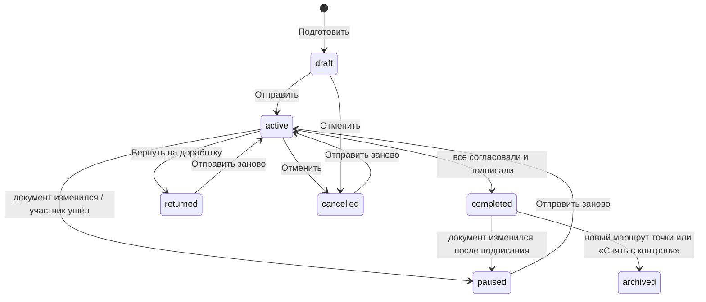

# Маршрут подписания: «Отправить на подписание»

Статус: дизайн, ждёт решения владельца (09.11.2026). Основа: `docs/design/signature-plan.md` (план подписей, слои
L0, L1, L2, L3, «Подписать комплект»), `docs/design/collaboration.md` (раздел 7.2 «Привязка к персонам», 8.1 «Приглашения»),
`docs/ru/deploy/invitations.md`.

Документ не входит в сайт документации, это рабочий дизайн для разработки.

## 1. Задача

Сейчас, чтобы документ подписали другие, автор приглашает каждого с ролью «Рецензент» и персоной (`supervisor`,
`academic_supervisor`, ...), объясняет на словах, что и где подписать, а подписант сам ищет свои слоты на вкладке
«Подписи». Порядок никто не держит: академрук может подписать раньше научрука, научрук после этого оставит замечания,
автор поправит текст, и академруку придётся подписывать снова.

Нужно:

1. Автор готовит точку сдачи (например, «Заявка на тему КП (SmartLMS)»): для каждого документа и слота точки указывает,
   где стоит подпись и чья она. Подписанты это участники проекта с персоной; кого нет в проекте, приглашают тут же.
2. Автор нажимает «Отправить на подписание».
3. Подписант получает уведомление во «Входящих» и письмо (если настроен SMTP) со ссылкой на страницу, где есть только
   то, что подписывает он: документы, места на страницах и способ (картинка или ЭП, как разрешает точка).
4. Подписант подписывает там же: картинкой (нарисовать или загрузить) или ЭП. Нет ключа: создать или загрузить его
   прямо на странице, без ухода в профиль.
5. Порядок задаётся: например, автор, затем научрук, затем академрук. Следующий получает уведомление, когда закончил
   предыдущий. В одном шаге может быть несколько человек. Порядок по умолчанию берётся из пака.
6. Если документ изменился во время маршрута, подписи сбрасываются и маршрут начинается заново. Подписант может
   вместо подписи вернуть документ на доработку с комментарием.

## 2. Инварианты

Инварианты плана подписей (`signature-plan.md`, раздел 2) остаются. Маршрут добавляет свои:

1. **Согласование по порядку.** Подписант шага k получает запрос и может согласовать только после того, как все шаги
   до k согласовали эту же версию. Ни одна видимая подпись шага k не появляется в документе раньше.
2. **Картинка это согласие.** Картинка подписанта попадает в документ (предпросмотр, «С подписями», фиксация) только
   после его согласования текущей версии.
3. **Подписи не ломают друг друга.** Ни одно действие маршрута не делает недействительной уже поставленную ЭП, кроме
   явного сброса из-за изменения документа (раздел 5.5).
4. **Минимум действий.** Подписант делает одно действие, если порядок позволяет; два, только если без этого нарушился бы
   инвариант 1 или 3 (раздел 4.4). Повторное согласование после сброса это одно нажатие.
5. **Маршрут не хранит то, что уже хранит план.** Что подписано и чем, знает состояние подписей
   (`.hse-studio/signatures.json`). Маршрут хранит людей, порядок, согласия и события.

## 3. Как это выглядит

### 3.1 Автор

1. **Точка сдачи** (`/projects/:id/submit/cp/:profileId`). Новая карточка «Подписание»: «Подписано 0 из 3. Отправьте
   документы на подписание, руководители подпишут у себя». Кнопка «Подготовить и отправить».
2. **Экран «Отправка на подписание»** (`/projects/:id/submit/cp/:profileId/route`). Четыре блока:
   - **Документы точки**: собран ли каждый документ, кнопка «Собрать». Без сборки отправить нельзя.
   - **Кто и в каком порядке**: шаги карточками. В шаге люди: имя, персона («Научный руководитель»), статус в проекте
     («участник», «приглашение отправлено», «нет в проекте» с кнопкой «Пригласить»), способ («Картинка», «ЭП»), готовность
     («подпись загружена», «ключ известен»). Шаги перетаскиваются; «В один шаг с предыдущим» и «Отдельным шагом».
     Рядом с человеком подсказка «1 действие» или «2 действия: согласовать, затем подписать итоговый PDF» (раздел 4.4).
   - **Где подписи**: вкладки документов, страница PDF с рамками слотов (тот же редактор размещения, что на вкладке
     «Подписи»). Необязательные для точки слоты (например, академрук на заявлении в КП) включаются здесь: «Добавить
     подпись академического руководителя».
   - **Ваша подпись**: картинка автора или его ключ. Если не готово, загрузить или нарисовать тут же.
   - Внизу: «Срок» (необязательно), «Сообщение подписантам» (необязательно), список того, что мешает, и кнопка
     «Отправить на подписание». Если автор подписывает ЭП и фиксация возможна сразу, кнопка «Отправить и подписать».
3. **После отправки** карточка «Подписание» на точке: «Шаг 2 из 3: ждём Петрова П. П. (научный руководитель) с 10.11».
   Шаги со статусами и временем. Действия: «Напомнить», «Скопировать ссылку» (для пересылки, если нет SMTP),
   «Отменить маршрут». В редакторе документов маршрута плашка: «Документ на подписании (шаг 2 из 3). Правка и пересборка
   остановят маршрут».
4. **Вернули на доработку**: уведомление и карточка «Петров П. П. вернул на доработку: «Уточните цель проекта»».
   Кнопки «Открыть документ» и «Отправить заново».
5. **Документ изменился**: «Документ изменился после согласования: маршрут остановлен». Кнопка «Отправить заново»,
   настройки маршрута сохраняются.
6. **Все подписали**: «Все подписали. Можно собирать пакет». Кнопка «Собрать пакет» (существующая сборка пакета).

### 3.2 Подписант

1. **Уведомление** (колокольчик, «Входящие» раздел «На подпись», письмо): «Иванов И. просит подписать: Заявка на тему КП
   (SmartLMS), проект «…». Срок 15.11». Ссылка `/sign/:projectId/:routeId`.
2. Не вошёл: вход, затем та же страница. Ещё не участник: страница приглашения, «Принять», затем та же страница
   (параметр `next`).
3. **Страница подписания** (без рабочего места проекта, вёрстка под телефон):
   - Шапка: проект, точка, от кого, срок, сообщение автора.
   - Ход маршрута одной строкой: «1. Иванов И.: согласовал · 2. Вы · 3. Сидоров С.: ждёт».
   - «Что нужно от вас»: «Подписать 2 документа: картинкой или открепленной ЭП».
   - Документы вкладками: PDF, кнопка «К месту подписи» (страница и рамка «Ваша подпись»), чужие слоты видны как есть.
   - «Как подписать»: выбор из разрешённых точкой способов.
     - Картинка: сохранённая подпись, «Нарисовать», «Загрузить» (редактор с удалением фона), галка «Запомнить для других
       проектов».
     - ЭП: если ключ известен, строка «Ключ: Петров П. П., OpenPGP 1A2B …» и больше ничего. Иначе, только то, что
       разрешено на установке: «Подписать в КриптоПро (в браузере)», «Загрузить готовую подпись (.asc, .sig, .p7s)»,
       «Создать ключ OpenPGP», «Импортировать ключ (.p12, OpenPGP)», «Указать сертификат для плашки».
   - Кнопки по ситуации (раздел 4.4): «Согласовать», «Согласовать и подписать» или «Подписать». Рядом «Вернуть на
     доработку» (обязательный комментарий).
4. **После действия**: «Готово. Следующим подписывает Сидоров С.» или «Согласовано. Когда все поставят видимые подписи,
   вас попросят подписать итоговый PDF».
5. **Второе действие** (если нужно): «Документы зафиксированы: подпишите итоговый PDF». Та же страница, итоговый PDF и
   одна кнопка «Подписать» (пароль ключа, если есть).
6. **После сброса**: «Документ изменён: нужна повторная подпись». Картинка и ключ уже на месте, одно нажатие.

### 3.3 Тексты

| Где | Текст |
|---|---|
| кнопка автора | Отправить на подписание; Отправить и подписать; Отправить заново; Отменить маршрут; Напомнить; Скопировать ссылку |
| кнопка подписанта | Согласовать; Согласовать и подписать; Подписать; Вернуть на доработку |
| уведомление подписанту | {автор} просит подписать: {точка}; Подпишите итоговый PDF: {точка}; Напоминание: {точка}, срок {дата} |
| уведомление автору | {кто} вернул на доработку: «{комментарий}»; Документ изменился, маршрут остановлен: {точка}; Все подписали: {точка} |
| уведомление всем | Маршрут отменён: {точка} |
| плашка в редакторе | Документ на подписании (шаг {k} из {n}). Правка и пересборка остановят маршрут |

## 4. Видимый слой и порядок

### 4.1 Ограничение

Всё видимое (картинки, плашки открепленных ЭП, картинки видимых PAdES) входит в зафиксированный PDF B, а открепленные
подписи сделаны над байтами B (`signature-plan.md`, раздел 4). Значит, картинка следующего подписанта меняет B и
делает недействительными все ЭП, поставленные раньше. Последовательный маршрут «каждый ставит свою подпись по очереди»
ломает подписи, если хотя бы одна картинка идёт после ЭП.

### 4.2 Решение: согласие по порядку, метки по слоям

Разделяем два действия подписанта:

| | Согласование | Метка |
|---|---|---|
| что это | «я прочитал эту версию и согласен» | картинка, плашка или ЭП в документе |
| где хранится | маршрут (сервер) | состояние подписей (файлы проекта) |
| порядок | строго по шагам маршрута | по слоям: L1 видимое до фиксации, L2 и L3 после |
| что привязано | отпечаток сборки каждого документа | байты B или F |

Правила:

1. **Картинка ставится в момент согласования.** До согласования слот картинки «придержан» (`withheld`, раздел 6.1):
   место на странице есть, картинки нет ни в предпросмотре, ни в «С подписями», ни в фиксации.
2. **Плашка ставится заранее.** Плашка это место под ЭП, без файла подписи она ничего не утверждает, и план не считает
   её подписью. Её данные (владелец, сертификат, срок) берутся из известного ключа подписанта (раздел 6.5). Если данных
   нет, подписант задаёт ключ на своём шаге, и это меняет B так же, как картинка.
3. **Фиксация автоматическая.** Маршрут фиксирует все документы, как только не осталось участников, чьё действие ещё
   может изменить видимый слой: несогласовавших подписантов картинкой и подписантов ЭП без данных плашки.
4. **ЭП после фиксации.** Подписанты ЭП, согласовавшие до фиксации, подписывают B после неё. Подписанты ЭП после
   фиксации согласуют и подписывают одним действием, по порядку шагов.

Обозначим L последний шаг, где есть участник, способный изменить видимый слой. Тогда маршрут идёт так:

```text
шаги 1..L        согласование по порядку; картинки появляются при согласовании
конец шага L     фиксация всех документов маршрута = B (L0 + все видимые метки)
сразу после      «подпишите итоговый PDF» всем подписантам ЭП из шагов 1..L (параллельно)
шаги L+1..N      по порядку: согласовать и подписать B одним действием
готово           все согласовали и все слоты маршрута в плане `signed`
```

L считается заново при каждом событии: подписант может сменить способ (из разрешённых точкой) на своём шаге. После
фиксации подписанту предлагаются только способы, которые не меняют видимый слой (ЭП с уже стоящей плашкой или PAdES
без картинки), иначе пришлось бы сбросить чужие ЭП.

Последний, кто меняет видимый слой, может совместить: если после его согласования не остаётся изменений видимого
слоя, сервер в том же запросе фиксирует документы и подписывает его слоты ЭП («Согласовать и подписать»). Отпечатки
проверяются так же, как в «Подписать комплект» (`build:<сборка>:<видимый слой>` до фиксации).

Шаг пройден, когда каждый его участник сделал всё, что было возможно в этот момент: до фиксации согласовал, после
фиксации согласовал и подписал. Поэтому вторые подписи из шагов 1..L не задерживают шаги после L.

### 4.3 Почему так держатся инварианты

- Порядок согласий строгий: академрук не получает запрос, пока документ не согласовал научрук, в любом сочетании
  способов.
- B меняется только до фиксации и только согласиями; после фиксации видимый слой заморожен (раздел 5.5), поэтому ЭП
  над B не сбрасываются ничем, кроме изменения документа.
- Картинка подписанта никогда не стоит на версии, которую он не согласовал: она придержана до согласия и снова
  придерживается, если версия изменилась.

### 4.4 Сколько действий у каждого

| Подписант | Действий |
|---|---|
| картинкой | 1: согласовать (картинка встаёт сразу) |
| ЭП, шаг после L (данные плашки известны) | 1: согласовать и подписать |
| ЭП, последний меняющий видимый слой | 1: согласовать и подписать (совмещение) |
| ЭП, шаги 1..L, согласовал до фиксации | 2: согласовать; после фиксации подписать |
| автор-отправитель | отправка это его согласование; ЭП как у всех |
| только согласование (без слотов) | 1 |

Примеры для «Заявки на тему КП» (автор, научрук, академрук):

| Способы | L | Автор | Научрук | Академрук |
|---|---|---|---|---|
| все картинкой | 3 | отправка | 1 | 1 |
| автор картинкой, научрук и академрук ЭП с известными ключами | 1 | отправка (фиксация сразу после) | 1 | 1 |
| все ЭП с известными ключами | 0 | «Отправить и подписать» | 1 | 1 |
| автор ЭП, научрук ЭП, академрук картинкой | 3 | отправка, потом подписать | 2 | 1 |
| автор ЭП, научрук картинкой, академрук ЭП без ключа | 3 | отправка, потом подписать | 1 | 1 (задаёт ключ и подписывает) |

Редактор маршрута показывает это число у каждого человека. Подсказка: «Подписи-картинки раньше ЭП сокращают число
действий».

Что пропускается само:

- шаг отправителя: отправка и есть его согласие (картинка или данные плашки должны быть готовы до отправки);
- настройка плашки, если данные ключа подписанта уже известны (6.5);
- ожидание фиксации, если никто не меняет видимый слой (L = 0): фиксация при отправке, автор может сразу «Отправить и
  подписать»;
- согласие при повторной отправке, если документы участника не менялись с его прошлого согласия (5.4);
- после остановки картинка и ключ подписанта остаются: повторное согласие или подпись это одно нажатие.

### 4.5 Отвергнутые варианты

| Вариант | Почему нет |
|---|---|
| Зафиксировать при отправке, все подписывают B по очереди | картинка позднего подписанта должна быть в B до его согласия, либо её добавление сбросит ранние ЭП |
| Картинки поздних подписантов инкрементальным обновлением поверх B | открепленная подпись проверяется только против B, а в LMS уходит один PDF с подписью к нему; для PAdES это изменение после подписи |
| Сначала все видимые метки по порядку, а подписанты ЭП с известным ключом в первой фазе не участвуют | академрук ставит картинку раньше, чем научрук прочитал документ: ровно тот случай, от которого защищаемся |
| Сервер сам подписывает ключом ЭП-подписанта после фиксации по заранее данному согласию | подпись покрыла бы байты, которых подписант не видел (инвариант 1 плана); пароль ключа не хранится; на проде ключи на сервере запрещены |
| ЭП из шагов 1..L тоже строго по порядку | согласия уже по порядку, B после фиксации измениться не может; очередь добавила бы дни ожидания и ничего не защитила |

## 5. Модель маршрута

### 5.1 Сущности

```text
SigningRoute
  id, project_id, profile_id
  status: draft | active | paused | returned | completed | cancelled | archived
  phase: approval | signing | done          (для active)
  round: int                                 (растёт при каждой отправке)
  docs: [doc_id]                             (документы точки с подписями маршрута)
  snapshot: {doc_id: {compiled_sha256, frozen_sha256?, marks_digest}}
  deadline?, message?, created_by, sent_by, sent_at, completed_at
  stop_reason?: rebuilt | marks_changed | frozen_changed | participant_left | returned

Participant
  id, route_id, step: int, persona
  user_id?                                   (пусто, пока приглашение не принято)
  invitation_id?
  assignments: [(doc_id, slot_id)]           (пусто: только согласование)
  approval?: {round, tokens: {doc_id: "build:<sha>"}, at}
  notified_at?, reminded_at?, reminders: int

RouteEvent
  route_id, round, at, actor_id, participant_id?, kind, details
  kind: sent | approved | signed | returned | paused | resumed | cancelled | completed | reminded | invited | frozen
```

Способ подписи берётся из слота (`SignatureSlot.sign_mode`, общий для всех документов проекта), как в плане. Маршрут
его не дублирует.

Чистый расчёт `evaluate(route, facts) -> Evaluation` живёт в `core/signing_route/engine.py`. `facts` это то, что
известно о документах (`DocFacts`, состояние подписей, статусы слотов из `slot_state`, известные данные плашек),
`Evaluation` это фаза, L, следующее действие каждого участника (`wait`, `approve`, `approve_and_sign`, `sign`, `done`),
нужно ли остановить маршрут и эффекты: кого уведомить, какие слоты придержать или открыть, какие документы
зафиксировать. Сценарии выполняют эффекты. Расчёт идемпотентный: повторный вызов на тех же фактах эффектов не даёт.

### 5.2 Порядок по умолчанию из пака

Новый необязательный ключ версии шаблона и переопределение в профиле:

```yaml
signatures:
  route: [[author], [supervisor, co_supervisor], [academic_supervisor]]   # шаги, внутри шага параллельно

pack_submission:
  profiles:
    - id: topic-approval
      signing_route: [[author], [supervisor], [co_supervisor], [academic_supervisor]]   # необязательно
```

Без ключа: авторы, затем научрук и соруководитель (консультант) одним шагом, затем академрук. Слот, которого нет в
списке, идёт отдельным последним шагом. `author` с `per_author: true` в команде раскрывается в шаг со всеми авторами.
Порядок служит заготовкой: автор меняет его до отправки, маршрут запоминает свой и предлагает его при следующей
отправке.

### 5.3 Состояния

Маршрут:



Участник (вычисляется, не хранится):

| Состояние | Когда |
|---|---|
| `invited` | приглашение не принято; шаг ждёт его |
| `waiting` | его шаг ещё не настал или он согласовал до фиксации и ждёт её (у него есть `approved_at`) |
| `to_approve` | его очередь согласовать (до фиксации) |
| `to_approve_sign` | его очередь, документы зафиксированы: согласовать и подписать |
| `to_sign` | согласовал до фиксации, документы зафиксированы, ждём его ЭП |
| `done` | согласовал, все его слоты `signed` |
| `returned` | вернул на доработку (до следующей отправки) |

### 5.4 Переходы и уведомления

| Событие | Что делает маршрут |
|---|---|
| Отправить | новый `round`, снимок отпечатков, слоты картинок придержаны, согласие отправителя записано; L = 0: фиксация; уведомить шаг 1 (или первый незавершённый) |
| Согласование | записать согласие с отпечатками; открыть его картинки; если больше никто не меняет видимый слой: фиксация, «подпишите итоговый PDF» подписантам ЭП шагов до L; если шаг пройден: уведомить следующий |
| Подпись ЭП (любой путь: страница, КриптоПро, загрузка .asc, «Подписать в Студии») | пересчёт; шаг пройден: уведомить следующий; всё подписано: `completed`, уведомить автора и участников |
| Вернуть на доработку | `returned`, комментарий в событии, уведомить автора и тех, кто уже согласовал |
| Документ изменился (5.5) | `paused`, согласия раунда недействительны, картинки снова придержаны, уведомить автора и тех, кто уже действовал |
| Отменить | `cancelled`, уведомить тех, кому уже приходил запрос; поставленные ЭП над B остаются |
| Отправить заново | новый `round`; согласие участника переносится, если отпечатки всех его документов те же (документ не менялся) |
| Приглашение принято | участник получает `user_id`; если его очередь, уведомление |
| Участник ушёл или сменил персону | `paused` (`participant_left`), автору: «назначьте другого подписанта» |

### 5.5 Что сбрасывает маршрут

Маршрут хранит снимок отпечатков документов (`snapshot`) и сверяет с ним текущее состояние:

| Изменение документа маршрута | Итог |
|---|---|
| собранный PDF другой (`compiled_sha256`): пересборка, обновление шаблона, восстановление из истории, синхронизация | `paused/rebuilt` |
| зафиксированный PDF другой или удалён вне маршрута (git, восстановление) | `paused/frozen_changed` |
| видимый слой другой, а маршрут его не менял | `paused/marks_changed` |
| подпись ЭП слота удалена или недействительна | только этот слот снова ждёт подписи, маршрут не останавливается |
| комментарии, другие документы, сборка других документов | ничего |

Сброс не перезапускает маршрут сам: иначе каждая пересборка во время правки рассылала бы запросы. Маршрут
останавливается, автор правит и нажимает «Отправить заново». Новый раунд начинается с шага 1, но согласие
переносится, если документ участника не менялся (например, академрук вернул на доработку, автор решил ничего не менять).

Чтобы видимый слой не менялся случайно, пока маршрут активен, правки подписей документов маршрута запрещены (409
«Документ на подписании: отмените маршрут, чтобы изменить подписи»): размещения, настройка слота, картинка слота,
подписант плашки, фиксация и её снятие (в том числе через «Подписать комплект»), удаление открепленной подписи.
Подписант меняет свою картинку, ключ и свою открепленную подпись только через свою страницу и только в свою очередь. Сборка не запрещается: это
и есть способ внести правку, редактор предупреждает плашкой.

Сборка в Студии сейчас невоспроизводима (дата и `/ID` в PDF), поэтому пересборка без изменений тоже даёт `rebuilt`.
Это безопасно, но лишне; воспроизводимая сборка (`SOURCE_DATE_EPOCH` от последнего снимка и `\pdftrailerid{}`)
вынесена в отдельный срез (раздел 10).

Как замечаем изменения: хук успешной сборки (`IBuiltPdfObserver.on_pdf_built`), хуки после записи состояния подписей,
применения синхронизации и восстановления (`IRouteWatch.on_project_changed`), и периодическая сверка активных
маршрутов (`PeriodicTask` лидера, раз в 5 минут) как страховка для гибрида. Чтение маршрута ничего не пишет, но
показывает вычисленное состояние, даже если хук ещё не сработал.

### 5.6 Вернуть, отменить, отправить заново

- **Вернуть на доработку**: любой участник в свою очередь (`to_approve`, `to_approve_sign`, `to_sign`). Комментарий
  обязателен, до 2000 символов. Подробные замечания к тексту подписант оставляет обычными ревью-комментариями (ссылка
  «Оставить замечания к тексту» ведёт в проект, право `COMMENT` у рецензента есть).
- **Отменить**: кто управляет маршрутом (раздел 7). Поставленные ЭП над B остаются в состоянии подписей, придержанные
  картинки остаются придержанными. На вкладке «Подписи» у такого слота пометка «Придержано маршрутом» и кнопка
  «Показать» (право записи файлов, как у любой правки размещения).
- **Отправить заново**: из `paused`, `returned`, `cancelled`. Те же шаги и люди, можно изменить до отправки.

### 5.7 Сроки и напоминания

- Срок необязательный, ставит автор. Показывается на странице, в уведомлении и письме; просроченный маршрут помечен,
  но не отменяется.
- «Напомнить» у автора: тем, чья очередь, не чаще раза в 12 часов на человека.
- Автоматически: за сутки до срока и через 3 дня ожидания в очереди, не больше 3 автонапоминаний на человека за раунд.

### 5.8 Где хранится

Маршрут живёт в Postgres сервера. В файлы проекта попадает только то, что уже было там: подписи, фиксации, картинки,
плюс список придержанных слотов (`withheld`, раздел 6.1).

| | Postgres | `.hse-studio/…` в проекте |
|---|---|---|
| участники это аккаунты, уведомления и письма | в одной транзакции с событием (как `Notifier`) | нет пользователей |
| кто может изменить | только сценарии маршрута | любой с правом записи файлов и git push |
| параллельные подписанты | блокировка строки маршрута | git-слияние |
| сроки и напоминания | периодическая задача | нечем запускать |
| где нужен | на сервере, где есть другие люди | локально подписант один, маршрут не нужен (раздел 6.9) |

Файлы проекта синхронизируются через git и правятся любым редактором, поэтому как источник истины для согласий они не
годятся. Результат маршрута при этом виден везде: это обычное состояние подписей. Экспорт и импорт проекта маршруты не
переносят: это процесс, а не содержимое.

Таблицы (миграция `sr_01_signing_routes`):

| Таблица | Поля |
|---|---|
| `signing_routes` | `id`, `project_id` (каскад), `profile_id`, `status`, `phase`, `round`, `snapshot` jsonb, `deadline`, `message`, `stop_reason`, `created_by`, `sent_by`, времена; уникальный частичный индекс `(project_id, profile_id)` для `draft`, `active`, `paused`, `returned` |
| `signing_route_docs` | `route_id`, `project_id`, `doc_id`, `active` (маршрут в `active`, `paused`, `returned` или `completed`); уникальный частичный индекс `(project_id, doc_id)` где `active`: документ под одним маршрутом |
| `signing_route_participants` | `id`, `route_id`, `step`, `persona`, `user_id`, `invitation_id`, `assignments` jsonb, `approval` jsonb, `notified_at`, `reminded_at`, `reminders` |
| `signing_route_events` | `id`, `route_id`, `round`, `at`, `actor_id`, `participant_id`, `kind`, `details` jsonb |

Переходы идут под блокировкой строки маршрута (`SELECT … FOR UPDATE`), запись файлов под `project_lock` проекта.
Порядок: сначала файлы (придержать, открыть, зафиксировать, подписать), затем транзакция с маршрутом, событиями и
уведомлениями. Если транзакция упала после записи файлов, следующий пересчёт приводит всё к согласованному виду.

## 6. Интеграция

### 6.1 План подписей и придержанные слоты

- Новое необязательное поле состояния подписей: `withheld: {doc_id: [slot_id]}`. `stamps_for_doc` пропускает такие
  слоты, поэтому их нет в предпросмотре, «С подписями», пакете для подписанта и фиксации. Отпечаток видимого слоя
  считается уже без них.
- Новая причина плана `awaiting_approval` (статус `pending`): «Ждёт согласования подписанта по маршруту». Проверяется
  после `placement_off` и до `no_image`. Размещение остаётся включённым, поэтому необязательный слот не выпадает из
  плана и счётчик «k из n» не прыгает.
- `GET /projects/{id}/signature-plan` добавляет к ответу `route` (id, статус, фаза, шаг) и к слоту `route_state`
  участника, которому слот принадлежит. Точка показывает состояние маршрута вместо подсказки слота.
- Старая Студия сохраняет `withheld` (`preserve_unknown`), но не учитывает его и поставит придержанную картинку в своём
  предпросмотре. Принимаем: маршрут есть только на сервере, а сдаётся зафиксированный там файл. git-слияние держит
  `withheld` в группе подписей документа вместе с `frozen` и `detached`.
- Маршрут считает статусы по своим парам «документ, слот» тем же `slot_state`, включая необязательные слоты, которые
  автор добавил (в профильный план они не входят).

### 6.2 Фиксация

- Фиксирует маршрут сам (`FreezePdfUC` без проверки прав внутри, как сейчас). Право на это дал отправитель: для отправки
  нужно право сдачи (раздел 7). В аудит `signature.freeze` добавляется `route_id`, актор тот, чьё действие её вызвало.
- Перед фиксацией маршрут заполняет плашки без подписанта данными известного ключа участника и ставит дату у размещений,
  где автор включил дату: дату согласования для картинки, дату фиксации для плашки.
- Ручная фиксация и снятие фиксации документов активного маршрута запрещены (раздел 5.5).
- Документ без криптослотов не фиксируется: картинки считаются по плану, как сейчас.

### 6.3 Ограничение способов

- Подписант выбирает способ на своей странице из пересечения `methods` всех пунктов точки, где его слот обязателен
  (`SubmissionDocItem.allowed_methods`). Запрещённые комбинации проверяются тем же `slot_mode_conflict`.
- Смена способа своего слота это действие маршрута (запись `sign_mode` от его имени), а не общая правка настройки
  слота: во время маршрута общая правка запрещена.
- `method_not_allowed` у слота подписанта не мешает отправке: подписант выберет способ сам. Редактор маршрута
  показывает: «Петров выберет способ при подписании».

### 6.4 Командные проекты

- Один маршрут на точку для всей команды: пары «документ, слот» как у `profile_pairs(..., author=None)`, то есть
  личные документы всех ведомых авторов и общие документы.
- Шаг «Авторы» параллельный: у каждого автора его слоты `author--<слаг>` на личных и общих документах.
- Отправитель, если он автор, согласует свой участок отправкой. Остальные авторы согласуют на своих страницах.
- Владелец без привязки к слагу отправить может, но автором в маршруте не считается (`signature-plan.md`, раздел 13).

### 6.5 Персоны и приглашения

- Участник шага это член проекта с `persona_slug` нужной персоны. Если таких несколько, автор выбирает одного; если
  нет, кнопка «Пригласить» открывает существующий `InviteDialog` с заготовкой: роль «Рецензент», персона слота, почта.
- Приглашённый участник ждёт в маршруте как `invited`. Когда приглашение принято, сценарий принятия вызывает хук
  маршрута, участник получает `user_id`. Ссылка приглашения ведёт после принятия на страницу подписания (`next`, только
  относительный путь этого же сайта).
- Без SMTP «Скопировать ссылку» у приглашённого повторно отправляет приглашение способом `manual` и отдаёт новую
  ссылку, как сейчас в блоке «Ожидают».
- Режим регистрации «закрыта»: пригласить человека без аккаунта нельзя, редактор маршрута так и пишет.
- Известные данные плашки (для расчёта L и автозаполнения): `slot.signer` из состояния подписей; публичная часть ключа
  по умолчанию участника и сертификат или открытый ключ из его профиля (порт публичных данных подписанта, срез R10).
  Закрытые ключи чужих людей маршрут не читает.

### 6.6 Уведомления и почта

Новые виды `NotificationKind`:

| Вид | Кому | Письмо |
|---|---|---|
| `signing_request` (`outcome`: `approve`, `approve_sign`, `sign`) | участнику, чья очередь | да |
| `signing_reminder` | ему же | да |
| `signing_returned` | автору и тем, кто уже согласовал | да, автору |
| `signing_paused` | автору и тем, кто уже действовал | нет |
| `signing_completed` | автору и участникам | да, автору |
| `signing_cancelled` | тем, кому приходил запрос | нет |

- `NotificationPayload`: `ref_id` id маршрута, `excerpt` комментарий возврата или название точки, новое поле
  `profile_id`. Ключ дедупликации `signing:<route>:<round>:<participant>:<вид>`.
- Шаблоны писем в `core/mail/locales` (ru, en): кто просит, проект, точка, срок, кнопка «Открыть страницу подписи».
  Ссылка без токенов, нужна авторизация, поэтому пересланное письмо ничего не открывает.
- «Входящие»: раздел «На подпись» (`GET /account/signing-tasks`), колокольчик считает и задачи на подпись
  (`InboxSummary.signing_tasks`). `notificationRoute` ведёт подписанта на `/sign/...`, автора на точку сдачи.

### 6.7 Аудит

`signing_route.send`, `.approve`, `.sign` (через существующие `signature.*` с `route_id`), `.return`, `.pause`,
`.cancel`, `.complete`, `.remind`, `.invite`. В деталях проект, точка, раунд, шаг, документы и слоты, причина остановки.
Текст комментария в аудит не пишется (он в событиях маршрута), пароли и ключи никогда.

### 6.8 MCP

| Тул | Право | Что |
|---|---|---|
| `get_signing_route(project_id, profile_id?)` | `OUTPUT_READ` | статус, фаза, шаги, участники и их состояния, срок, причина остановки |
| `list_signing_tasks()` | вход | мои задачи на подпись по всем проектам |
| `send_for_signing(project_id, profile_id)` | `SUBMISSION_CREATE`, опасный | отправить сохранённый маршрут (или заготовку из пака), только если все участники уже в проекте |

Согласование и возврат через MCP не делаются: это решение человека. Если участник подписывает через `sign_submission`,
когда настала его очередь подписывать, маршрут засчитывает это как обычную подпись; не в его очередь тул пропускает
документы маршрута с причиной «Документ на подписании по маршруту».

### 6.9 Локальная Студия и гибрид

- Локально человек один: маршрута нет, кнопка «Отправить на подписание» не показывается, работает «Подписать
  комплект». Маршруты подключаются только в `MODE=server`; локальные запросы к ним получают 404.
- Гибрид: маршрут идёт на сервере над серверной копией проекта. Правка и сборка в локальной Студии, отправленные на
  сервер, останавливают маршрут при сверке (5.5). `withheld` доходит до локальной Студии через git, и её предпросмотр
  не показывает придержанные картинки.
- Показ хода маршрута в локальной Студии через API сервера в этот объём не входит (раздел 11).

### 6.10 Другие входы подписи

- Пока маршрут активен, подписать слот маршрута любым путём (страница подписи, «Подписать в Студии», КриптоПро,
  загрузка готовой подписи, `sign_submission`) может только его участник и только в свою очередь. Иначе 409 «Сейчас
  не ваша очередь по маршруту».
- «Подписать комплект» (и `sign_submission`) не фиксирует документы маршрута, это делает только маршрут, и подписывает
  их слоты только в очередь актора на подпись. Иначе у документа причина «Документ на подписании по маршруту» и
  ссылка на страницу подписи.
- После каждой записи подписи слота маршрута вызывается пересчёт маршрута.
- Существующие компоненты на странице подписания: `PdfStampEditor` и `usePdfPage` (просмотр), `SignatureEditorModal`
  (загрузка картинки), `CryptoProSignDialog` и `lib/cades.ts`, блоки загрузки открепленной подписи
  (`DetachedSignatureBlocks`), формы `OpenPgpCreateForm` и импорта из настроек подписи, пакет для подписанта (zip).
  Новое только рисование подписи пальцем или мышью.

## 7. Права и безопасность

| Действие | Кто |
|---|---|
| видеть ход маршрута точки | `OUTPUT_READ` по членству (гостю и ссылочному праву 404); комментарии возврата видят управляющие маршрутом и участники маршрута |
| создать, изменить, отправить, отменить, напомнить | `SUBMISSION_CREATE`: владелец, редактор; в команде редактор с привязкой к автору |
| пригласить из редактора маршрута | дополнительно `ACCESS_MANAGE`, как обычное приглашение |
| согласовать, подписать, вернуть | только участник (`user_id` = актор) и `SIGN` на каждый свой слот (`_may_sign_slot`) |

- Подписант видит и подписывает только свои слоты. API страницы (`.../task`) отдаёт только его задачу; не участнику
  404, как и для чужого проекта.
- Страница раскрывает: документы маршрута (PDF, который и так доступен по `OUTPUT_READ`), места слотов, имена и
  персоны участников маршрута, их состояния, сообщение автора, события маршрута. Не раскрывает: исходники, другие
  документы и точки, ключи и сертификаты других людей сверх напечатанного на плашке.
- Вход обязателен. Ссылка в письме это обычный адрес страницы без токена: подпись это юридически значимое действие,
  ссылочный доступ подписывать уже не может (`LINK_DENIED` содержит `SIGN`). Гостю маршрут закрыт.
- Согласие и подпись принимают отпечатки того, что человек видел (`expected`: `build:<sha>` для согласия,
  `build:<sha>:<видимый слой>` для совмещения с фиксацией, `pdf:<sha>` для подписи): если документ изменился между
  показом и нажатием, 409 «Документ изменился, откройте заново».
- Владелец по-прежнему вправе загрузить картинку руководителя или приложить его готовую подпись, но не во время
  активного маршрута для слотов маршрута (5.5): иначе можно обойти очередь.
- Ключи на сервере запрещены администратором (по умолчанию на проде): страница не предлагает создать или
  импортировать закрытый ключ, остаются КриптоПро в браузере, загрузка готовой подписи и сертификат для плашки.
- Частота: напоминания (5.7), отправка не чаще раза в минуту на маршрут, возврат с комментарием до 2000 символов.

## 8. API

Проектные маршруты (все в `ROUTE_ACTIONS`, тест сверки таблицы с приложением). В колонке «Тело и ответ» имена схем
из 8.2:

| Метод и путь (`/api/v1`) | Правило | Что | Тело и ответ |
|---|---|---|---|
| `GET /projects/{id}/signing-routes?profile_id=` | `OUTPUT_READ` | маршруты точки (сводка), новые первыми; без `profile_id` все маршруты проекта | `SigningRouteList` |
| `POST /projects/{id}/signing-routes` | `SUBMISSION_CREATE` | черновик точки: существующий незавершённый (200) или новый из пака (201); новый снимает с контроля завершённый | `CreateSigningRouteRequest`, `SigningRoute` |
| `GET /projects/{id}/signing-routes/{route_id}` | `OUTPUT_READ` | ход маршрута | `SigningRoute` |
| `PUT /projects/{id}/signing-routes/{route_id}` | `SUBMISSION_CREATE` | шаги, люди, доп. слоты, срок, сообщение целиком (в `draft`, `paused`, `returned`, `cancelled`) | `UpdateSigningRouteRequest`, `SigningRoute` |
| `POST /projects/{id}/signing-routes/{route_id}/preview` | `SUBMISSION_CREATE` | что будет при отправке сохранённого маршрута; ничего не меняет | `{}`, `SigningRoutePreview` |
| `POST /projects/{id}/signing-routes/{route_id}/send` | `SUBMISSION_CREATE` | отправить или отправить заново; `sign` для «Отправить и подписать» | `SendSigningRouteRequest`, `SigningRoute` |
| `POST /projects/{id}/signing-routes/{route_id}/cancel` | `SUBMISSION_CREATE` | отменить | `{}`, `SigningRoute` |
| `POST /projects/{id}/signing-routes/{route_id}/archive` | `SUBMISSION_CREATE` | снять завершённый с контроля | `{}`, `SigningRoute` |
| `POST /projects/{id}/signing-routes/{route_id}/participants/{pid}/remind` | `SUBMISSION_CREATE` | напомнить; у приглашённого повторить приглашение (ссылка при `manual`) | `{}`, `SigningReminder` |
| `GET /projects/{id}/signing-routes/{route_id}/task` | `OUTPUT_READ` + участник | моя задача | `SigningTask` |
| `POST /projects/{id}/signing-routes/{route_id}/task/approve` | `OUTPUT_READ` + участник + `SIGN` | согласовать; `method` сменить способ своих слотов; `sign` «Согласовать и подписать» | `ApproveSigningTaskRequest`, `SigningTask` |
| `POST /projects/{id}/signing-routes/{route_id}/task/sign` | `OUTPUT_READ` + участник + `SIGN` | подписать свои криптослоты ключом Студии | `SignSigningTaskRequest`, `SigningTask` |
| `POST /projects/{id}/signing-routes/{route_id}/task/return` | `OUTPUT_READ` + участник | вернуть на доработку | `ReturnSigningTaskRequest`, `SigningTask` |
| `POST /projects/{id}/signing-routes/{route_id}/task/image` | `OUTPUT_READ` + участник + `SIGN` | своя картинка (загруженная или нарисованная), в очередь | multipart: `file` (PNG), `remember` (`true`, `false`); `SigningTask` |
| `PUT /projects/{id}/signing-routes/{route_id}/task/plate` | `OUTPUT_READ` + участник + `SIGN` | данные плашки из своего ключа Студии, в очередь | `SetSigningTaskPlateRequest`, `SigningTask` |
| `POST /projects/{id}/signing-routes/{route_id}/task/plate/file` | `OUTPUT_READ` + участник + `SIGN` | данные плашки из сертификата или открытого ключа файлом, в очередь | multipart: `file`; `SigningTask` |

Подпись КриптоПро и загрузка готовой подписи идут существующими `POST /projects/{id}/docs/{doc}/detached/{slot}` и
`.../sign`, с проверкой очереди (6.10). PDF документа подписант смотрит существующими адресами (`OUTPUT_READ`): до
фиксации `GET /projects/{id}/docs/{doc}/pdf/signed` (без придержанных картинок, раздел 6.1), после фиксации
`GET /projects/{id}/docs/{doc}/frozen/pdf`; задача отдаёт нужный в `pdf_url`.

Пользовательский: `GET /account/signing-tasks` (`SigningTaskList`): мои задачи по всем проектам, только те, где сейчас
нужно моё действие (`approve`, `approve_and_sign`, `sign`).

### 8.1 Общие правила

- Схемы строгие, как остальной контракт сервера: лишнее поле это ошибка (`extra=forbid`, `z.strictObject`), все поля
  приходят явно, пустое значение `null`. Время в ISO 8601 UTC.
- Названия из пака (точка, документ, слот) это словари `{ru, en}`, как в плане подписей и профилях сдачи; имена людей
  строкой.
- Шаги это массив массивов: номер шага равен индексу плюс 1, внутри шага параллельно.
- Пары «документ, слот» назначает сервер по персоне: слот принадлежит участнику с персоной владельца слота. PUT
  передаёт только людей (`id` участника или `null` для нового, `persona`, `user_id` или `invitation_id`); человек без
  обоих полей «нет в проекте» и мешает отправке. Необязательные слоты включаются через `extra_slots`.
- Отпечатки: каждое действие с документами передаёт `expected`, для каждого `doc_id` отпечаток из последнего показа.
  Отправка берёт `docs[].token` предпросмотра (`build:<sha>`); подписант берёт `docs[].token` задачи, где сервер уже
  положил отпечаток для его следующего действия: `build:<sha>` для согласия, `build:<sha>:<видимый слой>` для согласия
  с фиксацией, `pdf:<sha>` для подписи; `null`, когда действовать нечего.
- Значения `next_action`, состояний участника, событий и причин остановки совпадают с перечислениями ядра
  (`core/signing_route/entities.py`: `NextAction`, `ParticipantState`, `EventKind`, `StopReason`). Уведомление
  `signing_request` хранит своё `outcome` (`approve`, `approve_sign`, `sign`).
- Действия автора отвечают ходом маршрута (`SigningRoute`), действия подписанта его задачей (`SigningTask`): клиент
  кладёт ответ в кэш без повторного чтения.
- Ошибки телом `{detail, code}`, дополнительные поля рядом с `code`:

| Код | Статус | Когда |
|---|---|---|
| `not_found` | 404 | нет маршрута или проекта, `task` не участнику (`not_participant` ядра), неизвестная точка, локальный режим |
| `no_participants`, `bad_step`, `duplicate_participant`, `duplicate_slot`, `unknown_doc` | 400 | маршрут собран неверно (`RouteInputError` ядра, `check_route`) |
| `doc_changed` | 409 | `expected` не совпал с текущим отпечатком; `docs`: какие документы |
| `invalid_transition` | 409 | действие автора не подходит к статусу маршрута: PUT или отправка активного, отмена закрытого, архив незавершённого |
| `not_your_turn` | 409 | действие подписанта не в его очередь, в том числе у неактивного маршрута (и сторож 6.10) |
| `image_required` | 409 | согласие картинкой, пока картинка не загружена |
| `plate_required` | 409 | согласие ЭП, пока данные плашки неизвестны (`task/plate`) |
| `route_blocked` | 409 | отправка, когда предпросмотр называет помехи; `blockers` как в предпросмотре |
| `route_locked` | 409 | правка подписей документа активного маршрута (5.5, срез R7) |
| `participant_not_waiting` | 409 | напомнить тому, чья очередь не настала или кто уже закончил, или у неактивного маршрута |
| `rate_limited` | 429 | напоминание чаще раза в 12 часов, отправка чаще раза в минуту; `retry_after` в секундах |

Коды помех предпросмотра (`blockers[].code`): `not_built` (документ не собран), `participant_missing` (человека нет в
проекте), `slot_unassigned` (у слота маршрута нет участника с его персоной), `sender_not_ready` (картинка или данные
плашки отправителя не готовы), `doc_in_other_route` (документ под другим активным маршрутом), `no_participants`.

### 8.2 Схемы

```text
SigningRoute (ход маршрута)
  id, project_id, profile: {id, name}, status, phase (null вне active и completed), round,
  current_step (первый шаг, где не все согласовали; null вне active),
  deadline, message, stop_reason, sent_by: {id, name}, sent_at, completed_at, created_at, updated_at,
  docs: [{doc_id, name, frozen, slots: [{slot_id, label, participant_id, optional, status}]}],
  steps: [[RouteParticipant]],
  events: [RouteEvent]

RouteParticipant
  id, persona, user_id, invitation_id,
  name (имя; у приглашённого подсказка адреса; null, если человека нет),
  membership: member | invited | missing, assignments: [{doc_id, slot_id}],
  method: image | detached | pades (null у согласующего без слотов),
  state, next_action, approved_at (согласие текущего раунда), notified_at, reminded_at, reminders

RouteEvent
  id, kind, round, at, who (имя актора; null у событий сервера), comment (возврат), reason (остановка)

SigningRouteList: {items: [SigningRouteSummary]}
SigningRouteSummary
  id, profile, status, phase, round, current_step, steps_total, deadline, stop_reason, sent_at, completed_at,
  updated_at, waiting_for: [{name, persona}] (чья очередь сейчас)

CreateSigningRouteRequest: {profile_id}
UpdateSigningRouteRequest
  steps: [[{id, persona, user_id, invitation_id}]] (шаг не пустой; user_id и invitation_id не вместе),
  extra_slots: [{doc_id, slot_id}], deadline, message (до 2000)

SigningRoutePreview
  route_id, can_send, can_send_and_sign (L = 0 и отправитель подписывает ЭП), visual_step (L),
  docs: [{doc_id, name, built, token}],
  participants: [{participant_id, step, persona, name, membership, method, methods (разрешены точкой),
                  chooses_method (выберет при подписании), image_ready, plate_ready, actions (0..2, раздел 4.4)}],
  blockers: [{code, doc_id, slot_id, participant_id}],
  sender_key: {id, label, kind, protected, signer} | null

SendSigningRouteRequest: {expected: {doc_id: token}, sign: {identity_id, passphrase} | null}
SigningReminder: {participant_id, delivery: email | inbox | manual, link (только при manual)}

SigningTask
  route: {id, project: {id, name}, profile, status, phase, round, current_step, deadline, message, sender,
          sent_at, stop_reason},
  steps: [[{name, persona, state, at (последнее действие), me}]],
  me: {participant_id, state, next_action, methods (сейчас разрешённые), method, image_ready,
       plate: {owner, kind: x509 | openpgp | manual, cert_id} | null,
       keys: {server_keys_allowed, default_key: {id, label, kind, protected, signer} | null}},
  docs: [{doc_id, name, pdf_url, frozen, token,
          mine: [{slot_id, label, page, x_mm, y_mm, width_mm, mark: png | plate | none, status, reason}],
          others: [{slot_id, label, page, status}]}],
  events: [RouteEvent]

ApproveSigningTaskRequest: {expected, method | null, sign: {identity_id, passphrase} | null}
SignSigningTaskRequest: {expected, identity_id, passphrase}
ReturnSigningTaskRequest: {comment} (без пробелов по краям, 1..2000)
SetSigningTaskPlateRequest: {identity_id}

SigningTaskList: {items: [{project: {id, name}, route_id, profile, round, sender, deadline,
                           next_action: approve | approve_and_sign | sign, since (уведомление раунда)}]}
```

`reason` у своего слота это причина плана (`PlanReason`, в том числе `awaiting_approval`), строкой: набор причин
растёт вместе с планом.

Ответ `task`, научрук ЭП после фиксации:

```json
{
  "route": {"id": "sr_01hy2b7k9q", "project": {"id": "p_01hxa1c4de", "name": "Bertie: курсовой проект"},
            "profile": {"id": "topic-approval", "name": {"ru": "Заявка на тему КП", "en": "Course project topic application"}},
            "status": "active", "phase": "signing", "round": 1, "current_step": 2,
            "deadline": "2026-11-15T20:59:00Z", "message": "Прошу подписать заявление до пятницы.",
            "sender": "Иванов И. И.", "sent_at": "2026-11-10T09:00:00Z", "stop_reason": null},
  "steps": [[{"name": "Иванов И. И.", "persona": "author", "state": "done", "at": "2026-11-10T09:00:00Z", "me": false}],
            [{"name": "Петров П. П.", "persona": "supervisor", "state": "to_approve_sign", "at": null, "me": true}]],
  "me": {"participant_id": "srp_supervisor", "state": "to_approve_sign", "next_action": "approve_and_sign",
         "methods": ["detached"], "method": "detached", "image_ready": false,
         "plate": {"owner": "Петров П. П.", "kind": "openpgp", "cert_id": "1A2B 3C4D 5E6F 7A8B"},
         "keys": {"server_keys_allowed": false, "default_key": null}},
  "docs": [{"doc_id": "topic_application", "name": {"ru": "Заявление о выборе темы", "en": "Topic selection application"},
            "pdf_url": "/api/v1/projects/p_01hxa1c4de/docs/topic_application/frozen/pdf", "frozen": true,
            "token": "pdf:9c9c…",
            "mine": [{"slot_id": "supervisor", "label": {"ru": "Научный руководитель", "en": "Supervisor"}, "page": 1,
                      "x_mm": 110, "y_mm": 130, "width_mm": 40, "mark": "plate", "status": "pending",
                      "reason": "no_signature_file"}],
            "others": [{"slot_id": "author", "label": {"ru": "Студент", "en": "Student"}, "page": 1, "status": "signed"}]}],
  "events": [{"id": "sre_01", "kind": "sent", "round": 1, "at": "2026-11-10T09:00:00Z", "who": "Иванов И. И.",
              "comment": null, "reason": null}]
}
```

### 8.3 Схемы, эталоны и моки на фронтенде

Срез W1 держит контракт в коде, пока бэкенда нет:

- zod-схемы `services/web-app/src/entities/signing-route/model/signingRoute.schema.ts`, карта
  `SIGNING_ROUTE_CONTRACT_SCHEMAS` (схема zod по имени);
- эталоны `entities/signing-route/testing/fixtures.ts`, `SIGNING_ROUTE_CONTRACT_EXAMPLES` (тела по имени схемы и варианту);
- моки `entities/signing-route/testing/demoRoutes.ts` (`createSigningRouteDemo`) поверх демо-транспорта: правила
  разделов 4 и 5 в упрощённом виде, те же коды ошибок. Подключены к серверному демо (`VITE_SERVER_DEMO=1`), экраны
  W2, W3, W4, W5 и W6 работают на них до слияния R5 и R6.

R5 и R6 переносят эталоны в `contracts/server/fixtures/<Схема>/<вариант>.json`, добавляют модели pydantic в
`test_server_contract.py` и карту `SIGNING_ROUTE_CONTRACT_SCHEMAS` в `CONTRACT_SCHEMAS`
(`entities/session/api/contractSchemas.ts`), коды ошибок в `contracts/server/error_codes.json` с сообщениями ru и en.
Расхождение с этим разделом правят в обе стороны одним PR: сначала эталоны, затем схемы.

## 9. Решения

| Вопрос | Решение по умолчанию |
|---|---|
| Где хранится маршрут | Postgres сервера; в файлах проекта только результат подписей и `withheld` |
| Локальная Студия | маршрута нет, «Подписать комплект» как раньше |
| Нужен ли подписанту аккаунт | да; письмо ведёт на страницу после входа; не участник принимает приглашение и попадает туда же |
| Роль приглашённого подписанта | «Рецензент» с персоной слота, как «Пригласить научрука» |
| Порядок по умолчанию | из пака (`signatures.route`, профиль `signing_route`); иначе авторы, затем научрук и соруководитель одним шагом, затем академрук |
| Порядок согласований | строго по шагам, внутри шага параллельно |
| Согласование отдельно от метки | да: согласие по порядку, метки по слоям L1, L2, L3 |
| Картинка подписанта | придержана до его согласия текущей версии |
| Плашка | ставится заранее с данными известного ключа; без данных подписант задаёт ключ на своём шаге |
| Фиксация | автоматически, когда никто больше не меняет видимый слой; совмещается с последним согласием |
| ЭП тех, кто согласовал до фиксации | запрашиваются сразу у всех после фиксации, параллельно |
| ЭП после фиксации | по порядку шагов, согласование и подпись одним действием |
| Что останавливает маршрут | другой собранный PDF, другая фиксация или видимый слой документов маршрута; уход участника |
| Пересборка без изменений | тоже остановка; воспроизводимая сборка отдельным срезом |
| Правка подписей во время маршрута | запрещена (409), сборка разрешена с предупреждением |
| После остановки | автор отправляет заново; согласие переносится, если документ участника не менялся; картинка и ключ сохраняются |
| Вернуть на доработку | любой участник в свою очередь, комментарий обязателен; автору уведомление и письмо |
| Отмена | управляющий маршрутом в любой момент; поставленные ЭП остаются |
| Кто управляет маршрутом | право `SUBMISSION_CREATE` |
| Командный проект | один маршрут на точку для всех авторов, шаг «Авторы» параллельный |
| Документ в нескольких маршрутах | нельзя: один документ в одном активном маршруте; новый маршрут снимает с контроля завершённый |
| Завершённый маршрут | следит за документами до нового маршрута точки или «Снять с контроля» |
| Срок и напоминания | срок необязательный; вручную не чаще раза в 12 ч; автоматически за сутки до срока и через 3 дня ожидания, до 3 раз |
| Почта | запрос, напоминание, возврат и завершение; без SMTP ссылку копирует автор |
| MCP | чтение маршрута и своих задач; отправка опасным тулом; согласие и возврат только в интерфейсе |
| Согласующий без подписи | модель допускает (участник без слотов), в редакторе по кнопке «Добавить согласующего» |
| Способ подписи | выбирает подписант из разрешённых точкой; после фиксации только без новой видимой метки |
| Дата у подписи | если автор включил дату у размещения: дата согласования (картинка) или фиксации (плашка) |
| Ключи на сервере запрещены | только КриптоПро, готовая подпись и сертификат для плашки |
| Подпись и сертификат в профиле | да, отдельным срезом R10: картинка и открытый ключ для любых проектов |

## 10. План внедрения

Каждый срез это один PR в `master`, со своими тестами. Контракт API из раздела 8 позволяет вести фронтенд параллельно
бэкенду на моках.

### Бэкенд

| Срез | Что | Зависит от |
|---|---|---|
| R1 | `core/signing_route`: сущности, состояния, `evaluate()` (фаза, L, следующие действия, остановка, эффекты), юнит-тесты таблиц 4.4 и 5.5 | нет |
| R2 | пак: `signatures.route` и `profiles[].signing_route`, разбор в `yaml_template_repository`, `default_route(version, profile, project)`; встроенный порядок подходит hse-cs-sse и hse-cs-se, выпущенные версии паков не меняются | нет |
| R3 | `withheld` в `SignaturesState`, сериализация с `preserve_unknown`, `stamps_for_doc` его пропускает, причина плана `awaiting_approval`, правило git-слияния | нет |
| R4 | Postgres: ORM, миграция `sr_01_signing_routes`, `ISigningRouteRepository` и in-memory двойник для тестов | R1 |
| R5 | сценарии автора и API: черновик, изменение, предпросмотр, отправка («Отправить и подписать»), отмена, архив, список; разрешение участников по персонам и приглашениям; `ROUTE_ACTIONS`; только `MODE=server` | R1, R2, R3, R4 |
| R6 | сценарии подписанта и API `task`: согласие, картинка, плашка, способ, подпись ключом Студии, возврат; автоматическая фиксация и совмещение; придержать и открыть слоты | R5 |
| R7 | сторожа и триггеры: 409 на правки подписей и чужую очередь (6.10), «Подписать комплект» для документов маршрута, хук сборки, хук записи подписей, синхронизации и восстановления, периодическая сверка; `route` в ответе плана | R6 |
| R8 | уведомления: виды, `profile_id` в payload, `MAILED_KINDS`, шаблоны писем ru и en, `GET /account/signing-tasks`, `InboxSummary.signing_tasks`, хук принятия приглашения | R1, R4 (вызовы из R5, R6 подключаются по мере слияния) |
| R9 | аудит и MCP: события `signing_route.*`, `route_id` в `signature.*`, тулы `get_signing_route`, `list_signing_tasks`, `send_for_signing` | R6 |
| R10 | профиль подписанта: сохранённая картинка и сертификат или открытый ключ без закрытой части; порт публичных данных плашки (до слияния R6 работает заглушка, читающая только `slot.signer`) | нет |
| R11 | сроки и напоминания: автоматические по `PeriodicTask`, ручное «Напомнить» с ограничением частоты | R8 |
| R12 | воспроизводимая сборка: `SOURCE_DATE_EPOCH` от последнего снимка, `\pdftrailerid{}`; тест «две сборки без изменений дают один sha» | нет |

### Фронтенд

| Срез | Что | Зависит от |
|---|---|---|
| W1 | `entities/signing-route`: zod-схемы, API, запросы, моки по разделу 8 | контракт раздела 8 |
| W2 | экран «Отправка на подписание»: шаги и перетаскивание, люди и «Пригласить» (`InviteDialog` с заготовкой), «Добавить согласующего», размещения (`PdfStampEditor` только для слотов маршрута), своя подпись, срок, сообщение, предпросмотр и отправка | W1 |
| W3 | карточка «Подписание» на точке сдачи, плашка в редакторе документов маршрута, «Напомнить», «Скопировать ссылку», «Отменить», «Отправить заново» | W1 |
| W4 | страница `/sign/:projectId/:routeId`: шапка, ход маршрута, PDF с рамками своих слотов, «Согласовать», «Вернуть на доработку», вёрстка под телефон, `next` после входа и после принятия приглашения | W1 |
| W5 | подпись на странице: картинка (сохранённая, нарисовать, загрузить), ЭП (ключ Студии, создание и импорт по политике, КриптоПро, готовая подпись, сертификат для плашки), «Согласовать и подписать», «Подписать» с паролем | W4 |
| W6 | «Входящие»: раздел «На подпись», тексты и переходы новых уведомлений, счёт колокольчика | W1, R8 |

### Документация и сквозной тест

| Срез | Что | Зависит от |
|---|---|---|
| D1 | пользовательская документация ru и en: «Отправить на подписание» для автора и «Как подписать» для руководителя | W2, W3, W4, W5 |
| E1 | e2e: автор отправляет, научрук картинкой, академрук готовой открепленной подписью; возврат и повторная отправка; сброс пересборкой | R7, W5 |

Итого 20 срезов: 12 бэкенд, 6 фронтенд, документация и e2e. Сразу параллельно можно начинать R1, R2, R3, R10, R12 и
W1. Критический путь: R1, R4, R5, R6, R7 и W1, W4, W5, затем E1.

## 11. Открытые вопросы

- Подписант без аккаунта (одноразовый код на почту вместо регистрации): удобно для академрука на сотню студентов, но
  ослабляет проверку личности. В этот объём не входит.
- Подпись OpenPGP в браузере (ключ не покидает браузер) при запрете ключей на сервере: сейчас остаётся только готовая
  подпись `.asc`, сделанная в gpg.
- Подписать всё сразу по нескольким проектам (академрук и «Мои студенты»): страница «На подпись» с пакетным действием.
- Показ хода маршрута в локальной Студии, подключённой к серверу.
- Нужен ли отдельный «Подписант» с правами только на PDF вместо «Рецензента»: сейчас рецензент видит исходники.
- Политика организации «маршрут обязателен для точки» (нельзя сдать пакет без завершённого маршрута).
